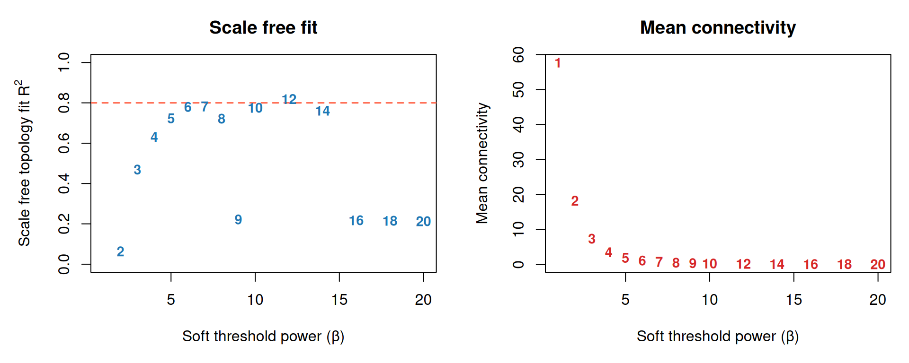
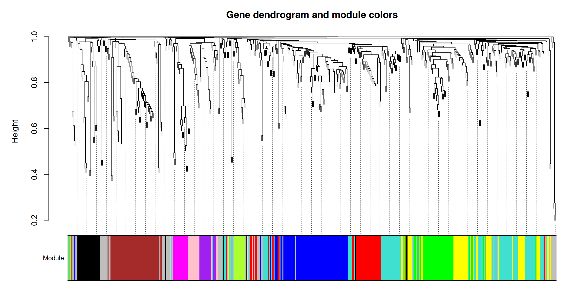
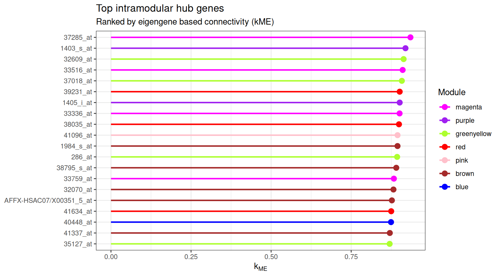
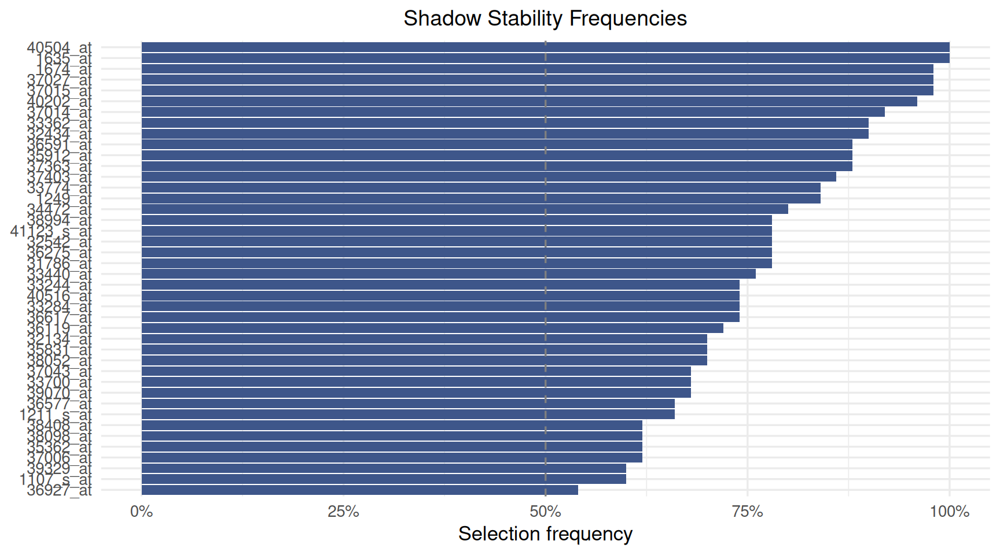
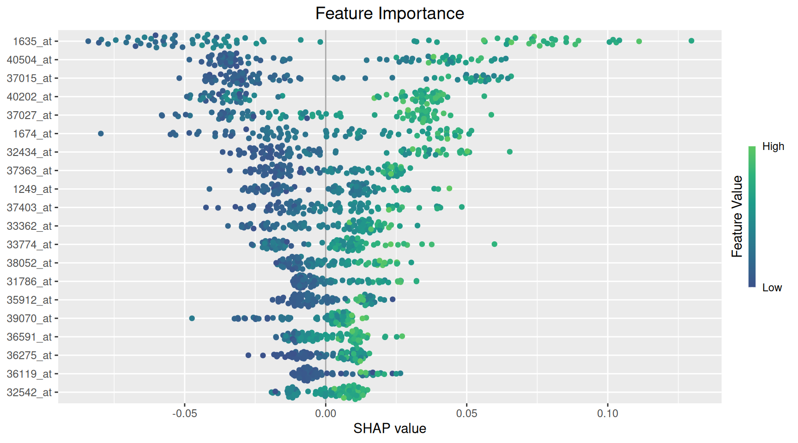
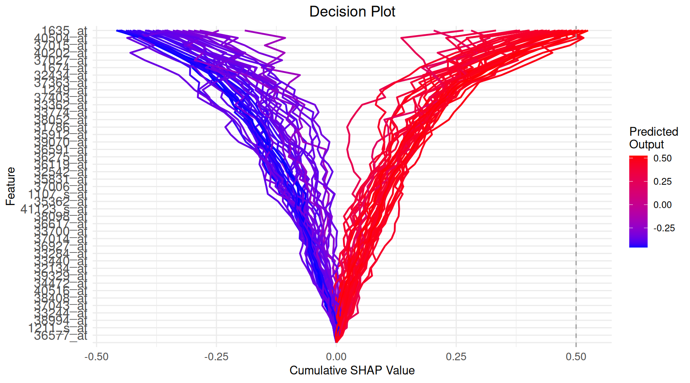
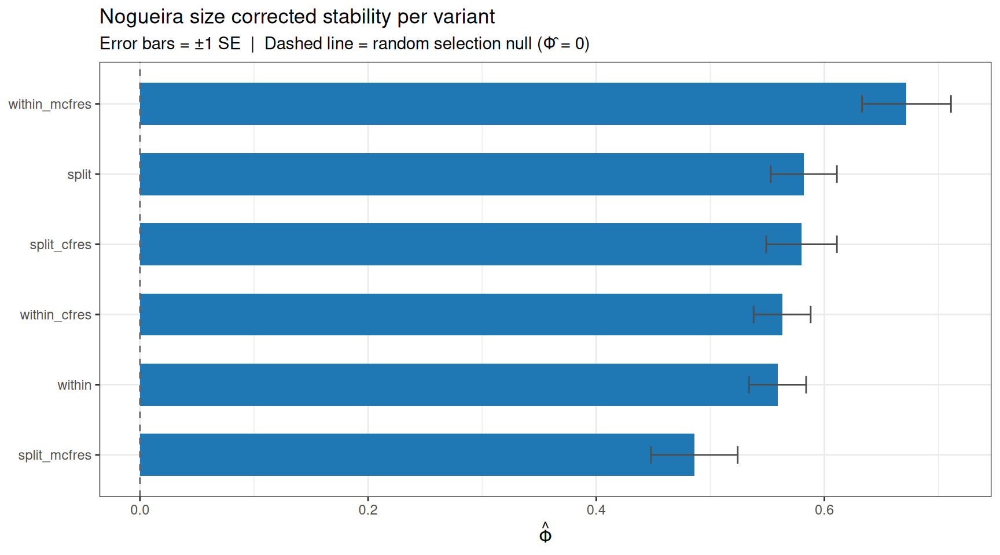

# MossyForest on Real Data: ALL Leukemia

## 1 Introduction

This vignette demonstrates the full Mossy Forest (MF) workflow on the
**Acute Lymphoblastic Leukemia (ALL)** microarray dataset. The dataset
is originally from the `ALL` package.

The vignette is separated in four stages:

1.  Data loading and summary
2.  WGCNA
3.  Single MF run and output
4.  Nested cross validation comparing all six MF variants

------------------------------------------------------------------------

## 2 Data

We first load the data (included in the package).

``` r

# if (!require("devtools", quietly = TRUE))
#     install.packages("devtools")
# library(devtools)
# devtools::install_github("timothyzshen/mossyforest")

library(mossyforest)
library(WGCNA)
```

``` r

data(leukemia)

leukemia_X <- leukemia$X
leukemia_y <- leukemia$y

cat("Samples :", nrow(leukemia_X), "\n")
```

    Samples : 79 

``` r

cat("Features:", ncol(leukemia_X), "\n")
```

    Features: 500 

``` r

cat("Outcome :", paste(names(table(leukemia_y)), collapse = " / "),
    "→ Distribution of Outcomes:", paste(table(leukemia_y), collapse = " / "), "\n")
```

    Outcome : 0 / 1 → Distribution of Outcomes: 42 / 37 

We have a relatively small dataset of $`79 \times 500`$ where the
outcome is the binary outcome of testing positive for leukemia.

------------------------------------------------------------------------

## 3 WGCNA Module Detection

Before running MF we perform WGCNA ourselves to build the network
structure.
[`wmf()`](https://timothyzshen.github.io/mossyforest/reference/wmf.md)
can run WGCNA internally, but we do it manually to find the best
parameters. We suggest running WGCNA separately and finding the best
parameters from not only the power rule but also the one that makes the
most biological sense.

``` r

options(stringsAsFactors = FALSE)
enableWGCNAThreads()
```

    Allowing parallel execution with up to 3 working processes.

### 3.1 Soft threshold power selection

WGCNA constructs a weighted gene co expression network by raising
pairwise correlations to a soft thresholding power $`\beta`$. The chosen
power should make the resulting network approximately **scale free**
($`R^2`$ be greater than 0.8) while keeping **mean connectivity**
reasonably high (not near zero).

``` r

powers <- c(1:10, seq(12, 20, by = 2))

sft <- pickSoftThreshold(
  leukemia_X,
  powerVector  = powers,
  networkType  = "signed hybrid",
  verbose      = 0
)
```

       Power SFT.R.sq  slope truncated.R.sq mean.k. median.k. max.k.
    1      1   0.1890  0.735          0.964 57.7000  56.20000 105.00
    2      2   0.0637 -0.256          0.965 18.2000  16.80000  41.70
    3      3   0.4690 -0.822          0.979  7.3700   6.53000  21.00
    4      4   0.6310 -1.040          0.982  3.5200   2.97000  11.90
    5      5   0.7230 -1.240          0.979  1.9100   1.55000   7.37
    6      6   0.7800 -1.190          0.976  1.1400   0.91800   4.81
    7      7   0.7820 -1.220          0.923  0.7480   0.54200   3.45
    8      8   0.7220 -1.340          0.863  0.5240   0.33200   2.74
    9      9   0.2220 -2.550          0.178  0.3900   0.19600   2.22
    10    10   0.7750 -1.250          0.827  0.3050   0.12200   1.82
    11    12   0.8190 -1.160          0.842  0.2090   0.04770   1.52
    12    14   0.7620 -1.180          0.815  0.1590   0.01930   1.42
    13    16   0.2180 -1.980          0.157  0.1300   0.00821   1.33
    14    18   0.2150 -1.900          0.148  0.1110   0.00348   1.26
    15    20   0.2130 -1.830          0.143  0.0977   0.00149   1.20

``` r

par(mfrow = c(1, 2), mar = c(5, 5, 3, 1))

# Scale free topology plot
plot(sft$fitIndices[, 1],
     -sign(sft$fitIndices[, 3]) * sft$fitIndices[, 2],
     xlab = "Soft threshold power (β)",
     ylab = expression(paste("Scale free topology fit R"^2)),
     main = "Scale free fit",
     type = "n", ylim = c(0, 1))
abline(h = 0.8, lty = 2, col = "tomato", lwd = 1.5)
text(sft$fitIndices[, 1],
     -sign(sft$fitIndices[, 3]) * sft$fitIndices[, 2],
     labels = powers, col = "#1F77B4", cex = 0.9, font = 2)

# Mean connectivity plot
plot(sft$fitIndices[, 1],
     sft$fitIndices[, 5],
     xlab = "Soft threshold power (β)",
     ylab = "Mean connectivity",
     main = "Mean connectivity",
     type = "n")
text(sft$fitIndices[, 1],
     sft$fitIndices[, 5],
     labels = powers, col = "#D62728", cex = 0.9, font = 2)
```



Left: scale free topology fit (R²) vs soft power. Right: mean network
connectivity vs soft power. Choose the lowest power where R² ≥ 0.8
(dashed line).

From the plots we choose **β = 7**, the lowest power where R² is close
to 0.8 and mean connectivity is still distinguishable from zero.

``` r

SOFT_POWER <- 7L

net <- blockwiseModules(
  leukemia_X,
  power             = SOFT_POWER,
  networkType       = "signed hybrid",
  TOMType           = "signed",
  minModuleSize     = 10L,
  mergeCutHeight    = 0.15,
  numericLabels     = FALSE,
  pamRespectsDendro = FALSE,
  saveTOMs          = FALSE,
  verbose           = 0
)

table(net$colors)   # grey = unassigned (treated as the unassigned pool by MF)
```


         blue     brown      grey turquoise    yellow
           21        14       423        30        12 

Note here the large amount of modules assigned to the unassigned (grey)
module. We note that the scale free topology rule is a guideline.
Langfelder & Horvath (WGCNA’s authors) acknowledged that scenarios where
there are few samples with a sparse network type (signed hybrid) can
lead to the $`R^2`$ criterion to become unreliable. This often forces a
power that will create a more sparse network. This means a high amount
in the grey module (unassigned pool). Thus, here the $`R^2`$ estimate
itself is noisy, and only 500 genes is a small network for this curve to
behave well. So we manually select a lower power threshold of
$`\beta = 4`$.

### 3.2 Module detection and dendrogram

``` r

SOFT_POWER <- 4L

net <- blockwiseModules(
  leukemia_X,
  power             = SOFT_POWER,
  networkType       = "signed hybrid",
  TOMType           = "signed",
  minModuleSize     = 10L,
  mergeCutHeight    = 0.15,
  numericLabels     = FALSE,
  pamRespectsDendro = FALSE,
  saveTOMs          = FALSE,
  verbose           = 0
)

table(net$colors)   # grey = unassigned (treated as unassigned by MF)
```


          black        blue       brown       green greenyellow        grey
             28          74          54          44          13          56
        magenta        pink      purple         red   turquoise      yellow
             15          17          15          40          91          53 

``` r

plotDendroAndColors(
  net$dendrograms[[1]],
  net$colors[net$blockGenes[[1]]],
  "Module",
  dendroLabels = FALSE,
  hang         = 0.03,
  addGuide     = TRUE,
  guideHang    = 0.05,
  main         = "Gene dendrogram and module colors"
)
```



Gene dendrogram with module color bar. Grey = unassigned features

#### 3.2.1 Module membership summary

``` r

mod_tbl <- as.data.frame(table(Module = net$colors))
mod_tbl$Unassigned <- mod_tbl$Module == "grey"
mod_tbl[order(mod_tbl$Freq, decreasing = TRUE), ]
```

            Module Freq Unassigned
    11   turquoise   91      FALSE
    2         blue   74      FALSE
    6         grey   56       TRUE
    3        brown   54      FALSE
    12      yellow   53      FALSE
    4        green   44      FALSE
    10         red   40      FALSE
    1        black   28      FALSE
    8         pink   17      FALSE
    7      magenta   15      FALSE
    9       purple   15      FALSE
    5  greenyellow   13      FALSE

Grey features are **unassigned by WGCNA** and treated as the unassigned
pool.

#### 3.2.2 Eigengene based connectivity (kME)

Module eigengenes summarise each module’s expression profile as a single
representative vector. Correlating every gene with each module eigengene
gives its **module membership** ($`k_{ME}`$). This is a continuous
measure of how central a gene is to that module, independent of where
the dendrogram was cut.

``` r

MEs <- net$MEs
kME <- as.data.frame(signedKME(leukemia_X, MEs, outputColumnName = "kME"))

# kME of each gene to the module it was originally assigned to
gene_kME <- vapply(seq_along(net$colors), function(i) {
  col <- paste0("kME", net$colors[i])
  if (col %in% colnames(kME)) kME[i, col] else NA_real_
}, numeric(1))
```

#### 3.2.3 Hub genes

**Hub genes** are the features most strongly correlated with their
module’s eigengene ($`k_{ME}`$ near 1). Practically, this is the genes
that best represent their module.

``` r

hub_df <- data.frame(
  gene   = colnames(leukemia_X),
  module = net$colors,
  kME    = gene_kME,
  stringsAsFactors = FALSE
)
hub_df <- hub_df[hub_df$module != "grey" & !is.na(hub_df$kME), ]

top_hubs <- hub_df[order(-hub_df$kME), ][seq_len(min(20L, nrow(hub_df))), ]
top_hubs
```

                                               gene      module       kME
    37285_at                               37285_at     magenta 0.9350544
    1403_s_at                             1403_s_at      purple 0.9195432
    32609_at                               32609_at greenyellow 0.9137521
    33516_at                               33516_at     magenta 0.9107193
    37018_at                               37018_at greenyellow 0.9082184
    39231_at                               39231_at         red 0.9014875
    1405_i_at                             1405_i_at      purple 0.9014629
    33336_at                               33336_at     magenta 0.9011376
    38035_at                               38035_at         red 0.8992464
    41096_at                               41096_at        pink 0.8947850
    1984_s_at                             1984_s_at       brown 0.8946778
    286_at                                   286_at greenyellow 0.8935174
    38795_s_at                           38795_s_at       brown 0.8907731
    33759_at                               33759_at     magenta 0.8833350
    32070_at                               32070_at       brown 0.8820503
    AFFX-HSAC07/X00351_5_at AFFX-HSAC07/X00351_5_at       brown 0.8770875
    41634_at                               41634_at         red 0.8749790
    40448_at                               40448_at        blue 0.8743989
    41337_at                               41337_at       brown 0.8706531
    35127_at                               35127_at greenyellow 0.8701115

``` r

library(ggplot2)

ggplot(top_hubs, aes(x = reorder(gene, kME), y = kME, color = module)) +
  geom_segment(aes(xend = gene, y = 0, yend = kME), linewidth = 0.9) +
  geom_point(size = 3) +
  scale_color_identity(guide = "legend", name = "Module",
                        breaks = unique(top_hubs$module),
                        labels = unique(top_hubs$module)) +
  coord_flip() +
  labs(title    = "Top intramodular hub genes",
       subtitle = "Ranked by eigengene based connectivity (kME)",
       x = NULL, y = expression(k[ME])) +
  theme_bw()
```



Top 20 intramodular hub genes ranked by eigengene based connectivity
(kME), colored by WGCNA module.

#### 3.2.4 Final module membership (kME refined)

Hierarchical clustering can leave borderline genes missassigned at the
dendrogram cut. As a final check we reassign every gene to the module
whose eigengene it correlates with most strongly. This is its **maximum
kME module**. This will be the membership (not the raw clustering
output) to MF.

``` r

module_names <- sub("^kME", "", colnames(kME))
best_module  <- module_names[max.col(as.matrix(kME), ties.method = "first")]

module_membership <- best_module
names(module_membership) <- colnames(leukemia_X)

# Recode grey (no strong eigengene correlation) → "unassigned" so MF
# recognises the unassigned pool
module_membership[module_membership == "grey"] <- "unassigned"

# How much does kME refinement move genes relative to the dendrogram cut?
table(clustering = net$colors, kME_refined = module_membership)
```

                 kME_refined
    clustering    black blue brown green greenyellow magenta pink purple red
      black          26    0     0     0           1       0    0      0   0
      blue            1   67     1     0           0       0    0      0   1
      brown           0    0    51     2           0       0    0      1   0
      green           0    0     0    41           0       0    0      0   0
      greenyellow     0    0     0     0          13       0    0      0   0
      grey            1    4    10     1           2       0    5      2   3
      magenta         0    0     0     0           0      15    0      0   0
      pink            0    0     0     0           0       0   17      0   0
      purple          0    0     0     0           0       0    0     15   0
      red             0    0     0     0           0       0    0      0  39
      turquoise       0    0     0     0           0       0    0      1   1
      yellow          0    0     0     2           0       0    0      1   0
                 kME_refined
    clustering    turquoise unassigned yellow
      black               0          1      0
      blue                2          2      0
      brown               0          0      0
      green               1          0      2
      greenyellow         0          0      0
      grey                4         19      5
      magenta             0          0      0
      pink                0          0      0
      purple              0          0      0
      red                 1          0      0
      turquoise          87          0      2
      yellow              2          1     47

This `module_membership` is reused everywhere below: by the single MF
run, and by every cross validation fold and the final refit in the model
comparison section.

WGCNA is **unsupervised** (it is built from gene–gene correlations in
`X` and never sees the outcome `y`), so defining modules on the full
expression matrix does **not** leak the label.

However, it is up to the user to run WGCNA within the CV or outside of
it.

------------------------------------------------------------------------

## 4 Single MF Run

We fit MF once on the full dataset using the module membership derived
above and the **Python backend**, which provides exact TreeSHAP values
and is much faster than the pure R method. The outcome is passed as a
factor so MF runs classification, and
`unassigned_modules = "unassigned"` tells MF to treat the features we
recoded as `"unassigned"` as their own pool.

This requires a Python environment with `scikit-learn`, `shap`, and
`numpy` (see
[`?mf_setup`](https://timothyzshen.github.io/mossyforest/reference/mf_setup.md)).
Note this only needs to be configured once per session with
[`mf_setup()`](https://timothyzshen.github.io/mossyforest/reference/mf_setup.md).

``` r

mf_setup()
```

``` r

leukemia_X <- as.data.frame(leukemia_X)

# `y` must be a factor for classification. Its first level is the class that the
# SHAP values and each feature's direction refer to.
leukemia_y_f <- factor(leukemia_y, levels = c(1, 0), labels = c("BCR/ABL", "NEG"))

fit <- mf(
  X = leukemia_X,
  y = leukemia_y_f,
  module_membership = module_membership,
  select_params = select_control(unassigned_modules = "unassigned"),
  backend = "python",
  verbose = 1L,
  seed = 2026
)
```

### 4.1 Stable set

``` r

cat("Stable features selected:", length(fit$feature_list$feature_name), "\n")
head(sort(fit$stability_freq, decreasing = TRUE), 20)
```

### 4.2 Stability plot

``` r

plot_stability(fit)
```



Shadow stability selection frequency of each stable feature, sorted from
most to least stable.

Each bar is the share of subsample replicates in which the feature beat
its own shadow copy, and the dashed line marks 50%. To see the stability
threshold itself, including the elbow cutoff of the unassigned pool, use
`plot_stability_elbow(fit)`.

### 4.3 Feature importance

``` r

plot_importance(fit, max_display = 20)
```



Mean \|SHAP\| for the top 20 stable features.

### 4.4 Decision plot

[`plot_decisions()`](https://timothyzshen.github.io/mossyforest/reference/plot_decisions.md)
traces each sample’s prediction as a path built up feature by feature
(ordered by mean \|SHAP\|), from the base rate to the final predicted
output. This can be useful for seeing whether a handful of samples are
driven by an unusual combination of features rather than the typical
pattern. It is also an oddly visually satisfying plot to look at.

``` r

plot_decisions(fit)
```



Decision plot: cumulative SHAP contribution per sample, ordered by mean
\|SHAP\|.

------------------------------------------------------------------------

## 5 Model Comparison: Three Way Split + Cross Validated Tuning

### 5.1 Design

We compare **six MF variants** formed by two criterions × three cfRes
options:

| Variant         | Criterions    | cfRes    |
|-----------------|---------------|----------|
| `split`         | split         | none     |
| `split_cfres`   | split         | standard |
| `split_mcfres`  | split         | marginal |
| `within`        | within_module | none     |
| `within_cfres`  | within_module | standard |
| `within_mcfres` | within_module | marginal |

There are many ways to approach evaluating the best parameters for
variable importance.

We proceed with the following:

0.  **Modules from all data.** The WGCNA network / `module_membership`
    from the section above (built on all samples) is reused throughout.

1.  **Vault a test set** (~20%, stratified) — held out once, scored
    once, at the very end.

2.  **On the remaining ~80% (train):** 5 fold CV tunes the
    hyperparameter grid *and* compares the six variants on both
    performance (mean validation fold AUC) **and** stability (Nogueira
    $`\hat\Phi`$ of the stable set across folds).

3.  **Select one variant** by a pre specified rule (below), refit every
    variant on the *full* train set, and report performance on the test
    set.

Hyperparameters tuned jointly on the validation folds:

| Parameter                       | Grid             | Default |
|---------------------------------|------------------|---------|
| `screen_control(drop_fraction)` | 0.25 (fixed)     | 0.25    |
| `select_control(pi_thr)`        | 0.50, 0.60, 0.70 | 0.60    |
| `min_ntree` (screen + select)   | 500 (fixed)      | 500     |
| `n_reps`                        | 25 (fixed)       | 50      |

All other parameters stay at package defaults.

**Selection rule** For each variant, hyperparameters are tuned by the
predictive AUC. Variant *selection* then uses the **Nogueira size
corrected stability index** $`\hat\Phi`$. Among variants whose
$`\hat\Phi`$ falls within one SE of the maximum, we choose the most
**parsimonious**.

### 5.2 Setup

``` r

library(pROC)
library(caret)
```

``` r

VARIANTS <- list(
  split       = list(shadow_mode = "split",         use_cfres = FALSE, cfres_scope = "unassigned"),
  split_cfres = list(shadow_mode = "split",         use_cfres = TRUE,  cfres_scope = "unassigned"),
  split_mcfres  = list(shadow_mode = "split",         use_cfres = TRUE,  cfres_scope = "all_modules"),
  within      = list(shadow_mode = "within_module", use_cfres = FALSE, cfres_scope = "unassigned"),
  within_cfres = list(shadow_mode = "within_module", use_cfres = TRUE,  cfres_scope = "unassigned"),
  within_mcfres = list(shadow_mode = "within_module", use_cfres = TRUE,  cfres_scope = "all_modules")
)

GRID <- expand.grid(
  screen_drop = 0.25,
  pi_thr      = c(0.50, 0.60, 0.70),
  stringsAsFactors = FALSE
)

# ── Three way split ─────────────────────────────────────────────────────────
# Vault ~20% as the held out test set (stratified); the rest is train.
set.seed(2026)
trainval_idx <- as.integer(caret::createDataPartition(
  factor(leukemia_y), p = 0.8, list = FALSE))
test_idx     <- setdiff(seq_along(leukemia_y), trainval_idx)

X_tv   <- leukemia_X[trainval_idx, ]; y_tv   <- leukemia_y[trainval_idx]
X_test <- leukemia_X[test_idx, ];     y_test <- leukemia_y[test_idx]

# Validation role = 5 fold CV *within* train (stratified)
val_folds <- caret::createFolds(y_tv, k = 5, returnTrain = FALSE)

cat(sprintf("Train: %d  |  Test vault: %d  |  Test positives: %d\n",
            length(y_tv), length(y_test), sum(y_test == 1)))
```

### 5.3 Fit and evaluate helper

``` r

fit_eval <- function(X_tr, y_tr, X_te, y_te, variant, grid_row) {

  sc  <- screen_control(
    drop_fraction = grid_row$screen_drop,
    min_ntree     = 500L
  )
  sl  <- select_control(
    pi_thr           = grid_row$pi_thr,
    n_reps          = 25L,
    min_ntree        = 500L,
    shadow_mode      = variant$shadow_mode,
    unassigned_modules = "unassigned",
    use_cfres = variant$use_cfres,
    cfres_scope        = variant$cfres_scope
  )

  # MF needs a factor outcome for classification; its first level is the class
  # the SHAP values refer to. The numeric y_tr is kept for the AUC below.
  y_tr_f <- factor(y_tr, levels = c(1, 0), labels = c("BCR/ABL", "NEG"))

  # Reuse the global module membership (computed once on all data)
  fit <- tryCatch(
    mf(X_tr, y_tr_f,
       module_membership = module_membership,
       screen_params     = sc,
       select_params     = sl,
       backend           = "python",
       seed              = 42L,
       verbose           = 0L),
    error = function(e) NULL
  )

  stable <- if (!is.null(fit)) fit$feature_list$feature_name else character(0)
  if (length(stable) == 0L)
    return(list(auc = NA_real_, brier = NA_real_,
                n_stable = 0L, stable = character(0)))

  rf   <- ranger::ranger(
    y ~ ., probability = TRUE, num.trees = 300L, seed = 1L,
    data = data.frame(y = factor(y_tr), X_tr[, stable, drop = FALSE])
  )
  prob <- predict(rf,
    data.frame(X_te[, stable, drop = FALSE]))$predictions[, 2]

  list(
    auc      = as.numeric(pROC::auc(y_te, prob, quiet = TRUE)),
    brier    = mean((prob - y_te)^2),
    n_stable = length(stable),
    stable   = stable
  )
}
```

### 5.4 Cross validated tuning and stability

For each variant we sweep all 3 grid rows across the five validation
folds, record each row’s mean validation AUC, and lock the best
performing row. At that locked setting we also keep the per fold stable
sets, whose Nogueira $`\hat\Phi`$ is the variant’s **stability**.

``` r

jac_fn <- function(a, b)
  length(intersect(a, b)) / max(length(union(a, b)), 1L)

tune_one <- function(vname) {
  variant <- VARIANTS[[vname]]

  grid_res <- lapply(seq_len(nrow(GRID)), function(g) {
    per_fold <- lapply(seq_along(val_folds), function(fi) {
      vi   <- val_folds[[fi]]
      i_te <- vi; i_tr <- setdiff(seq_along(y_tv), vi)
      r <- fit_eval(X_tv[i_tr, ], y_tv[i_tr],
                    X_tv[i_te, ], y_tv[i_te],
                    variant, GRID[g, ])
      message(sprintf("[%s] g%02d fold%d — auc=%.3f n=%d",
                      vname, g, fi, r$auc, r$n_stable))
      r
    })
    list(
      auc  = mean(vapply(per_fold, `[[`, numeric(1), "auc"), na.rm = TRUE),
      aucs = vapply(per_fold, `[[`, numeric(1), "auc"),
      sets = lapply(per_fold, `[[`, "stable")
    )
  })

  best_g <- which.max(vapply(grid_res, `[[`, numeric(1), "auc"))
  best   <- grid_res[[best_g]]

  jac <- mean(combn(length(best$sets), 2,
                    function(i) jac_fn(best$sets[[i[1]]], best$sets[[i[2]]]),
                    simplify = TRUE))

  message(sprintf(">>> [%s] DONE — best g%02d cv_auc=%.3f jaccard=%.3f",
                  vname, best_g, best$auc, jac))

  list(
    variant  = vname,
    best_row = GRID[best_g, ],
    cv_auc   = best$auc,
    cv_aucs  = best$aucs,
    jaccard  = jac,
    sets     = best$sets
  )
}

tune <- lapply(names(VARIANTS), tune_one)
names(tune) <- names(VARIANTS)
```

### 5.5 Results

#### 5.5.1 Variant selection

We assemble per variant CV performance and stability, then apply the
defined **one standard error rule**: among variants whose mean CV AUC
falls within one SE of the best, pick the most stable.

``` r

# helper functions
.phi_hat <- function(sets, d) {
  M     <- length(sets)
  k_bar <- mean(sapply(sets, length))
  if (k_bar == 0 || k_bar >= d) return(NA_real_)
  pairs <- combn(M, 2, simplify = FALSE)
  sym_d <- sapply(pairs, function(idx) {
    a <- sets[[idx[1]]]; b <- sets[[idx[2]]]
    length(a) + length(b) - 2L * length(intersect(a, b))
  })
  v_obs  <- mean(sym_d) / d
  v_null <- 2 * k_bar * (d - k_bar) / d^2
  1 - v_obs / v_null
}

.phi_se <- function(sets, d) {
  M     <- length(sets)
  k_bar <- mean(sapply(sets, length))
  if (k_bar == 0 || k_bar >= d) return(NA_real_)
  v_null <- 2 * k_bar * (d - k_bar) / d^2
  pairs  <- combn(M, 2, simplify = FALSE)
  v_ij   <- sapply(pairs, function(idx) {
    a <- sets[[idx[1]]]; b <- sets[[idx[2]]]
    (length(a) + length(b) - 2L * length(intersect(a, b))) / d
  })
  sd(v_ij) / (sqrt(length(v_ij)) * v_null)
}

d_total <- ncol(leukemia_X)

summary_tbl <- do.call(rbind, lapply(tune, function(t) {
  phi    <- .phi_hat(t$sets, d_total)
  phi_se <- .phi_se(t$sets, d_total)
  k_bar  <- mean(sapply(t$sets, length))
  data.frame(
    Variant        = t$variant,
    CV_AUC         = round(t$cv_auc, 3),
    CV_AUC_SE      = round(sd(t$cv_aucs, na.rm = TRUE) /
                             sqrt(sum(!is.na(t$cv_aucs))), 3),
    Jaccard        = round(t$jaccard, 3),
    Phi            = round(phi, 3),
    Phi_SE         = round(phi_se, 3),
    k_bar          = round(k_bar, 1),
    `Best pi_thr`  = t$best_row$pi_thr,
    `Best sc_drop` = t$best_row$screen_drop,
    check.names = FALSE, row.names = NULL
  )
}))

# 1 SE rule 
top     <- which.max(summary_tbl$Phi)
cutoff  <- summary_tbl$Phi[top] - summary_tbl$Phi_SE[top]
in_band <- summary_tbl[summary_tbl$Phi >= cutoff, ]
best_v  <- in_band$Variant[which.min(in_band$k_bar)]

knitr::kable(summary_tbl, align = "lcccccccc",
             caption = "Validation fold performance and stability per variant.")
cat("Selected variant (1 SE on Φ̂, parsimony tiebreak):", best_v, "\n")
```

|  | Variant | CV_AUC | CV_AUC_SE | Jaccard | Phi | Phi_SE | k_bar | Best pi_thr | Best sc_drop |
|:---|:---|:--:|:--:|:--:|:--:|:--:|:--:|:--:|:--:|
| split | split | 0.974 | 0.011 | 0.437 | 0.582 | 0.029 | 25.2 | 0.7 | 0.25 |
| split_cfres | split_cfres | 0.973 | 0.013 | 0.428 | 0.580 | 0.031 | 21.4 | 0.7 | 0.25 |
| split_mcfres | split_mcfres | 0.979 | 0.010 | 0.340 | 0.486 | 0.038 | 19.0 | 0.5 | 0.25 |
| within | within | 0.969 | 0.014 | 0.411 | 0.559 | 0.025 | 26.6 | 0.7 | 0.25 |
| within_cfres | within_cfres | 0.969 | 0.014 | 0.436 | 0.563 | 0.025 | 47.6 | 0.5 | 0.25 |
| within_mcfres | within_mcfres | 1.000 | 0.000 | 0.528 | 0.672 | 0.039 | 13.8 | 0.7 | 0.25 |

Validation fold performance and stability per variant. {.table
.caption-top}

#### 5.5.2 Nogueira stability

``` r

library(ggplot2)

phi_df <- data.frame(
  Variant = summary_tbl$Variant,
  Phi     = summary_tbl$Phi,
  Phi_SE  = summary_tbl$Phi_SE
)

ggplot(phi_df, aes(x = reorder(Variant, Phi), y = Phi)) +
  geom_col(fill = "#1F77B4", width = 0.6) +
  geom_errorbar(aes(ymin = Phi - Phi_SE, ymax = Phi + Phi_SE),
                width = 0.25, color = "grey30") +
  geom_hline(yintercept = 0, linetype = "dashed", color = "grey40") +
  coord_flip() +
  labs(title    = "Nogueira size corrected stability per variant",
       subtitle = "Error bars = ±1 SE  |  Dashed line = random selection null (Φ̂ = 0)",
       x = NULL, y = expression(hat(Phi))) +
  theme_bw()
```



Nogueira size corrected stability index (Φ̂) per variant, across the five
validation folds. High values indicate MF selects the same genes
regardless of which patients it trains on.

#### 5.5.3 Final models and held out test evaluation

We refit **every** variant on the full train set at its locked
hyperparameters, then score each on the vaulted test set.

``` r

final_models <- lapply(names(VARIANTS), function(vname) {
  variant <- VARIANTS[[vname]]
  row     <- tune[[vname]]$best_row

  sc <- screen_control(
    drop_fraction = row$screen_drop,
    min_ntree     = 500L
  )
  sl <- select_control(
    pi_thr           = row$pi_thr,
    n_reps          = 25L,
    min_ntree        = 500L,
    shadow_mode      = variant$shadow_mode,
    unassigned_modules = "unassigned",
    use_cfres = variant$use_cfres,
    cfres_scope        = variant$cfres_scope
  )

  y_tv_f <- factor(y_tv, levels = c(1, 0), labels = c("BCR/ABL", "NEG"))

  set.seed(42)
  fit <- mf(X_tv, y_tv_f,
            module_membership = module_membership,   # global, from WGCNA section
            screen_params     = sc,
            select_params     = sl,
            backend           = "python",
            seed              = 42L,
            verbose           = 0L)

  stable <- fit$feature_list$feature_name
  rf <- ranger::ranger(
    y ~ ., probability = TRUE, num.trees = 300L, seed = 1L,
    data = data.frame(y = factor(y_tv), X_tv[, stable, drop = FALSE])
  )
  prob <- predict(rf, data.frame(X_test[, stable, drop = FALSE]))$predictions[, 2]

  list(
    fit        = fit,                       # full MF object for your own plots
    test_auc   = as.numeric(pROC::auc(y_test, prob, quiet = TRUE)),
    test_brier = mean((prob - y_test)^2),
    n_stable   = length(stable)
  )
})
names(final_models) <- names(VARIANTS)

# Honest test vault performance per variant (selected variant flagged)
test_tbl <- data.frame(
  Variant    = names(final_models),
  Test_AUC   = round(vapply(final_models, `[[`, numeric(1), "test_auc"),   3),
  Test_Brier = round(vapply(final_models, `[[`, numeric(1), "test_brier"), 3),
  n_stable   = vapply(final_models, `[[`, integer(1), "n_stable"),
  Selected   = ifelse(names(final_models) == best_v, "<<", ""),
  row.names  = NULL
)
knitr::kable(test_tbl, align = "lcccc",
             caption = "Held out test vault performance (selection made on validation only).")
```

| Variant       | Test_AUC | Test_Brier | n_stable | Selected |
|:--------------|:--------:|:----------:|:--------:|:--------:|
| split         |  0.839   |   0.178    |    29    |          |
| split_cfres   |  0.857   |   0.178    |    35    |          |
| split_mcfres  |  0.821   |   0.184    |    24    |          |
| within        |  0.821   |   0.182    |    35    |          |
| within_cfres  |  0.804   |   0.184    |    61    |          |
| within_mcfres |  0.857   |   0.164    |    15    |   \<\<   |

Held out test vault performance (selection made on validation only).
{.table .caption-top}

The test vault is small (~20% of an already small cohort), so read these
numbers as noisy point estimates.

------------------------------------------------------------------------

## 6 Session Info

``` r

sessionInfo()
```

    R version 4.6.1 (2026-06-24)
    Platform: x86_64-pc-linux-gnu
    Running under: Ubuntu 24.04.5 LTS

    Matrix products: default
    BLAS:   /usr/lib/x86_64-linux-gnu/openblas-pthread/libblas.so.3
    LAPACK: /usr/lib/x86_64-linux-gnu/openblas-pthread/libopenblasp-r0.3.26.so;  LAPACK version 3.12.0

    locale:
     [1] LC_CTYPE=C.UTF-8       LC_NUMERIC=C           LC_TIME=C.UTF-8
     [4] LC_COLLATE=C.UTF-8     LC_MONETARY=C.UTF-8    LC_MESSAGES=C.UTF-8
     [7] LC_PAPER=C.UTF-8       LC_NAME=C              LC_ADDRESS=C
    [10] LC_TELEPHONE=C         LC_MEASUREMENT=C.UTF-8 LC_IDENTIFICATION=C

    time zone: UTC
    tzcode source: system (glibc)

    attached base packages:
    [1] stats     graphics  grDevices utils     datasets  methods   base

    other attached packages:
    [1] ggplot2_4.0.3         WGCNA_1.74            fastcluster_1.3.0
    [4] dynamicTreeCut_1.63-1 mossyforest_0.1.0

    loaded via a namespace (and not attached):
     [1] generics_0.1.4        stringi_1.8.9         lattice_0.22-9
     [4] digest_0.6.39         magrittr_2.0.5        evaluate_1.0.5
     [7] grid_4.6.1            RColorBrewer_1.1-3    iterators_1.0.14
    [10] fastmap_1.2.0         xgboost_3.2.1.1       foreach_1.5.2
    [13] doParallel_1.0.17     jsonlite_2.0.0        Matrix_1.7-5
    [16] backports_1.5.1       nnet_7.3-20           Formula_1.2-6
    [19] survival_3.8-6        gridExtra_2.3.1       preprocessCore_1.74.0
    [22] scales_1.4.0          codetools_0.2-20      cli_3.6.6
    [25] rlang_1.3.0           splines_4.6.1         Hmisc_5.3-0
    [28] withr_3.0.3           base64enc_0.1-6       yaml_2.3.12
    [31] otel_0.2.0            tools_4.6.1           parallel_4.6.1
    [34] checkmate_2.3.4       htmlTable_2.5.0       dplyr_1.2.1
    [37] colorspace_2.1-4      impute_1.86.0         ranger_0.18.0
    [40] rpart_4.1.27          vctrs_0.7.3           R6_2.6.1
    [43] matrixStats_1.5.0     lifecycle_1.0.5       stringr_1.6.0
    [46] htmlwidgets_1.6.4     foreign_0.8-91        cluster_2.1.8.2
    [49] pkgconfig_2.0.3       pillar_1.11.1         gtable_0.3.6
    [52] data.table_1.18.6.1   glue_1.8.1            Rcpp_1.1.2
    [55] xfun_0.62             tibble_3.3.1          tidyselect_1.2.1
    [58] rstudioapi_0.19.0     knitr_1.52            farver_2.1.2
    [61] htmltools_0.5.9       labeling_0.4.3        rmarkdown_2.32
    [64] compiler_4.6.1        shapviz_0.10.4        S7_0.2.2             
