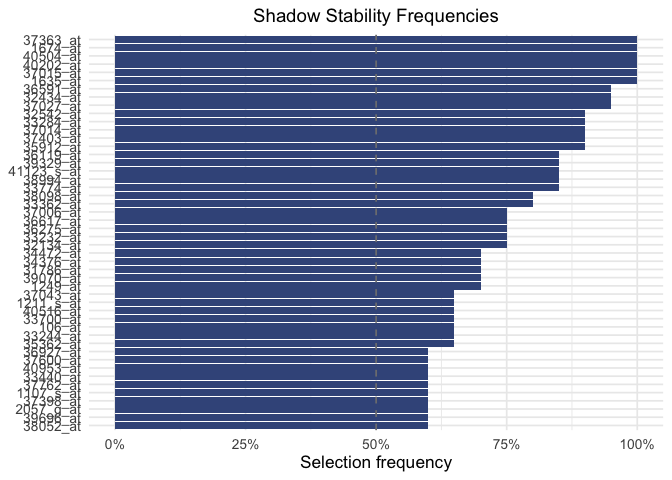
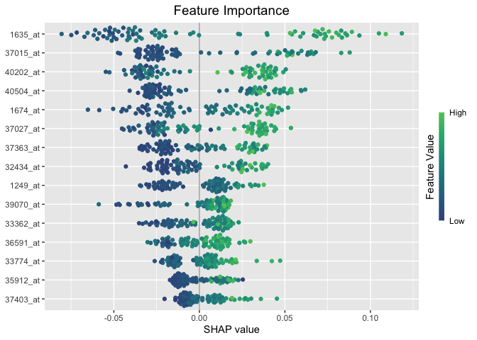
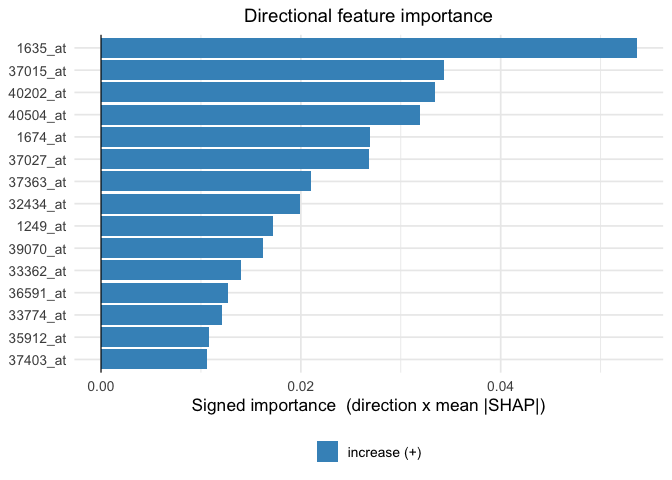
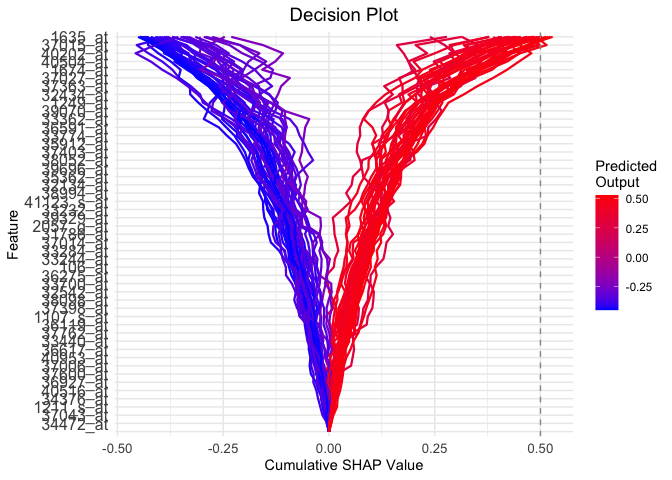

# Getting started with mossyforest

## Overview

Mossy Forest (MF) selects a small, stable set of features from high
dimensional, correlated data. It first screens features within modules
of correlated features, then keeps those that repeatedly beat their own
permuted “shadow” copies, and finally explains the stable set with
TreeSHAP values.

This vignette runs the whole workflow once on the ALL leukemia
microarray data: build modules with WGCNA, fit MF with the Python
backend, and plot the result using the SHAP values. The longer analyses,
with cross validated tuning on the leukemia and World Bank data, are in
the `vignettes/articles` folder of the [GitHub
repository](https://github.com/timothyzshen/mossyforest).

## Data

`leukemia` holds the 500 most variable probe sets for 79 patients, and a
0/1 outcome: 1 for the BCR/ABL subtype, 0 for cytogenetically normal
(NEG).

``` r

library(mossyforest)

data(leukemia)
X <- as.data.frame(leukemia$X)
y <- factor(leukemia$y, levels = c(1, 0), labels = c("BCR/ABL", "NEG"))

dim(X)
#> [1]  79 500
table(y)
#> y
#> BCR/ABL     NEG 
#>      37      42
```

The first level of `y` is the class that the SHAP values and the
direction of each feature refer to, so here a positive direction means
“higher expression makes BCR/ABL more likely”.

## Modules with WGCNA

MF works within modules of correlated features. We build them with
WGCNA.

### Choosing the soft threshold power

WGCNA raises the pairwise correlations to a soft thresholding power
$`\beta`$. The usual rule is to take the lowest power at which the
network is approximately scale free ($`R^2`$ near 0.8) while the mean
connectivity stays well above zero.

``` r

library(WGCNA)

powers <- c(1:10, seq(12, 20, by = 2))
invisible(capture.output(
  sft <- pickSoftThreshold(X, powerVector = powers,
                           networkType = "signed hybrid", verbose = 0)))
fit_idx <- sft$fitIndices

par(mfrow = c(1, 2), mar = c(5, 5, 3, 1))
plot(fit_idx$Power, -sign(fit_idx$slope) * fit_idx$SFT.R.sq, type = "n",
     xlab = "Soft threshold power", ylab = "Scale free fit (R^2)",
     main = "Scale free fit", ylim = c(0, 1))
abline(h = 0.8, lty = 2, col = "tomato")
text(fit_idx$Power, -sign(fit_idx$slope) * fit_idx$SFT.R.sq,
     labels = powers, col = "#1F77B4", font = 2)
plot(fit_idx$Power, fit_idx$mean.k., type = "n",
     xlab = "Soft threshold power", ylab = "Mean connectivity",
     main = "Mean connectivity")
text(fit_idx$Power, fit_idx$mean.k., labels = powers, col = "#D62728", font = 2)
```


plot of chunk soft-threshold

The fit only approaches 0.8 around $`\beta = 7`$, where the mean
connectivity is near zero. With only 79 samples and 500 features the
$`R^2`$ criterion is noisy, so we compare the powers with a lower power
($`\beta=4`$) directly by how many features each leaves in WGCNA’s grey
(unassigned) module.

``` r

modules_at <- function(beta) {
  blockwiseModules(
    X,
    power             = beta,
    networkType       = "signed hybrid",
    TOMType           = "signed",
    minModuleSize     = 10,
    mergeCutHeight    = 0.15,
    numericLabels     = FALSE,
    pamRespectsDendro = FALSE,
    saveTOMs          = FALSE,
    verbose           = 0
  )
}

c(beta_7 = sum(modules_at(7)$colors == "grey"),
  beta_4 = sum(modules_at(4)$colors == "grey"))
#> beta_7 beta_4 
#>    423     56
```

Power 7 leaves most of the features unassigned, which would leave little
structure for MF to work with, so we use $`\beta = 4`$.

``` r

net <- modules_at(4)
table(net$colors)
#> 
#>       black        blue       brown       green greenyellow        grey 
#>          28          74          54          44          13          56 
#>     magenta        pink      purple         red   turquoise      yellow 
#>          15          17          15          40          91          53
```

WGCNA leaves some features in a grey module. We then move every feature
to the module whose eigensignal it correlates with most (its maximum kME
module), and rename the grey module `"unassigned"`, which MF treats as
its own pool.

``` r

kME <- as.data.frame(signedKME(X, net$MEs, outputColumnName = "kME"))
module_names <- sub("^kME", "", colnames(kME))

module_membership <- module_names[max.col(as.matrix(kME), ties.method = "first")]
names(module_membership) <- colnames(X)
module_membership[module_membership == "grey"] <- "unassigned"

table(module_membership)
#> module_membership
#>       black        blue       brown       green greenyellow     magenta 
#>          28          71          62          46          16          15 
#>        pink      purple         red   turquoise  unassigned      yellow 
#>          22          20          44          97          23          56
```

[`wmf()`](https://timothyzshen.github.io/mossyforest/reference/wmf.md)
does the same module detection internally. However, running WGCNA
yourself, lets you inspect and tune the modules first.

## Fitting Mossy Forest

The Python backend computes exact TreeSHAP values. It needs a Python
environment with scikit-learn, shap and numpy, which you configure once
per session (see
[`?mf_setup`](https://timothyzshen.github.io/mossyforest/reference/mf_setup.md)):

``` r

mf_setup(condaenv = "my-python-env")
```

We use small settings so the example runs in seconds. For real analyses
keep the defaults (`n_reps = 50`, `min_ntree = 500`).

``` r

fit <- mf(
  X, y,
  module_membership = module_membership,
  screen_params = screen_control(min_ntree = 200),
  select_params = select_control(n_reps = 20, min_ntree = 200,
                                 unassigned_modules = "unassigned"),
  final_ntree = 200,
  backend = "python",
  verbose = 0,
  seed = 2026
)
```

The stable features, with their mean absolute SHAP value, direction and
how often they beat their shadows:

``` r

nrow(fit$final_SHAP)
#> [1] 48
head(fit$final_SHAP[, c("feature_name", "module_membership", "mean_abs_shap",
                        "direction", "stability_freq")], 10)
#>          feature_name module_membership mean_abs_shap direction stability_freq
#> 1635_at       1635_at         turquoise        0.0536         1           1.00
#> 37015_at     37015_at         turquoise        0.0343         1           1.00
#> 40202_at     40202_at         turquoise        0.0334         1           1.00
#> 40504_at     40504_at         turquoise        0.0319         1           1.00
#> 1674_at       1674_at         turquoise        0.0269         1           1.00
#> 37027_at     37027_at            purple        0.0268         1           0.95
#> 37363_at     37363_at            purple        0.0210         1           1.00
#> 32434_at     32434_at              pink        0.0199         1           0.95
#> 1249_at       1249_at             brown        0.0172         1           0.70
#> 39070_at     39070_at            yellow        0.0162         1           0.70
```

## Stability

Each bar is a stable feature’s selection frequency. That is, the share
of subsample replicates in which it beat its own shadow copy.

``` r

plot_stability(fit)
```



plot of chunk stability

The elbow plot shows the thresholds that decided which features entered
the stable set. Filled points pass the threshold. The correlated modules
use a fixed threshold, and the unassigned pool uses its own elbow
cutoff.

``` r

plot_stability_elbow(fit)
```


plot of chunk stability-elbow

## SHAP plots

The beeswarm shows the SHAP value of every patient for each stable
feature, colored by the feature’s value.

``` r

plot_importance(fit, max_display = 15)
```



plot of chunk importance

The signed importance combines the size of a feature’s SHAP values with
the direction of its effect. Bars to the right increase the average
predicted outcome, and bars to the left decrease it. Grey bars are
features whose effect is not monotone and ambiguous here.

``` r

plot_signed_importance(fit, top_n = 15)
```



plot of chunk signed

The decision plot follows each patient’s prediction as features are
added. It shows the cumulative SHAP value, which starts at 0 (the
average prediction) and ends at the patient’s final prediction relative
to it.

``` r

plot_decisions(fit)
```



plot of chunk decisions
