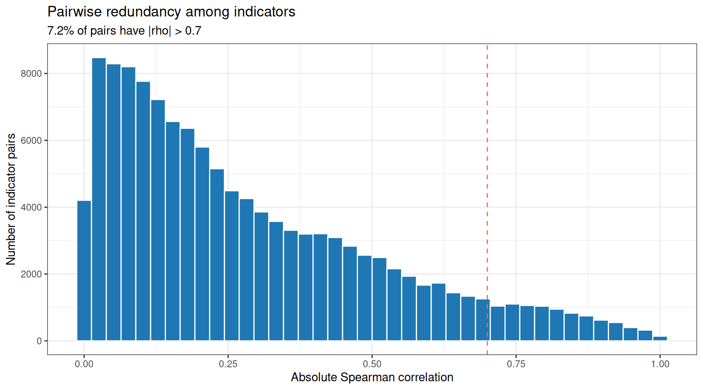
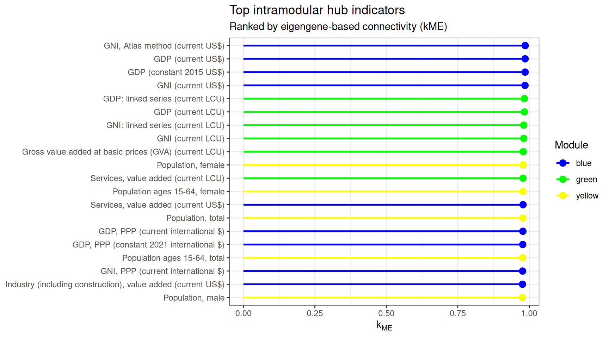
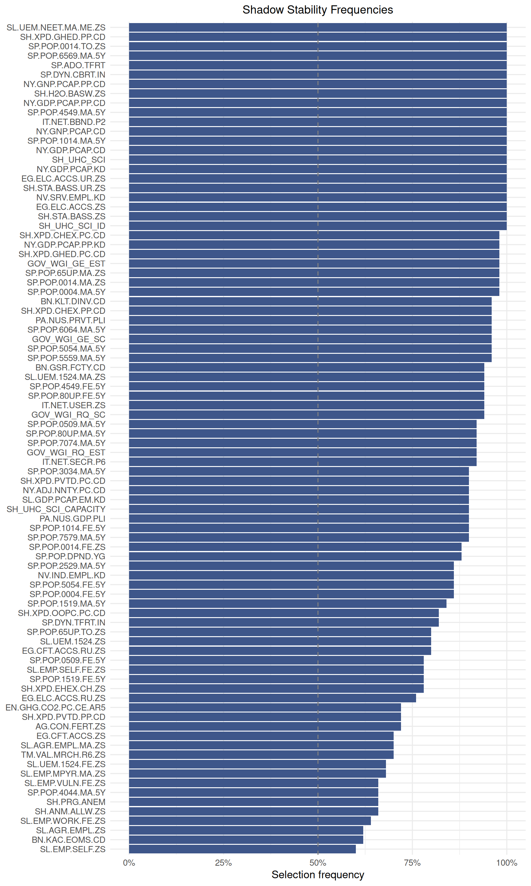
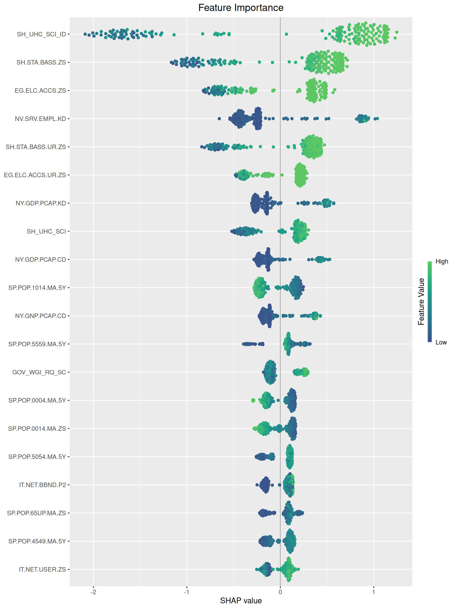
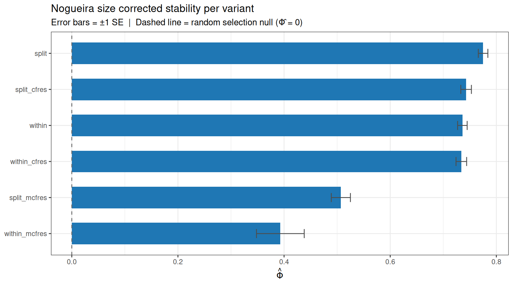
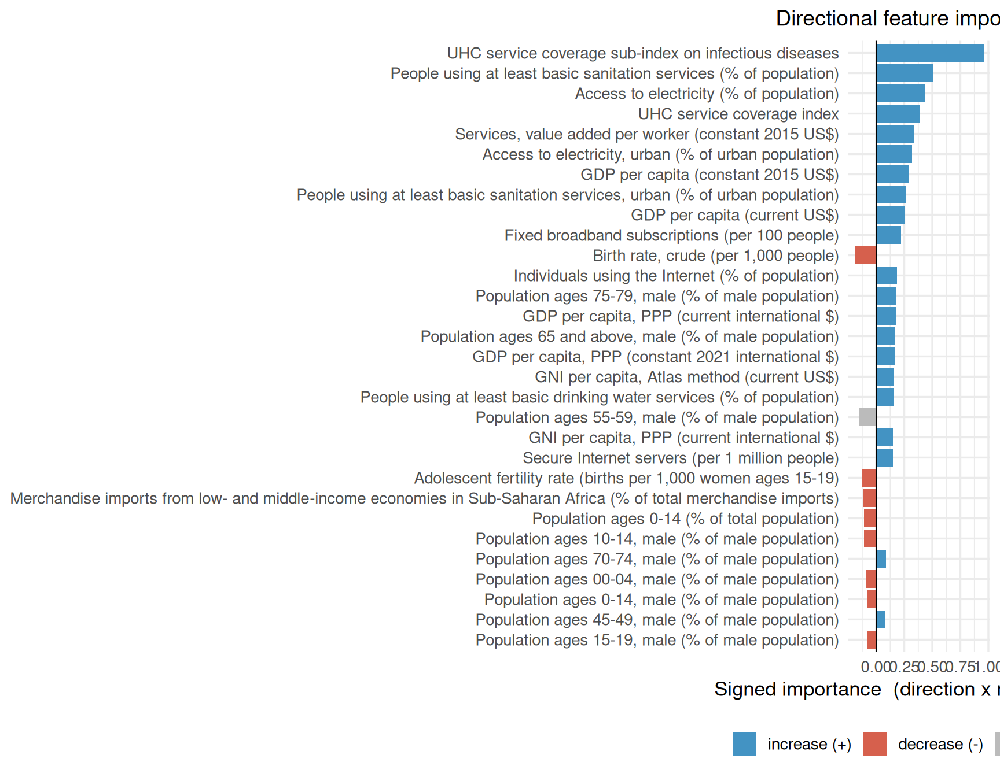

# MossyForest on Real Data: World Development Indicators

## 1 Introduction

This vignette demonstrates the full Mossy Forest (MF) workflow on the
**World Development Indicators (WDI)** dataset from the World Bank. We
want to predict a country’s **life expectancy at birth** from its
development profile.

Many indicators are strongly correlated (a country rich on one economic
axis tends to be rich on many), so a model can “explain” the outcome
with almost any one of the redundant block as a stand in for the others.

The vignette is separated in four stages:

1.  Data loading and summary
2.  WGCNA
3.  Single MF run and output for exploration purposes
4.  Nested cross validation comparing all six MF variants

------------------------------------------------------------------------

## 2 Data

We first load the data (included in the package).

``` r

# if (!require("devtools", quietly = TRUE))
#     install.packages("devtools")
# library(devtools)
# devtools::install_github("timothyzshen/mossyforest")

library(mossyforest)
library(WGCNA)
```

``` r

data(wdi)

wdi_X      <- as.data.frame(wdi$X)
wdi_y      <- wdi$y
wdi_labels <- wdi$labels   # indicator 

cat("Countries :", nrow(wdi_X), "\n")
```

    Countries : 181 

``` r

cat("Indicators:", ncol(wdi_X), "\n")
```

    Indicators: 501 

``` r

cat("Outcome   : life expectancy at birth,",
    paste(round(range(wdi_y), 1), collapse = " - "), "years\n")
```

    Outcome   : life expectancy at birth, 50.6 - 85.5 years

We have a $`181 \times 501`$ matrix where the outcome is a continuous
quantity (years of life expectancy). This is a regression problem, so
throughout we score models by **out of sample $`R^2`$** (and RMSE in
years) rather than the AUC used in the classification vignettes.

### 2.1 Feature correlation structure

Before fitting anything it is worth seeing why this is a hard selection
problem. Most of these indicators move together. We summarise this by
the distribution of absolute pairwise **Spearman** (rank) correlations
among all indicators. We use Spearman rather than Pearson because
development indicators are heavily skewed (GDP, population, and land
area span orders of magnitude) and often related monotonically but non
linearly.

``` r

library(ggplot2)

cor_mat <- cor(wdi_X, method = "spearman")
off_diag <- abs(cor_mat[upper.tri(cor_mat)])

ggplot(data.frame(r = off_diag), aes(x = r)) +
  geom_histogram(bins = 40, fill = "#1F77B4", color = "white") +
  geom_vline(xintercept = 0.7, linetype = "dashed", color = "tomato") +
  labs(title    = "Pairwise redundancy among indicators",
       subtitle = sprintf("%.1f%% of pairs have |rho| > 0.7",
                          100 * mean(off_diag > 0.7)),
       x = "Absolute Spearman correlation", y = "Number of indicator pairs") +
  theme_bw()
```



Distribution of absolute pairwise Spearman correlations among the 501
indicators. The right tail marks blocks of mutually redundant features —
exactly the structure MF is designed to navigate.

------------------------------------------------------------------------

## 3 WGCNA Module Detection

Before running MF we perform WGCNA ourselves to build the network
structure.
[`mf()`](https://timothyzshen.github.io/mossyforest/reference/mf.md) can
run WGCNA internally, but doing it manually lets us select the
parameters and inspect the modules before moving towards MF.

``` r

options(stringsAsFactors = FALSE)
enableWGCNAThreads()
```

    Allowing parallel execution with up to 3 working processes.

### 3.1 Rank transform for the network

WGCNA builds its network from pairwise correlations, so it inherits
Pearson’s weakness on skewed data. On the raw indicators this leads to a
network in which ~80% of indicators unassigned, not because they lack
structure but because their monotonic associations do not show up as
high linear correlations. We therefore rank transform every indicator
before building the network which recovers a better network structure.
This transform is used **only** to define modules, MF itself is fit on
the raw indicators (random forests are invariant to monotonic
transforms, so this changes the module labels, not the model).

``` r

wdi_Xnet <- as.data.frame(lapply(wdi_X, rank))
rownames(wdi_Xnet) <- rownames(wdi_X)
```

### 3.2 Soft threshold power selection

WGCNA constructs a weighted co expression style network by raising
pairwise correlations to a soft thresholding power $`\beta`$. The chosen
power should make the resulting network approximately **scale free**
($`R^2 \geq 0.8`$) while keeping **mean connectivity** reasonably high.
We use a **signed** network so that positively- and negatively
associated indicators land in different modules.

``` r

powers <- c(1:10, seq(12, 20, by = 2))

sft <- pickSoftThreshold(
  wdi_Xnet,
  powerVector = powers,
  networkType = "signed",
  verbose     = 0
)
```

``` r

par(mfrow = c(1, 2), mar = c(5, 5, 3, 1))

plot(sft$fitIndices[, 1],
     -sign(sft$fitIndices[, 3]) * sft$fitIndices[, 2],
     xlab = "Soft threshold power (β)",
     ylab = expression(paste("Scale free topology fit R"^2)),
     main = "Scale free fit",
     type = "n", ylim = c(0, 1))
abline(h = 0.8, lty = 2, col = "tomato", lwd = 1.5)
text(sft$fitIndices[, 1],
     -sign(sft$fitIndices[, 3]) * sft$fitIndices[, 2],
     labels = powers, col = "#1F77B4", cex = 0.9, font = 2)

plot(sft$fitIndices[, 1],
     sft$fitIndices[, 5],
     xlab = "Soft threshold power (β)",
     ylab = "Mean connectivity",
     main = "Mean connectivity",
     type = "n")
text(sft$fitIndices[, 1],
     sft$fitIndices[, 5],
     labels = powers, col = "#D62728", cex = 0.9, font = 2)
```

Signed networks need roughly double the power of unsigned ones to reach
scale free topology. We choose **β = 10**, the lowest power where
$`R^2`$ reaches 0.8 while mean connectivity is still distinguishable
from zero.

### 3.3 Module detection and dendrogram

``` r

SOFT_POWER <- 6L

net <- blockwiseModules(
  wdi_Xnet,
  power             = SOFT_POWER,
  networkType       = "signed",
  TOMType           = "signed",
  minModuleSize     = 10L,
  mergeCutHeight    = 0.25,
  deepSplit         = 2,
  numericLabels     = FALSE,
  pamRespectsDendro = FALSE,
  saveTOMs          = FALSE,
  verbose           = 0
)

table(net$colors)   # grey = unassigned (treated as the unassigned pool by MF)
```

``` r

plotDendroAndColors(
  net$dendrograms[[1]],
  net$colors[net$blockGenes[[1]]],
  "Module",
  dendroLabels = FALSE,
  hang         = 0.03,
  addGuide     = TRUE,
  guideHang    = 0.05,
  main         = "Indicator dendrogram and module colors"
)
p_dendro <- recordPlot()
```

    [[1]]
    [[1]][[1]]
    [[1]][[1]][[1]]
    function (.NAME, ..., PACKAGE)  .Primitive(".External2")

    [[1]][[1]][[2]]
    [[1]][[1]][[2]][[1]]
    [[1]][[1]][[2]][[1]]$name
    [1] "C_plot_new"

    [[1]][[1]][[2]][[1]]$address
    <pointer: (nil)>
    attr(,"class")
    [1] "RegisteredNativeSymbol"

    [[1]][[1]][[2]][[1]]$dll
    [[1]][[1]][[2]][[1]]$dll$name
    [1] "graphics"

    [[1]][[1]][[2]][[1]]$dll$path
    [1] "/Library/Frameworks/R.framework/Versions/4.4-arm64/Resources/library/graphics/libs/graphics.so"

    [[1]][[1]][[2]][[1]]$dll$dynamicLookup
    [1] FALSE

    [[1]][[1]][[2]][[1]]$dll$handle
    <pointer: (nil)>
    attr(,"class")
    [1] "DLLHandle"

    [[1]][[1]][[2]][[1]]$dll$info
    <pointer: (nil)>
    attr(,"class")
    [1] "DLLInfoReference"

    [[1]][[1]][[2]][[1]]$dll$forceSymbols
    [1] TRUE


    [[1]][[1]][[2]][[1]]$numParameters
    [1] 0


    [[1]][[2]]
    [[1]][[2]][[1]]
    function (.NAME, ..., PACKAGE)  .Primitive(".Call.graphics")

    [[1]][[2]][[2]]
    [[1]][[2]][[2]][[1]]
    [[1]][[2]][[2]][[1]]$name
    [1] "palette2"

    [[1]][[2]][[2]][[1]]$address
    <pointer: (nil)>
    attr(,"class")
    [1] "RegisteredNativeSymbol"

    [[1]][[2]][[2]][[1]]$dll
    [[1]][[2]][[2]][[1]]$dll$name
    [1] "grDevices"

    [[1]][[2]][[2]][[1]]$dll$path
    [1] "/Library/Frameworks/R.framework/Versions/4.4-arm64/Resources/library/grDevices/libs/grDevices.so"

    [[1]][[2]][[2]][[1]]$dll$dynamicLookup
    [1] FALSE

    [[1]][[2]][[2]][[1]]$dll$handle
    <pointer: (nil)>
    attr(,"class")
    [1] "DLLHandle"

    [[1]][[2]][[2]][[1]]$dll$info
    <pointer: (nil)>
    attr(,"class")
    [1] "DLLInfoReference"

    [[1]][[2]][[2]][[1]]$dll$forceSymbols
    [1] TRUE


    [[1]][[2]][[2]][[1]]$numParameters
    [1] 1


    [[1]][[2]][[2]][[2]]
    [1] -16777216  -9743393 -11546527  -1665246  -1711576  -4453427 -15677451
    [8]  -6381922


    [[1]][[3]]
    [[1]][[3]][[1]]
    function (.NAME, ..., PACKAGE)  .Primitive(".External.graphics")

    [[1]][[3]][[2]]
    [[1]][[3]][[2]][[1]]
    [[1]][[3]][[2]][[1]]$name
    [1] "C_dendwindow"

    [[1]][[3]][[2]][[1]]$address
    <pointer: (nil)>
    attr(,"class")
    [1] "RegisteredNativeSymbol"

    [[1]][[3]][[2]][[1]]$dll
    [[1]][[3]][[2]][[1]]$dll$name
    [1] "graphics"

    [[1]][[3]][[2]][[1]]$dll$path
    [1] "/Library/Frameworks/R.framework/Versions/4.4-arm64/Resources/library/graphics/libs/graphics.so"

    [[1]][[3]][[2]][[1]]$dll$dynamicLookup
    [1] FALSE

    [[1]][[3]][[2]][[1]]$dll$handle
    <pointer: (nil)>
    attr(,"class")
    [1] "DLLHandle"

    [[1]][[3]][[2]][[1]]$dll$info
    <pointer: (nil)>
    attr(,"class")
    [1] "DLLInfoReference"

    [[1]][[3]][[2]][[1]]$dll$forceSymbols
    [1] TRUE


    [[1]][[3]][[2]][[1]]$numParameters
    [1] -1


    [[1]][[3]][[2]][[2]]
    [1] 500

    [[1]][[3]][[2]][[3]]
           [,1] [,2]
      [1,] -246 -265
      [2,] -247    1
      [3,] -109    2
      [4,] -236 -243
      [5,] -261    4
      [6,] -262    5
      [7,] -234 -240
      [8,]    6    7
      [9,]    3    8
     [10,] -199    9
     [11,] -201   10
     [12,] -206   11
     [13,] -100   12
     [14,] -208   13
     [15,] -193   14
     [16,] -214   15
     [17,] -195   16
     [18,] -464   17
     [19,]  -95   18
     [20,] -474   19
     [21,] -226   20
     [22,] -218   21
     [23,]  -88   22
     [24,]  -24   23
     [25,]  -89   24
     [26,] -241 -267
     [27,] -212   25
     [28,] -242 -250
     [29,]  -75   27
     [30,]  -22   29
     [31,] -485   30
     [32,] -163   31
     [33,] -167   32
     [34,] -170   33
     [35,]  -26   34
     [36,] -110 -433
     [37,]  -46   35
     [38,] -495   37
     [39,] -253 -263
     [40,] -457   36
     [41,]  -83   38
     [42,] -435   40
     [43,] -151   42
     [44,] -394 -398
     [45,] -176   41
     [46,] -407   43
     [47,]  -45   45
     [48,] -409   46
     [49,]  -82   47
     [50,] -405   48
     [51,] -396   44
     [52,] -264   26
     [53,] -446   51
     [54,]  -86   49
     [55,] -207   28
     [56,] -448   50
     [57,]  -84   54
     [58,] -449   56
     [59,] -389   53
     [60,] -451   58
     [61,] -144   57
     [62,]  -25   61
     [63,] -399   59
     [64,] -431   60
     [65,] -400   63
     [66,] -478   62
     [67,] -266 -268
     [68,]  -48   66
     [69,] -186   64
     [70,] -254 -308
     [71,] -392   65
     [72,] -235   55
     [73,] -401   71
     [74,] -200   52
     [75,]  -97   68
     [76,] -249   67
     [77,] -391   73
     [78,]   70   76
     [79,]   72   74
     [80,] -371   69
     [81,] -160   75
     [82,] -309 -316
     [83,] -402   77
     [84,] -251   78
     [85,]   82   84
     [86,] -188   80
     [87,]  -53   81
     [88,] -168   79
     [89,] -245   39
     [90,] -390   83
     [91,] -255 -349
     [92,] -357   85
     [93,]   88   89
     [94,] -179   87
     [95,] -317   92
     [96,] -224   86
     [97,] -386   94
     [98,] -237   93
     [99,]   91   95
    [100,]  -21   97
    [101,] -164   98
    [102,] -153  100
    [103,] -227   99
    [104,] -271  102
    [105,] -107   96
    [106,] -165  101
    [107,] -180 -194
    [108,] -210  106
    [109,] -105  104
    [110,] -171  108
    [111,] -403   90
    [112,]  -80  109
    [113,]  -81  105
    [114,]  107  110
    [115,] -205  103
    [116,] -258  112
    [117,] -173  116
    [118,] -155  117
    [119,] -161  114
    [120,] -353  115
    [121,] -203  119
    [122,] -395  113
    [123,]  -74  118
    [124,] -397  122
    [125,] -347  120
    [126,] -108  123
    [127,] -393  124
    [128,] -404  111
    [129,] -177  121
    [130,] -427 -436
    [131,] -295  125
    [132,]  -87  126
    [133,]   -4  127
    [134,] -197  129
    [135,]  -58  131
    [136,] -432  130
    [137,] -106  132
    [138,]  -56  135
    [139,] -102  133
    [140,] -322  138
    [141,] -429 -441
    [142,] -424 -425
    [143,] -434  136
    [144,] -359  140
    [145,] -190  134
    [146,] -428  143
    [147,]  -77  139
    [148,]  141  146
    [149,] -426  142
    [150,] -272  145
    [151,] -437  148
    [152,] -187  150
    [153,] -430  151
    [154,] -348  144
    [155,] -156 -423
    [156,] -445  153
    [157,] -439  156
    [158,] -159  154
    [159,]  149  155
    [160,] -442  157
    [161,] -438  160
    [162,] -174  152
    [163,]  -47  137
    [164,] -453  147
    [165,] -499  163
    [166,] -440  161
    [167,] -319  158
    [168,]  -57  167
    [169,]  159  166
    [170,] -324  168
    [171,] -338 -346
    [172,] -340  171
    [173,] -273  162
    [174,]   -7  164
    [175,] -344  172
    [176,] -345  175
    [177,] -301  170
    [178,] -103  174
    [179,] -388  128
    [180,] -358  177
    [181,] -114  165
    [182,]  -70  181
    [183,] -323  180
    [184,] -339  176
    [185,] -325  183
    [186,]  -62  185
    [187,] -122  182
    [188,] -326  186
    [189,] -158  188
    [190,] -154  189
    [191,]   -2  178
    [192,]  -29  187
    [193,] -422  190
    [194,] -411  179
    [195,] -330  184
    [196,] -157  192
    [197,]  -54  196
    [198,] -421  169
    [199,]  -41  197
    [200,]  -13  191
    [201,] -331  195
    [202,]  -61  193
    [203,] -303  194
    [204,] -351  201
    [205,]  -96  202
    [206,]  -44  199
    [207,]  -12  200
    [208,] -387  205
    [209,]  -30  206
    [210,] -132 -136
    [211,] -133 -137
    [212,] -281  173
    [213,] -320  208
    [214,]  -17  207
    [215,] -222  209
    [216,] -300  213
    [217,] -310  203
    [218,] -279  212
    [219,]  198  216
    [220,] -130 -138
    [221,] -131 -139
    [222,] -352  204
    [223,]  -78  214
    [224,] -329  222
    [225,]  -60  219
    [226,] -294  225
    [227,] -302  217
    [228,]  210  211
    [229,]  220  228
    [230,] -314  226
    [231,]  221  229
    [232,]  224  227
    [233,] -211  230
    [234,]  231  233
    [235,]  -79  223
    [236,]  215  235
    [237,] -191  232
    [238,] -134  234
    [239,] -135  238
    [240,] -259  218
    [241,] -465  239
    [242,] -299  237
    [243,] -276  240
    [244,] -313  241
    [245,] -420  244
    [246,] -116  236
    [247,] -192  245
    [248,] -412  242
    [249,] -280  247
    [250,] -140  249
    [251,] -141  250
    [252,]  -51  246
    [253,] -408  251
    [254,]  -76  253
    [255,] -455  248
    [256,] -419  254
    [257,] -277  243
    [258,] -115  252
    [259,] -350  255
    [260,] -315  256
    [261,] -278  260
    [262,] -447  259
    [263,] -149  261
    [264,]  -66  258
    [265,] -305  263
    [266,] -292  262
    [267,] -374 -380
    [268,] -248  264
    [269,] -410  265
    [270,] -328  269
    [271,] -444  266
    [272,] -293  271
    [273,] -104  268
    [274,] -198  273
    [275,] -312  272
    [276,]   -9  274
    [277,] -378  267
    [278,] -307  270
    [279,]  -63  276
    [280,] -458  278
    [281,]  -19  280
    [282,] -456  275
    [283,] -143  281
    [284,] -256  279
    [285,]  -18  283
    [286,] -311  282
    [287,] -406  285
    [288,] -148  284
    [289,] -238  286
    [290,] -379  277
    [291,] -297  287
    [292,] -223  288
    [293,] -150  291
    [294,] -306  289
    [295,] -220  292
    [296,] -373  290
    [297,] -355  293
    [298,] -341 -366
    [299,] -375  294
    [300,]  -67  295
    [301,] -145  297
    [302,] -381  300
    [303,] -334 -362
    [304,] -142  301
    [305,] -124  302
    [306,] -372  296
    [307,] -418  304
    [308,] -494  305
    [309,] -152  307
    [310,] -473  308
    [311,]   -1  309
    [312,] -298  311
    [313,] -454  299
    [314,] -162  312
    [315,] -343 -369
    [316,] -377  313
    [317,] -260  310
    [318,] -332 -360
    [319,] -486  314
    [320,] -228  317
    [321,] -117  319
    [322,]  303  318
    [323,] -296  321
    [324,]  298  315
    [325,] -289  323
    [326,] -184  320
    [327,] -175  325
    [328,] -147  327
    [329,] -146  326
    [330,] -365  324
    [331,] -290  328
    [332,] -166  316
    [333,] -291  331
    [334,] -383  329
    [335,] -443  333
    [336,]  -85  332
    [337,]  322  330
    [338,] -219  335
    [339,] -363 -367
    [340,] -185  338
    [341,] -101  336
    [342,]  257  334
    [343,] -217  341
    [344,]  -72  343
    [345,] -417  340
    [346,] -333 -361
    [347,] -172  344
    [348,]  -90  342
    [349,] -477  345
    [350,] -204  348
    [351,]  -20  349
    [352,] -120  351
    [353,] -183  352
    [354,] -213  353
    [355,] -169  347
    [356,] -239  350
    [357,] -356  354
    [358,] -479  355
    [359,] -221  356
    [360,] -498  359
    [361,]  -94  357
    [362,]  337  339
    [363,] -282  361
    [364,] -275  358
    [365,]  -71  363
    [366,]  -27  364
    [367,]  -32  360
    [368,] -488  367
    [369,] -384  365
    [370,] -376  366
    [371,] -181  369
    [372,] -121  368
    [373,] -112  370
    [374,]  -42  372
    [375,] -111  373
    [376,] -270  371
    [377,] -459  376
    [378,]   -6  374
    [379,] -182  377
    [380,]  346  362
    [381,] -490  379
    [382,] -491  378
    [383,]  -35  381
    [384,] -257  375
    [385,]  -34 -269
    [386,] -283  383
    [387,] -127  382
    [388,]   -5  387
    [389,] -225  384
    [390,] -123  388
    [391,] -342 -368
    [392,] -288  390
    [393,]  -55  389
    [394,] -304  393
    [395,] -413 -414
    [396,] -382 -385
    [397,] -471  394
    [398,] -467  392
    [399,] -364  398
    [400,] -487  399
    [401,]  -68  397
    [402,] -489  400
    [403,] -354  402
    [404,] -484  403
    [405,] -415 -416
    [406,] -119  386
    [407,]  -50 -501
    [408,]  -16  404
    [409,] -492  408
    [410,] -475  401
    [411,] -216  410
    [412,]  380  391
    [413,] -461  406
    [414,]  -40 -274
    [415,] -126  413
    [416,] -129  411
    [417,]  -49  409
    [418,]  -43  417
    [419,] -231  416
    [420,] -232  419
    [421,]  396  420
    [422,]   -3  418
    [423,]  -73  421
    [424,] -244 -252
    [425,] -336 -337
    [426,]  -39  415
    [427,] -500  422
    [428,]  414  423
    [429,] -209  427
    [430,] -335  425
    [431,] -128  428
    [432,] -370  412
    [433,] -450  426
    [434,]  -23  429
    [435,] -466  434
    [436,] -462  435
    [437,]  -28 -480
    [438,] -118  431
    [439,]  -31  433
    [440,] -196  436
    [441,] -472  438
    [442,] -229 -230
    [443,]  -59  441
    [444,]  -99  439
    [445,]  440  444
    [446,] -496  443
    [447,] -202  424
    [448,]  -98 -215
    [449,]  395  446
    [450,] -233  445
    [451,] -318 -321
    [452,] -113  450
    [453,]  -14  449
    [454,]  451  453
    [455,]  -36  452
    [456,] -178  455
    [457,] -287  456
    [458,]  -33  457
    [459,] -286  454
    [460,] -469  458
    [461,]  430  460
    [462,] -460 -476
    [463,] -493  459
    [464,]  407  463
    [465,]  -65  -69
    [466,] -463 -470
    [467,]  -38  385
    [468,] -327  461
    [469,]  405  468
    [470,] -189  464
    [471,] -483  469
    [472,]  437  471
    [473,] -482 -497
    [474,]  -92  470
    [475,]  -52  472
    [476,] -284  475
    [477,]  -15  474
    [478,]  -10  476
    [479,] -125  478
    [480,]  462  479
    [481,]  466  477
    [482,] -468  480
    [483,]  442  481
    [484,]  432  482
    [485,] -285  483
    [486,] -452  485
    [487,]  465  484
    [488,]  473  487
    [489,]  306  488
    [490,]   -8  486
    [491,]  448  489
    [492,]  447  490
    [493,]  -64  491
    [494,] -481  492
    [495,]  -93  493
    [496,]  -11  494
    [497,]  -91  496
    [498,]  -37  497
    [499,]  467  498
    [500,]  495  499

    [[1]][[3]][[2]][[4]]
      [1] 0.4412196 0.4418463 0.4470102 0.4475616 0.4484850 0.4488021 0.4490394
      [8] 0.4509890 0.4530800 0.4553238 0.4586974 0.4608803 0.4634407 0.4648570
     [15] 0.4675707 0.4711044 0.4737588 0.4751124 0.4765828 0.4781558 0.4786902
     [22] 0.4792753 0.4818000 0.4859925 0.4870457 0.4899349 0.4904935 0.4905576
     [29] 0.4927323 0.4948342 0.4959702 0.4974370 0.4997191 0.5011962 0.5025578
     [36] 0.5031628 0.5038074 0.5056716 0.5070686 0.5074947 0.5084772 0.5092806
     [43] 0.5107530 0.5112366 0.5121444 0.5121790 0.5126198 0.5141169 0.5144989
     [50] 0.5155338 0.5160589 0.5163837 0.5167231 0.5172578 0.5177671 0.5178423
     [57] 0.5189651 0.5190546 0.5193743 0.5201401 0.5202787 0.5220288 0.5221321
     [64] 0.5228165 0.5229024 0.5229520 0.5231173 0.5231524 0.5246638 0.5247394
     [71] 0.5248882 0.5255044 0.5256688 0.5267331 0.5269349 0.5273585 0.5278974
     [78] 0.5284867 0.5286194 0.5290529 0.5292256 0.5293896 0.5295317 0.5296290
     [85] 0.5318182 0.5324821 0.5333994 0.5334536 0.5335118 0.5335239 0.5343074
     [92] 0.5353046 0.5360045 0.5365536 0.5369365 0.5385172 0.5393673 0.5403409
     [99] 0.5404228 0.5409254 0.5418076 0.5421562 0.5430737 0.5440645 0.5442510
    [106] 0.5442777 0.5460779 0.5471117 0.5471240 0.5482166 0.5483696 0.5483734
    [113] 0.5494395 0.5498923 0.5500240 0.5507693 0.5520144 0.5531871 0.5533383
    [120] 0.5534437 0.5539738 0.5546652 0.5547992 0.5568934 0.5575921 0.5578482
    [127] 0.5588892 0.5603569 0.5610707 0.5621137 0.5624336 0.5640857 0.5642268
    [134] 0.5647768 0.5649056 0.5656655 0.5659324 0.5666622 0.5676240 0.5681094
    [141] 0.5682981 0.5684875 0.5687205 0.5699290 0.5702631 0.5703043 0.5707697
    [148] 0.5710582 0.5717836 0.5721213 0.5730479 0.5737226 0.5740886 0.5743497
    [155] 0.5756750 0.5757247 0.5764040 0.5767860 0.5778059 0.5778919 0.5783847
    [162] 0.5784460 0.5784834 0.5803636 0.5807865 0.5808094 0.5810046 0.5826411
    [169] 0.5827083 0.5841265 0.5845058 0.5848087 0.5854772 0.5861126 0.5861786
    [176] 0.5875911 0.5883832 0.5898986 0.5904584 0.5907797 0.5913904 0.5932795
    [183] 0.5935335 0.5936092 0.5943220 0.5952786 0.5985396 0.5986174 0.5999326
    [190] 0.6005480 0.6007783 0.6009434 0.6013115 0.6021884 0.6033826 0.6036585
    [197] 0.6054552 0.6069171 0.6073896 0.6078834 0.6083056 0.6084654 0.6099920
    [204] 0.6108218 0.6114866 0.6126231 0.6142402 0.6145261 0.6149658 0.6163101
    [211] 0.6163101 0.6168914 0.6171441 0.6174196 0.6180308 0.6181918 0.6183710
    [218] 0.6191847 0.6215247 0.6220057 0.6220057 0.6247405 0.6262354 0.6280477
    [225] 0.6319377 0.6340346 0.6342120 0.6344366 0.6347179 0.6360450 0.6373958
    [232] 0.6395155 0.6395856 0.6410932 0.6421014 0.6428054 0.6449889 0.6491895
    [239] 0.6505216 0.6526009 0.6531030 0.6558432 0.6563885 0.6590941 0.6632847
    [246] 0.6638332 0.6644087 0.6656464 0.6678398 0.6698084 0.6706395 0.6718068
    [253] 0.6733462 0.6758229 0.6767554 0.6775596 0.6798967 0.6812735 0.6822644
    [260] 0.6849591 0.6881237 0.6893848 0.6902174 0.6913473 0.6942440 0.6950703
    [267] 0.6962884 0.6967655 0.6971756 0.6984910 0.6986816 0.7019364 0.7039847
    [274] 0.7066335 0.7069915 0.7084590 0.7099024 0.7111518 0.7124915 0.7130207
    [281] 0.7158701 0.7161309 0.7169035 0.7182611 0.7203366 0.7207801 0.7226752
    [288] 0.7229987 0.7242101 0.7256101 0.7256734 0.7263802 0.7272680 0.7273921
    [295] 0.7282167 0.7295209 0.7313934 0.7317527 0.7318372 0.7327297 0.7340427
    [302] 0.7348057 0.7363000 0.7367132 0.7374272 0.7381090 0.7400465 0.7405428
    [309] 0.7416554 0.7433357 0.7434429 0.7443492 0.7446283 0.7466852 0.7467834
    [316] 0.7489850 0.7494019 0.7519805 0.7520873 0.7525093 0.7551970 0.7568519
    [323] 0.7571230 0.7574861 0.7584859 0.7594251 0.7600044 0.7617025 0.7641374
    [330] 0.7658619 0.7679659 0.7686247 0.7704278 0.7709306 0.7741192 0.7744844
    [337] 0.7760411 0.7775101 0.7785523 0.7798200 0.7802000 0.7803869 0.7841794
    [344] 0.7866896 0.7880962 0.7883927 0.7900931 0.7911276 0.7932705 0.7944354
    [351] 0.7947011 0.7969807 0.7987251 0.8000619 0.8002843 0.8030346 0.8030660
    [358] 0.8034547 0.8042631 0.8064696 0.8068113 0.8079426 0.8080078 0.8087188
    [365] 0.8108530 0.8110867 0.8135695 0.8154731 0.8155809 0.8169451 0.8172589
    [372] 0.8181030 0.8192239 0.8196854 0.8205150 0.8210818 0.8229227 0.8234432
    [379] 0.8239711 0.8251958 0.8252118 0.8257146 0.8260689 0.8262528 0.8263034
    [386] 0.8278397 0.8281359 0.8295444 0.8299218 0.8314823 0.8323036 0.8331872
    [393] 0.8335719 0.8352351 0.8356387 0.8364472 0.8377805 0.8390027 0.8398073
    [400] 0.8411281 0.8419764 0.8429795 0.8437495 0.8444428 0.8460143 0.8462535
    [407] 0.8464745 0.8474302 0.8479941 0.8483372 0.8499244 0.8509673 0.8517845
    [414] 0.8520487 0.8528721 0.8557662 0.8564043 0.8570415 0.8571267 0.8572449
    [421] 0.8581060 0.8586563 0.8592992 0.8601554 0.8616891 0.8628577 0.8633146
    [428] 0.8637770 0.8643502 0.8646526 0.8650982 0.8669408 0.8687840 0.8688128
    [435] 0.8695300 0.8701199 0.8716628 0.8720579 0.8733908 0.8735565 0.8741352
    [442] 0.8746894 0.8763226 0.8764927 0.8775377 0.8787937 0.8805819 0.8808861
    [449] 0.8819676 0.8827656 0.8830288 0.8873435 0.8901020 0.8914503 0.8916953
    [456] 0.8920096 0.8928341 0.8941424 0.8955253 0.8960961 0.9014398 0.9018458
    [463] 0.9029745 0.9042901 0.9048886 0.9053948 0.9054345 0.9088826 0.9094573
    [470] 0.9097403 0.9117225 0.9130806 0.9148133 0.9149242 0.9157049 0.9164542
    [477] 0.9175412 0.9181293 0.9183212 0.9187112 0.9192784 0.9206052 0.9208344
    [484] 0.9212295 0.9219587 0.9239487 0.9252666 0.9257741 0.9264588 0.9291545
    [491] 0.9302241 0.9311923 0.9315559 0.9341816 0.9341988 0.9373576 0.9389551
    [498] 0.9436115 0.9525592 0.9592744

    [[1]][[3]][[2]][[5]]
    [1] 0.03

    [[1]][[3]][[2]][[6]]
      [1] "" "" "" "" "" "" "" "" "" "" "" "" "" "" "" "" "" "" "" "" "" "" "" "" ""
     [26] "" "" "" "" "" "" "" "" "" "" "" "" "" "" "" "" "" "" "" "" "" "" "" "" ""
     [51] "" "" "" "" "" "" "" "" "" "" "" "" "" "" "" "" "" "" "" "" "" "" "" "" ""
     [76] "" "" "" "" "" "" "" "" "" "" "" "" "" "" "" "" "" "" "" "" "" "" "" "" ""
    [101] "" "" "" "" "" "" "" "" "" "" "" "" "" "" "" "" "" "" "" "" "" "" "" "" ""
    [126] "" "" "" "" "" "" "" "" "" "" "" "" "" "" "" "" "" "" "" "" "" "" "" "" ""
    [151] "" "" "" "" "" "" "" "" "" "" "" "" "" "" "" "" "" "" "" "" "" "" "" "" ""
    [176] "" "" "" "" "" "" "" "" "" "" "" "" "" "" "" "" "" "" "" "" "" "" "" "" ""
    [201] "" "" "" "" "" "" "" "" "" "" "" "" "" "" "" "" "" "" "" "" "" "" "" "" ""
    [226] "" "" "" "" "" "" "" "" "" "" "" "" "" "" "" "" "" "" "" "" "" "" "" "" ""
    [251] "" "" "" "" "" "" "" "" "" "" "" "" "" "" "" "" "" "" "" "" "" "" "" "" ""
    [276] "" "" "" "" "" "" "" "" "" "" "" "" "" "" "" "" "" "" "" "" "" "" "" "" ""
    [301] "" "" "" "" "" "" "" "" "" "" "" "" "" "" "" "" "" "" "" "" "" "" "" "" ""
    [326] "" "" "" "" "" "" "" "" "" "" "" "" "" "" "" "" "" "" "" "" "" "" "" "" ""
    [351] "" "" "" "" "" "" "" "" "" "" "" "" "" "" "" "" "" "" "" "" "" "" "" "" ""
    [376] "" "" "" "" "" "" "" "" "" "" "" "" "" "" "" "" "" "" "" "" "" "" "" "" ""
    [401] "" "" "" "" "" "" "" "" "" "" "" "" "" "" "" "" "" "" "" "" "" "" "" "" ""
    [426] "" "" "" "" "" "" "" "" "" "" "" "" "" "" "" "" "" "" "" "" "" "" "" "" ""
    [451] "" "" "" "" "" "" "" "" "" "" "" "" "" "" "" "" "" "" "" "" "" "" "" "" ""
    [476] "" "" "" "" "" "" "" "" "" "" "" "" "" "" "" "" "" "" "" "" "" "" "" "" ""
    [501] ""

    [[1]][[3]][[2]]$cex
    [1] 0.9


    [[1]][[4]]
    [[1]][[4]][[1]]
    function (.NAME, ..., PACKAGE)  .Primitive(".External.graphics")

    [[1]][[4]][[2]]
    [[1]][[4]][[2]][[1]]
    [[1]][[4]][[2]][[1]]$name
    [1] "C_dend"

    [[1]][[4]][[2]][[1]]$address
    <pointer: (nil)>
    attr(,"class")
    [1] "RegisteredNativeSymbol"

    [[1]][[4]][[2]][[1]]$dll
    [[1]][[4]][[2]][[1]]$dll$name
    [1] "graphics"

    [[1]][[4]][[2]][[1]]$dll$path
    [1] "/Library/Frameworks/R.framework/Versions/4.4-arm64/Resources/library/graphics/libs/graphics.so"

    [[1]][[4]][[2]][[1]]$dll$dynamicLookup
    [1] FALSE

    [[1]][[4]][[2]][[1]]$dll$handle
    <pointer: (nil)>
    attr(,"class")
    [1] "DLLHandle"

    [[1]][[4]][[2]][[1]]$dll$info
    <pointer: (nil)>
    attr(,"class")
    [1] "DLLInfoReference"

    [[1]][[4]][[2]][[1]]$dll$forceSymbols
    [1] TRUE


    [[1]][[4]][[2]][[1]]$numParameters
    [1] -1


    [[1]][[4]][[2]][[2]]
    [1] 500

    [[1]][[4]][[2]][[3]]
           [,1] [,2]
      [1,] -246 -265
      [2,] -247    1
      [3,] -109    2
      [4,] -236 -243
      [5,] -261    4
      [6,] -262    5
      [7,] -234 -240
      [8,]    6    7
      [9,]    3    8
     [10,] -199    9
     [11,] -201   10
     [12,] -206   11
     [13,] -100   12
     [14,] -208   13
     [15,] -193   14
     [16,] -214   15
     [17,] -195   16
     [18,] -464   17
     [19,]  -95   18
     [20,] -474   19
     [21,] -226   20
     [22,] -218   21
     [23,]  -88   22
     [24,]  -24   23
     [25,]  -89   24
     [26,] -241 -267
     [27,] -212   25
     [28,] -242 -250
     [29,]  -75   27
     [30,]  -22   29
     [31,] -485   30
     [32,] -163   31
     [33,] -167   32
     [34,] -170   33
     [35,]  -26   34
     [36,] -110 -433
     [37,]  -46   35
     [38,] -495   37
     [39,] -253 -263
     [40,] -457   36
     [41,]  -83   38
     [42,] -435   40
     [43,] -151   42
     [44,] -394 -398
     [45,] -176   41
     [46,] -407   43
     [47,]  -45   45
     [48,] -409   46
     [49,]  -82   47
     [50,] -405   48
     [51,] -396   44
     [52,] -264   26
     [53,] -446   51
     [54,]  -86   49
     [55,] -207   28
     [56,] -448   50
     [57,]  -84   54
     [58,] -449   56
     [59,] -389   53
     [60,] -451   58
     [61,] -144   57
     [62,]  -25   61
     [63,] -399   59
     [64,] -431   60
     [65,] -400   63
     [66,] -478   62
     [67,] -266 -268
     [68,]  -48   66
     [69,] -186   64
     [70,] -254 -308
     [71,] -392   65
     [72,] -235   55
     [73,] -401   71
     [74,] -200   52
     [75,]  -97   68
     [76,] -249   67
     [77,] -391   73
     [78,]   70   76
     [79,]   72   74
     [80,] -371   69
     [81,] -160   75
     [82,] -309 -316
     [83,] -402   77
     [84,] -251   78
     [85,]   82   84
     [86,] -188   80
     [87,]  -53   81
     [88,] -168   79
     [89,] -245   39
     [90,] -390   83
     [91,] -255 -349
     [92,] -357   85
     [93,]   88   89
     [94,] -179   87
     [95,] -317   92
     [96,] -224   86
     [97,] -386   94
     [98,] -237   93
     [99,]   91   95
    [100,]  -21   97
    [101,] -164   98
    [102,] -153  100
    [103,] -227   99
    [104,] -271  102
    [105,] -107   96
    [106,] -165  101
    [107,] -180 -194
    [108,] -210  106
    [109,] -105  104
    [110,] -171  108
    [111,] -403   90
    [112,]  -80  109
    [113,]  -81  105
    [114,]  107  110
    [115,] -205  103
    [116,] -258  112
    [117,] -173  116
    [118,] -155  117
    [119,] -161  114
    [120,] -353  115
    [121,] -203  119
    [122,] -395  113
    [123,]  -74  118
    [124,] -397  122
    [125,] -347  120
    [126,] -108  123
    [127,] -393  124
    [128,] -404  111
    [129,] -177  121
    [130,] -427 -436
    [131,] -295  125
    [132,]  -87  126
    [133,]   -4  127
    [134,] -197  129
    [135,]  -58  131
    [136,] -432  130
    [137,] -106  132
    [138,]  -56  135
    [139,] -102  133
    [140,] -322  138
    [141,] -429 -441
    [142,] -424 -425
    [143,] -434  136
    [144,] -359  140
    [145,] -190  134
    [146,] -428  143
    [147,]  -77  139
    [148,]  141  146
    [149,] -426  142
    [150,] -272  145
    [151,] -437  148
    [152,] -187  150
    [153,] -430  151
    [154,] -348  144
    [155,] -156 -423
    [156,] -445  153
    [157,] -439  156
    [158,] -159  154
    [159,]  149  155
    [160,] -442  157
    [161,] -438  160
    [162,] -174  152
    [163,]  -47  137
    [164,] -453  147
    [165,] -499  163
    [166,] -440  161
    [167,] -319  158
    [168,]  -57  167
    [169,]  159  166
    [170,] -324  168
    [171,] -338 -346
    [172,] -340  171
    [173,] -273  162
    [174,]   -7  164
    [175,] -344  172
    [176,] -345  175
    [177,] -301  170
    [178,] -103  174
    [179,] -388  128
    [180,] -358  177
    [181,] -114  165
    [182,]  -70  181
    [183,] -323  180
    [184,] -339  176
    [185,] -325  183
    [186,]  -62  185
    [187,] -122  182
    [188,] -326  186
    [189,] -158  188
    [190,] -154  189
    [191,]   -2  178
    [192,]  -29  187
    [193,] -422  190
    [194,] -411  179
    [195,] -330  184
    [196,] -157  192
    [197,]  -54  196
    [198,] -421  169
    [199,]  -41  197
    [200,]  -13  191
    [201,] -331  195
    [202,]  -61  193
    [203,] -303  194
    [204,] -351  201
    [205,]  -96  202
    [206,]  -44  199
    [207,]  -12  200
    [208,] -387  205
    [209,]  -30  206
    [210,] -132 -136
    [211,] -133 -137
    [212,] -281  173
    [213,] -320  208
    [214,]  -17  207
    [215,] -222  209
    [216,] -300  213
    [217,] -310  203
    [218,] -279  212
    [219,]  198  216
    [220,] -130 -138
    [221,] -131 -139
    [222,] -352  204
    [223,]  -78  214
    [224,] -329  222
    [225,]  -60  219
    [226,] -294  225
    [227,] -302  217
    [228,]  210  211
    [229,]  220  228
    [230,] -314  226
    [231,]  221  229
    [232,]  224  227
    [233,] -211  230
    [234,]  231  233
    [235,]  -79  223
    [236,]  215  235
    [237,] -191  232
    [238,] -134  234
    [239,] -135  238
    [240,] -259  218
    [241,] -465  239
    [242,] -299  237
    [243,] -276  240
    [244,] -313  241
    [245,] -420  244
    [246,] -116  236
    [247,] -192  245
    [248,] -412  242
    [249,] -280  247
    [250,] -140  249
    [251,] -141  250
    [252,]  -51  246
    [253,] -408  251
    [254,]  -76  253
    [255,] -455  248
    [256,] -419  254
    [257,] -277  243
    [258,] -115  252
    [259,] -350  255
    [260,] -315  256
    [261,] -278  260
    [262,] -447  259
    [263,] -149  261
    [264,]  -66  258
    [265,] -305  263
    [266,] -292  262
    [267,] -374 -380
    [268,] -248  264
    [269,] -410  265
    [270,] -328  269
    [271,] -444  266
    [272,] -293  271
    [273,] -104  268
    [274,] -198  273
    [275,] -312  272
    [276,]   -9  274
    [277,] -378  267
    [278,] -307  270
    [279,]  -63  276
    [280,] -458  278
    [281,]  -19  280
    [282,] -456  275
    [283,] -143  281
    [284,] -256  279
    [285,]  -18  283
    [286,] -311  282
    [287,] -406  285
    [288,] -148  284
    [289,] -238  286
    [290,] -379  277
    [291,] -297  287
    [292,] -223  288
    [293,] -150  291
    [294,] -306  289
    [295,] -220  292
    [296,] -373  290
    [297,] -355  293
    [298,] -341 -366
    [299,] -375  294
    [300,]  -67  295
    [301,] -145  297
    [302,] -381  300
    [303,] -334 -362
    [304,] -142  301
    [305,] -124  302
    [306,] -372  296
    [307,] -418  304
    [308,] -494  305
    [309,] -152  307
    [310,] -473  308
    [311,]   -1  309
    [312,] -298  311
    [313,] -454  299
    [314,] -162  312
    [315,] -343 -369
    [316,] -377  313
    [317,] -260  310
    [318,] -332 -360
    [319,] -486  314
    [320,] -228  317
    [321,] -117  319
    [322,]  303  318
    [323,] -296  321
    [324,]  298  315
    [325,] -289  323
    [326,] -184  320
    [327,] -175  325
    [328,] -147  327
    [329,] -146  326
    [330,] -365  324
    [331,] -290  328
    [332,] -166  316
    [333,] -291  331
    [334,] -383  329
    [335,] -443  333
    [336,]  -85  332
    [337,]  322  330
    [338,] -219  335
    [339,] -363 -367
    [340,] -185  338
    [341,] -101  336
    [342,]  257  334
    [343,] -217  341
    [344,]  -72  343
    [345,] -417  340
    [346,] -333 -361
    [347,] -172  344
    [348,]  -90  342
    [349,] -477  345
    [350,] -204  348
    [351,]  -20  349
    [352,] -120  351
    [353,] -183  352
    [354,] -213  353
    [355,] -169  347
    [356,] -239  350
    [357,] -356  354
    [358,] -479  355
    [359,] -221  356
    [360,] -498  359
    [361,]  -94  357
    [362,]  337  339
    [363,] -282  361
    [364,] -275  358
    [365,]  -71  363
    [366,]  -27  364
    [367,]  -32  360
    [368,] -488  367
    [369,] -384  365
    [370,] -376  366
    [371,] -181  369
    [372,] -121  368
    [373,] -112  370
    [374,]  -42  372
    [375,] -111  373
    [376,] -270  371
    [377,] -459  376
    [378,]   -6  374
    [379,] -182  377
    [380,]  346  362
    [381,] -490  379
    [382,] -491  378
    [383,]  -35  381
    [384,] -257  375
    [385,]  -34 -269
    [386,] -283  383
    [387,] -127  382
    [388,]   -5  387
    [389,] -225  384
    [390,] -123  388
    [391,] -342 -368
    [392,] -288  390
    [393,]  -55  389
    [394,] -304  393
    [395,] -413 -414
    [396,] -382 -385
    [397,] -471  394
    [398,] -467  392
    [399,] -364  398
    [400,] -487  399
    [401,]  -68  397
    [402,] -489  400
    [403,] -354  402
    [404,] -484  403
    [405,] -415 -416
    [406,] -119  386
    [407,]  -50 -501
    [408,]  -16  404
    [409,] -492  408
    [410,] -475  401
    [411,] -216  410
    [412,]  380  391
    [413,] -461  406
    [414,]  -40 -274
    [415,] -126  413
    [416,] -129  411
    [417,]  -49  409
    [418,]  -43  417
    [419,] -231  416
    [420,] -232  419
    [421,]  396  420
    [422,]   -3  418
    [423,]  -73  421
    [424,] -244 -252
    [425,] -336 -337
    [426,]  -39  415
    [427,] -500  422
    [428,]  414  423
    [429,] -209  427
    [430,] -335  425
    [431,] -128  428
    [432,] -370  412
    [433,] -450  426
    [434,]  -23  429
    [435,] -466  434
    [436,] -462  435
    [437,]  -28 -480
    [438,] -118  431
    [439,]  -31  433
    [440,] -196  436
    [441,] -472  438
    [442,] -229 -230
    [443,]  -59  441
    [444,]  -99  439
    [445,]  440  444
    [446,] -496  443
    [447,] -202  424
    [448,]  -98 -215
    [449,]  395  446
    [450,] -233  445
    [451,] -318 -321
    [452,] -113  450
    [453,]  -14  449
    [454,]  451  453
    [455,]  -36  452
    [456,] -178  455
    [457,] -287  456
    [458,]  -33  457
    [459,] -286  454
    [460,] -469  458
    [461,]  430  460
    [462,] -460 -476
    [463,] -493  459
    [464,]  407  463
    [465,]  -65  -69
    [466,] -463 -470
    [467,]  -38  385
    [468,] -327  461
    [469,]  405  468
    [470,] -189  464
    [471,] -483  469
    [472,]  437  471
    [473,] -482 -497
    [474,]  -92  470
    [475,]  -52  472
    [476,] -284  475
    [477,]  -15  474
    [478,]  -10  476
    [479,] -125  478
    [480,]  462  479
    [481,]  466  477
    [482,] -468  480
    [483,]  442  481
    [484,]  432  482
    [485,] -285  483
    [486,] -452  485
    [487,]  465  484
    [488,]  473  487
    [489,]  306  488
    [490,]   -8  486
    [491,]  448  489
    [492,]  447  490
    [493,]  -64  491
    [494,] -481  492
    [495,]  -93  493
    [496,]  -11  494
    [497,]  -91  496
    [498,]  -37  497
    [499,]  467  498
    [500,]  495  499

    [[1]][[4]][[2]][[4]]
      [1] 0.4412196 0.4418463 0.4470102 0.4475616 0.4484850 0.4488021 0.4490394
      [8] 0.4509890 0.4530800 0.4553238 0.4586974 0.4608803 0.4634407 0.4648570
     [15] 0.4675707 0.4711044 0.4737588 0.4751124 0.4765828 0.4781558 0.4786902
     [22] 0.4792753 0.4818000 0.4859925 0.4870457 0.4899349 0.4904935 0.4905576
     [29] 0.4927323 0.4948342 0.4959702 0.4974370 0.4997191 0.5011962 0.5025578
     [36] 0.5031628 0.5038074 0.5056716 0.5070686 0.5074947 0.5084772 0.5092806
     [43] 0.5107530 0.5112366 0.5121444 0.5121790 0.5126198 0.5141169 0.5144989
     [50] 0.5155338 0.5160589 0.5163837 0.5167231 0.5172578 0.5177671 0.5178423
     [57] 0.5189651 0.5190546 0.5193743 0.5201401 0.5202787 0.5220288 0.5221321
     [64] 0.5228165 0.5229024 0.5229520 0.5231173 0.5231524 0.5246638 0.5247394
     [71] 0.5248882 0.5255044 0.5256688 0.5267331 0.5269349 0.5273585 0.5278974
     [78] 0.5284867 0.5286194 0.5290529 0.5292256 0.5293896 0.5295317 0.5296290
     [85] 0.5318182 0.5324821 0.5333994 0.5334536 0.5335118 0.5335239 0.5343074
     [92] 0.5353046 0.5360045 0.5365536 0.5369365 0.5385172 0.5393673 0.5403409
     [99] 0.5404228 0.5409254 0.5418076 0.5421562 0.5430737 0.5440645 0.5442510
    [106] 0.5442777 0.5460779 0.5471117 0.5471240 0.5482166 0.5483696 0.5483734
    [113] 0.5494395 0.5498923 0.5500240 0.5507693 0.5520144 0.5531871 0.5533383
    [120] 0.5534437 0.5539738 0.5546652 0.5547992 0.5568934 0.5575921 0.5578482
    [127] 0.5588892 0.5603569 0.5610707 0.5621137 0.5624336 0.5640857 0.5642268
    [134] 0.5647768 0.5649056 0.5656655 0.5659324 0.5666622 0.5676240 0.5681094
    [141] 0.5682981 0.5684875 0.5687205 0.5699290 0.5702631 0.5703043 0.5707697
    [148] 0.5710582 0.5717836 0.5721213 0.5730479 0.5737226 0.5740886 0.5743497
    [155] 0.5756750 0.5757247 0.5764040 0.5767860 0.5778059 0.5778919 0.5783847
    [162] 0.5784460 0.5784834 0.5803636 0.5807865 0.5808094 0.5810046 0.5826411
    [169] 0.5827083 0.5841265 0.5845058 0.5848087 0.5854772 0.5861126 0.5861786
    [176] 0.5875911 0.5883832 0.5898986 0.5904584 0.5907797 0.5913904 0.5932795
    [183] 0.5935335 0.5936092 0.5943220 0.5952786 0.5985396 0.5986174 0.5999326
    [190] 0.6005480 0.6007783 0.6009434 0.6013115 0.6021884 0.6033826 0.6036585
    [197] 0.6054552 0.6069171 0.6073896 0.6078834 0.6083056 0.6084654 0.6099920
    [204] 0.6108218 0.6114866 0.6126231 0.6142402 0.6145261 0.6149658 0.6163101
    [211] 0.6163101 0.6168914 0.6171441 0.6174196 0.6180308 0.6181918 0.6183710
    [218] 0.6191847 0.6215247 0.6220057 0.6220057 0.6247405 0.6262354 0.6280477
    [225] 0.6319377 0.6340346 0.6342120 0.6344366 0.6347179 0.6360450 0.6373958
    [232] 0.6395155 0.6395856 0.6410932 0.6421014 0.6428054 0.6449889 0.6491895
    [239] 0.6505216 0.6526009 0.6531030 0.6558432 0.6563885 0.6590941 0.6632847
    [246] 0.6638332 0.6644087 0.6656464 0.6678398 0.6698084 0.6706395 0.6718068
    [253] 0.6733462 0.6758229 0.6767554 0.6775596 0.6798967 0.6812735 0.6822644
    [260] 0.6849591 0.6881237 0.6893848 0.6902174 0.6913473 0.6942440 0.6950703
    [267] 0.6962884 0.6967655 0.6971756 0.6984910 0.6986816 0.7019364 0.7039847
    [274] 0.7066335 0.7069915 0.7084590 0.7099024 0.7111518 0.7124915 0.7130207
    [281] 0.7158701 0.7161309 0.7169035 0.7182611 0.7203366 0.7207801 0.7226752
    [288] 0.7229987 0.7242101 0.7256101 0.7256734 0.7263802 0.7272680 0.7273921
    [295] 0.7282167 0.7295209 0.7313934 0.7317527 0.7318372 0.7327297 0.7340427
    [302] 0.7348057 0.7363000 0.7367132 0.7374272 0.7381090 0.7400465 0.7405428
    [309] 0.7416554 0.7433357 0.7434429 0.7443492 0.7446283 0.7466852 0.7467834
    [316] 0.7489850 0.7494019 0.7519805 0.7520873 0.7525093 0.7551970 0.7568519
    [323] 0.7571230 0.7574861 0.7584859 0.7594251 0.7600044 0.7617025 0.7641374
    [330] 0.7658619 0.7679659 0.7686247 0.7704278 0.7709306 0.7741192 0.7744844
    [337] 0.7760411 0.7775101 0.7785523 0.7798200 0.7802000 0.7803869 0.7841794
    [344] 0.7866896 0.7880962 0.7883927 0.7900931 0.7911276 0.7932705 0.7944354
    [351] 0.7947011 0.7969807 0.7987251 0.8000619 0.8002843 0.8030346 0.8030660
    [358] 0.8034547 0.8042631 0.8064696 0.8068113 0.8079426 0.8080078 0.8087188
    [365] 0.8108530 0.8110867 0.8135695 0.8154731 0.8155809 0.8169451 0.8172589
    [372] 0.8181030 0.8192239 0.8196854 0.8205150 0.8210818 0.8229227 0.8234432
    [379] 0.8239711 0.8251958 0.8252118 0.8257146 0.8260689 0.8262528 0.8263034
    [386] 0.8278397 0.8281359 0.8295444 0.8299218 0.8314823 0.8323036 0.8331872
    [393] 0.8335719 0.8352351 0.8356387 0.8364472 0.8377805 0.8390027 0.8398073
    [400] 0.8411281 0.8419764 0.8429795 0.8437495 0.8444428 0.8460143 0.8462535
    [407] 0.8464745 0.8474302 0.8479941 0.8483372 0.8499244 0.8509673 0.8517845
    [414] 0.8520487 0.8528721 0.8557662 0.8564043 0.8570415 0.8571267 0.8572449
    [421] 0.8581060 0.8586563 0.8592992 0.8601554 0.8616891 0.8628577 0.8633146
    [428] 0.8637770 0.8643502 0.8646526 0.8650982 0.8669408 0.8687840 0.8688128
    [435] 0.8695300 0.8701199 0.8716628 0.8720579 0.8733908 0.8735565 0.8741352
    [442] 0.8746894 0.8763226 0.8764927 0.8775377 0.8787937 0.8805819 0.8808861
    [449] 0.8819676 0.8827656 0.8830288 0.8873435 0.8901020 0.8914503 0.8916953
    [456] 0.8920096 0.8928341 0.8941424 0.8955253 0.8960961 0.9014398 0.9018458
    [463] 0.9029745 0.9042901 0.9048886 0.9053948 0.9054345 0.9088826 0.9094573
    [470] 0.9097403 0.9117225 0.9130806 0.9148133 0.9149242 0.9157049 0.9164542
    [477] 0.9175412 0.9181293 0.9183212 0.9187112 0.9192784 0.9206052 0.9208344
    [484] 0.9212295 0.9219587 0.9239487 0.9252666 0.9257741 0.9264588 0.9291545
    [491] 0.9302241 0.9311923 0.9315559 0.9341816 0.9341988 0.9373576 0.9389551
    [498] 0.9436115 0.9525592 0.9592744

    [[1]][[4]][[2]][[5]]
      [1] 288 222  60 228  73  76 224 402 134  35 397 220 221 418 409  64 219 297
     [19] 299 272 165 188  57 192 173 183 445  38 148 143 251  80  48 393 258  51
     [37] 395 392 253 426 145  77  61 144 178 182 153 171  62 412 140  37 168 146
     [55] 439 373 367 374 422 331 356 361 133   2  13 138 128 436  14 150 265 450
     [73] 428 157 189 309 226 218 217 161 232 177 180 175 453 176 155 193 191  85
     [91] 396 410   1 267 197 355 170   3 250 203 452 227 223 136 162 154 233 156
    [109] 207 248 442 443  52 151 139 141 284 424 256 271  78 149  72 126  34 254
    [127]  74 425 433 322 320 324 326 319 318 325 327 323 321 312 311 291 298 174
    [145] 292 120 280 131 305 294 245 289 164 358 158 336 147 359 369 169  99 286
    [163] 186 105 104 454 185 107 448 184 102 449 159  92 281 179  97  50 167 100
    [181] 263 260 270 121 275 237  93 235 411  95 471 314 201 101 199  54  96 135
    [199] 206 112 205 399  98  84 378 204 109 202  58 103 328 190 269 200   4 434
    [217] 451 194 276 129  82 142 130 234 440 195 379 122 405 406 432 431  53 215
    [235] 108 213 106 459  83 216 114 110 214 400 116 209 208 137 389 111 386 401
    [253] 117 387 380 132 441 160  88 123 212 211 118 113 210 390 115 391 394 262
    [271] 163  94  91 427 446  87  86 306  89 313  90 266 257  36 404 415  49  71
    [289] 282 279 278 465 463 330 375 283 295 287 470 352 365 483 485 438 304 458
    [307] 301 388 384 484 460 462 316 329 307 385 382 416 368 353 417 372 363 366
    [325] 362 360  43 302 472 476 475  20  16  18  44  45  46 481 477 480  23  29
    [343]  25 479 478 482 376 370 381 467 474 473 377  66 293 268 383 364 371  21
    [361]  17  19  27  69  22  24  28  30  26  15 236   5   6   9 457 444 455   8
    [379]   7  10 127 429 119 264 430 166 354 487 497 490 492 494 229 500 231 499
    [397] 230 501 496 495 493 491 489 488 242 296 244 310 243 303 486 469 419 420
    [415]  41  42 274 290 308 315 332 357 337 334 335 333 350 347 345 343 238 349
    [433] 249 348 246 351 344 339 341 338 346 340 277 464 342 498 466 241 240 252
    [451] 239 403 225 456 468 461 247 300 261  32 255  55 407 198 317  56  70  31
    [469]  47 408 437 423 124 196 435  33 273 172 447  39 398  11  40  65 187 285
    [487]  68  79  67 259  75  63 414 125 181 421  12  81 152  59 413

    [[1]][[4]][[2]][[6]]
    [1] 0.03

    [[1]][[4]][[2]][[7]]
      [1] "" "" "" "" "" "" "" "" "" "" "" "" "" "" "" "" "" "" "" "" "" "" "" "" ""
     [26] "" "" "" "" "" "" "" "" "" "" "" "" "" "" "" "" "" "" "" "" "" "" "" "" ""
     [51] "" "" "" "" "" "" "" "" "" "" "" "" "" "" "" "" "" "" "" "" "" "" "" "" ""
     [76] "" "" "" "" "" "" "" "" "" "" "" "" "" "" "" "" "" "" "" "" "" "" "" "" ""
    [101] "" "" "" "" "" "" "" "" "" "" "" "" "" "" "" "" "" "" "" "" "" "" "" "" ""
    [126] "" "" "" "" "" "" "" "" "" "" "" "" "" "" "" "" "" "" "" "" "" "" "" "" ""
    [151] "" "" "" "" "" "" "" "" "" "" "" "" "" "" "" "" "" "" "" "" "" "" "" "" ""
    [176] "" "" "" "" "" "" "" "" "" "" "" "" "" "" "" "" "" "" "" "" "" "" "" "" ""
    [201] "" "" "" "" "" "" "" "" "" "" "" "" "" "" "" "" "" "" "" "" "" "" "" "" ""
    [226] "" "" "" "" "" "" "" "" "" "" "" "" "" "" "" "" "" "" "" "" "" "" "" "" ""
    [251] "" "" "" "" "" "" "" "" "" "" "" "" "" "" "" "" "" "" "" "" "" "" "" "" ""
    [276] "" "" "" "" "" "" "" "" "" "" "" "" "" "" "" "" "" "" "" "" "" "" "" "" ""
    [301] "" "" "" "" "" "" "" "" "" "" "" "" "" "" "" "" "" "" "" "" "" "" "" "" ""
    [326] "" "" "" "" "" "" "" "" "" "" "" "" "" "" "" "" "" "" "" "" "" "" "" "" ""
    [351] "" "" "" "" "" "" "" "" "" "" "" "" "" "" "" "" "" "" "" "" "" "" "" "" ""
    [376] "" "" "" "" "" "" "" "" "" "" "" "" "" "" "" "" "" "" "" "" "" "" "" "" ""
    [401] "" "" "" "" "" "" "" "" "" "" "" "" "" "" "" "" "" "" "" "" "" "" "" "" ""
    [426] "" "" "" "" "" "" "" "" "" "" "" "" "" "" "" "" "" "" "" "" "" "" "" "" ""
    [451] "" "" "" "" "" "" "" "" "" "" "" "" "" "" "" "" "" "" "" "" "" "" "" "" ""
    [476] "" "" "" "" "" "" "" "" "" "" "" "" "" "" "" "" "" "" "" "" "" "" "" "" ""
    [501] ""

    [[1]][[4]][[2]]$cex
    [1] 0.9


    [[1]][[5]]
    [[1]][[5]][[1]]
    function (.NAME, ..., PACKAGE)  .Primitive(".External.graphics")

    [[1]][[5]][[2]]
    [[1]][[5]][[2]][[1]]
    [[1]][[5]][[2]][[1]]$name
    [1] "C_axis"

    [[1]][[5]][[2]][[1]]$address
    <pointer: (nil)>
    attr(,"class")
    [1] "RegisteredNativeSymbol"

    [[1]][[5]][[2]][[1]]$dll
    [[1]][[5]][[2]][[1]]$dll$name
    [1] "graphics"

    [[1]][[5]][[2]][[1]]$dll$path
    [1] "/Library/Frameworks/R.framework/Versions/4.4-arm64/Resources/library/graphics/libs/graphics.so"

    [[1]][[5]][[2]][[1]]$dll$dynamicLookup
    [1] FALSE

    [[1]][[5]][[2]][[1]]$dll$handle
    <pointer: (nil)>
    attr(,"class")
    [1] "DLLHandle"

    [[1]][[5]][[2]][[1]]$dll$info
    <pointer: (nil)>
    attr(,"class")
    [1] "DLLInfoReference"

    [[1]][[5]][[2]][[1]]$dll$forceSymbols
    [1] TRUE


    [[1]][[5]][[2]][[1]]$numParameters
    [1] -1


    [[1]][[5]][[2]][[2]]
    [1] 2

    [[1]][[5]][[2]][[3]]
    [1] 0.4 0.5 0.6 0.7 0.8 0.9 1.0

    [[1]][[5]][[2]][[4]]
    [1] TRUE

    [[1]][[5]][[2]][[5]]
    [1] TRUE

    [[1]][[5]][[2]][[6]]
    [1] NA

    [[1]][[5]][[2]][[7]]
    [1] NA

    [[1]][[5]][[2]][[8]]
    [1] FALSE

    [[1]][[5]][[2]][[9]]
    [1] NA

    [[1]][[5]][[2]][[10]]
    [1] "solid"

    [[1]][[5]][[2]][[11]]
    [1] 1

    [[1]][[5]][[2]][[12]]
    [1] 1

    [[1]][[5]][[2]][[13]]
    NULL

    [[1]][[5]][[2]][[14]]
    NULL

    [[1]][[5]][[2]][[15]]
    [1] NA

    [[1]][[5]][[2]][[16]]
    [1] NA

    [[1]][[5]][[2]][[17]]
    [1] NA

    [[1]][[5]][[2]]$cex
    [1] 0.9


    [[1]][[6]]
    [[1]][[6]][[1]]
    function (.NAME, ..., PACKAGE)  .Primitive(".External.graphics")

    [[1]][[6]][[2]]
    [[1]][[6]][[2]][[1]]
    [[1]][[6]][[2]][[1]]$name
    [1] "C_title"

    [[1]][[6]][[2]][[1]]$address
    <pointer: (nil)>
    attr(,"class")
    [1] "RegisteredNativeSymbol"

    [[1]][[6]][[2]][[1]]$dll
    [[1]][[6]][[2]][[1]]$dll$name
    [1] "graphics"

    [[1]][[6]][[2]][[1]]$dll$path
    [1] "/Library/Frameworks/R.framework/Versions/4.4-arm64/Resources/library/graphics/libs/graphics.so"

    [[1]][[6]][[2]][[1]]$dll$dynamicLookup
    [1] FALSE

    [[1]][[6]][[2]][[1]]$dll$handle
    <pointer: (nil)>
    attr(,"class")
    [1] "DLLHandle"

    [[1]][[6]][[2]][[1]]$dll$info
    <pointer: (nil)>
    attr(,"class")
    [1] "DLLInfoReference"

    [[1]][[6]][[2]][[1]]$dll$forceSymbols
    [1] TRUE


    [[1]][[6]][[2]][[1]]$numParameters
    [1] -1


    [[1]][[6]][[2]][[2]]
    [1] "Indicator dendrogram and module colours"

    [[1]][[6]][[2]][[3]]
    [1] "fastcluster::hclust (*, \"average\")"

    [[1]][[6]][[2]][[4]]
    [1] "as.dist(dissTom)"

    [[1]][[6]][[2]][[5]]
    [1] "Height"

    [[1]][[6]][[2]][[6]]
    [1] NA

    [[1]][[6]][[2]][[7]]
    [1] FALSE

    [[1]][[6]][[2]]$cex
    [1] 0.9


    [[1]][[7]]
    [[1]][[7]][[1]]
    function (.NAME, ..., PACKAGE)  .Primitive(".External.graphics")

    [[1]][[7]][[2]]
    [[1]][[7]][[2]][[1]]
    [[1]][[7]][[2]][[1]]$name
    [1] "C_plotXY"

    [[1]][[7]][[2]][[1]]$address
    <pointer: (nil)>
    attr(,"class")
    [1] "RegisteredNativeSymbol"

    [[1]][[7]][[2]][[1]]$dll
    [[1]][[7]][[2]][[1]]$dll$name
    [1] "graphics"

    [[1]][[7]][[2]][[1]]$dll$path
    [1] "/Library/Frameworks/R.framework/Versions/4.4-arm64/Resources/library/graphics/libs/graphics.so"

    [[1]][[7]][[2]][[1]]$dll$dynamicLookup
    [1] FALSE

    [[1]][[7]][[2]][[1]]$dll$handle
    <pointer: (nil)>
    attr(,"class")
    [1] "DLLHandle"

    [[1]][[7]][[2]][[1]]$dll$info
    <pointer: (nil)>
    attr(,"class")
    [1] "DLLInfoReference"

    [[1]][[7]][[2]][[1]]$dll$forceSymbols
    [1] TRUE


    [[1]][[7]][[2]][[1]]$numParameters
    [1] -1


    [[1]][[7]][[2]][[2]]
    [[1]][[7]][[2]][[2]]$x
    [1] 10.02 10.02

    [[1]][[7]][[2]][[2]]$y
    [1] 0.3873183 0.6665907

    [[1]][[7]][[2]][[2]]$xlab
    NULL

    [[1]][[7]][[2]][[2]]$ylab
    NULL


    [[1]][[7]][[2]][[3]]
    [1] "l"

    [[1]][[7]][[2]][[4]]
    [1] 1

    [[1]][[7]][[2]][[5]]
    [1] 3

    [[1]][[7]][[2]][[6]]
    [1] "grey30"

    [[1]][[7]][[2]][[7]]
    [1] NA

    [[1]][[7]][[2]][[8]]
    [1] 1

    [[1]][[7]][[2]][[9]]
    [1] 1


    [[1]][[8]]
    [[1]][[8]][[1]]
    function (.NAME, ..., PACKAGE)  .Primitive(".External.graphics")

    [[1]][[8]][[2]]
    [[1]][[8]][[2]][[1]]
    [[1]][[8]][[2]][[1]]$name
    [1] "C_plotXY"

    [[1]][[8]][[2]][[1]]$address
    <pointer: (nil)>
    attr(,"class")
    [1] "RegisteredNativeSymbol"

    [[1]][[8]][[2]][[1]]$dll
    [[1]][[8]][[2]][[1]]$dll$name
    [1] "graphics"

    [[1]][[8]][[2]][[1]]$dll$path
    [1] "/Library/Frameworks/R.framework/Versions/4.4-arm64/Resources/library/graphics/libs/graphics.so"

    [[1]][[8]][[2]][[1]]$dll$dynamicLookup
    [1] FALSE

    [[1]][[8]][[2]][[1]]$dll$handle
    <pointer: (nil)>
    attr(,"class")
    [1] "DLLHandle"

    [[1]][[8]][[2]][[1]]$dll$info
    <pointer: (nil)>
    attr(,"class")
    [1] "DLLInfoReference"

    [[1]][[8]][[2]][[1]]$dll$forceSymbols
    [1] TRUE


    [[1]][[8]][[2]][[1]]$numParameters
    [1] -1


    [[1]][[8]][[2]][[2]]
    [[1]][[8]][[2]][[2]]$x
    [1] 20.04 20.04

    [[1]][[8]][[2]][[2]]$y
    [1] 0.3873183 0.7222828

    [[1]][[8]][[2]][[2]]$xlab
    NULL

    [[1]][[8]][[2]][[2]]$ylab
    NULL


    [[1]][[8]][[2]][[3]]
    [1] "l"

    [[1]][[8]][[2]][[4]]
    [1] 1

    [[1]][[8]][[2]][[5]]
    [1] 3

    [[1]][[8]][[2]][[6]]
    [1] "grey30"

    [[1]][[8]][[2]][[7]]
    [1] NA

    [[1]][[8]][[2]][[8]]
    [1] 1

    [[1]][[8]][[2]][[9]]
    [1] 1


    [[1]][[9]]
    [[1]][[9]][[1]]
    function (.NAME, ..., PACKAGE)  .Primitive(".External.graphics")

    [[1]][[9]][[2]]
    [[1]][[9]][[2]][[1]]
    [[1]][[9]][[2]][[1]]$name
    [1] "C_plotXY"

    [[1]][[9]][[2]][[1]]$address
    <pointer: (nil)>
    attr(,"class")
    [1] "RegisteredNativeSymbol"

    [[1]][[9]][[2]][[1]]$dll
    [[1]][[9]][[2]][[1]]$dll$name
    [1] "graphics"

    [[1]][[9]][[2]][[1]]$dll$path
    [1] "/Library/Frameworks/R.framework/Versions/4.4-arm64/Resources/library/graphics/libs/graphics.so"

    [[1]][[9]][[2]][[1]]$dll$dynamicLookup
    [1] FALSE

    [[1]][[9]][[2]][[1]]$dll$handle
    <pointer: (nil)>
    attr(,"class")
    [1] "DLLHandle"

    [[1]][[9]][[2]][[1]]$dll$info
    <pointer: (nil)>
    attr(,"class")
    [1] "DLLInfoReference"

    [[1]][[9]][[2]][[1]]$dll$forceSymbols
    [1] TRUE


    [[1]][[9]][[2]][[1]]$numParameters
    [1] -1


    [[1]][[9]][[2]][[2]]
    [[1]][[9]][[2]][[2]]$x
    [1] 30.06 30.06

    [[1]][[9]][[2]][[2]]$y
    [1] 0.3873183 0.8026059

    [[1]][[9]][[2]][[2]]$xlab
    NULL

    [[1]][[9]][[2]][[2]]$ylab
    NULL


    [[1]][[9]][[2]][[3]]
    [1] "l"

    [[1]][[9]][[2]][[4]]
    [1] 1

    [[1]][[9]][[2]][[5]]
    [1] 3

    [[1]][[9]][[2]][[6]]
    [1] "grey30"

    [[1]][[9]][[2]][[7]]
    [1] NA

    [[1]][[9]][[2]][[8]]
    [1] 1

    [[1]][[9]][[2]][[9]]
    [1] 1


    [[1]][[10]]
    [[1]][[10]][[1]]
    function (.NAME, ..., PACKAGE)  .Primitive(".External.graphics")

    [[1]][[10]][[2]]
    [[1]][[10]][[2]][[1]]
    [[1]][[10]][[2]][[1]]$name
    [1] "C_plotXY"

    [[1]][[10]][[2]][[1]]$address
    <pointer: (nil)>
    attr(,"class")
    [1] "RegisteredNativeSymbol"

    [[1]][[10]][[2]][[1]]$dll
    [[1]][[10]][[2]][[1]]$dll$name
    [1] "graphics"

    [[1]][[10]][[2]][[1]]$dll$path
    [1] "/Library/Frameworks/R.framework/Versions/4.4-arm64/Resources/library/graphics/libs/graphics.so"

    [[1]][[10]][[2]][[1]]$dll$dynamicLookup
    [1] FALSE

    [[1]][[10]][[2]][[1]]$dll$handle
    <pointer: (nil)>
    attr(,"class")
    [1] "DLLHandle"

    [[1]][[10]][[2]][[1]]$dll$info
    <pointer: (nil)>
    attr(,"class")
    [1] "DLLInfoReference"

    [[1]][[10]][[2]][[1]]$dll$forceSymbols
    [1] TRUE


    [[1]][[10]][[2]][[1]]$numParameters
    [1] -1


    [[1]][[10]][[2]][[2]]
    [[1]][[10]][[2]][[2]]$x
    [1] 40.08 40.08

    [[1]][[10]][[2]][[2]]$y
    [1] 0.3873183 0.8163166

    [[1]][[10]][[2]][[2]]$xlab
    NULL

    [[1]][[10]][[2]][[2]]$ylab
    NULL


    [[1]][[10]][[2]][[3]]
    [1] "l"

    [[1]][[10]][[2]][[4]]
    [1] 1

    [[1]][[10]][[2]][[5]]
    [1] 3

    [[1]][[10]][[2]][[6]]
    [1] "grey30"

    [[1]][[10]][[2]][[7]]
    [1] NA

    [[1]][[10]][[2]][[8]]
    [1] 1

    [[1]][[10]][[2]][[9]]
    [1] 1


    [[1]][[11]]
    [[1]][[11]][[1]]
    function (.NAME, ..., PACKAGE)  .Primitive(".External.graphics")

    [[1]][[11]][[2]]
    [[1]][[11]][[2]][[1]]
    [[1]][[11]][[2]][[1]]$name
    [1] "C_plotXY"

    [[1]][[11]][[2]][[1]]$address
    <pointer: (nil)>
    attr(,"class")
    [1] "RegisteredNativeSymbol"

    [[1]][[11]][[2]][[1]]$dll
    [[1]][[11]][[2]][[1]]$dll$name
    [1] "graphics"

    [[1]][[11]][[2]][[1]]$dll$path
    [1] "/Library/Frameworks/R.framework/Versions/4.4-arm64/Resources/library/graphics/libs/graphics.so"

    [[1]][[11]][[2]][[1]]$dll$dynamicLookup
    [1] FALSE

    [[1]][[11]][[2]][[1]]$dll$handle
    <pointer: (nil)>
    attr(,"class")
    [1] "DLLHandle"

    [[1]][[11]][[2]][[1]]$dll$info
    <pointer: (nil)>
    attr(,"class")
    [1] "DLLInfoReference"

    [[1]][[11]][[2]][[1]]$dll$forceSymbols
    [1] TRUE


    [[1]][[11]][[2]][[1]]$numParameters
    [1] -1


    [[1]][[11]][[2]][[2]]
    [[1]][[11]][[2]][[2]]$x
    [1] 50.1 50.1

    [[1]][[11]][[2]][[2]]$y
    [1] 0.3873183 0.8619976

    [[1]][[11]][[2]][[2]]$xlab
    NULL

    [[1]][[11]][[2]][[2]]$ylab
    NULL


    [[1]][[11]][[2]][[3]]
    [1] "l"

    [[1]][[11]][[2]][[4]]
    [1] 1

    [[1]][[11]][[2]][[5]]
    [1] 3

    [[1]][[11]][[2]][[6]]
    [1] "grey30"

    [[1]][[11]][[2]][[7]]
    [1] NA

    [[1]][[11]][[2]][[8]]
    [1] 1

    [[1]][[11]][[2]][[9]]
    [1] 1


    [[1]][[12]]
    [[1]][[12]][[1]]
    function (.NAME, ..., PACKAGE)  .Primitive(".External.graphics")

    [[1]][[12]][[2]]
    [[1]][[12]][[2]][[1]]
    [[1]][[12]][[2]][[1]]$name
    [1] "C_plotXY"

    [[1]][[12]][[2]][[1]]$address
    <pointer: (nil)>
    attr(,"class")
    [1] "RegisteredNativeSymbol"

    [[1]][[12]][[2]][[1]]$dll
    [[1]][[12]][[2]][[1]]$dll$name
    [1] "graphics"

    [[1]][[12]][[2]][[1]]$dll$path
    [1] "/Library/Frameworks/R.framework/Versions/4.4-arm64/Resources/library/graphics/libs/graphics.so"

    [[1]][[12]][[2]][[1]]$dll$dynamicLookup
    [1] FALSE

    [[1]][[12]][[2]][[1]]$dll$handle
    <pointer: (nil)>
    attr(,"class")
    [1] "DLLHandle"

    [[1]][[12]][[2]][[1]]$dll$info
    <pointer: (nil)>
    attr(,"class")
    [1] "DLLInfoReference"

    [[1]][[12]][[2]][[1]]$dll$forceSymbols
    [1] TRUE


    [[1]][[12]][[2]][[1]]$numParameters
    [1] -1


    [[1]][[12]][[2]][[2]]
    [[1]][[12]][[2]][[2]]$x
    [1] 60.12 60.12

    [[1]][[12]][[2]][[2]]$y
    [1] 0.3873183 0.8273438

    [[1]][[12]][[2]][[2]]$xlab
    NULL

    [[1]][[12]][[2]][[2]]$ylab
    NULL


    [[1]][[12]][[2]][[3]]
    [1] "l"

    [[1]][[12]][[2]][[4]]
    [1] 1

    [[1]][[12]][[2]][[5]]
    [1] 3

    [[1]][[12]][[2]][[6]]
    [1] "grey30"

    [[1]][[12]][[2]][[7]]
    [1] NA

    [[1]][[12]][[2]][[8]]
    [1] 1

    [[1]][[12]][[2]][[9]]
    [1] 1


    [[1]][[13]]
    [[1]][[13]][[1]]
    function (.NAME, ..., PACKAGE)  .Primitive(".External.graphics")

    [[1]][[13]][[2]]
    [[1]][[13]][[2]][[1]]
    [[1]][[13]][[2]][[1]]$name
    [1] "C_plotXY"

    [[1]][[13]][[2]][[1]]$address
    <pointer: (nil)>
    attr(,"class")
    [1] "RegisteredNativeSymbol"

    [[1]][[13]][[2]][[1]]$dll
    [[1]][[13]][[2]][[1]]$dll$name
    [1] "graphics"

    [[1]][[13]][[2]][[1]]$dll$path
    [1] "/Library/Frameworks/R.framework/Versions/4.4-arm64/Resources/library/graphics/libs/graphics.so"

    [[1]][[13]][[2]][[1]]$dll$dynamicLookup
    [1] FALSE

    [[1]][[13]][[2]][[1]]$dll$handle
    <pointer: (nil)>
    attr(,"class")
    [1] "DLLHandle"

    [[1]][[13]][[2]][[1]]$dll$info
    <pointer: (nil)>
    attr(,"class")
    [1] "DLLInfoReference"

    [[1]][[13]][[2]][[1]]$dll$forceSymbols
    [1] TRUE


    [[1]][[13]][[2]][[1]]$numParameters
    [1] -1


    [[1]][[13]][[2]][[2]]
    [[1]][[13]][[2]][[2]]$x
    [1] 70.14 70.14

    [[1]][[13]][[2]][[2]]$y
    [1] 0.3873183 0.8034895

    [[1]][[13]][[2]][[2]]$xlab
    NULL

    [[1]][[13]][[2]][[2]]$ylab
    NULL


    [[1]][[13]][[2]][[3]]
    [1] "l"

    [[1]][[13]][[2]][[4]]
    [1] 1

    [[1]][[13]][[2]][[5]]
    [1] 3

    [[1]][[13]][[2]][[6]]
    [1] "grey30"

    [[1]][[13]][[2]][[7]]
    [1] NA

    [[1]][[13]][[2]][[8]]
    [1] 1

    [[1]][[13]][[2]][[9]]
    [1] 1


    [[1]][[14]]
    [[1]][[14]][[1]]
    function (.NAME, ..., PACKAGE)  .Primitive(".External.graphics")

    [[1]][[14]][[2]]
    [[1]][[14]][[2]][[1]]
    [[1]][[14]][[2]][[1]]$name
    [1] "C_plotXY"

    [[1]][[14]][[2]][[1]]$address
    <pointer: (nil)>
    attr(,"class")
    [1] "RegisteredNativeSymbol"

    [[1]][[14]][[2]][[1]]$dll
    [[1]][[14]][[2]][[1]]$dll$name
    [1] "graphics"

    [[1]][[14]][[2]][[1]]$dll$path
    [1] "/Library/Frameworks/R.framework/Versions/4.4-arm64/Resources/library/graphics/libs/graphics.so"

    [[1]][[14]][[2]][[1]]$dll$dynamicLookup
    [1] FALSE

    [[1]][[14]][[2]][[1]]$dll$handle
    <pointer: (nil)>
    attr(,"class")
    [1] "DLLHandle"

    [[1]][[14]][[2]][[1]]$dll$info
    <pointer: (nil)>
    attr(,"class")
    [1] "DLLInfoReference"

    [[1]][[14]][[2]][[1]]$dll$forceSymbols
    [1] TRUE


    [[1]][[14]][[2]][[1]]$numParameters
    [1] -1


    [[1]][[14]][[2]][[2]]
    [[1]][[14]][[2]][[2]]$x
    [1] 80.16 80.16

    [[1]][[14]][[2]][[2]]$y
    [1] 0.3873183 0.7767719

    [[1]][[14]][[2]][[2]]$xlab
    NULL

    [[1]][[14]][[2]][[2]]$ylab
    NULL


    [[1]][[14]][[2]][[3]]
    [1] "l"

    [[1]][[14]][[2]][[4]]
    [1] 1

    [[1]][[14]][[2]][[5]]
    [1] 3

    [[1]][[14]][[2]][[6]]
    [1] "grey30"

    [[1]][[14]][[2]][[7]]
    [1] NA

    [[1]][[14]][[2]][[8]]
    [1] 1

    [[1]][[14]][[2]][[9]]
    [1] 1


    [[1]][[15]]
    [[1]][[15]][[1]]
    function (.NAME, ..., PACKAGE)  .Primitive(".External.graphics")

    [[1]][[15]][[2]]
    [[1]][[15]][[2]][[1]]
    [[1]][[15]][[2]][[1]]$name
    [1] "C_plotXY"

    [[1]][[15]][[2]][[1]]$address
    <pointer: (nil)>
    attr(,"class")
    [1] "RegisteredNativeSymbol"

    [[1]][[15]][[2]][[1]]$dll
    [[1]][[15]][[2]][[1]]$dll$name
    [1] "graphics"

    [[1]][[15]][[2]][[1]]$dll$path
    [1] "/Library/Frameworks/R.framework/Versions/4.4-arm64/Resources/library/graphics/libs/graphics.so"

    [[1]][[15]][[2]][[1]]$dll$dynamicLookup
    [1] FALSE

    [[1]][[15]][[2]][[1]]$dll$handle
    <pointer: (nil)>
    attr(,"class")
    [1] "DLLHandle"

    [[1]][[15]][[2]][[1]]$dll$info
    <pointer: (nil)>
    attr(,"class")
    [1] "DLLInfoReference"

    [[1]][[15]][[2]][[1]]$dll$forceSymbols
    [1] TRUE


    [[1]][[15]][[2]][[1]]$numParameters
    [1] -1


    [[1]][[15]][[2]][[2]]
    [[1]][[15]][[2]][[2]]$x
    [1] 90.18 90.18

    [[1]][[15]][[2]][[2]]$y
    [1] 0.3873183 0.5557795

    [[1]][[15]][[2]][[2]]$xlab
    NULL

    [[1]][[15]][[2]][[2]]$ylab
    NULL


    [[1]][[15]][[2]][[3]]
    [1] "l"

    [[1]][[15]][[2]][[4]]
    [1] 1

    [[1]][[15]][[2]][[5]]
    [1] 3

    [[1]][[15]][[2]][[6]]
    [1] "grey30"

    [[1]][[15]][[2]][[7]]
    [1] NA

    [[1]][[15]][[2]][[8]]
    [1] 1

    [[1]][[15]][[2]][[9]]
    [1] 1


    [[1]][[16]]
    [[1]][[16]][[1]]
    function (.NAME, ..., PACKAGE)  .Primitive(".External.graphics")

    [[1]][[16]][[2]]
    [[1]][[16]][[2]][[1]]
    [[1]][[16]][[2]][[1]]$name
    [1] "C_plotXY"

    [[1]][[16]][[2]][[1]]$address
    <pointer: (nil)>
    attr(,"class")
    [1] "RegisteredNativeSymbol"

    [[1]][[16]][[2]][[1]]$dll
    [[1]][[16]][[2]][[1]]$dll$name
    [1] "graphics"

    [[1]][[16]][[2]][[1]]$dll$path
    [1] "/Library/Frameworks/R.framework/Versions/4.4-arm64/Resources/library/graphics/libs/graphics.so"

    [[1]][[16]][[2]][[1]]$dll$dynamicLookup
    [1] FALSE

    [[1]][[16]][[2]][[1]]$dll$handle
    <pointer: (nil)>
    attr(,"class")
    [1] "DLLHandle"

    [[1]][[16]][[2]][[1]]$dll$info
    <pointer: (nil)>
    attr(,"class")
    [1] "DLLInfoReference"

    [[1]][[16]][[2]][[1]]$dll$forceSymbols
    [1] TRUE


    [[1]][[16]][[2]][[1]]$numParameters
    [1] -1


    [[1]][[16]][[2]][[2]]
    [[1]][[16]][[2]][[2]]$x
    [1] 100.2 100.2

    [[1]][[16]][[2]][[2]]$y
    [1] 0.3873183 0.5163802

    [[1]][[16]][[2]][[2]]$xlab
    NULL

    [[1]][[16]][[2]][[2]]$ylab
    NULL


    [[1]][[16]][[2]][[3]]
    [1] "l"

    [[1]][[16]][[2]][[4]]
    [1] 1

    [[1]][[16]][[2]][[5]]
    [1] 3

    [[1]][[16]][[2]][[6]]
    [1] "grey30"

    [[1]][[16]][[2]][[7]]
    [1] NA

    [[1]][[16]][[2]][[8]]
    [1] 1

    [[1]][[16]][[2]][[9]]
    [1] 1


    [[1]][[17]]
    [[1]][[17]][[1]]
    function (.NAME, ..., PACKAGE)  .Primitive(".External.graphics")

    [[1]][[17]][[2]]
    [[1]][[17]][[2]][[1]]
    [[1]][[17]][[2]][[1]]$name
    [1] "C_plotXY"

    [[1]][[17]][[2]][[1]]$address
    <pointer: (nil)>
    attr(,"class")
    [1] "RegisteredNativeSymbol"

    [[1]][[17]][[2]][[1]]$dll
    [[1]][[17]][[2]][[1]]$dll$name
    [1] "graphics"

    [[1]][[17]][[2]][[1]]$dll$path
    [1] "/Library/Frameworks/R.framework/Versions/4.4-arm64/Resources/library/graphics/libs/graphics.so"

    [[1]][[17]][[2]][[1]]$dll$dynamicLookup
    [1] FALSE

    [[1]][[17]][[2]][[1]]$dll$handle
    <pointer: (nil)>
    attr(,"class")
    [1] "DLLHandle"

    [[1]][[17]][[2]][[1]]$dll$info
    <pointer: (nil)>
    attr(,"class")
    [1] "DLLInfoReference"

    [[1]][[17]][[2]][[1]]$dll$forceSymbols
    [1] TRUE


    [[1]][[17]][[2]][[1]]$numParameters
    [1] -1


    [[1]][[17]][[2]][[2]]
    [[1]][[17]][[2]][[2]]$x
    [1] 110.22 110.22

    [[1]][[17]][[2]][[2]]$y
    [1] 0.3873183 0.4608598

    [[1]][[17]][[2]][[2]]$xlab
    NULL

    [[1]][[17]][[2]][[2]]$ylab
    NULL


    [[1]][[17]][[2]][[3]]
    [1] "l"

    [[1]][[17]][[2]][[4]]
    [1] 1

    [[1]][[17]][[2]][[5]]
    [1] 3

    [[1]][[17]][[2]][[6]]
    [1] "grey30"

    [[1]][[17]][[2]][[7]]
    [1] NA

    [[1]][[17]][[2]][[8]]
    [1] 1

    [[1]][[17]][[2]][[9]]
    [1] 1


    [[1]][[18]]
    [[1]][[18]][[1]]
    function (.NAME, ..., PACKAGE)  .Primitive(".External.graphics")

    [[1]][[18]][[2]]
    [[1]][[18]][[2]][[1]]
    [[1]][[18]][[2]][[1]]$name
    [1] "C_plotXY"

    [[1]][[18]][[2]][[1]]$address
    <pointer: (nil)>
    attr(,"class")
    [1] "RegisteredNativeSymbol"

    [[1]][[18]][[2]][[1]]$dll
    [[1]][[18]][[2]][[1]]$dll$name
    [1] "graphics"

    [[1]][[18]][[2]][[1]]$dll$path
    [1] "/Library/Frameworks/R.framework/Versions/4.4-arm64/Resources/library/graphics/libs/graphics.so"

    [[1]][[18]][[2]][[1]]$dll$dynamicLookup
    [1] FALSE

    [[1]][[18]][[2]][[1]]$dll$handle
    <pointer: (nil)>
    attr(,"class")
    [1] "DLLHandle"

    [[1]][[18]][[2]][[1]]$dll$info
    <pointer: (nil)>
    attr(,"class")
    [1] "DLLInfoReference"

    [[1]][[18]][[2]][[1]]$dll$forceSymbols
    [1] TRUE


    [[1]][[18]][[2]][[1]]$numParameters
    [1] -1


    [[1]][[18]][[2]][[2]]
    [[1]][[18]][[2]][[2]]$x
    [1] 120.24 120.24

    [[1]][[18]][[2]][[2]]$y
    [1] 0.3873183 0.7297273

    [[1]][[18]][[2]][[2]]$xlab
    NULL

    [[1]][[18]][[2]][[2]]$ylab
    NULL


    [[1]][[18]][[2]][[3]]
    [1] "l"

    [[1]][[18]][[2]][[4]]
    [1] 1

    [[1]][[18]][[2]][[5]]
    [1] 3

    [[1]][[18]][[2]][[6]]
    [1] "grey30"

    [[1]][[18]][[2]][[7]]
    [1] NA

    [[1]][[18]][[2]][[8]]
    [1] 1

    [[1]][[18]][[2]][[9]]
    [1] 1


    [[1]][[19]]
    [[1]][[19]][[1]]
    function (.NAME, ..., PACKAGE)  .Primitive(".External.graphics")

    [[1]][[19]][[2]]
    [[1]][[19]][[2]][[1]]
    [[1]][[19]][[2]][[1]]$name
    [1] "C_plotXY"

    [[1]][[19]][[2]][[1]]$address
    <pointer: (nil)>
    attr(,"class")
    [1] "RegisteredNativeSymbol"

    [[1]][[19]][[2]][[1]]$dll
    [[1]][[19]][[2]][[1]]$dll$name
    [1] "graphics"

    [[1]][[19]][[2]][[1]]$dll$path
    [1] "/Library/Frameworks/R.framework/Versions/4.4-arm64/Resources/library/graphics/libs/graphics.so"

    [[1]][[19]][[2]][[1]]$dll$dynamicLookup
    [1] FALSE

    [[1]][[19]][[2]][[1]]$dll$handle
    <pointer: (nil)>
    attr(,"class")
    [1] "DLLHandle"

    [[1]][[19]][[2]][[1]]$dll$info
    <pointer: (nil)>
    attr(,"class")
    [1] "DLLInfoReference"

    [[1]][[19]][[2]][[1]]$dll$forceSymbols
    [1] TRUE


    [[1]][[19]][[2]][[1]]$numParameters
    [1] -1


    [[1]][[19]][[2]][[2]]
    [[1]][[19]][[2]][[2]]$x
    [1] 130.26 130.26

    [[1]][[19]][[2]][[2]]$y
    [1] 0.3873183 0.6933009

    [[1]][[19]][[2]][[2]]$xlab
    NULL

    [[1]][[19]][[2]][[2]]$ylab
    NULL


    [[1]][[19]][[2]][[3]]
    [1] "l"

    [[1]][[19]][[2]][[4]]
    [1] 1

    [[1]][[19]][[2]][[5]]
    [1] 3

    [[1]][[19]][[2]][[6]]
    [1] "grey30"

    [[1]][[19]][[2]][[7]]
    [1] NA

    [[1]][[19]][[2]][[8]]
    [1] 1

    [[1]][[19]][[2]][[9]]
    [1] 1


    [[1]][[20]]
    [[1]][[20]][[1]]
    function (.NAME, ..., PACKAGE)  .Primitive(".External.graphics")

    [[1]][[20]][[2]]
    [[1]][[20]][[2]][[1]]
    [[1]][[20]][[2]][[1]]$name
    [1] "C_plotXY"

    [[1]][[20]][[2]][[1]]$address
    <pointer: (nil)>
    attr(,"class")
    [1] "RegisteredNativeSymbol"

    [[1]][[20]][[2]][[1]]$dll
    [[1]][[20]][[2]][[1]]$dll$name
    [1] "graphics"

    [[1]][[20]][[2]][[1]]$dll$path
    [1] "/Library/Frameworks/R.framework/Versions/4.4-arm64/Resources/library/graphics/libs/graphics.so"

    [[1]][[20]][[2]][[1]]$dll$dynamicLookup
    [1] FALSE

    [[1]][[20]][[2]][[1]]$dll$handle
    <pointer: (nil)>
    attr(,"class")
    [1] "DLLHandle"

    [[1]][[20]][[2]][[1]]$dll$info
    <pointer: (nil)>
    attr(,"class")
    [1] "DLLInfoReference"

    [[1]][[20]][[2]][[1]]$dll$forceSymbols
    [1] TRUE


    [[1]][[20]][[2]][[1]]$numParameters
    [1] -1


    [[1]][[20]][[2]][[2]]
    [[1]][[20]][[2]][[2]]$x
    [1] 140.28 140.28

    [[1]][[20]][[2]][[2]]$y
    [1] 0.3873183 0.6341355

    [[1]][[20]][[2]][[2]]$xlab
    NULL

    [[1]][[20]][[2]][[2]]$ylab
    NULL


    [[1]][[20]][[2]][[3]]
    [1] "l"

    [[1]][[20]][[2]][[4]]
    [1] 1

    [[1]][[20]][[2]][[5]]
    [1] 3

    [[1]][[20]][[2]][[6]]
    [1] "grey30"

    [[1]][[20]][[2]][[7]]
    [1] NA

    [[1]][[20]][[2]][[8]]
    [1] 1

    [[1]][[20]][[2]][[9]]
    [1] 1


    [[1]][[21]]
    [[1]][[21]][[1]]
    function (.NAME, ..., PACKAGE)  .Primitive(".External.graphics")

    [[1]][[21]][[2]]
    [[1]][[21]][[2]][[1]]
    [[1]][[21]][[2]][[1]]$name
    [1] "C_plotXY"

    [[1]][[21]][[2]][[1]]$address
    <pointer: (nil)>
    attr(,"class")
    [1] "RegisteredNativeSymbol"

    [[1]][[21]][[2]][[1]]$dll
    [[1]][[21]][[2]][[1]]$dll$name
    [1] "graphics"

    [[1]][[21]][[2]][[1]]$dll$path
    [1] "/Library/Frameworks/R.framework/Versions/4.4-arm64/Resources/library/graphics/libs/graphics.so"

    [[1]][[21]][[2]][[1]]$dll$dynamicLookup
    [1] FALSE

    [[1]][[21]][[2]][[1]]$dll$handle
    <pointer: (nil)>
    attr(,"class")
    [1] "DLLHandle"

    [[1]][[21]][[2]][[1]]$dll$info
    <pointer: (nil)>
    attr(,"class")
    [1] "DLLInfoReference"

    [[1]][[21]][[2]][[1]]$dll$forceSymbols
    [1] TRUE


    [[1]][[21]][[2]][[1]]$numParameters
    [1] -1


    [[1]][[21]][[2]][[2]]
    [[1]][[21]][[2]][[2]]$x
    [1] 150.3 150.3

    [[1]][[21]][[2]][[2]]$y
    [1] 0.3873183 0.5616926

    [[1]][[21]][[2]][[2]]$xlab
    NULL

    [[1]][[21]][[2]][[2]]$ylab
    NULL


    [[1]][[21]][[2]][[3]]
    [1] "l"

    [[1]][[21]][[2]][[4]]
    [1] 1

    [[1]][[21]][[2]][[5]]
    [1] 3

    [[1]][[21]][[2]][[6]]
    [1] "grey30"

    [[1]][[21]][[2]][[7]]
    [1] NA

    [[1]][[21]][[2]][[8]]
    [1] 1

    [[1]][[21]][[2]][[9]]
    [1] 1


    [[1]][[22]]
    [[1]][[22]][[1]]
    function (.NAME, ..., PACKAGE)  .Primitive(".External.graphics")

    [[1]][[22]][[2]]
    [[1]][[22]][[2]][[1]]
    [[1]][[22]][[2]][[1]]$name
    [1] "C_plotXY"

    [[1]][[22]][[2]][[1]]$address
    <pointer: (nil)>
    attr(,"class")
    [1] "RegisteredNativeSymbol"

    [[1]][[22]][[2]][[1]]$dll
    [[1]][[22]][[2]][[1]]$dll$name
    [1] "graphics"

    [[1]][[22]][[2]][[1]]$dll$path
    [1] "/Library/Frameworks/R.framework/Versions/4.4-arm64/Resources/library/graphics/libs/graphics.so"

    [[1]][[22]][[2]][[1]]$dll$dynamicLookup
    [1] FALSE

    [[1]][[22]][[2]][[1]]$dll$handle
    <pointer: (nil)>
    attr(,"class")
    [1] "DLLHandle"

    [[1]][[22]][[2]][[1]]$dll$info
    <pointer: (nil)>
    attr(,"class")
    [1] "DLLInfoReference"

    [[1]][[22]][[2]][[1]]$dll$forceSymbols
    [1] TRUE


    [[1]][[22]][[2]][[1]]$numParameters
    [1] -1


    [[1]][[22]][[2]][[2]]
    [[1]][[22]][[2]][[2]]$x
    [1] 160.32 160.32

    [[1]][[22]][[2]][[2]]$y
    [1] 0.3873183 0.5186757

    [[1]][[22]][[2]][[2]]$xlab
    NULL

    [[1]][[22]][[2]][[2]]$ylab
    NULL


    [[1]][[22]][[2]][[3]]
    [1] "l"

    [[1]][[22]][[2]][[4]]
    [1] 1

    [[1]][[22]][[2]][[5]]
    [1] 3

    [[1]][[22]][[2]][[6]]
    [1] "grey30"

    [[1]][[22]][[2]][[7]]
    [1] NA

    [[1]][[22]][[2]][[8]]
    [1] 1

    [[1]][[22]][[2]][[9]]
    [1] 1


    [[1]][[23]]
    [[1]][[23]][[1]]
    function (.NAME, ..., PACKAGE)  .Primitive(".External.graphics")

    [[1]][[23]][[2]]
    [[1]][[23]][[2]][[1]]
    [[1]][[23]][[2]][[1]]$name
    [1] "C_plotXY"

    [[1]][[23]][[2]][[1]]$address
    <pointer: (nil)>
    attr(,"class")
    [1] "RegisteredNativeSymbol"

    [[1]][[23]][[2]][[1]]$dll
    [[1]][[23]][[2]][[1]]$dll$name
    [1] "graphics"

    [[1]][[23]][[2]][[1]]$dll$path
    [1] "/Library/Frameworks/R.framework/Versions/4.4-arm64/Resources/library/graphics/libs/graphics.so"

    [[1]][[23]][[2]][[1]]$dll$dynamicLookup
    [1] FALSE

    [[1]][[23]][[2]][[1]]$dll$handle
    <pointer: (nil)>
    attr(,"class")
    [1] "DLLHandle"

    [[1]][[23]][[2]][[1]]$dll$info
    <pointer: (nil)>
    attr(,"class")
    [1] "DLLInfoReference"

    [[1]][[23]][[2]][[1]]$dll$forceSymbols
    [1] TRUE


    [[1]][[23]][[2]][[1]]$numParameters
    [1] -1


    [[1]][[23]][[2]][[2]]
    [[1]][[23]][[2]][[2]]$x
    [1] 170.34 170.34

    [[1]][[23]][[2]][[2]]$y
    [1] 0.3873183 0.4934547

    [[1]][[23]][[2]][[2]]$xlab
    NULL

    [[1]][[23]][[2]][[2]]$ylab
    NULL


    [[1]][[23]][[2]][[3]]
    [1] "l"

    [[1]][[23]][[2]][[4]]
    [1] 1

    [[1]][[23]][[2]][[5]]
    [1] 3

    [[1]][[23]][[2]][[6]]
    [1] "grey30"

    [[1]][[23]][[2]][[7]]
    [1] NA

    [[1]][[23]][[2]][[8]]
    [1] 1

    [[1]][[23]][[2]][[9]]
    [1] 1


    [[1]][[24]]
    [[1]][[24]][[1]]
    function (.NAME, ..., PACKAGE)  .Primitive(".External.graphics")

    [[1]][[24]][[2]]
    [[1]][[24]][[2]][[1]]
    [[1]][[24]][[2]][[1]]$name
    [1] "C_plotXY"

    [[1]][[24]][[2]][[1]]$address
    <pointer: (nil)>
    attr(,"class")
    [1] "RegisteredNativeSymbol"

    [[1]][[24]][[2]][[1]]$dll
    [[1]][[24]][[2]][[1]]$dll$name
    [1] "graphics"

    [[1]][[24]][[2]][[1]]$dll$path
    [1] "/Library/Frameworks/R.framework/Versions/4.4-arm64/Resources/library/graphics/libs/graphics.so"

    [[1]][[24]][[2]][[1]]$dll$dynamicLookup
    [1] FALSE

    [[1]][[24]][[2]][[1]]$dll$handle
    <pointer: (nil)>
    attr(,"class")
    [1] "DLLHandle"

    [[1]][[24]][[2]][[1]]$dll$info
    <pointer: (nil)>
    attr(,"class")
    [1] "DLLInfoReference"

    [[1]][[24]][[2]][[1]]$dll$forceSymbols
    [1] TRUE


    [[1]][[24]][[2]][[1]]$numParameters
    [1] -1


    [[1]][[24]][[2]][[2]]
    [[1]][[24]][[2]][[2]]$x
    [1] 180.36 180.36

    [[1]][[24]][[2]][[2]]$y
    [1] 0.3873183 0.4759739

    [[1]][[24]][[2]][[2]]$xlab
    NULL

    [[1]][[24]][[2]][[2]]$ylab
    NULL


    [[1]][[24]][[2]][[3]]
    [1] "l"

    [[1]][[24]][[2]][[4]]
    [1] 1

    [[1]][[24]][[2]][[5]]
    [1] 3

    [[1]][[24]][[2]][[6]]
    [1] "grey30"

    [[1]][[24]][[2]][[7]]
    [1] NA

    [[1]][[24]][[2]][[8]]
    [1] 1

    [[1]][[24]][[2]][[9]]
    [1] 1


    [[1]][[25]]
    [[1]][[25]][[1]]
    function (.NAME, ..., PACKAGE)  .Primitive(".External.graphics")

    [[1]][[25]][[2]]
    [[1]][[25]][[2]][[1]]
    [[1]][[25]][[2]][[1]]$name
    [1] "C_plotXY"

    [[1]][[25]][[2]][[1]]$address
    <pointer: (nil)>
    attr(,"class")
    [1] "RegisteredNativeSymbol"

    [[1]][[25]][[2]][[1]]$dll
    [[1]][[25]][[2]][[1]]$dll$name
    [1] "graphics"

    [[1]][[25]][[2]][[1]]$dll$path
    [1] "/Library/Frameworks/R.framework/Versions/4.4-arm64/Resources/library/graphics/libs/graphics.so"

    [[1]][[25]][[2]][[1]]$dll$dynamicLookup
    [1] FALSE

    [[1]][[25]][[2]][[1]]$dll$handle
    <pointer: (nil)>
    attr(,"class")
    [1] "DLLHandle"

    [[1]][[25]][[2]][[1]]$dll$info
    <pointer: (nil)>
    attr(,"class")
    [1] "DLLInfoReference"

    [[1]][[25]][[2]][[1]]$dll$forceSymbols
    [1] TRUE


    [[1]][[25]][[2]][[1]]$numParameters
    [1] -1


    [[1]][[25]][[2]][[2]]
    [[1]][[25]][[2]][[2]]$x
    [1] 190.38 190.38

    [[1]][[25]][[2]][[2]]$y
    [1] 0.3873183 0.4573480

    [[1]][[25]][[2]][[2]]$xlab
    NULL

    [[1]][[25]][[2]][[2]]$ylab
    NULL


    [[1]][[25]][[2]][[3]]
    [1] "l"

    [[1]][[25]][[2]][[4]]
    [1] 1

    [[1]][[25]][[2]][[5]]
    [1] 3

    [[1]][[25]][[2]][[6]]
    [1] "grey30"

    [[1]][[25]][[2]][[7]]
    [1] NA

    [[1]][[25]][[2]][[8]]
    [1] 1

    [[1]][[25]][[2]][[9]]
    [1] 1


    [[1]][[26]]
    [[1]][[26]][[1]]
    function (.NAME, ..., PACKAGE)  .Primitive(".External.graphics")

    [[1]][[26]][[2]]
    [[1]][[26]][[2]][[1]]
    [[1]][[26]][[2]][[1]]$name
    [1] "C_plotXY"

    [[1]][[26]][[2]][[1]]$address
    <pointer: (nil)>
    attr(,"class")
    [1] "RegisteredNativeSymbol"

    [[1]][[26]][[2]][[1]]$dll
    [[1]][[26]][[2]][[1]]$dll$name
    [1] "graphics"

    [[1]][[26]][[2]][[1]]$dll$path
    [1] "/Library/Frameworks/R.framework/Versions/4.4-arm64/Resources/library/graphics/libs/graphics.so"

    [[1]][[26]][[2]][[1]]$dll$dynamicLookup
    [1] FALSE

    [[1]][[26]][[2]][[1]]$dll$handle
    <pointer: (nil)>
    attr(,"class")
    [1] "DLLHandle"

    [[1]][[26]][[2]][[1]]$dll$info
    <pointer: (nil)>
    attr(,"class")
    [1] "DLLInfoReference"

    [[1]][[26]][[2]][[1]]$dll$forceSymbols
    [1] TRUE


    [[1]][[26]][[2]][[1]]$numParameters
    [1] -1


    [[1]][[26]][[2]][[2]]
    [[1]][[26]][[2]][[2]]$x
    [1] 200.4 200.4

    [[1]][[26]][[2]][[2]]$y
    [1] 0.3873183 0.4378730

    [[1]][[26]][[2]][[2]]$xlab
    NULL

    [[1]][[26]][[2]][[2]]$ylab
    NULL


    [[1]][[26]][[2]][[3]]
    [1] "l"

    [[1]][[26]][[2]][[4]]
    [1] 1

    [[1]][[26]][[2]][[5]]
    [1] 3

    [[1]][[26]][[2]][[6]]
    [1] "grey30"

    [[1]][[26]][[2]][[7]]
    [1] NA

    [[1]][[26]][[2]][[8]]
    [1] 1

    [[1]][[26]][[2]][[9]]
    [1] 1


    [[1]][[27]]
    [[1]][[27]][[1]]
    function (.NAME, ..., PACKAGE)  .Primitive(".External.graphics")

    [[1]][[27]][[2]]
    [[1]][[27]][[2]][[1]]
    [[1]][[27]][[2]][[1]]$name
    [1] "C_plotXY"

    [[1]][[27]][[2]][[1]]$address
    <pointer: (nil)>
    attr(,"class")
    [1] "RegisteredNativeSymbol"

    [[1]][[27]][[2]][[1]]$dll
    [[1]][[27]][[2]][[1]]$dll$name
    [1] "graphics"

    [[1]][[27]][[2]][[1]]$dll$path
    [1] "/Library/Frameworks/R.framework/Versions/4.4-arm64/Resources/library/graphics/libs/graphics.so"

    [[1]][[27]][[2]][[1]]$dll$dynamicLookup
    [1] FALSE

    [[1]][[27]][[2]][[1]]$dll$handle
    <pointer: (nil)>
    attr(,"class")
    [1] "DLLHandle"

    [[1]][[27]][[2]][[1]]$dll$info
    <pointer: (nil)>
    attr(,"class")
    [1] "DLLInfoReference"

    [[1]][[27]][[2]][[1]]$dll$forceSymbols
    [1] TRUE


    [[1]][[27]][[2]][[1]]$numParameters
    [1] -1


    [[1]][[27]][[2]][[2]]
    [[1]][[27]][[2]][[2]]$x
    [1] 210.42 210.42

    [[1]][[27]][[2]][[2]]$y
    [1] 0.3873183 0.4115219

    [[1]][[27]][[2]][[2]]$xlab
    NULL

    [[1]][[27]][[2]][[2]]$ylab
    NULL


    [[1]][[27]][[2]][[3]]
    [1] "l"

    [[1]][[27]][[2]][[4]]
    [1] 1

    [[1]][[27]][[2]][[5]]
    [1] 3

    [[1]][[27]][[2]][[6]]
    [1] "grey30"

    [[1]][[27]][[2]][[7]]
    [1] NA

    [[1]][[27]][[2]][[8]]
    [1] 1

    [[1]][[27]][[2]][[9]]
    [1] 1


    [[1]][[28]]
    [[1]][[28]][[1]]
    function (.NAME, ..., PACKAGE)  .Primitive(".External.graphics")

    [[1]][[28]][[2]]
    [[1]][[28]][[2]][[1]]
    [[1]][[28]][[2]][[1]]$name
    [1] "C_plotXY"

    [[1]][[28]][[2]][[1]]$address
    <pointer: (nil)>
    attr(,"class")
    [1] "RegisteredNativeSymbol"

    [[1]][[28]][[2]][[1]]$dll
    [[1]][[28]][[2]][[1]]$dll$name
    [1] "graphics"

    [[1]][[28]][[2]][[1]]$dll$path
    [1] "/Library/Frameworks/R.framework/Versions/4.4-arm64/Resources/library/graphics/libs/graphics.so"

    [[1]][[28]][[2]][[1]]$dll$dynamicLookup
    [1] FALSE

    [[1]][[28]][[2]][[1]]$dll$handle
    <pointer: (nil)>
    attr(,"class")
    [1] "DLLHandle"

    [[1]][[28]][[2]][[1]]$dll$info
    <pointer: (nil)>
    attr(,"class")
    [1] "DLLInfoReference"

    [[1]][[28]][[2]][[1]]$dll$forceSymbols
    [1] TRUE


    [[1]][[28]][[2]][[1]]$numParameters
    [1] -1


    [[1]][[28]][[2]][[2]]
    [[1]][[28]][[2]][[2]]$x
    [1] 220.44 220.44

    [[1]][[28]][[2]][[2]]$y
    [1] 0.3873183 0.5781857

    [[1]][[28]][[2]][[2]]$xlab
    NULL

    [[1]][[28]][[2]][[2]]$ylab
    NULL


    [[1]][[28]][[2]][[3]]
    [1] "l"

    [[1]][[28]][[2]][[4]]
    [1] 1

    [[1]][[28]][[2]][[5]]
    [1] 3

    [[1]][[28]][[2]][[6]]
    [1] "grey30"

    [[1]][[28]][[2]][[7]]
    [1] NA

    [[1]][[28]][[2]][[8]]
    [1] 1

    [[1]][[28]][[2]][[9]]
    [1] 1


    [[1]][[29]]
    [[1]][[29]][[1]]
    function (.NAME, ..., PACKAGE)  .Primitive(".External.graphics")

    [[1]][[29]][[2]]
    [[1]][[29]][[2]][[1]]
    [[1]][[29]][[2]][[1]]$name
    [1] "C_plotXY"

    [[1]][[29]][[2]][[1]]$address
    <pointer: (nil)>
    attr(,"class")
    [1] "RegisteredNativeSymbol"

    [[1]][[29]][[2]][[1]]$dll
    [[1]][[29]][[2]][[1]]$dll$name
    [1] "graphics"

    [[1]][[29]][[2]][[1]]$dll$path
    [1] "/Library/Frameworks/R.framework/Versions/4.4-arm64/Resources/library/graphics/libs/graphics.so"

    [[1]][[29]][[2]][[1]]$dll$dynamicLookup
    [1] FALSE

    [[1]][[29]][[2]][[1]]$dll$handle
    <pointer: (nil)>
    attr(,"class")
    [1] "DLLHandle"

    [[1]][[29]][[2]][[1]]$dll$info
    <pointer: (nil)>
    attr(,"class")
    [1] "DLLInfoReference"

    [[1]][[29]][[2]][[1]]$dll$forceSymbols
    [1] TRUE


    [[1]][[29]][[2]][[1]]$numParameters
    [1] -1


    [[1]][[29]][[2]][[2]]
    [[1]][[29]][[2]][[2]]$x
    [1] 230.46 230.46

    [[1]][[29]][[2]][[2]]$y
    [1] 0.3873183 0.5249675

    [[1]][[29]][[2]][[2]]$xlab
    NULL

    [[1]][[29]][[2]][[2]]$ylab
    NULL


    [[1]][[29]][[2]][[3]]
    [1] "l"

    [[1]][[29]][[2]][[4]]
    [1] 1

    [[1]][[29]][[2]][[5]]
    [1] 3

    [[1]][[29]][[2]][[6]]
    [1] "grey30"

    [[1]][[29]][[2]][[7]]
    [1] NA

    [[1]][[29]][[2]][[8]]
    [1] 1

    [[1]][[29]][[2]][[9]]
    [1] 1


    [[1]][[30]]
    [[1]][[30]][[1]]
    function (.NAME, ..., PACKAGE)  .Primitive(".External.graphics")

    [[1]][[30]][[2]]
    [[1]][[30]][[2]][[1]]
    [[1]][[30]][[2]][[1]]$name
    [1] "C_plotXY"

    [[1]][[30]][[2]][[1]]$address
    <pointer: (nil)>
    attr(,"class")
    [1] "RegisteredNativeSymbol"

    [[1]][[30]][[2]][[1]]$dll
    [[1]][[30]][[2]][[1]]$dll$name
    [1] "graphics"

    [[1]][[30]][[2]][[1]]$dll$path
    [1] "/Library/Frameworks/R.framework/Versions/4.4-arm64/Resources/library/graphics/libs/graphics.so"

    [[1]][[30]][[2]][[1]]$dll$dynamicLookup
    [1] FALSE

    [[1]][[30]][[2]][[1]]$dll$handle
    <pointer: (nil)>
    attr(,"class")
    [1] "DLLHandle"

    [[1]][[30]][[2]][[1]]$dll$info
    <pointer: (nil)>
    attr(,"class")
    [1] "DLLInfoReference"

    [[1]][[30]][[2]][[1]]$dll$forceSymbols
    [1] TRUE


    [[1]][[30]][[2]][[1]]$numParameters
    [1] -1


    [[1]][[30]][[2]][[2]]
    [[1]][[30]][[2]][[2]]$x
    [1] 240.48 240.48

    [[1]][[30]][[2]][[2]]$y
    [1] 0.3873183 0.4881446

    [[1]][[30]][[2]][[2]]$xlab
    NULL

    [[1]][[30]][[2]][[2]]$ylab
    NULL


    [[1]][[30]][[2]][[3]]
    [1] "l"

    [[1]][[30]][[2]][[4]]
    [1] 1

    [[1]][[30]][[2]][[5]]
    [1] 3

    [[1]][[30]][[2]][[6]]
    [1] "grey30"

    [[1]][[30]][[2]][[7]]
    [1] NA

    [[1]][[30]][[2]][[8]]
    [1] 1

    [[1]][[30]][[2]][[9]]
    [1] 1


    [[1]][[31]]
    [[1]][[31]][[1]]
    function (.NAME, ..., PACKAGE)  .Primitive(".External.graphics")

    [[1]][[31]][[2]]
    [[1]][[31]][[2]][[1]]
    [[1]][[31]][[2]][[1]]$name
    [1] "C_plotXY"

    [[1]][[31]][[2]][[1]]$address
    <pointer: (nil)>
    attr(,"class")
    [1] "RegisteredNativeSymbol"

    [[1]][[31]][[2]][[1]]$dll
    [[1]][[31]][[2]][[1]]$dll$name
    [1] "graphics"

    [[1]][[31]][[2]][[1]]$dll$path
    [1] "/Library/Frameworks/R.framework/Versions/4.4-arm64/Resources/library/graphics/libs/graphics.so"

    [[1]][[31]][[2]][[1]]$dll$dynamicLookup
    [1] FALSE

    [[1]][[31]][[2]][[1]]$dll$handle
    <pointer: (nil)>
    attr(,"class")
    [1] "DLLHandle"

    [[1]][[31]][[2]][[1]]$dll$info
    <pointer: (nil)>
    attr(,"class")
    [1] "DLLInfoReference"

    [[1]][[31]][[2]][[1]]$dll$forceSymbols
    [1] TRUE


    [[1]][[31]][[2]][[1]]$numParameters
    [1] -1


    [[1]][[31]][[2]][[2]]
    [[1]][[31]][[2]][[2]]$x
    [1] 250.5 250.5

    [[1]][[31]][[2]][[2]]$y
    [1] 0.3873183 0.8436931

    [[1]][[31]][[2]][[2]]$xlab
    NULL

    [[1]][[31]][[2]][[2]]$ylab
    NULL


    [[1]][[31]][[2]][[3]]
    [1] "l"

    [[1]][[31]][[2]][[4]]
    [1] 1

    [[1]][[31]][[2]][[5]]
    [1] 3

    [[1]][[31]][[2]][[6]]
    [1] "grey30"

    [[1]][[31]][[2]][[7]]
    [1] NA

    [[1]][[31]][[2]][[8]]
    [1] 1

    [[1]][[31]][[2]][[9]]
    [1] 1


    [[1]][[32]]
    [[1]][[32]][[1]]
    function (.NAME, ..., PACKAGE)  .Primitive(".External.graphics")

    [[1]][[32]][[2]]
    [[1]][[32]][[2]][[1]]
    [[1]][[32]][[2]][[1]]$name
    [1] "C_plotXY"

    [[1]][[32]][[2]][[1]]$address
    <pointer: (nil)>
    attr(,"class")
    [1] "RegisteredNativeSymbol"

    [[1]][[32]][[2]][[1]]$dll
    [[1]][[32]][[2]][[1]]$dll$name
    [1] "graphics"

    [[1]][[32]][[2]][[1]]$dll$path
    [1] "/Library/Frameworks/R.framework/Versions/4.4-arm64/Resources/library/graphics/libs/graphics.so"

    [[1]][[32]][[2]][[1]]$dll$dynamicLookup
    [1] FALSE

    [[1]][[32]][[2]][[1]]$dll$handle
    <pointer: (nil)>
    attr(,"class")
    [1] "DLLHandle"

    [[1]][[32]][[2]][[1]]$dll$info
    <pointer: (nil)>
    attr(,"class")
    [1] "DLLInfoReference"

    [[1]][[32]][[2]][[1]]$dll$forceSymbols
    [1] TRUE


    [[1]][[32]][[2]][[1]]$numParameters
    [1] -1


    [[1]][[32]][[2]][[2]]
    [[1]][[32]][[2]][[2]]$x
    [1] 260.52 260.52

    [[1]][[32]][[2]][[2]]$y
    [1] 0.3873183 0.7932250

    [[1]][[32]][[2]][[2]]$xlab
    NULL

    [[1]][[32]][[2]][[2]]$ylab
    NULL


    [[1]][[32]][[2]][[3]]
    [1] "l"

    [[1]][[32]][[2]][[4]]
    [1] 1

    [[1]][[32]][[2]][[5]]
    [1] 3

    [[1]][[32]][[2]][[6]]
    [1] "grey30"

    [[1]][[32]][[2]][[7]]
    [1] NA

    [[1]][[32]][[2]][[8]]
    [1] 1

    [[1]][[32]][[2]][[9]]
    [1] 1


    [[1]][[33]]
    [[1]][[33]][[1]]
    function (.NAME, ..., PACKAGE)  .Primitive(".External.graphics")

    [[1]][[33]][[2]]
    [[1]][[33]][[2]][[1]]
    [[1]][[33]][[2]][[1]]$name
    [1] "C_plotXY"

    [[1]][[33]][[2]][[1]]$address
    <pointer: (nil)>
    attr(,"class")
    [1] "RegisteredNativeSymbol"

    [[1]][[33]][[2]][[1]]$dll
    [[1]][[33]][[2]][[1]]$dll$name
    [1] "graphics"

    [[1]][[33]][[2]][[1]]$dll$path
    [1] "/Library/Frameworks/R.framework/Versions/4.4-arm64/Resources/library/graphics/libs/graphics.so"

    [[1]][[33]][[2]][[1]]$dll$dynamicLookup
    [1] FALSE

    [[1]][[33]][[2]][[1]]$dll$handle
    <pointer: (nil)>
    attr(,"class")
    [1] "DLLHandle"

    [[1]][[33]][[2]][[1]]$dll$info
    <pointer: (nil)>
    attr(,"class")
    [1] "DLLInfoReference"

    [[1]][[33]][[2]][[1]]$dll$forceSymbols
    [1] TRUE


    [[1]][[33]][[2]][[1]]$numParameters
    [1] -1


    [[1]][[33]][[2]][[2]]
    [[1]][[33]][[2]][[2]]$x
    [1] 270.54 270.54

    [[1]][[33]][[2]][[2]]$y
    [1] 0.3873183 0.7672830

    [[1]][[33]][[2]][[2]]$xlab
    NULL

    [[1]][[33]][[2]][[2]]$ylab
    NULL


    [[1]][[33]][[2]][[3]]
    [1] "l"

    [[1]][[33]][[2]][[4]]
    [1] 1

    [[1]][[33]][[2]][[5]]
    [1] 3

    [[1]][[33]][[2]][[6]]
    [1] "grey30"

    [[1]][[33]][[2]][[7]]
    [1] NA

    [[1]][[33]][[2]][[8]]
    [1] 1

    [[1]][[33]][[2]][[9]]
    [1] 1


    [[1]][[34]]
    [[1]][[34]][[1]]
    function (.NAME, ..., PACKAGE)  .Primitive(".External.graphics")

    [[1]][[34]][[2]]
    [[1]][[34]][[2]][[1]]
    [[1]][[34]][[2]][[1]]$name
    [1] "C_plotXY"

    [[1]][[34]][[2]][[1]]$address
    <pointer: (nil)>
    attr(,"class")
    [1] "RegisteredNativeSymbol"

    [[1]][[34]][[2]][[1]]$dll
    [[1]][[34]][[2]][[1]]$dll$name
    [1] "graphics"

    [[1]][[34]][[2]][[1]]$dll$path
    [1] "/Library/Frameworks/R.framework/Versions/4.4-arm64/Resources/library/graphics/libs/graphics.so"

    [[1]][[34]][[2]][[1]]$dll$dynamicLookup
    [1] FALSE

    [[1]][[34]][[2]][[1]]$dll$handle
    <pointer: (nil)>
    attr(,"class")
    [1] "DLLHandle"

    [[1]][[34]][[2]][[1]]$dll$info
    <pointer: (nil)>
    attr(,"class")
    [1] "DLLInfoReference"

    [[1]][[34]][[2]][[1]]$dll$forceSymbols
    [1] TRUE


    [[1]][[34]][[2]][[1]]$numParameters
    [1] -1


    [[1]][[34]][[2]][[2]]
    [[1]][[34]][[2]][[2]]$x
    [1] 280.56 280.56

    [[1]][[34]][[2]][[2]]$y
    [1] 0.3873183 0.7303067

    [[1]][[34]][[2]][[2]]$xlab
    NULL

    [[1]][[34]][[2]][[2]]$ylab
    NULL


    [[1]][[34]][[2]][[3]]
    [1] "l"

    [[1]][[34]][[2]][[4]]
    [1] 1

    [[1]][[34]][[2]][[5]]
    [1] 3

    [[1]][[34]][[2]][[6]]
    [1] "grey30"

    [[1]][[34]][[2]][[7]]
    [1] NA

    [[1]][[34]][[2]][[8]]
    [1] 1

    [[1]][[34]][[2]][[9]]
    [1] 1


    [[1]][[35]]
    [[1]][[35]][[1]]
    function (.NAME, ..., PACKAGE)  .Primitive(".External.graphics")

    [[1]][[35]][[2]]
    [[1]][[35]][[2]][[1]]
    [[1]][[35]][[2]][[1]]$name
    [1] "C_plotXY"

    [[1]][[35]][[2]][[1]]$address
    <pointer: (nil)>
    attr(,"class")
    [1] "RegisteredNativeSymbol"

    [[1]][[35]][[2]][[1]]$dll
    [[1]][[35]][[2]][[1]]$dll$name
    [1] "graphics"

    [[1]][[35]][[2]][[1]]$dll$path
    [1] "/Library/Frameworks/R.framework/Versions/4.4-arm64/Resources/library/graphics/libs/graphics.so"

    [[1]][[35]][[2]][[1]]$dll$dynamicLookup
    [1] FALSE

    [[1]][[35]][[2]][[1]]$dll$handle
    <pointer: (nil)>
    attr(,"class")
    [1] "DLLHandle"

    [[1]][[35]][[2]][[1]]$dll$info
    <pointer: (nil)>
    attr(,"class")
    [1] "DLLInfoReference"

    [[1]][[35]][[2]][[1]]$dll$forceSymbols
    [1] TRUE


    [[1]][[35]][[2]][[1]]$numParameters
    [1] -1


    [[1]][[35]][[2]][[2]]
    [[1]][[35]][[2]][[2]]$x
    [1] 290.58 290.58

    [[1]][[35]][[2]][[2]]$y
    [1] 0.3873183 0.7070155

    [[1]][[35]][[2]][[2]]$xlab
    NULL

    [[1]][[35]][[2]][[2]]$ylab
    NULL


    [[1]][[35]][[2]][[3]]
    [1] "l"

    [[1]][[35]][[2]][[4]]
    [1] 1

    [[1]][[35]][[2]][[5]]
    [1] 3

    [[1]][[35]][[2]][[6]]
    [1] "grey30"

    [[1]][[35]][[2]][[7]]
    [1] NA

    [[1]][[35]][[2]][[8]]
    [1] 1

    [[1]][[35]][[2]][[9]]
    [1] 1


    [[1]][[36]]
    [[1]][[36]][[1]]
    function (.NAME, ..., PACKAGE)  .Primitive(".External.graphics")

    [[1]][[36]][[2]]
    [[1]][[36]][[2]][[1]]
    [[1]][[36]][[2]][[1]]$name
    [1] "C_plotXY"

    [[1]][[36]][[2]][[1]]$address
    <pointer: (nil)>
    attr(,"class")
    [1] "RegisteredNativeSymbol"

    [[1]][[36]][[2]][[1]]$dll
    [[1]][[36]][[2]][[1]]$dll$name
    [1] "graphics"

    [[1]][[36]][[2]][[1]]$dll$path
    [1] "/Library/Frameworks/R.framework/Versions/4.4-arm64/Resources/library/graphics/libs/graphics.so"

    [[1]][[36]][[2]][[1]]$dll$dynamicLookup
    [1] FALSE

    [[1]][[36]][[2]][[1]]$dll$handle
    <pointer: (nil)>
    attr(,"class")
    [1] "DLLHandle"

    [[1]][[36]][[2]][[1]]$dll$info
    <pointer: (nil)>
    attr(,"class")
    [1] "DLLInfoReference"

    [[1]][[36]][[2]][[1]]$dll$forceSymbols
    [1] TRUE


    [[1]][[36]][[2]][[1]]$numParameters
    [1] -1


    [[1]][[36]][[2]][[2]]
    [[1]][[36]][[2]][[2]]$x
    [1] 300.6 300.6

    [[1]][[36]][[2]][[2]]$y
    [1] 0.3873183 0.6814541

    [[1]][[36]][[2]][[2]]$xlab
    NULL

    [[1]][[36]][[2]][[2]]$ylab
    NULL


    [[1]][[36]][[2]][[3]]
    [1] "l"

    [[1]][[36]][[2]][[4]]
    [1] 1

    [[1]][[36]][[2]][[5]]
    [1] 3

    [[1]][[36]][[2]][[6]]
    [1] "grey30"

    [[1]][[36]][[2]][[7]]
    [1] NA

    [[1]][[36]][[2]][[8]]
    [1] 1

    [[1]][[36]][[2]][[9]]
    [1] 1


    [[1]][[37]]
    [[1]][[37]][[1]]
    function (.NAME, ..., PACKAGE)  .Primitive(".External.graphics")

    [[1]][[37]][[2]]
    [[1]][[37]][[2]][[1]]
    [[1]][[37]][[2]][[1]]$name
    [1] "C_plotXY"

    [[1]][[37]][[2]][[1]]$address
    <pointer: (nil)>
    attr(,"class")
    [1] "RegisteredNativeSymbol"

    [[1]][[37]][[2]][[1]]$dll
    [[1]][[37]][[2]][[1]]$dll$name
    [1] "graphics"

    [[1]][[37]][[2]][[1]]$dll$path
    [1] "/Library/Frameworks/R.framework/Versions/4.4-arm64/Resources/library/graphics/libs/graphics.so"

    [[1]][[37]][[2]][[1]]$dll$dynamicLookup
    [1] FALSE

    [[1]][[37]][[2]][[1]]$dll$handle
    <pointer: (nil)>
    attr(,"class")
    [1] "DLLHandle"

    [[1]][[37]][[2]][[1]]$dll$info
    <pointer: (nil)>
    attr(,"class")
    [1] "DLLInfoReference"

    [[1]][[37]][[2]][[1]]$dll$forceSymbols
    [1] TRUE


    [[1]][[37]][[2]][[1]]$numParameters
    [1] -1


    [[1]][[37]][[2]][[2]]
    [[1]][[37]][[2]][[2]]$x
    [1] 310.62 310.62

    [[1]][[37]][[2]][[2]]$y
    [1] 0.3873183 0.6409418

    [[1]][[37]][[2]][[2]]$xlab
    NULL

    [[1]][[37]][[2]][[2]]$ylab
    NULL


    [[1]][[37]][[2]][[3]]
    [1] "l"

    [[1]][[37]][[2]][[4]]
    [1] 1

    [[1]][[37]][[2]][[5]]
    [1] 3

    [[1]][[37]][[2]][[6]]
    [1] "grey30"

    [[1]][[37]][[2]][[7]]
    [1] NA

    [[1]][[37]][[2]][[8]]
    [1] 1

    [[1]][[37]][[2]][[9]]
    [1] 1


    [[1]][[38]]
    [[1]][[38]][[1]]
    function (.NAME, ..., PACKAGE)  .Primitive(".External.graphics")

    [[1]][[38]][[2]]
    [[1]][[38]][[2]][[1]]
    [[1]][[38]][[2]][[1]]$name
    [1] "C_plotXY"

    [[1]][[38]][[2]][[1]]$address
    <pointer: (nil)>
    attr(,"class")
    [1] "RegisteredNativeSymbol"

    [[1]][[38]][[2]][[1]]$dll
    [[1]][[38]][[2]][[1]]$dll$name
    [1] "graphics"

    [[1]][[38]][[2]][[1]]$dll$path
    [1] "/Library/Frameworks/R.framework/Versions/4.4-arm64/Resources/library/graphics/libs/graphics.so"

    [[1]][[38]][[2]][[1]]$dll$dynamicLookup
    [1] FALSE

    [[1]][[38]][[2]][[1]]$dll$handle
    <pointer: (nil)>
    attr(,"class")
    [1] "DLLHandle"

    [[1]][[38]][[2]][[1]]$dll$info
    <pointer: (nil)>
    attr(,"class")
    [1] "DLLInfoReference"

    [[1]][[38]][[2]][[1]]$dll$forceSymbols
    [1] TRUE


    [[1]][[38]][[2]][[1]]$numParameters
    [1] -1


    [[1]][[38]][[2]][[2]]
    [[1]][[38]][[2]][[2]]$x
    [1] 320.64 320.64

    [[1]][[38]][[2]][[2]]$y
    [1] 0.3873183 0.5923080

    [[1]][[38]][[2]][[2]]$xlab
    NULL

    [[1]][[38]][[2]][[2]]$ylab
    NULL


    [[1]][[38]][[2]][[3]]
    [1] "l"

    [[1]][[38]][[2]][[4]]
    [1] 1

    [[1]][[38]][[2]][[5]]
    [1] 3

    [[1]][[38]][[2]][[6]]
    [1] "grey30"

    [[1]][[38]][[2]][[7]]
    [1] NA

    [[1]][[38]][[2]][[8]]
    [1] 1

    [[1]][[38]][[2]][[9]]
    [1] 1


    [[1]][[39]]
    [[1]][[39]][[1]]
    function (.NAME, ..., PACKAGE)  .Primitive(".External.graphics")

    [[1]][[39]][[2]]
    [[1]][[39]][[2]][[1]]
    [[1]][[39]][[2]][[1]]$name
    [1] "C_plotXY"

    [[1]][[39]][[2]][[1]]$address
    <pointer: (nil)>
    attr(,"class")
    [1] "RegisteredNativeSymbol"

    [[1]][[39]][[2]][[1]]$dll
    [[1]][[39]][[2]][[1]]$dll$name
    [1] "graphics"

    [[1]][[39]][[2]][[1]]$dll$path
    [1] "/Library/Frameworks/R.framework/Versions/4.4-arm64/Resources/library/graphics/libs/graphics.so"

    [[1]][[39]][[2]][[1]]$dll$dynamicLookup
    [1] FALSE

    [[1]][[39]][[2]][[1]]$dll$handle
    <pointer: (nil)>
    attr(,"class")
    [1] "DLLHandle"

    [[1]][[39]][[2]][[1]]$dll$info
    <pointer: (nil)>
    attr(,"class")
    [1] "DLLInfoReference"

    [[1]][[39]][[2]][[1]]$dll$forceSymbols
    [1] TRUE


    [[1]][[39]][[2]][[1]]$numParameters
    [1] -1


    [[1]][[39]][[2]][[2]]
    [[1]][[39]][[2]][[2]]$x
    [1] 330.66 330.66

    [[1]][[39]][[2]][[2]]$y
    [1] 0.3873183 0.6022400

    [[1]][[39]][[2]][[2]]$xlab
    NULL

    [[1]][[39]][[2]][[2]]$ylab
    NULL


    [[1]][[39]][[2]][[3]]
    [1] "l"

    [[1]][[39]][[2]][[4]]
    [1] 1

    [[1]][[39]][[2]][[5]]
    [1] 3

    [[1]][[39]][[2]][[6]]
    [1] "grey30"

    [[1]][[39]][[2]][[7]]
    [1] NA

    [[1]][[39]][[2]][[8]]
    [1] 1

    [[1]][[39]][[2]][[9]]
    [1] 1


    [[1]][[40]]
    [[1]][[40]][[1]]
    function (.NAME, ..., PACKAGE)  .Primitive(".External.graphics")

    [[1]][[40]][[2]]
    [[1]][[40]][[2]][[1]]
    [[1]][[40]][[2]][[1]]$name
    [1] "C_plotXY"

    [[1]][[40]][[2]][[1]]$address
    <pointer: (nil)>
    attr(,"class")
    [1] "RegisteredNativeSymbol"

    [[1]][[40]][[2]][[1]]$dll
    [[1]][[40]][[2]][[1]]$dll$name
    [1] "graphics"

    [[1]][[40]][[2]][[1]]$dll$path
    [1] "/Library/Frameworks/R.framework/Versions/4.4-arm64/Resources/library/graphics/libs/graphics.so"

    [[1]][[40]][[2]][[1]]$dll$dynamicLookup
    [1] FALSE

    [[1]][[40]][[2]][[1]]$dll$handle
    <pointer: (nil)>
    attr(,"class")
    [1] "DLLHandle"

    [[1]][[40]][[2]][[1]]$dll$info
    <pointer: (nil)>
    attr(,"class")
    [1] "DLLInfoReference"

    [[1]][[40]][[2]][[1]]$dll$forceSymbols
    [1] TRUE


    [[1]][[40]][[2]][[1]]$numParameters
    [1] -1


    [[1]][[40]][[2]][[2]]
    [[1]][[40]][[2]][[2]]$x
    [1] 340.68 340.68

    [[1]][[40]][[2]][[2]]$y
    [1] 0.3873183 0.5467062

    [[1]][[40]][[2]][[2]]$xlab
    NULL

    [[1]][[40]][[2]][[2]]$ylab
    NULL


    [[1]][[40]][[2]][[3]]
    [1] "l"

    [[1]][[40]][[2]][[4]]
    [1] 1

    [[1]][[40]][[2]][[5]]
    [1] 3

    [[1]][[40]][[2]][[6]]
    [1] "grey30"

    [[1]][[40]][[2]][[7]]
    [1] NA

    [[1]][[40]][[2]][[8]]
    [1] 1

    [[1]][[40]][[2]][[9]]
    [1] 1


    [[1]][[41]]
    [[1]][[41]][[1]]
    function (.NAME, ..., PACKAGE)  .Primitive(".External.graphics")

    [[1]][[41]][[2]]
    [[1]][[41]][[2]][[1]]
    [[1]][[41]][[2]][[1]]$name
    [1] "C_plotXY"

    [[1]][[41]][[2]][[1]]$address
    <pointer: (nil)>
    attr(,"class")
    [1] "RegisteredNativeSymbol"

    [[1]][[41]][[2]][[1]]$dll
    [[1]][[41]][[2]][[1]]$dll$name
    [1] "graphics"

    [[1]][[41]][[2]][[1]]$dll$path
    [1] "/Library/Frameworks/R.framework/Versions/4.4-arm64/Resources/library/graphics/libs/graphics.so"

    [[1]][[41]][[2]][[1]]$dll$dynamicLookup
    [1] FALSE

    [[1]][[41]][[2]][[1]]$dll$handle
    <pointer: (nil)>
    attr(,"class")
    [1] "DLLHandle"

    [[1]][[41]][[2]][[1]]$dll$info
    <pointer: (nil)>
    attr(,"class")
    [1] "DLLInfoReference"

    [[1]][[41]][[2]][[1]]$dll$forceSymbols
    [1] TRUE


    [[1]][[41]][[2]][[1]]$numParameters
    [1] -1


    [[1]][[41]][[2]][[2]]
    [[1]][[41]][[2]][[2]]$x
    [1] 350.7 350.7

    [[1]][[41]][[2]][[2]]$y
    [1] 0.3873183 0.5324159

    [[1]][[41]][[2]][[2]]$xlab
    NULL

    [[1]][[41]][[2]][[2]]$ylab
    NULL


    [[1]][[41]][[2]][[3]]
    [1] "l"

    [[1]][[41]][[2]][[4]]
    [1] 1

    [[1]][[41]][[2]][[5]]
    [1] 3

    [[1]][[41]][[2]][[6]]
    [1] "grey30"

    [[1]][[41]][[2]][[7]]
    [1] NA

    [[1]][[41]][[2]][[8]]
    [1] 1

    [[1]][[41]][[2]][[9]]
    [1] 1


    [[1]][[42]]
    [[1]][[42]][[1]]
    function (.NAME, ..., PACKAGE)  .Primitive(".External.graphics")

    [[1]][[42]][[2]]
    [[1]][[42]][[2]][[1]]
    [[1]][[42]][[2]][[1]]$name
    [1] "C_plotXY"

    [[1]][[42]][[2]][[1]]$address
    <pointer: (nil)>
    attr(,"class")
    [1] "RegisteredNativeSymbol"

    [[1]][[42]][[2]][[1]]$dll
    [[1]][[42]][[2]][[1]]$dll$name
    [1] "graphics"

    [[1]][[42]][[2]][[1]]$dll$path
    [1] "/Library/Frameworks/R.framework/Versions/4.4-arm64/Resources/library/graphics/libs/graphics.so"

    [[1]][[42]][[2]][[1]]$dll$dynamicLookup
    [1] FALSE

    [[1]][[42]][[2]][[1]]$dll$handle
    <pointer: (nil)>
    attr(,"class")
    [1] "DLLHandle"

    [[1]][[42]][[2]][[1]]$dll$info
    <pointer: (nil)>
    attr(,"class")
    [1] "DLLInfoReference"

    [[1]][[42]][[2]][[1]]$dll$forceSymbols
    [1] TRUE


    [[1]][[42]][[2]][[1]]$numParameters
    [1] -1


    [[1]][[42]][[2]][[2]]
    [[1]][[42]][[2]][[2]]$x
    [1] 360.72 360.72

    [[1]][[42]][[2]][[2]]$y
    [1] 0.3873183 0.5655809

    [[1]][[42]][[2]][[2]]$xlab
    NULL

    [[1]][[42]][[2]][[2]]$ylab
    NULL


    [[1]][[42]][[2]][[3]]
    [1] "l"

    [[1]][[42]][[2]][[4]]
    [1] 1

    [[1]][[42]][[2]][[5]]
    [1] 3

    [[1]][[42]][[2]][[6]]
    [1] "grey30"

    [[1]][[42]][[2]][[7]]
    [1] NA

    [[1]][[42]][[2]][[8]]
    [1] 1

    [[1]][[42]][[2]][[9]]
    [1] 1


    [[1]][[43]]
    [[1]][[43]][[1]]
    function (.NAME, ..., PACKAGE)  .Primitive(".External.graphics")

    [[1]][[43]][[2]]
    [[1]][[43]][[2]][[1]]
    [[1]][[43]][[2]][[1]]$name
    [1] "C_plotXY"

    [[1]][[43]][[2]][[1]]$address
    <pointer: (nil)>
    attr(,"class")
    [1] "RegisteredNativeSymbol"

    [[1]][[43]][[2]][[1]]$dll
    [[1]][[43]][[2]][[1]]$dll$name
    [1] "graphics"

    [[1]][[43]][[2]][[1]]$dll$path
    [1] "/Library/Frameworks/R.framework/Versions/4.4-arm64/Resources/library/graphics/libs/graphics.so"

    [[1]][[43]][[2]][[1]]$dll$dynamicLookup
    [1] FALSE

    [[1]][[43]][[2]][[1]]$dll$handle
    <pointer: (nil)>
    attr(,"class")
    [1] "DLLHandle"

    [[1]][[43]][[2]][[1]]$dll$info
    <pointer: (nil)>
    attr(,"class")
    [1] "DLLInfoReference"

    [[1]][[43]][[2]][[1]]$dll$forceSymbols
    [1] TRUE


    [[1]][[43]][[2]][[1]]$numParameters
    [1] -1


    [[1]][[43]][[2]][[2]]
    [[1]][[43]][[2]][[2]]$x
    [1] 370.74 370.74

    [[1]][[43]][[2]][[2]]$y
    [1] 0.3873183 0.5402313

    [[1]][[43]][[2]][[2]]$xlab
    NULL

    [[1]][[43]][[2]][[2]]$ylab
    NULL


    [[1]][[43]][[2]][[3]]
    [1] "l"

    [[1]][[43]][[2]][[4]]
    [1] 1

    [[1]][[43]][[2]][[5]]
    [1] 3

    [[1]][[43]][[2]][[6]]
    [1] "grey30"

    [[1]][[43]][[2]][[7]]
    [1] NA

    [[1]][[43]][[2]][[8]]
    [1] 1

    [[1]][[43]][[2]][[9]]
    [1] 1


    [[1]][[44]]
    [[1]][[44]][[1]]
    function (.NAME, ..., PACKAGE)  .Primitive(".External.graphics")

    [[1]][[44]][[2]]
    [[1]][[44]][[2]][[1]]
    [[1]][[44]][[2]][[1]]$name
    [1] "C_plotXY"

    [[1]][[44]][[2]][[1]]$address
    <pointer: (nil)>
    attr(,"class")
    [1] "RegisteredNativeSymbol"

    [[1]][[44]][[2]][[1]]$dll
    [[1]][[44]][[2]][[1]]$dll$name
    [1] "graphics"

    [[1]][[44]][[2]][[1]]$dll$path
    [1] "/Library/Frameworks/R.framework/Versions/4.4-arm64/Resources/library/graphics/libs/graphics.so"

    [[1]][[44]][[2]][[1]]$dll$dynamicLookup
    [1] FALSE

    [[1]][[44]][[2]][[1]]$dll$handle
    <pointer: (nil)>
    attr(,"class")
    [1] "DLLHandle"

    [[1]][[44]][[2]][[1]]$dll$info
    <pointer: (nil)>
    attr(,"class")
    [1] "DLLInfoReference"

    [[1]][[44]][[2]][[1]]$dll$forceSymbols
    [1] TRUE


    [[1]][[44]][[2]][[1]]$numParameters
    [1] -1


    [[1]][[44]][[2]][[2]]
    [[1]][[44]][[2]][[2]]$x
    [1] 380.76 380.76

    [[1]][[44]][[2]][[2]]$y
    [1] 0.3873183 0.5046097

    [[1]][[44]][[2]][[2]]$xlab
    NULL

    [[1]][[44]][[2]][[2]]$ylab
    NULL


    [[1]][[44]][[2]][[3]]
    [1] "l"

    [[1]][[44]][[2]][[4]]
    [1] 1

    [[1]][[44]][[2]][[5]]
    [1] 3

    [[1]][[44]][[2]][[6]]
    [1] "grey30"

    [[1]][[44]][[2]][[7]]
    [1] NA

    [[1]][[44]][[2]][[8]]
    [1] 1

    [[1]][[44]][[2]][[9]]
    [1] 1


    [[1]][[45]]
    [[1]][[45]][[1]]
    function (.NAME, ..., PACKAGE)  .Primitive(".External.graphics")

    [[1]][[45]][[2]]
    [[1]][[45]][[2]][[1]]
    [[1]][[45]][[2]][[1]]$name
    [1] "C_plotXY"

    [[1]][[45]][[2]][[1]]$address
    <pointer: (nil)>
    attr(,"class")
    [1] "RegisteredNativeSymbol"

    [[1]][[45]][[2]][[1]]$dll
    [[1]][[45]][[2]][[1]]$dll$name
    [1] "graphics"

    [[1]][[45]][[2]][[1]]$dll$path
    [1] "/Library/Frameworks/R.framework/Versions/4.4-arm64/Resources/library/graphics/libs/graphics.so"

    [[1]][[45]][[2]][[1]]$dll$dynamicLookup
    [1] FALSE

    [[1]][[45]][[2]][[1]]$dll$handle
    <pointer: (nil)>
    attr(,"class")
    [1] "DLLHandle"

    [[1]][[45]][[2]][[1]]$dll$info
    <pointer: (nil)>
    attr(,"class")
    [1] "DLLInfoReference"

    [[1]][[45]][[2]][[1]]$dll$forceSymbols
    [1] TRUE


    [[1]][[45]][[2]][[1]]$numParameters
    [1] -1


    [[1]][[45]][[2]][[2]]
    [[1]][[45]][[2]][[2]]$x
    [1] 390.78 390.78

    [[1]][[45]][[2]][[2]]$y
    [1] 0.3873183 0.4934195

    [[1]][[45]][[2]][[2]]$xlab
    NULL

    [[1]][[45]][[2]][[2]]$ylab
    NULL


    [[1]][[45]][[2]][[3]]
    [1] "l"

    [[1]][[45]][[2]][[4]]
    [1] 1

    [[1]][[45]][[2]][[5]]
    [1] 3

    [[1]][[45]][[2]][[6]]
    [1] "grey30"

    [[1]][[45]][[2]][[7]]
    [1] NA

    [[1]][[45]][[2]][[8]]
    [1] 1

    [[1]][[45]][[2]][[9]]
    [1] 1


    [[1]][[46]]
    [[1]][[46]][[1]]
    function (.NAME, ..., PACKAGE)  .Primitive(".External.graphics")

    [[1]][[46]][[2]]
    [[1]][[46]][[2]][[1]]
    [[1]][[46]][[2]][[1]]$name
    [1] "C_plotXY"

    [[1]][[46]][[2]][[1]]$address
    <pointer: (nil)>
    attr(,"class")
    [1] "RegisteredNativeSymbol"

    [[1]][[46]][[2]][[1]]$dll
    [[1]][[46]][[2]][[1]]$dll$name
    [1] "graphics"

    [[1]][[46]][[2]][[1]]$dll$path
    [1] "/Library/Frameworks/R.framework/Versions/4.4-arm64/Resources/library/graphics/libs/graphics.so"

    [[1]][[46]][[2]][[1]]$dll$dynamicLookup
    [1] FALSE

    [[1]][[46]][[2]][[1]]$dll$handle
    <pointer: (nil)>
    attr(,"class")
    [1] "DLLHandle"

    [[1]][[46]][[2]][[1]]$dll$info
    <pointer: (nil)>
    attr(,"class")
    [1] "DLLInfoReference"

    [[1]][[46]][[2]][[1]]$dll$forceSymbols
    [1] TRUE


    [[1]][[46]][[2]][[1]]$numParameters
    [1] -1


    [[1]][[46]][[2]][[2]]
    [[1]][[46]][[2]][[2]]$x
    [1] 400.8 400.8

    [[1]][[46]][[2]][[2]]$y
    [1] 0.3873183 0.8304577

    [[1]][[46]][[2]][[2]]$xlab
    NULL

    [[1]][[46]][[2]][[2]]$ylab
    NULL


    [[1]][[46]][[2]][[3]]
    [1] "l"

    [[1]][[46]][[2]][[4]]
    [1] 1

    [[1]][[46]][[2]][[5]]
    [1] 3

    [[1]][[46]][[2]][[6]]
    [1] "grey30"

    [[1]][[46]][[2]][[7]]
    [1] NA

    [[1]][[46]][[2]][[8]]
    [1] 1

    [[1]][[46]][[2]][[9]]
    [1] 1


    [[1]][[47]]
    [[1]][[47]][[1]]
    function (.NAME, ..., PACKAGE)  .Primitive(".External.graphics")

    [[1]][[47]][[2]]
    [[1]][[47]][[2]][[1]]
    [[1]][[47]][[2]][[1]]$name
    [1] "C_plotXY"

    [[1]][[47]][[2]][[1]]$address
    <pointer: (nil)>
    attr(,"class")
    [1] "RegisteredNativeSymbol"

    [[1]][[47]][[2]][[1]]$dll
    [[1]][[47]][[2]][[1]]$dll$name
    [1] "graphics"

    [[1]][[47]][[2]][[1]]$dll$path
    [1] "/Library/Frameworks/R.framework/Versions/4.4-arm64/Resources/library/graphics/libs/graphics.so"

    [[1]][[47]][[2]][[1]]$dll$dynamicLookup
    [1] FALSE

    [[1]][[47]][[2]][[1]]$dll$handle
    <pointer: (nil)>
    attr(,"class")
    [1] "DLLHandle"

    [[1]][[47]][[2]][[1]]$dll$info
    <pointer: (nil)>
    attr(,"class")
    [1] "DLLInfoReference"

    [[1]][[47]][[2]][[1]]$dll$forceSymbols
    [1] TRUE


    [[1]][[47]][[2]][[1]]$numParameters
    [1] -1


    [[1]][[47]][[2]][[2]]
    [[1]][[47]][[2]][[2]]$x
    [1] 410.82 410.82

    [[1]][[47]][[2]][[2]]$y
    [1] 0.3873183 0.8800426

    [[1]][[47]][[2]][[2]]$xlab
    NULL

    [[1]][[47]][[2]][[2]]$ylab
    NULL


    [[1]][[47]][[2]][[3]]
    [1] "l"

    [[1]][[47]][[2]][[4]]
    [1] 1

    [[1]][[47]][[2]][[5]]
    [1] 3

    [[1]][[47]][[2]][[6]]
    [1] "grey30"

    [[1]][[47]][[2]][[7]]
    [1] NA

    [[1]][[47]][[2]][[8]]
    [1] 1

    [[1]][[47]][[2]][[9]]
    [1] 1


    [[1]][[48]]
    [[1]][[48]][[1]]
    function (.NAME, ..., PACKAGE)  .Primitive(".External.graphics")

    [[1]][[48]][[2]]
    [[1]][[48]][[2]][[1]]
    [[1]][[48]][[2]][[1]]$name
    [1] "C_plotXY"

    [[1]][[48]][[2]][[1]]$address
    <pointer: (nil)>
    attr(,"class")
    [1] "RegisteredNativeSymbol"

    [[1]][[48]][[2]][[1]]$dll
    [[1]][[48]][[2]][[1]]$dll$name
    [1] "graphics"

    [[1]][[48]][[2]][[1]]$dll$path
    [1] "/Library/Frameworks/R.framework/Versions/4.4-arm64/Resources/library/graphics/libs/graphics.so"

    [[1]][[48]][[2]][[1]]$dll$dynamicLookup
    [1] FALSE

    [[1]][[48]][[2]][[1]]$dll$handle
    <pointer: (nil)>
    attr(,"class")
    [1] "DLLHandle"

    [[1]][[48]][[2]][[1]]$dll$info
    <pointer: (nil)>
    attr(,"class")
    [1] "DLLInfoReference"

    [[1]][[48]][[2]][[1]]$dll$forceSymbols
    [1] TRUE


    [[1]][[48]][[2]][[1]]$numParameters
    [1] -1


    [[1]][[48]][[2]][[2]]
    [[1]][[48]][[2]][[2]]$x
    [1] 420.84 420.84

    [[1]][[48]][[2]][[2]]$y
    [1] 0.3873183 0.8059410

    [[1]][[48]][[2]][[2]]$xlab
    NULL

    [[1]][[48]][[2]][[2]]$ylab
    NULL


    [[1]][[48]][[2]][[3]]
    [1] "l"

    [[1]][[48]][[2]][[4]]
    [1] 1

    [[1]][[48]][[2]][[5]]
    [1] 3

    [[1]][[48]][[2]][[6]]
    [1] "grey30"

    [[1]][[48]][[2]][[7]]
    [1] NA

    [[1]][[48]][[2]][[8]]
    [1] 1

    [[1]][[48]][[2]][[9]]
    [1] 1


    [[1]][[49]]
    [[1]][[49]][[1]]
    function (.NAME, ..., PACKAGE)  .Primitive(".External.graphics")

    [[1]][[49]][[2]]
    [[1]][[49]][[2]][[1]]
    [[1]][[49]][[2]][[1]]$name
    [1] "C_plotXY"

    [[1]][[49]][[2]][[1]]$address
    <pointer: (nil)>
    attr(,"class")
    [1] "RegisteredNativeSymbol"

    [[1]][[49]][[2]][[1]]$dll
    [[1]][[49]][[2]][[1]]$dll$name
    [1] "graphics"

    [[1]][[49]][[2]][[1]]$dll$path
    [1] "/Library/Frameworks/R.framework/Versions/4.4-arm64/Resources/library/graphics/libs/graphics.so"

    [[1]][[49]][[2]][[1]]$dll$dynamicLookup
    [1] FALSE

    [[1]][[49]][[2]][[1]]$dll$handle
    <pointer: (nil)>
    attr(,"class")
    [1] "DLLHandle"

    [[1]][[49]][[2]][[1]]$dll$info
    <pointer: (nil)>
    attr(,"class")
    [1] "DLLInfoReference"

    [[1]][[49]][[2]][[1]]$dll$forceSymbols
    [1] TRUE


    [[1]][[49]][[2]][[1]]$numParameters
    [1] -1


    [[1]][[49]][[2]][[2]]
    [[1]][[49]][[2]][[2]]$x
    [1] 430.86 430.86

    [[1]][[49]][[2]][[2]]$y
    [1] 0.3873183 0.8067495

    [[1]][[49]][[2]][[2]]$xlab
    NULL

    [[1]][[49]][[2]][[2]]$ylab
    NULL


    [[1]][[49]][[2]][[3]]
    [1] "l"

    [[1]][[49]][[2]][[4]]
    [1] 1

    [[1]][[49]][[2]][[5]]
    [1] 3

    [[1]][[49]][[2]][[6]]
    [1] "grey30"

    [[1]][[49]][[2]][[7]]
    [1] NA

    [[1]][[49]][[2]][[8]]
    [1] 1

    [[1]][[49]][[2]][[9]]
    [1] 1


    [[1]][[50]]
    [[1]][[50]][[1]]
    function (.NAME, ..., PACKAGE)  .Primitive(".External.graphics")

    [[1]][[50]][[2]]
    [[1]][[50]][[2]][[1]]
    [[1]][[50]][[2]][[1]]$name
    [1] "C_plotXY"

    [[1]][[50]][[2]][[1]]$address
    <pointer: (nil)>
    attr(,"class")
    [1] "RegisteredNativeSymbol"

    [[1]][[50]][[2]][[1]]$dll
    [[1]][[50]][[2]][[1]]$dll$name
    [1] "graphics"

    [[1]][[50]][[2]][[1]]$dll$path
    [1] "/Library/Frameworks/R.framework/Versions/4.4-arm64/Resources/library/graphics/libs/graphics.so"

    [[1]][[50]][[2]][[1]]$dll$dynamicLookup
    [1] FALSE

    [[1]][[50]][[2]][[1]]$dll$handle
    <pointer: (nil)>
    attr(,"class")
    [1] "DLLHandle"

    [[1]][[50]][[2]][[1]]$dll$info
    <pointer: (nil)>
    attr(,"class")
    [1] "DLLInfoReference"

    [[1]][[50]][[2]][[1]]$dll$forceSymbols
    [1] TRUE


    [[1]][[50]][[2]][[1]]$numParameters
    [1] -1


    [[1]][[50]][[2]][[2]]
    [[1]][[50]][[2]][[2]]$x
    [1] 440.88 440.88

    [[1]][[50]][[2]][[2]]$y
    [1] 0.3873183 0.7965551

    [[1]][[50]][[2]][[2]]$xlab
    NULL

    [[1]][[50]][[2]][[2]]$ylab
    NULL


    [[1]][[50]][[2]][[3]]
    [1] "l"

    [[1]][[50]][[2]][[4]]
    [1] 1

    [[1]][[50]][[2]][[5]]
    [1] 3

    [[1]][[50]][[2]][[6]]
    [1] "grey30"

    [[1]][[50]][[2]][[7]]
    [1] NA

    [[1]][[50]][[2]][[8]]
    [1] 1

    [[1]][[50]][[2]][[9]]
    [1] 1


    [[1]][[51]]
    [[1]][[51]][[1]]
    function (.NAME, ..., PACKAGE)  .Primitive(".External.graphics")

    [[1]][[51]][[2]]
    [[1]][[51]][[2]][[1]]
    [[1]][[51]][[2]][[1]]$name
    [1] "C_plotXY"

    [[1]][[51]][[2]][[1]]$address
    <pointer: (nil)>
    attr(,"class")
    [1] "RegisteredNativeSymbol"

    [[1]][[51]][[2]][[1]]$dll
    [[1]][[51]][[2]][[1]]$dll$name
    [1] "graphics"

    [[1]][[51]][[2]][[1]]$dll$path
    [1] "/Library/Frameworks/R.framework/Versions/4.4-arm64/Resources/library/graphics/libs/graphics.so"

    [[1]][[51]][[2]][[1]]$dll$dynamicLookup
    [1] FALSE

    [[1]][[51]][[2]][[1]]$dll$handle
    <pointer: (nil)>
    attr(,"class")
    [1] "DLLHandle"

    [[1]][[51]][[2]][[1]]$dll$info
    <pointer: (nil)>
    attr(,"class")
    [1] "DLLInfoReference"

    [[1]][[51]][[2]][[1]]$dll$forceSymbols
    [1] TRUE


    [[1]][[51]][[2]][[1]]$numParameters
    [1] -1


    [[1]][[51]][[2]][[2]]
    [[1]][[51]][[2]][[2]]$x
    [1] 450.9 450.9

    [[1]][[51]][[2]][[2]]$y
    [1] 0.3873183 0.7544817

    [[1]][[51]][[2]][[2]]$xlab
    NULL

    [[1]][[51]][[2]][[2]]$ylab
    NULL


    [[1]][[51]][[2]][[3]]
    [1] "l"

    [[1]][[51]][[2]][[4]]
    [1] 1

    [[1]][[51]][[2]][[5]]
    [1] 3

    [[1]][[51]][[2]][[6]]
    [1] "grey30"

    [[1]][[51]][[2]][[7]]
    [1] NA

    [[1]][[51]][[2]][[8]]
    [1] 1

    [[1]][[51]][[2]][[9]]
    [1] 1


    [[1]][[52]]
    [[1]][[52]][[1]]
    function (.NAME, ..., PACKAGE)  .Primitive(".External.graphics")

    [[1]][[52]][[2]]
    [[1]][[52]][[2]][[1]]
    [[1]][[52]][[2]][[1]]$name
    [1] "C_plotXY"

    [[1]][[52]][[2]][[1]]$address
    <pointer: (nil)>
    attr(,"class")
    [1] "RegisteredNativeSymbol"

    [[1]][[52]][[2]][[1]]$dll
    [[1]][[52]][[2]][[1]]$dll$name
    [1] "graphics"

    [[1]][[52]][[2]][[1]]$dll$path
    [1] "/Library/Frameworks/R.framework/Versions/4.4-arm64/Resources/library/graphics/libs/graphics.so"

    [[1]][[52]][[2]][[1]]$dll$dynamicLookup
    [1] FALSE

    [[1]][[52]][[2]][[1]]$dll$handle
    <pointer: (nil)>
    attr(,"class")
    [1] "DLLHandle"

    [[1]][[52]][[2]][[1]]$dll$info
    <pointer: (nil)>
    attr(,"class")
    [1] "DLLInfoReference"

    [[1]][[52]][[2]][[1]]$dll$forceSymbols
    [1] TRUE


    [[1]][[52]][[2]][[1]]$numParameters
    [1] -1


    [[1]][[52]][[2]][[2]]
    [[1]][[52]][[2]][[2]]$x
    [1] 460.92 460.92

    [[1]][[52]][[2]][[2]]$y
    [1] 0.3873183 0.6864331

    [[1]][[52]][[2]][[2]]$xlab
    NULL

    [[1]][[52]][[2]][[2]]$ylab
    NULL


    [[1]][[52]][[2]][[3]]
    [1] "l"

    [[1]][[52]][[2]][[4]]
    [1] 1

    [[1]][[52]][[2]][[5]]
    [1] 3

    [[1]][[52]][[2]][[6]]
    [1] "grey30"

    [[1]][[52]][[2]][[7]]
    [1] NA

    [[1]][[52]][[2]][[8]]
    [1] 1

    [[1]][[52]][[2]][[9]]
    [1] 1


    [[1]][[53]]
    [[1]][[53]][[1]]
    function (.NAME, ..., PACKAGE)  .Primitive(".External.graphics")

    [[1]][[53]][[2]]
    [[1]][[53]][[2]][[1]]
    [[1]][[53]][[2]][[1]]$name
    [1] "C_plotXY"

    [[1]][[53]][[2]][[1]]$address
    <pointer: (nil)>
    attr(,"class")
    [1] "RegisteredNativeSymbol"

    [[1]][[53]][[2]][[1]]$dll
    [[1]][[53]][[2]][[1]]$dll$name
    [1] "graphics"

    [[1]][[53]][[2]][[1]]$dll$path
    [1] "/Library/Frameworks/R.framework/Versions/4.4-arm64/Resources/library/graphics/libs/graphics.so"

    [[1]][[53]][[2]][[1]]$dll$dynamicLookup
    [1] FALSE

    [[1]][[53]][[2]][[1]]$dll$handle
    <pointer: (nil)>
    attr(,"class")
    [1] "DLLHandle"

    [[1]][[53]][[2]][[1]]$dll$info
    <pointer: (nil)>
    attr(,"class")
    [1] "DLLInfoReference"

    [[1]][[53]][[2]][[1]]$dll$forceSymbols
    [1] TRUE


    [[1]][[53]][[2]][[1]]$numParameters
    [1] -1


    [[1]][[53]][[2]][[2]]
    [[1]][[53]][[2]][[2]]$x
    [1] 470.94 470.94

    [[1]][[53]][[2]][[2]]$y
    [1] 0.3873183 0.6152912

    [[1]][[53]][[2]][[2]]$xlab
    NULL

    [[1]][[53]][[2]][[2]]$ylab
    NULL


    [[1]][[53]][[2]][[3]]
    [1] "l"

    [[1]][[53]][[2]][[4]]
    [1] 1

    [[1]][[53]][[2]][[5]]
    [1] 3

    [[1]][[53]][[2]][[6]]
    [1] "grey30"

    [[1]][[53]][[2]][[7]]
    [1] NA

    [[1]][[53]][[2]][[8]]
    [1] 1

    [[1]][[53]][[2]][[9]]
    [1] 1


    [[1]][[54]]
    [[1]][[54]][[1]]
    function (.NAME, ..., PACKAGE)  .Primitive(".External.graphics")

    [[1]][[54]][[2]]
    [[1]][[54]][[2]][[1]]
    [[1]][[54]][[2]][[1]]$name
    [1] "C_plotXY"

    [[1]][[54]][[2]][[1]]$address
    <pointer: (nil)>
    attr(,"class")
    [1] "RegisteredNativeSymbol"

    [[1]][[54]][[2]][[1]]$dll
    [[1]][[54]][[2]][[1]]$dll$name
    [1] "graphics"

    [[1]][[54]][[2]][[1]]$dll$path
    [1] "/Library/Frameworks/R.framework/Versions/4.4-arm64/Resources/library/graphics/libs/graphics.so"

    [[1]][[54]][[2]][[1]]$dll$dynamicLookup
    [1] FALSE

    [[1]][[54]][[2]][[1]]$dll$handle
    <pointer: (nil)>
    attr(,"class")
    [1] "DLLHandle"

    [[1]][[54]][[2]][[1]]$dll$info
    <pointer: (nil)>
    attr(,"class")
    [1] "DLLInfoReference"

    [[1]][[54]][[2]][[1]]$dll$forceSymbols
    [1] TRUE


    [[1]][[54]][[2]][[1]]$numParameters
    [1] -1


    [[1]][[54]][[2]][[2]]
    [[1]][[54]][[2]][[2]]$x
    [1] 480.96 480.96

    [[1]][[54]][[2]][[2]]$y
    [1] 0.3873183 0.5548081

    [[1]][[54]][[2]][[2]]$xlab
    NULL

    [[1]][[54]][[2]][[2]]$ylab
    NULL


    [[1]][[54]][[2]][[3]]
    [1] "l"

    [[1]][[54]][[2]][[4]]
    [1] 1

    [[1]][[54]][[2]][[5]]
    [1] 3

    [[1]][[54]][[2]][[6]]
    [1] "grey30"

    [[1]][[54]][[2]][[7]]
    [1] NA

    [[1]][[54]][[2]][[8]]
    [1] 1

    [[1]][[54]][[2]][[9]]
    [1] 1


    [[1]][[55]]
    [[1]][[55]][[1]]
    function (.NAME, ..., PACKAGE)  .Primitive(".External.graphics")

    [[1]][[55]][[2]]
    [[1]][[55]][[2]][[1]]
    [[1]][[55]][[2]][[1]]$name
    [1] "C_plotXY"

    [[1]][[55]][[2]][[1]]$address
    <pointer: (nil)>
    attr(,"class")
    [1] "RegisteredNativeSymbol"

    [[1]][[55]][[2]][[1]]$dll
    [[1]][[55]][[2]][[1]]$dll$name
    [1] "graphics"

    [[1]][[55]][[2]][[1]]$dll$path
    [1] "/Library/Frameworks/R.framework/Versions/4.4-arm64/Resources/library/graphics/libs/graphics.so"

    [[1]][[55]][[2]][[1]]$dll$dynamicLookup
    [1] FALSE

    [[1]][[55]][[2]][[1]]$dll$handle
    <pointer: (nil)>
    attr(,"class")
    [1] "DLLHandle"

    [[1]][[55]][[2]][[1]]$dll$info
    <pointer: (nil)>
    attr(,"class")
    [1] "DLLInfoReference"

    [[1]][[55]][[2]][[1]]$dll$forceSymbols
    [1] TRUE


    [[1]][[55]][[2]][[1]]$numParameters
    [1] -1


    [[1]][[55]][[2]][[2]]
    [[1]][[55]][[2]][[2]]$x
    [1] 490.98 490.98

    [[1]][[55]][[2]][[2]]$y
    [1] 0.3873183 0.4998339

    [[1]][[55]][[2]][[2]]$xlab
    NULL

    [[1]][[55]][[2]][[2]]$ylab
    NULL


    [[1]][[55]][[2]][[3]]
    [1] "l"

    [[1]][[55]][[2]][[4]]
    [1] 1

    [[1]][[55]][[2]][[5]]
    [1] 3

    [[1]][[55]][[2]][[6]]
    [1] "grey30"

    [[1]][[55]][[2]][[7]]
    [1] NA

    [[1]][[55]][[2]][[8]]
    [1] 1

    [[1]][[55]][[2]][[9]]
    [1] 1


    [[1]][[56]]
    [[1]][[56]][[1]]
    function (.NAME, ..., PACKAGE)  .Primitive(".External.graphics")

    [[1]][[56]][[2]]
    [[1]][[56]][[2]][[1]]
    [[1]][[56]][[2]][[1]]$name
    [1] "C_plotXY"

    [[1]][[56]][[2]][[1]]$address
    <pointer: (nil)>
    attr(,"class")
    [1] "RegisteredNativeSymbol"

    [[1]][[56]][[2]][[1]]$dll
    [[1]][[56]][[2]][[1]]$dll$name
    [1] "graphics"

    [[1]][[56]][[2]][[1]]$dll$path
    [1] "/Library/Frameworks/R.framework/Versions/4.4-arm64/Resources/library/graphics/libs/graphics.so"

    [[1]][[56]][[2]][[1]]$dll$dynamicLookup
    [1] FALSE

    [[1]][[56]][[2]][[1]]$dll$handle
    <pointer: (nil)>
    attr(,"class")
    [1] "DLLHandle"

    [[1]][[56]][[2]][[1]]$dll$info
    <pointer: (nil)>
    attr(,"class")
    [1] "DLLInfoReference"

    [[1]][[56]][[2]][[1]]$dll$forceSymbols
    [1] TRUE


    [[1]][[56]][[2]][[1]]$numParameters
    [1] -1


    [[1]][[56]][[2]][[2]]
    [[1]][[56]][[2]][[2]]$x
    [1] 501 501

    [[1]][[56]][[2]][[2]]$y
    [1] 0.3873183 0.4815389

    [[1]][[56]][[2]][[2]]$xlab
    NULL

    [[1]][[56]][[2]][[2]]$ylab
    NULL


    [[1]][[56]][[2]][[3]]
    [1] "l"

    [[1]][[56]][[2]][[4]]
    [1] 1

    [[1]][[56]][[2]][[5]]
    [1] 3

    [[1]][[56]][[2]][[6]]
    [1] "grey30"

    [[1]][[56]][[2]][[7]]
    [1] NA

    [[1]][[56]][[2]][[8]]
    [1] 1

    [[1]][[56]][[2]][[9]]
    [1] 1


    [[1]][[57]]
    [[1]][[57]][[1]]
    function (.NAME, ..., PACKAGE)  .Primitive(".External2")

    [[1]][[57]][[2]]
    [[1]][[57]][[2]][[1]]
    [[1]][[57]][[2]][[1]]$name
    [1] "C_par"

    [[1]][[57]][[2]][[1]]$address
    <pointer: (nil)>
    attr(,"class")
    [1] "RegisteredNativeSymbol"

    [[1]][[57]][[2]][[1]]$dll
    [[1]][[57]][[2]][[1]]$dll$name
    [1] "graphics"

    [[1]][[57]][[2]][[1]]$dll$path
    [1] "/Library/Frameworks/R.framework/Versions/4.4-arm64/Resources/library/graphics/libs/graphics.so"

    [[1]][[57]][[2]][[1]]$dll$dynamicLookup
    [1] FALSE

    [[1]][[57]][[2]][[1]]$dll$handle
    <pointer: (nil)>
    attr(,"class")
    [1] "DLLHandle"

    [[1]][[57]][[2]][[1]]$dll$info
    <pointer: (nil)>
    attr(,"class")
    [1] "DLLInfoReference"

    [[1]][[57]][[2]][[1]]$dll$forceSymbols
    [1] TRUE


    [[1]][[57]][[2]][[1]]$numParameters
    [1] -1


    [[1]][[57]][[2]][[2]]
    [[1]][[57]][[2]][[2]]$mar
    [1] 1 5 0 1


    [[1]][[58]]
    [[1]][[58]][[1]]
    function (.NAME, ..., PACKAGE)  .Primitive(".External2")

    [[1]][[58]][[2]]
    [[1]][[58]][[2]][[1]]
    [[1]][[58]][[2]][[1]]$name
    [1] "C_par"

    [[1]][[58]][[2]][[1]]$address
    <pointer: (nil)>
    attr(,"class")
    [1] "RegisteredNativeSymbol"

    [[1]][[58]][[2]][[1]]$dll
    [[1]][[58]][[2]][[1]]$dll$name
    [1] "graphics"

    [[1]][[58]][[2]][[1]]$dll$path
    [1] "/Library/Frameworks/R.framework/Versions/4.4-arm64/Resources/library/graphics/libs/graphics.so"

    [[1]][[58]][[2]][[1]]$dll$dynamicLookup
    [1] FALSE

    [[1]][[58]][[2]][[1]]$dll$handle
    <pointer: (nil)>
    attr(,"class")
    [1] "DLLHandle"

    [[1]][[58]][[2]][[1]]$dll$info
    <pointer: (nil)>
    attr(,"class")
    [1] "DLLInfoReference"

    [[1]][[58]][[2]][[1]]$dll$forceSymbols
    [1] TRUE


    [[1]][[58]][[2]][[1]]$numParameters
    [1] -1


    [[1]][[58]][[2]][[2]]
    [[1]][[58]][[2]][[2]]$yaxs
    [1] "i"

    [[1]][[58]][[2]][[2]]$xpd
    [1] TRUE


    [[1]][[59]]
    [[1]][[59]][[1]]
    function (.NAME, ..., PACKAGE)  .Primitive(".External2")

    [[1]][[59]][[2]]
    [[1]][[59]][[2]][[1]]
    [[1]][[59]][[2]][[1]]$name
    [1] "C_plot_new"

    [[1]][[59]][[2]][[1]]$address
    <pointer: (nil)>
    attr(,"class")
    [1] "RegisteredNativeSymbol"

    [[1]][[59]][[2]][[1]]$dll
    [[1]][[59]][[2]][[1]]$dll$name
    [1] "graphics"

    [[1]][[59]][[2]][[1]]$dll$path
    [1] "/Library/Frameworks/R.framework/Versions/4.4-arm64/Resources/library/graphics/libs/graphics.so"

    [[1]][[59]][[2]][[1]]$dll$dynamicLookup
    [1] FALSE

    [[1]][[59]][[2]][[1]]$dll$handle
    <pointer: (nil)>
    attr(,"class")
    [1] "DLLHandle"

    [[1]][[59]][[2]][[1]]$dll$info
    <pointer: (nil)>
    attr(,"class")
    [1] "DLLInfoReference"

    [[1]][[59]][[2]][[1]]$dll$forceSymbols
    [1] TRUE


    [[1]][[59]][[2]][[1]]$numParameters
    [1] 0


    [[1]][[60]]
    [[1]][[60]][[1]]
    function (.NAME, ..., PACKAGE)  .Primitive(".Call.graphics")

    [[1]][[60]][[2]]
    [[1]][[60]][[2]][[1]]
    [[1]][[60]][[2]][[1]]$name
    [1] "palette2"

    [[1]][[60]][[2]][[1]]$address
    <pointer: (nil)>
    attr(,"class")
    [1] "RegisteredNativeSymbol"

    [[1]][[60]][[2]][[1]]$dll
    [[1]][[60]][[2]][[1]]$dll$name
    [1] "grDevices"

    [[1]][[60]][[2]][[1]]$dll$path
    [1] "/Library/Frameworks/R.framework/Versions/4.4-arm64/Resources/library/grDevices/libs/grDevices.so"

    [[1]][[60]][[2]][[1]]$dll$dynamicLookup
    [1] FALSE

    [[1]][[60]][[2]][[1]]$dll$handle
    <pointer: (nil)>
    attr(,"class")
    [1] "DLLHandle"

    [[1]][[60]][[2]][[1]]$dll$info
    <pointer: (nil)>
    attr(,"class")
    [1] "DLLInfoReference"

    [[1]][[60]][[2]][[1]]$dll$forceSymbols
    [1] TRUE


    [[1]][[60]][[2]][[1]]$numParameters
    [1] 1


    [[1]][[60]][[2]][[2]]
    [1] -16777216  -9743393 -11546527  -1665246  -1711576  -4453427 -15677451
    [8]  -6381922


    [[1]][[61]]
    [[1]][[61]][[1]]
    function (.NAME, ..., PACKAGE)  .Primitive(".External.graphics")

    [[1]][[61]][[2]]
    [[1]][[61]][[2]][[1]]
    [[1]][[61]][[2]][[1]]$name
    [1] "C_plot_window"

    [[1]][[61]][[2]][[1]]$address
    <pointer: (nil)>
    attr(,"class")
    [1] "RegisteredNativeSymbol"

    [[1]][[61]][[2]][[1]]$dll
    [[1]][[61]][[2]][[1]]$dll$name
    [1] "graphics"

    [[1]][[61]][[2]][[1]]$dll$path
    [1] "/Library/Frameworks/R.framework/Versions/4.4-arm64/Resources/library/graphics/libs/graphics.so"

    [[1]][[61]][[2]][[1]]$dll$dynamicLookup
    [1] FALSE

    [[1]][[61]][[2]][[1]]$dll$handle
    <pointer: (nil)>
    attr(,"class")
    [1] "DLLHandle"

    [[1]][[61]][[2]][[1]]$dll$info
    <pointer: (nil)>
    attr(,"class")
    [1] "DLLInfoReference"

    [[1]][[61]][[2]][[1]]$dll$forceSymbols
    [1] TRUE


    [[1]][[61]][[2]][[1]]$numParameters
    [1] -1


    [[1]][[61]][[2]][[2]]
    [1] 0 1

    [[1]][[61]][[2]][[3]]
    [1] -0.01  1.00

    [[1]][[61]][[2]][[4]]
    [1] ""

    [[1]][[61]][[2]][[5]]
    [1] NA


    [[1]][[62]]
    [[1]][[62]][[1]]
    function (.NAME, ..., PACKAGE)  .Primitive(".External.graphics")

    [[1]][[62]][[2]]
    [[1]][[62]][[2]][[1]]
    [[1]][[62]][[2]][[1]]$name
    [1] "C_rect"

    [[1]][[62]][[2]][[1]]$address
    <pointer: (nil)>
    attr(,"class")
    [1] "RegisteredNativeSymbol"

    [[1]][[62]][[2]][[1]]$dll
    [[1]][[62]][[2]][[1]]$dll$name
    [1] "graphics"

    [[1]][[62]][[2]][[1]]$dll$path
    [1] "/Library/Frameworks/R.framework/Versions/4.4-arm64/Resources/library/graphics/libs/graphics.so"

    [[1]][[62]][[2]][[1]]$dll$dynamicLookup
    [1] FALSE

    [[1]][[62]][[2]][[1]]$dll$handle
    <pointer: (nil)>
    attr(,"class")
    [1] "DLLHandle"

    [[1]][[62]][[2]][[1]]$dll$info
    <pointer: (nil)>
    attr(,"class")
    [1] "DLLInfoReference"

    [[1]][[62]][[2]][[1]]$dll$forceSymbols
    [1] TRUE


    [[1]][[62]][[2]][[1]]$numParameters
    [1] -1


    [[1]][[62]][[2]][[2]]
    [1] 0

    [[1]][[62]][[2]][[3]]
    [1] 0

    [[1]][[62]][[2]][[4]]
    [1] 1

    [[1]][[62]][[2]][[5]]
    [1] 1

    [[1]][[62]][[2]]$col
    [1] "white"

    [[1]][[62]][[2]]$border
    [1] FALSE

    [[1]][[62]][[2]]$lty
    [1] "solid"

    [[1]][[62]][[2]]$lwd
    [1] 1


    [[1]][[63]]
    [[1]][[63]][[1]]
    function (.NAME, ..., PACKAGE)  .Primitive(".External.graphics")

    [[1]][[63]][[2]]
    [[1]][[63]][[2]][[1]]
    [[1]][[63]][[2]][[1]]$name
    [1] "C_title"

    [[1]][[63]][[2]][[1]]$address
    <pointer: (nil)>
    attr(,"class")
    [1] "RegisteredNativeSymbol"

    [[1]][[63]][[2]][[1]]$dll
    [[1]][[63]][[2]][[1]]$dll$name
    [1] "graphics"

    [[1]][[63]][[2]][[1]]$dll$path
    [1] "/Library/Frameworks/R.framework/Versions/4.4-arm64/Resources/library/graphics/libs/graphics.so"

    [[1]][[63]][[2]][[1]]$dll$dynamicLookup
    [1] FALSE

    [[1]][[63]][[2]][[1]]$dll$handle
    <pointer: (nil)>
    attr(,"class")
    [1] "DLLHandle"

    [[1]][[63]][[2]][[1]]$dll$info
    <pointer: (nil)>
    attr(,"class")
    [1] "DLLInfoReference"

    [[1]][[63]][[2]][[1]]$dll$forceSymbols
    [1] TRUE


    [[1]][[63]][[2]][[1]]$numParameters
    [1] -1


    [[1]][[63]][[2]][[2]]
    [1] ""

    [[1]][[63]][[2]][[3]]
    NULL

    [[1]][[63]][[2]][[4]]
    NULL

    [[1]][[63]][[2]][[5]]
    NULL

    [[1]][[63]][[2]][[6]]
    [1] NA

    [[1]][[63]][[2]][[7]]
    [1] FALSE


    [[1]][[64]]
    [[1]][[64]][[1]]
    function (.NAME, ..., PACKAGE)  .Primitive(".External2")

    [[1]][[64]][[2]]
    [[1]][[64]][[2]][[1]]
    [[1]][[64]][[2]][[1]]$name
    [1] "C_par"

    [[1]][[64]][[2]][[1]]$address
    <pointer: (nil)>
    attr(,"class")
    [1] "RegisteredNativeSymbol"

    [[1]][[64]][[2]][[1]]$dll
    [[1]][[64]][[2]][[1]]$dll$name
    [1] "graphics"

    [[1]][[64]][[2]][[1]]$dll$path
    [1] "/Library/Frameworks/R.framework/Versions/4.4-arm64/Resources/library/graphics/libs/graphics.so"

    [[1]][[64]][[2]][[1]]$dll$dynamicLookup
    [1] FALSE

    [[1]][[64]][[2]][[1]]$dll$handle
    <pointer: (nil)>
    attr(,"class")
    [1] "DLLHandle"

    [[1]][[64]][[2]][[1]]$dll$info
    <pointer: (nil)>
    attr(,"class")
    [1] "DLLInfoReference"

    [[1]][[64]][[2]][[1]]$dll$forceSymbols
    [1] TRUE


    [[1]][[64]][[2]][[1]]$numParameters
    [1] -1


    [[1]][[64]][[2]][[2]]
    [[1]][[64]][[2]][[2]]$yaxs
    [1] "r"

    [[1]][[64]][[2]][[2]]$xpd
    [1] FALSE


    [[1]][[65]]
    [[1]][[65]][[1]]
    function (.NAME, ..., PACKAGE)  .Primitive(".External.graphics")

    [[1]][[65]][[2]]
    [[1]][[65]][[2]][[1]]
    [[1]][[65]][[2]][[1]]$name
    [1] "C_strWidth"

    [[1]][[65]][[2]][[1]]$address
    <pointer: (nil)>
    attr(,"class")
    [1] "RegisteredNativeSymbol"

    [[1]][[65]][[2]][[1]]$dll
    [[1]][[65]][[2]][[1]]$dll$name
    [1] "graphics"

    [[1]][[65]][[2]][[1]]$dll$path
    [1] "/Library/Frameworks/R.framework/Versions/4.4-arm64/Resources/library/graphics/libs/graphics.so"

    [[1]][[65]][[2]][[1]]$dll$dynamicLookup
    [1] FALSE

    [[1]][[65]][[2]][[1]]$dll$handle
    <pointer: (nil)>
    attr(,"class")
    [1] "DLLHandle"

    [[1]][[65]][[2]][[1]]$dll$info
    <pointer: (nil)>
    attr(,"class")
    [1] "DLLInfoReference"

    [[1]][[65]][[2]][[1]]$dll$forceSymbols
    [1] TRUE


    [[1]][[65]][[2]][[1]]$numParameters
    [1] -1


    [[1]][[65]][[2]][[2]]
    [1] "W"

    [[1]][[65]][[2]][[3]]
    [1] 3

    [[1]][[65]][[2]][[4]]
    NULL

    [[1]][[65]][[2]][[5]]
    NULL

    [[1]][[65]][[2]][[6]]
    NULL


    [[1]][[66]]
    [[1]][[66]][[1]]
    function (.NAME, ..., PACKAGE)  .Primitive(".External.graphics")

    [[1]][[66]][[2]]
    [[1]][[66]][[2]][[1]]
    [[1]][[66]][[2]][[1]]$name
    [1] "C_rect"

    [[1]][[66]][[2]][[1]]$address
    <pointer: (nil)>
    attr(,"class")
    [1] "RegisteredNativeSymbol"

    [[1]][[66]][[2]][[1]]$dll
    [[1]][[66]][[2]][[1]]$dll$name
    [1] "graphics"

    [[1]][[66]][[2]][[1]]$dll$path
    [1] "/Library/Frameworks/R.framework/Versions/4.4-arm64/Resources/library/graphics/libs/graphics.so"

    [[1]][[66]][[2]][[1]]$dll$dynamicLookup
    [1] FALSE

    [[1]][[66]][[2]][[1]]$dll$handle
    <pointer: (nil)>
    attr(,"class")
    [1] "DLLHandle"

    [[1]][[66]][[2]][[1]]$dll$info
    <pointer: (nil)>
    attr(,"class")
    [1] "DLLInfoReference"

    [[1]][[66]][[2]][[1]]$dll$forceSymbols
    [1] TRUE


    [[1]][[66]][[2]][[1]]$numParameters
    [1] -1


    [[1]][[66]][[2]][[2]]
      [1] -0.001  0.001  0.003  0.005  0.007  0.009  0.011  0.013  0.015  0.017
     [11]  0.019  0.021  0.023  0.025  0.027  0.029  0.031  0.033  0.035  0.037
     [21]  0.039  0.041  0.043  0.045  0.047  0.049  0.051  0.053  0.055  0.057
     [31]  0.059  0.061  0.063  0.065  0.067  0.069  0.071  0.073  0.075  0.077
     [41]  0.079  0.081  0.083  0.085  0.087  0.089  0.091  0.093  0.095  0.097
     [51]  0.099  0.101  0.103  0.105  0.107  0.109  0.111  0.113  0.115  0.117
     [61]  0.119  0.121  0.123  0.125  0.127  0.129  0.131  0.133  0.135  0.137
     [71]  0.139  0.141  0.143  0.145  0.147  0.149  0.151  0.153  0.155  0.157
     [81]  0.159  0.161  0.163  0.165  0.167  0.169  0.171  0.173  0.175  0.177
     [91]  0.179  0.181  0.183  0.185  0.187  0.189  0.191  0.193  0.195  0.197
    [101]  0.199  0.201  0.203  0.205  0.207  0.209  0.211  0.213  0.215  0.217
    [111]  0.219  0.221  0.223  0.225  0.227  0.229  0.231  0.233  0.235  0.237
    [121]  0.239  0.241  0.243  0.245  0.247  0.249  0.251  0.253  0.255  0.257
    [131]  0.259  0.261  0.263  0.265  0.267  0.269  0.271  0.273  0.275  0.277
    [141]  0.279  0.281  0.283  0.285  0.287  0.289  0.291  0.293  0.295  0.297
    [151]  0.299  0.301  0.303  0.305  0.307  0.309  0.311  0.313  0.315  0.317
    [161]  0.319  0.321  0.323  0.325  0.327  0.329  0.331  0.333  0.335  0.337
    [171]  0.339  0.341  0.343  0.345  0.347  0.349  0.351  0.353  0.355  0.357
    [181]  0.359  0.361  0.363  0.365  0.367  0.369  0.371  0.373  0.375  0.377
    [191]  0.379  0.381  0.383  0.385  0.387  0.389  0.391  0.393  0.395  0.397
    [201]  0.399  0.401  0.403  0.405  0.407  0.409  0.411  0.413  0.415  0.417
    [211]  0.419  0.421  0.423  0.425  0.427  0.429  0.431  0.433  0.435  0.437
    [221]  0.439  0.441  0.443  0.445  0.447  0.449  0.451  0.453  0.455  0.457
    [231]  0.459  0.461  0.463  0.465  0.467  0.469  0.471  0.473  0.475  0.477
    [241]  0.479  0.481  0.483  0.485  0.487  0.489  0.491  0.493  0.495  0.497
    [251]  0.499  0.501  0.503  0.505  0.507  0.509  0.511  0.513  0.515  0.517
    [261]  0.519  0.521  0.523  0.525  0.527  0.529  0.531  0.533  0.535  0.537
    [271]  0.539  0.541  0.543  0.545  0.547  0.549  0.551  0.553  0.555  0.557
    [281]  0.559  0.561  0.563  0.565  0.567  0.569  0.571  0.573  0.575  0.577
    [291]  0.579  0.581  0.583  0.585  0.587  0.589  0.591  0.593  0.595  0.597
    [301]  0.599  0.601  0.603  0.605  0.607  0.609  0.611  0.613  0.615  0.617
    [311]  0.619  0.621  0.623  0.625  0.627  0.629  0.631  0.633  0.635  0.637
    [321]  0.639  0.641  0.643  0.645  0.647  0.649  0.651  0.653  0.655  0.657
    [331]  0.659  0.661  0.663  0.665  0.667  0.669  0.671  0.673  0.675  0.677
    [341]  0.679  0.681  0.683  0.685  0.687  0.689  0.691  0.693  0.695  0.697
    [351]  0.699  0.701  0.703  0.705  0.707  0.709  0.711  0.713  0.715  0.717
    [361]  0.719  0.721  0.723  0.725  0.727  0.729  0.731  0.733  0.735  0.737
    [371]  0.739  0.741  0.743  0.745  0.747  0.749  0.751  0.753  0.755  0.757
    [381]  0.759  0.761  0.763  0.765  0.767  0.769  0.771  0.773  0.775  0.777
    [391]  0.779  0.781  0.783  0.785  0.787  0.789  0.791  0.793  0.795  0.797
    [401]  0.799  0.801  0.803  0.805  0.807  0.809  0.811  0.813  0.815  0.817
    [411]  0.819  0.821  0.823  0.825  0.827  0.829  0.831  0.833  0.835  0.837
    [421]  0.839  0.841  0.843  0.845  0.847  0.849  0.851  0.853  0.855  0.857
    [431]  0.859  0.861  0.863  0.865  0.867  0.869  0.871  0.873  0.875  0.877
    [441]  0.879  0.881  0.883  0.885  0.887  0.889  0.891  0.893  0.895  0.897
    [451]  0.899  0.901  0.903  0.905  0.907  0.909  0.911  0.913  0.915  0.917
    [461]  0.919  0.921  0.923  0.925  0.927  0.929  0.931  0.933  0.935  0.937
    [471]  0.939  0.941  0.943  0.945  0.947  0.949  0.951  0.953  0.955  0.957
    [481]  0.959  0.961  0.963  0.965  0.967  0.969  0.971  0.973  0.975  0.977
    [491]  0.979  0.981  0.983  0.985  0.987  0.989  0.991  0.993  0.995  0.997
    [501]  0.999

    [[1]][[66]][[2]][[3]]
      [1] 0.02740741 0.02740741 0.02740741 0.02740741 0.02740741 0.02740741
      [7] 0.02740741 0.02740741 0.02740741 0.02740741 0.02740741 0.02740741
     [13] 0.02740741 0.02740741 0.02740741 0.02740741 0.02740741 0.02740741
     [19] 0.02740741 0.02740741 0.02740741 0.02740741 0.02740741 0.02740741
     [25] 0.02740741 0.02740741 0.02740741 0.02740741 0.02740741 0.02740741
     [31] 0.02740741 0.02740741 0.02740741 0.02740741 0.02740741 0.02740741
     [37] 0.02740741 0.02740741 0.02740741 0.02740741 0.02740741 0.02740741
     [43] 0.02740741 0.02740741 0.02740741 0.02740741 0.02740741 0.02740741
     [49] 0.02740741 0.02740741 0.02740741 0.02740741 0.02740741 0.02740741
     [55] 0.02740741 0.02740741 0.02740741 0.02740741 0.02740741 0.02740741
     [61] 0.02740741 0.02740741 0.02740741 0.02740741 0.02740741 0.02740741
     [67] 0.02740741 0.02740741 0.02740741 0.02740741 0.02740741 0.02740741
     [73] 0.02740741 0.02740741 0.02740741 0.02740741 0.02740741 0.02740741
     [79] 0.02740741 0.02740741 0.02740741 0.02740741 0.02740741 0.02740741
     [85] 0.02740741 0.02740741 0.02740741 0.02740741 0.02740741 0.02740741
     [91] 0.02740741 0.02740741 0.02740741 0.02740741 0.02740741 0.02740741
     [97] 0.02740741 0.02740741 0.02740741 0.02740741 0.02740741 0.02740741
    [103] 0.02740741 0.02740741 0.02740741 0.02740741 0.02740741 0.02740741
    [109] 0.02740741 0.02740741 0.02740741 0.02740741 0.02740741 0.02740741
    [115] 0.02740741 0.02740741 0.02740741 0.02740741 0.02740741 0.02740741
    [121] 0.02740741 0.02740741 0.02740741 0.02740741 0.02740741 0.02740741
    [127] 0.02740741 0.02740741 0.02740741 0.02740741 0.02740741 0.02740741
    [133] 0.02740741 0.02740741 0.02740741 0.02740741 0.02740741 0.02740741
    [139] 0.02740741 0.02740741 0.02740741 0.02740741 0.02740741 0.02740741
    [145] 0.02740741 0.02740741 0.02740741 0.02740741 0.02740741 0.02740741
    [151] 0.02740741 0.02740741 0.02740741 0.02740741 0.02740741 0.02740741
    [157] 0.02740741 0.02740741 0.02740741 0.02740741 0.02740741 0.02740741
    [163] 0.02740741 0.02740741 0.02740741 0.02740741 0.02740741 0.02740741
    [169] 0.02740741 0.02740741 0.02740741 0.02740741 0.02740741 0.02740741
    [175] 0.02740741 0.02740741 0.02740741 0.02740741 0.02740741 0.02740741
    [181] 0.02740741 0.02740741 0.02740741 0.02740741 0.02740741 0.02740741
    [187] 0.02740741 0.02740741 0.02740741 0.02740741 0.02740741 0.02740741
    [193] 0.02740741 0.02740741 0.02740741 0.02740741 0.02740741 0.02740741
    [199] 0.02740741 0.02740741 0.02740741 0.02740741 0.02740741 0.02740741
    [205] 0.02740741 0.02740741 0.02740741 0.02740741 0.02740741 0.02740741
    [211] 0.02740741 0.02740741 0.02740741 0.02740741 0.02740741 0.02740741
    [217] 0.02740741 0.02740741 0.02740741 0.02740741 0.02740741 0.02740741
    [223] 0.02740741 0.02740741 0.02740741 0.02740741 0.02740741 0.02740741
    [229] 0.02740741 0.02740741 0.02740741 0.02740741 0.02740741 0.02740741
    [235] 0.02740741 0.02740741 0.02740741 0.02740741 0.02740741 0.02740741
    [241] 0.02740741 0.02740741 0.02740741 0.02740741 0.02740741 0.02740741
    [247] 0.02740741 0.02740741 0.02740741 0.02740741 0.02740741 0.02740741
    [253] 0.02740741 0.02740741 0.02740741 0.02740741 0.02740741 0.02740741
    [259] 0.02740741 0.02740741 0.02740741 0.02740741 0.02740741 0.02740741
    [265] 0.02740741 0.02740741 0.02740741 0.02740741 0.02740741 0.02740741
    [271] 0.02740741 0.02740741 0.02740741 0.02740741 0.02740741 0.02740741
    [277] 0.02740741 0.02740741 0.02740741 0.02740741 0.02740741 0.02740741
    [283] 0.02740741 0.02740741 0.02740741 0.02740741 0.02740741 0.02740741
    [289] 0.02740741 0.02740741 0.02740741 0.02740741 0.02740741 0.02740741
    [295] 0.02740741 0.02740741 0.02740741 0.02740741 0.02740741 0.02740741
    [301] 0.02740741 0.02740741 0.02740741 0.02740741 0.02740741 0.02740741
    [307] 0.02740741 0.02740741 0.02740741 0.02740741 0.02740741 0.02740741
    [313] 0.02740741 0.02740741 0.02740741 0.02740741 0.02740741 0.02740741
    [319] 0.02740741 0.02740741 0.02740741 0.02740741 0.02740741 0.02740741
    [325] 0.02740741 0.02740741 0.02740741 0.02740741 0.02740741 0.02740741
    [331] 0.02740741 0.02740741 0.02740741 0.02740741 0.02740741 0.02740741
    [337] 0.02740741 0.02740741 0.02740741 0.02740741 0.02740741 0.02740741
    [343] 0.02740741 0.02740741 0.02740741 0.02740741 0.02740741 0.02740741
    [349] 0.02740741 0.02740741 0.02740741 0.02740741 0.02740741 0.02740741
    [355] 0.02740741 0.02740741 0.02740741 0.02740741 0.02740741 0.02740741
    [361] 0.02740741 0.02740741 0.02740741 0.02740741 0.02740741 0.02740741
    [367] 0.02740741 0.02740741 0.02740741 0.02740741 0.02740741 0.02740741
    [373] 0.02740741 0.02740741 0.02740741 0.02740741 0.02740741 0.02740741
    [379] 0.02740741 0.02740741 0.02740741 0.02740741 0.02740741 0.02740741
    [385] 0.02740741 0.02740741 0.02740741 0.02740741 0.02740741 0.02740741
    [391] 0.02740741 0.02740741 0.02740741 0.02740741 0.02740741 0.02740741
    [397] 0.02740741 0.02740741 0.02740741 0.02740741 0.02740741 0.02740741
    [403] 0.02740741 0.02740741 0.02740741 0.02740741 0.02740741 0.02740741
    [409] 0.02740741 0.02740741 0.02740741 0.02740741 0.02740741 0.02740741
    [415] 0.02740741 0.02740741 0.02740741 0.02740741 0.02740741 0.02740741
    [421] 0.02740741 0.02740741 0.02740741 0.02740741 0.02740741 0.02740741
    [427] 0.02740741 0.02740741 0.02740741 0.02740741 0.02740741 0.02740741
    [433] 0.02740741 0.02740741 0.02740741 0.02740741 0.02740741 0.02740741
    [439] 0.02740741 0.02740741 0.02740741 0.02740741 0.02740741 0.02740741
    [445] 0.02740741 0.02740741 0.02740741 0.02740741 0.02740741 0.02740741
    [451] 0.02740741 0.02740741 0.02740741 0.02740741 0.02740741 0.02740741
    [457] 0.02740741 0.02740741 0.02740741 0.02740741 0.02740741 0.02740741
    [463] 0.02740741 0.02740741 0.02740741 0.02740741 0.02740741 0.02740741
    [469] 0.02740741 0.02740741 0.02740741 0.02740741 0.02740741 0.02740741
    [475] 0.02740741 0.02740741 0.02740741 0.02740741 0.02740741 0.02740741
    [481] 0.02740741 0.02740741 0.02740741 0.02740741 0.02740741 0.02740741
    [487] 0.02740741 0.02740741 0.02740741 0.02740741 0.02740741 0.02740741
    [493] 0.02740741 0.02740741 0.02740741 0.02740741 0.02740741 0.02740741
    [499] 0.02740741 0.02740741 0.02740741

    [[1]][[66]][[2]][[4]]
      [1] 0.001 0.003 0.005 0.007 0.009 0.011 0.013 0.015 0.017 0.019 0.021 0.023
     [13] 0.025 0.027 0.029 0.031 0.033 0.035 0.037 0.039 0.041 0.043 0.045 0.047
     [25] 0.049 0.051 0.053 0.055 0.057 0.059 0.061 0.063 0.065 0.067 0.069 0.071
     [37] 0.073 0.075 0.077 0.079 0.081 0.083 0.085 0.087 0.089 0.091 0.093 0.095
     [49] 0.097 0.099 0.101 0.103 0.105 0.107 0.109 0.111 0.113 0.115 0.117 0.119
     [61] 0.121 0.123 0.125 0.127 0.129 0.131 0.133 0.135 0.137 0.139 0.141 0.143
     [73] 0.145 0.147 0.149 0.151 0.153 0.155 0.157 0.159 0.161 0.163 0.165 0.167
     [85] 0.169 0.171 0.173 0.175 0.177 0.179 0.181 0.183 0.185 0.187 0.189 0.191
     [97] 0.193 0.195 0.197 0.199 0.201 0.203 0.205 0.207 0.209 0.211 0.213 0.215
    [109] 0.217 0.219 0.221 0.223 0.225 0.227 0.229 0.231 0.233 0.235 0.237 0.239
    [121] 0.241 0.243 0.245 0.247 0.249 0.251 0.253 0.255 0.257 0.259 0.261 0.263
    [133] 0.265 0.267 0.269 0.271 0.273 0.275 0.277 0.279 0.281 0.283 0.285 0.287
    [145] 0.289 0.291 0.293 0.295 0.297 0.299 0.301 0.303 0.305 0.307 0.309 0.311
    [157] 0.313 0.315 0.317 0.319 0.321 0.323 0.325 0.327 0.329 0.331 0.333 0.335
    [169] 0.337 0.339 0.341 0.343 0.345 0.347 0.349 0.351 0.353 0.355 0.357 0.359
    [181] 0.361 0.363 0.365 0.367 0.369 0.371 0.373 0.375 0.377 0.379 0.381 0.383
    [193] 0.385 0.387 0.389 0.391 0.393 0.395 0.397 0.399 0.401 0.403 0.405 0.407
    [205] 0.409 0.411 0.413 0.415 0.417 0.419 0.421 0.423 0.425 0.427 0.429 0.431
    [217] 0.433 0.435 0.437 0.439 0.441 0.443 0.445 0.447 0.449 0.451 0.453 0.455
    [229] 0.457 0.459 0.461 0.463 0.465 0.467 0.469 0.471 0.473 0.475 0.477 0.479
    [241] 0.481 0.483 0.485 0.487 0.489 0.491 0.493 0.495 0.497 0.499 0.501 0.503
    [253] 0.505 0.507 0.509 0.511 0.513 0.515 0.517 0.519 0.521 0.523 0.525 0.527
    [265] 0.529 0.531 0.533 0.535 0.537 0.539 0.541 0.543 0.545 0.547 0.549 0.551
    [277] 0.553 0.555 0.557 0.559 0.561 0.563 0.565 0.567 0.569 0.571 0.573 0.575
    [289] 0.577 0.579 0.581 0.583 0.585 0.587 0.589 0.591 0.593 0.595 0.597 0.599
    [301] 0.601 0.603 0.605 0.607 0.609 0.611 0.613 0.615 0.617 0.619 0.621 0.623
    [313] 0.625 0.627 0.629 0.631 0.633 0.635 0.637 0.639 0.641 0.643 0.645 0.647
    [325] 0.649 0.651 0.653 0.655 0.657 0.659 0.661 0.663 0.665 0.667 0.669 0.671
    [337] 0.673 0.675 0.677 0.679 0.681 0.683 0.685 0.687 0.689 0.691 0.693 0.695
    [349] 0.697 0.699 0.701 0.703 0.705 0.707 0.709 0.711 0.713 0.715 0.717 0.719
    [361] 0.721 0.723 0.725 0.727 0.729 0.731 0.733 0.735 0.737 0.739 0.741 0.743
    [373] 0.745 0.747 0.749 0.751 0.753 0.755 0.757 0.759 0.761 0.763 0.765 0.767
    [385] 0.769 0.771 0.773 0.775 0.777 0.779 0.781 0.783 0.785 0.787 0.789 0.791
    [397] 0.793 0.795 0.797 0.799 0.801 0.803 0.805 0.807 0.809 0.811 0.813 0.815
    [409] 0.817 0.819 0.821 0.823 0.825 0.827 0.829 0.831 0.833 0.835 0.837 0.839
    [421] 0.841 0.843 0.845 0.847 0.849 0.851 0.853 0.855 0.857 0.859 0.861 0.863
    [433] 0.865 0.867 0.869 0.871 0.873 0.875 0.877 0.879 0.881 0.883 0.885 0.887
    [445] 0.889 0.891 0.893 0.895 0.897 0.899 0.901 0.903 0.905 0.907 0.909 0.911
    [457] 0.913 0.915 0.917 0.919 0.921 0.923 0.925 0.927 0.929 0.931 0.933 0.935
    [469] 0.937 0.939 0.941 0.943 0.945 0.947 0.949 0.951 0.953 0.955 0.957 0.959
    [481] 0.961 0.963 0.965 0.967 0.969 0.971 0.973 0.975 0.977 0.979 0.981 0.983
    [493] 0.985 0.987 0.989 0.991 0.993 0.995 0.997 0.999 1.001

    [[1]][[66]][[2]][[5]]
      [1] 0.9625926 0.9625926 0.9625926 0.9625926 0.9625926 0.9625926 0.9625926
      [8] 0.9625926 0.9625926 0.9625926 0.9625926 0.9625926 0.9625926 0.9625926
     [15] 0.9625926 0.9625926 0.9625926 0.9625926 0.9625926 0.9625926 0.9625926
     [22] 0.9625926 0.9625926 0.9625926 0.9625926 0.9625926 0.9625926 0.9625926
     [29] 0.9625926 0.9625926 0.9625926 0.9625926 0.9625926 0.9625926 0.9625926
     [36] 0.9625926 0.9625926 0.9625926 0.9625926 0.9625926 0.9625926 0.9625926
     [43] 0.9625926 0.9625926 0.9625926 0.9625926 0.9625926 0.9625926 0.9625926
     [50] 0.9625926 0.9625926 0.9625926 0.9625926 0.9625926 0.9625926 0.9625926
     [57] 0.9625926 0.9625926 0.9625926 0.9625926 0.9625926 0.9625926 0.9625926
     [64] 0.9625926 0.9625926 0.9625926 0.9625926 0.9625926 0.9625926 0.9625926
     [71] 0.9625926 0.9625926 0.9625926 0.9625926 0.9625926 0.9625926 0.9625926
     [78] 0.9625926 0.9625926 0.9625926 0.9625926 0.9625926 0.9625926 0.9625926
     [85] 0.9625926 0.9625926 0.9625926 0.9625926 0.9625926 0.9625926 0.9625926
     [92] 0.9625926 0.9625926 0.9625926 0.9625926 0.9625926 0.9625926 0.9625926
     [99] 0.9625926 0.9625926 0.9625926 0.9625926 0.9625926 0.9625926 0.9625926
    [106] 0.9625926 0.9625926 0.9625926 0.9625926 0.9625926 0.9625926 0.9625926
    [113] 0.9625926 0.9625926 0.9625926 0.9625926 0.9625926 0.9625926 0.9625926
    [120] 0.9625926 0.9625926 0.9625926 0.9625926 0.9625926 0.9625926 0.9625926
    [127] 0.9625926 0.9625926 0.9625926 0.9625926 0.9625926 0.9625926 0.9625926
    [134] 0.9625926 0.9625926 0.9625926 0.9625926 0.9625926 0.9625926 0.9625926
    [141] 0.9625926 0.9625926 0.9625926 0.9625926 0.9625926 0.9625926 0.9625926
    [148] 0.9625926 0.9625926 0.9625926 0.9625926 0.9625926 0.9625926 0.9625926
    [155] 0.9625926 0.9625926 0.9625926 0.9625926 0.9625926 0.9625926 0.9625926
    [162] 0.9625926 0.9625926 0.9625926 0.9625926 0.9625926 0.9625926 0.9625926
    [169] 0.9625926 0.9625926 0.9625926 0.9625926 0.9625926 0.9625926 0.9625926
    [176] 0.9625926 0.9625926 0.9625926 0.9625926 0.9625926 0.9625926 0.9625926
    [183] 0.9625926 0.9625926 0.9625926 0.9625926 0.9625926 0.9625926 0.9625926
    [190] 0.9625926 0.9625926 0.9625926 0.9625926 0.9625926 0.9625926 0.9625926
    [197] 0.9625926 0.9625926 0.9625926 0.9625926 0.9625926 0.9625926 0.9625926
    [204] 0.9625926 0.9625926 0.9625926 0.9625926 0.9625926 0.9625926 0.9625926
    [211] 0.9625926 0.9625926 0.9625926 0.9625926 0.9625926 0.9625926 0.9625926
    [218] 0.9625926 0.9625926 0.9625926 0.9625926 0.9625926 0.9625926 0.9625926
    [225] 0.9625926 0.9625926 0.9625926 0.9625926 0.9625926 0.9625926 0.9625926
    [232] 0.9625926 0.9625926 0.9625926 0.9625926 0.9625926 0.9625926 0.9625926
    [239] 0.9625926 0.9625926 0.9625926 0.9625926 0.9625926 0.9625926 0.9625926
    [246] 0.9625926 0.9625926 0.9625926 0.9625926 0.9625926 0.9625926 0.9625926
    [253] 0.9625926 0.9625926 0.9625926 0.9625926 0.9625926 0.9625926 0.9625926
    [260] 0.9625926 0.9625926 0.9625926 0.9625926 0.9625926 0.9625926 0.9625926
    [267] 0.9625926 0.9625926 0.9625926 0.9625926 0.9625926 0.9625926 0.9625926
    [274] 0.9625926 0.9625926 0.9625926 0.9625926 0.9625926 0.9625926 0.9625926
    [281] 0.9625926 0.9625926 0.9625926 0.9625926 0.9625926 0.9625926 0.9625926
    [288] 0.9625926 0.9625926 0.9625926 0.9625926 0.9625926 0.9625926 0.9625926
    [295] 0.9625926 0.9625926 0.9625926 0.9625926 0.9625926 0.9625926 0.9625926
    [302] 0.9625926 0.9625926 0.9625926 0.9625926 0.9625926 0.9625926 0.9625926
    [309] 0.9625926 0.9625926 0.9625926 0.9625926 0.9625926 0.9625926 0.9625926
    [316] 0.9625926 0.9625926 0.9625926 0.9625926 0.9625926 0.9625926 0.9625926
    [323] 0.9625926 0.9625926 0.9625926 0.9625926 0.9625926 0.9625926 0.9625926
    [330] 0.9625926 0.9625926 0.9625926 0.9625926 0.9625926 0.9625926 0.9625926
    [337] 0.9625926 0.9625926 0.9625926 0.9625926 0.9625926 0.9625926 0.9625926
    [344] 0.9625926 0.9625926 0.9625926 0.9625926 0.9625926 0.9625926 0.9625926
    [351] 0.9625926 0.9625926 0.9625926 0.9625926 0.9625926 0.9625926 0.9625926
    [358] 0.9625926 0.9625926 0.9625926 0.9625926 0.9625926 0.9625926 0.9625926
    [365] 0.9625926 0.9625926 0.9625926 0.9625926 0.9625926 0.9625926 0.9625926
    [372] 0.9625926 0.9625926 0.9625926 0.9625926 0.9625926 0.9625926 0.9625926
    [379] 0.9625926 0.9625926 0.9625926 0.9625926 0.9625926 0.9625926 0.9625926
    [386] 0.9625926 0.9625926 0.9625926 0.9625926 0.9625926 0.9625926 0.9625926
    [393] 0.9625926 0.9625926 0.9625926 0.9625926 0.9625926 0.9625926 0.9625926
    [400] 0.9625926 0.9625926 0.9625926 0.9625926 0.9625926 0.9625926 0.9625926
    [407] 0.9625926 0.9625926 0.9625926 0.9625926 0.9625926 0.9625926 0.9625926
    [414] 0.9625926 0.9625926 0.9625926 0.9625926 0.9625926 0.9625926 0.9625926
    [421] 0.9625926 0.9625926 0.9625926 0.9625926 0.9625926 0.9625926 0.9625926
    [428] 0.9625926 0.9625926 0.9625926 0.9625926 0.9625926 0.9625926 0.9625926
    [435] 0.9625926 0.9625926 0.9625926 0.9625926 0.9625926 0.9625926 0.9625926
    [442] 0.9625926 0.9625926 0.9625926 0.9625926 0.9625926 0.9625926 0.9625926
    [449] 0.9625926 0.9625926 0.9625926 0.9625926 0.9625926 0.9625926 0.9625926
    [456] 0.9625926 0.9625926 0.9625926 0.9625926 0.9625926 0.9625926 0.9625926
    [463] 0.9625926 0.9625926 0.9625926 0.9625926 0.9625926 0.9625926 0.9625926
    [470] 0.9625926 0.9625926 0.9625926 0.9625926 0.9625926 0.9625926 0.9625926
    [477] 0.9625926 0.9625926 0.9625926 0.9625926 0.9625926 0.9625926 0.9625926
    [484] 0.9625926 0.9625926 0.9625926 0.9625926 0.9625926 0.9625926 0.9625926
    [491] 0.9625926 0.9625926 0.9625926 0.9625926 0.9625926 0.9625926 0.9625926
    [498] 0.9625926 0.9625926 0.9625926 0.9625926

    [[1]][[66]][[2]]$col
      [1] "grey"      "grey"      "grey"      "grey"      "grey"      "grey"
      [7] "grey"      "grey"      "grey"      "grey"      "grey"      "grey"
     [13] "grey"      "grey"      "red"       "red"       "red"       "red"
     [19] "red"       "red"       "red"       "red"       "red"       "red"
     [25] "red"       "red"       "red"       "red"       "red"       "red"
     [31] "grey"      "grey"      "grey"      "grey"      "grey"      "grey"
     [37] "grey"      "grey"      "grey"      "grey"      "grey"      "grey"
     [43] "grey"      "grey"      "grey"      "grey"      "grey"      "grey"
     [49] "grey"      "grey"      "grey"      "grey"      "grey"      "grey"
     [55] "grey"      "yellow"    "grey"      "grey"      "grey"      "grey"
     [61] "grey"      "grey"      "yellow"    "grey"      "grey"      "grey"
     [67] "grey"      "grey"      "red"       "yellow"    "blue"      "grey"
     [73] "yellow"    "blue"      "blue"      "grey"      "blue"      "blue"
     [79] "grey"      "blue"      "blue"      "yellow"    "yellow"    "blue"
     [85] "yellow"    "green"     "green"     "green"     "green"     "green"
     [91] "green"     "green"     "green"     "green"     "green"     "green"
     [97] "green"     "green"     "green"     "green"     "green"     "green"
    [103] "green"     "green"     "green"     "green"     "green"     "green"
    [109] "green"     "green"     "green"     "green"     "green"     "green"
    [115] "green"     "green"     "green"     "green"     "yellow"    "blue"
    [121] "blue"      "blue"      "blue"      "blue"      "blue"      "yellow"
    [127] "blue"      "blue"      "yellow"    "blue"      "blue"      "blue"
    [133] "blue"      "yellow"    "blue"      "yellow"    "blue"      "blue"
    [139] "yellow"    "blue"      "yellow"    "blue"      "blue"      "blue"
    [145] "blue"      "blue"      "blue"      "blue"      "yellow"    "blue"
    [151] "blue"      "blue"      "blue"      "yellow"    "blue"      "blue"
    [157] "blue"      "blue"      "blue"      "blue"      "blue"      "blue"
    [163] "blue"      "blue"      "blue"      "blue"      "blue"      "blue"
    [169] "blue"      "blue"      "blue"      "blue"      "blue"      "blue"
    [175] "blue"      "blue"      "blue"      "blue"      "blue"      "blue"
    [181] "blue"      "blue"      "blue"      "blue"      "blue"      "blue"
    [187] "blue"      "blue"      "blue"      "blue"      "blue"      "blue"
    [193] "blue"      "blue"      "blue"      "blue"      "blue"      "blue"
    [199] "blue"      "blue"      "blue"      "blue"      "blue"      "blue"
    [205] "blue"      "blue"      "blue"      "blue"      "blue"      "blue"
    [211] "blue"      "blue"      "blue"      "blue"      "blue"      "blue"
    [217] "yellow"    "yellow"    "yellow"    "yellow"    "yellow"    "yellow"
    [223] "yellow"    "yellow"    "yellow"    "yellow"    "yellow"    "yellow"
    [229] "yellow"    "yellow"    "yellow"    "yellow"    "yellow"    "yellow"
    [235] "yellow"    "yellow"    "yellow"    "yellow"    "yellow"    "yellow"
    [241] "yellow"    "yellow"    "yellow"    "yellow"    "yellow"    "yellow"
    [247] "yellow"    "yellow"    "yellow"    "grey"      "grey"      "grey"
    [253] "grey"      "grey"      "grey"      "grey"      "turquoise" "turquoise"
    [259] "turquoise" "turquoise" "turquoise" "grey"      "turquoise" "turquoise"
    [265] "turquoise" "turquoise" "turquoise" "turquoise" "turquoise" "turquoise"
    [271] "turquoise" "turquoise" "turquoise" "turquoise" "turquoise" "turquoise"
    [277] "turquoise" "turquoise" "turquoise" "turquoise" "turquoise" "turquoise"
    [283] "turquoise" "turquoise" "turquoise" "turquoise" "turquoise" "turquoise"
    [289] "turquoise" "turquoise" "turquoise" "turquoise" "turquoise" "turquoise"
    [295] "turquoise" "turquoise" "turquoise" "turquoise" "turquoise" "turquoise"
    [301] "turquoise" "turquoise" "turquoise" "turquoise" "turquoise" "turquoise"
    [307] "turquoise" "turquoise" "turquoise" "turquoise" "turquoise" "turquoise"
    [313] "turquoise" "turquoise" "turquoise" "turquoise" "turquoise" "turquoise"
    [319] "turquoise" "turquoise" "turquoise" "turquoise" "turquoise" "turquoise"
    [325] "turquoise" "turquoise" "turquoise" "turquoise" "turquoise" "turquoise"
    [331] "turquoise" "turquoise" "turquoise" "turquoise" "turquoise" "turquoise"
    [337] "turquoise" "turquoise" "turquoise" "turquoise" "turquoise" "turquoise"
    [343] "turquoise" "turquoise" "turquoise" "turquoise" "turquoise" "turquoise"
    [349] "turquoise" "turquoise" "turquoise" "turquoise" "turquoise" "turquoise"
    [355] "turquoise" "turquoise" "turquoise" "turquoise" "turquoise" "turquoise"
    [361] "turquoise" "turquoise" "turquoise" "turquoise" "turquoise" "turquoise"
    [367] "turquoise" "turquoise" "turquoise" "turquoise" "turquoise" "turquoise"
    [373] "turquoise" "turquoise" "turquoise" "turquoise" "turquoise" "turquoise"
    [379] "turquoise" "turquoise" "turquoise" "turquoise" "turquoise" "turquoise"
    [385] "turquoise" "turquoise" "turquoise" "turquoise" "turquoise" "turquoise"
    [391] "turquoise" "grey"      "grey"      "grey"      "grey"      "grey"
    [397] "grey"      "grey"      "grey"      "brown"     "grey"      "grey"
    [403] "grey"      "grey"      "brown"     "brown"     "brown"     "grey"
    [409] "brown"     "grey"      "grey"      "grey"      "grey"      "brown"
    [415] "grey"      "brown"     "brown"     "brown"     "brown"     "grey"
    [421] "brown"     "brown"     "brown"     "brown"     "brown"     "brown"
    [427] "brown"     "brown"     "brown"     "brown"     "brown"     "brown"
    [433] "brown"     "brown"     "brown"     "brown"     "brown"     "brown"
    [439] "brown"     "brown"     "brown"     "brown"     "brown"     "brown"
    [445] "brown"     "brown"     "brown"     "brown"     "brown"     "brown"
    [451] "brown"     "brown"     "brown"     "brown"     "brown"     "brown"
    [457] "brown"     "brown"     "brown"     "brown"     "brown"     "brown"
    [463] "brown"     "brown"     "brown"     "brown"     "brown"     "brown"
    [469] "brown"     "brown"     "brown"     "brown"     "brown"     "brown"
    [475] "brown"     "brown"     "brown"     "brown"     "brown"     "brown"
    [481] "brown"     "brown"     "brown"     "brown"     "brown"     "brown"
    [487] "brown"     "brown"     "brown"     "brown"     "brown"     "brown"
    [493] "brown"     "brown"     "brown"     "brown"     "brown"     "brown"
    [499] "brown"     "brown"     "brown"

    [[1]][[66]][[2]]$border
      [1] "grey"      "grey"      "grey"      "grey"      "grey"      "grey"
      [7] "grey"      "grey"      "grey"      "grey"      "grey"      "grey"
     [13] "grey"      "grey"      "red"       "red"       "red"       "red"
     [19] "red"       "red"       "red"       "red"       "red"       "red"
     [25] "red"       "red"       "red"       "red"       "red"       "red"
     [31] "grey"      "grey"      "grey"      "grey"      "grey"      "grey"
     [37] "grey"      "grey"      "grey"      "grey"      "grey"      "grey"
     [43] "grey"      "grey"      "grey"      "grey"      "grey"      "grey"
     [49] "grey"      "grey"      "grey"      "grey"      "grey"      "grey"
     [55] "grey"      "yellow"    "grey"      "grey"      "grey"      "grey"
     [61] "grey"      "grey"      "yellow"    "grey"      "grey"      "grey"
     [67] "grey"      "grey"      "red"       "yellow"    "blue"      "grey"
     [73] "yellow"    "blue"      "blue"      "grey"      "blue"      "blue"
     [79] "grey"      "blue"      "blue"      "yellow"    "yellow"    "blue"
     [85] "yellow"    "green"     "green"     "green"     "green"     "green"
     [91] "green"     "green"     "green"     "green"     "green"     "green"
     [97] "green"     "green"     "green"     "green"     "green"     "green"
    [103] "green"     "green"     "green"     "green"     "green"     "green"
    [109] "green"     "green"     "green"     "green"     "green"     "green"
    [115] "green"     "green"     "green"     "green"     "yellow"    "blue"
    [121] "blue"      "blue"      "blue"      "blue"      "blue"      "yellow"
    [127] "blue"      "blue"      "yellow"    "blue"      "blue"      "blue"
    [133] "blue"      "yellow"    "blue"      "yellow"    "blue"      "blue"
    [139] "yellow"    "blue"      "yellow"    "blue"      "blue"      "blue"
    [145] "blue"      "blue"      "blue"      "blue"      "yellow"    "blue"
    [151] "blue"      "blue"      "blue"      "yellow"    "blue"      "blue"
    [157] "blue"      "blue"      "blue"      "blue"      "blue"      "blue"
    [163] "blue"      "blue"      "blue"      "blue"      "blue"      "blue"
    [169] "blue"      "blue"      "blue"      "blue"      "blue"      "blue"
    [175] "blue"      "blue"      "blue"      "blue"      "blue"      "blue"
    [181] "blue"      "blue"      "blue"      "blue"      "blue"      "blue"
    [187] "blue"      "blue"      "blue"      "blue"      "blue"      "blue"
    [193] "blue"      "blue"      "blue"      "blue"      "blue"      "blue"
    [199] "blue"      "blue"      "blue"      "blue"      "blue"      "blue"
    [205] "blue"      "blue"      "blue"      "blue"      "blue"      "blue"
    [211] "blue"      "blue"      "blue"      "blue"      "blue"      "blue"
    [217] "yellow"    "yellow"    "yellow"    "yellow"    "yellow"    "yellow"
    [223] "yellow"    "yellow"    "yellow"    "yellow"    "yellow"    "yellow"
    [229] "yellow"    "yellow"    "yellow"    "yellow"    "yellow"    "yellow"
    [235] "yellow"    "yellow"    "yellow"    "yellow"    "yellow"    "yellow"
    [241] "yellow"    "yellow"    "yellow"    "yellow"    "yellow"    "yellow"
    [247] "yellow"    "yellow"    "yellow"    "grey"      "grey"      "grey"
    [253] "grey"      "grey"      "grey"      "grey"      "turquoise" "turquoise"
    [259] "turquoise" "turquoise" "turquoise" "grey"      "turquoise" "turquoise"
    [265] "turquoise" "turquoise" "turquoise" "turquoise" "turquoise" "turquoise"
    [271] "turquoise" "turquoise" "turquoise" "turquoise" "turquoise" "turquoise"
    [277] "turquoise" "turquoise" "turquoise" "turquoise" "turquoise" "turquoise"
    [283] "turquoise" "turquoise" "turquoise" "turquoise" "turquoise" "turquoise"
    [289] "turquoise" "turquoise" "turquoise" "turquoise" "turquoise" "turquoise"
    [295] "turquoise" "turquoise" "turquoise" "turquoise" "turquoise" "turquoise"
    [301] "turquoise" "turquoise" "turquoise" "turquoise" "turquoise" "turquoise"
    [307] "turquoise" "turquoise" "turquoise" "turquoise" "turquoise" "turquoise"
    [313] "turquoise" "turquoise" "turquoise" "turquoise" "turquoise" "turquoise"
    [319] "turquoise" "turquoise" "turquoise" "turquoise" "turquoise" "turquoise"
    [325] "turquoise" "turquoise" "turquoise" "turquoise" "turquoise" "turquoise"
    [331] "turquoise" "turquoise" "turquoise" "turquoise" "turquoise" "turquoise"
    [337] "turquoise" "turquoise" "turquoise" "turquoise" "turquoise" "turquoise"
    [343] "turquoise" "turquoise" "turquoise" "turquoise" "turquoise" "turquoise"
    [349] "turquoise" "turquoise" "turquoise" "turquoise" "turquoise" "turquoise"
    [355] "turquoise" "turquoise" "turquoise" "turquoise" "turquoise" "turquoise"
    [361] "turquoise" "turquoise" "turquoise" "turquoise" "turquoise" "turquoise"
    [367] "turquoise" "turquoise" "turquoise" "turquoise" "turquoise" "turquoise"
    [373] "turquoise" "turquoise" "turquoise" "turquoise" "turquoise" "turquoise"
    [379] "turquoise" "turquoise" "turquoise" "turquoise" "turquoise" "turquoise"
    [385] "turquoise" "turquoise" "turquoise" "turquoise" "turquoise" "turquoise"
    [391] "turquoise" "grey"      "grey"      "grey"      "grey"      "grey"
    [397] "grey"      "grey"      "grey"      "brown"     "grey"      "grey"
    [403] "grey"      "grey"      "brown"     "brown"     "brown"     "grey"
    [409] "brown"     "grey"      "grey"      "grey"      "grey"      "brown"
    [415] "grey"      "brown"     "brown"     "brown"     "brown"     "grey"
    [421] "brown"     "brown"     "brown"     "brown"     "brown"     "brown"
    [427] "brown"     "brown"     "brown"     "brown"     "brown"     "brown"
    [433] "brown"     "brown"     "brown"     "brown"     "brown"     "brown"
    [439] "brown"     "brown"     "brown"     "brown"     "brown"     "brown"
    [445] "brown"     "brown"     "brown"     "brown"     "brown"     "brown"
    [451] "brown"     "brown"     "brown"     "brown"     "brown"     "brown"
    [457] "brown"     "brown"     "brown"     "brown"     "brown"     "brown"
    [463] "brown"     "brown"     "brown"     "brown"     "brown"     "brown"
    [469] "brown"     "brown"     "brown"     "brown"     "brown"     "brown"
    [475] "brown"     "brown"     "brown"     "brown"     "brown"     "brown"
    [481] "brown"     "brown"     "brown"     "brown"     "brown"     "brown"
    [487] "brown"     "brown"     "brown"     "brown"     "brown"     "brown"
    [493] "brown"     "brown"     "brown"     "brown"     "brown"     "brown"
    [499] "brown"     "brown"     "brown"

    [[1]][[66]][[2]]$lty
    [1] "solid"

    [[1]][[66]][[2]]$lwd
    [1] 1

    [[1]][[66]][[2]]$xpd
    [1] TRUE


    [[1]][[67]]
    [[1]][[67]][[1]]
    function (.NAME, ..., PACKAGE)  .Primitive(".External.graphics")

    [[1]][[67]][[2]]
    [[1]][[67]][[2]][[1]]
    [[1]][[67]][[2]][[1]]$name
    [1] "C_text"

    [[1]][[67]][[2]][[1]]$address
    <pointer: (nil)>
    attr(,"class")
    [1] "RegisteredNativeSymbol"

    [[1]][[67]][[2]][[1]]$dll
    [[1]][[67]][[2]][[1]]$dll$name
    [1] "graphics"

    [[1]][[67]][[2]][[1]]$dll$path
    [1] "/Library/Frameworks/R.framework/Versions/4.4-arm64/Resources/library/graphics/libs/graphics.so"

    [[1]][[67]][[2]][[1]]$dll$dynamicLookup
    [1] FALSE

    [[1]][[67]][[2]][[1]]$dll$handle
    <pointer: (nil)>
    attr(,"class")
    [1] "DLLHandle"

    [[1]][[67]][[2]][[1]]$dll$info
    <pointer: (nil)>
    attr(,"class")
    [1] "DLLInfoReference"

    [[1]][[67]][[2]][[1]]$dll$forceSymbols
    [1] TRUE


    [[1]][[67]][[2]][[1]]$numParameters
    [1] -1


    [[1]][[67]][[2]][[2]]
    [[1]][[67]][[2]][[2]]$x
    [1] -0.008865397

    [[1]][[67]][[2]][[2]]$y
    [1] 0.495

    [[1]][[67]][[2]][[2]]$xlab
    NULL

    [[1]][[67]][[2]][[2]]$ylab
    NULL


    [[1]][[67]][[2]][[3]]
    [1] "Module"

    [[1]][[67]][[2]][[4]]
    [1] 1.0 0.5

    [[1]][[67]][[2]][[5]]
    NULL

    [[1]][[67]][[2]][[6]]
    [1] 0.5

    [[1]][[67]][[2]][[7]]
    NULL

    [[1]][[67]][[2]][[8]]
    [1] 0.8

    [[1]][[67]][[2]][[9]]
    NULL

    [[1]][[67]][[2]][[10]]
    NULL

    [[1]][[67]][[2]]$srt
    [1] 0

    [[1]][[67]][[2]]$xpd
    [1] TRUE


    [[1]][[68]]
    [[1]][[68]][[1]]
    function (.NAME, ..., PACKAGE)  .Primitive(".External.graphics")

    [[1]][[68]][[2]]
    [[1]][[68]][[2]][[1]]
    [[1]][[68]][[2]][[1]]$name
    [1] "C_plotXY"

    [[1]][[68]][[2]][[1]]$address
    <pointer: (nil)>
    attr(,"class")
    [1] "RegisteredNativeSymbol"

    [[1]][[68]][[2]][[1]]$dll
    [[1]][[68]][[2]][[1]]$dll$name
    [1] "graphics"

    [[1]][[68]][[2]][[1]]$dll$path
    [1] "/Library/Frameworks/R.framework/Versions/4.4-arm64/Resources/library/graphics/libs/graphics.so"

    [[1]][[68]][[2]][[1]]$dll$dynamicLookup
    [1] FALSE

    [[1]][[68]][[2]][[1]]$dll$handle
    <pointer: (nil)>
    attr(,"class")
    [1] "DLLHandle"

    [[1]][[68]][[2]][[1]]$dll$info
    <pointer: (nil)>
    attr(,"class")
    [1] "DLLInfoReference"

    [[1]][[68]][[2]][[1]]$dll$forceSymbols
    [1] TRUE


    [[1]][[68]][[2]][[1]]$numParameters
    [1] -1


    [[1]][[68]][[2]][[2]]
    [[1]][[68]][[2]][[2]]$x
    [1] -0.001  1.001

    [[1]][[68]][[2]][[2]]$y
    [1] 0.02740741 0.02740741

    [[1]][[68]][[2]][[2]]$xlab
    NULL

    [[1]][[68]][[2]][[2]]$ylab
    NULL


    [[1]][[68]][[2]][[3]]
    [1] "l"

    [[1]][[68]][[2]][[4]]
    [1] 1

    [[1]][[68]][[2]][[5]]
    [1] "solid"

    [[1]][[68]][[2]][[6]]
    [1] "black"

    [[1]][[68]][[2]][[7]]
    [1] NA

    [[1]][[68]][[2]][[8]]
    [1] 1

    [[1]][[68]][[2]][[9]]
    [1] 1


    [[1]][[69]]
    [[1]][[69]][[1]]
    function (.NAME, ..., PACKAGE)  .Primitive(".External.graphics")

    [[1]][[69]][[2]]
    [[1]][[69]][[2]][[1]]
    [[1]][[69]][[2]][[1]]$name
    [1] "C_plotXY"

    [[1]][[69]][[2]][[1]]$address
    <pointer: (nil)>
    attr(,"class")
    [1] "RegisteredNativeSymbol"

    [[1]][[69]][[2]][[1]]$dll
    [[1]][[69]][[2]][[1]]$dll$name
    [1] "graphics"

    [[1]][[69]][[2]][[1]]$dll$path
    [1] "/Library/Frameworks/R.framework/Versions/4.4-arm64/Resources/library/graphics/libs/graphics.so"

    [[1]][[69]][[2]][[1]]$dll$dynamicLookup
    [1] FALSE

    [[1]][[69]][[2]][[1]]$dll$handle
    <pointer: (nil)>
    attr(,"class")
    [1] "DLLHandle"

    [[1]][[69]][[2]][[1]]$dll$info
    <pointer: (nil)>
    attr(,"class")
    [1] "DLLInfoReference"

    [[1]][[69]][[2]][[1]]$dll$forceSymbols
    [1] TRUE


    [[1]][[69]][[2]][[1]]$numParameters
    [1] -1


    [[1]][[69]][[2]][[2]]
    [[1]][[69]][[2]][[2]]$x
    [1] -0.001  1.001

    [[1]][[69]][[2]][[2]]$y
    [1] 0.9625926 0.9625926

    [[1]][[69]][[2]][[2]]$xlab
    NULL

    [[1]][[69]][[2]][[2]]$ylab
    NULL


    [[1]][[69]][[2]][[3]]
    [1] "l"

    [[1]][[69]][[2]][[4]]
    [1] 1

    [[1]][[69]][[2]][[5]]
    [1] "solid"

    [[1]][[69]][[2]][[6]]
    [1] "black"

    [[1]][[69]][[2]][[7]]
    [1] NA

    [[1]][[69]][[2]][[8]]
    [1] 1

    [[1]][[69]][[2]][[9]]
    [1] 1


    [[1]][[70]]
    [[1]][[70]][[1]]
    function (.NAME, ..., PACKAGE)  .Primitive(".External2")

    [[1]][[70]][[2]]
    [[1]][[70]][[2]][[1]]
    [[1]][[70]][[2]][[1]]$name
    [1] "C_par"

    [[1]][[70]][[2]][[1]]$address
    <pointer: (nil)>
    attr(,"class")
    [1] "RegisteredNativeSymbol"

    [[1]][[70]][[2]][[1]]$dll
    [[1]][[70]][[2]][[1]]$dll$name
    [1] "graphics"

    [[1]][[70]][[2]][[1]]$dll$path
    [1] "/Library/Frameworks/R.framework/Versions/4.4-arm64/Resources/library/graphics/libs/graphics.so"

    [[1]][[70]][[2]][[1]]$dll$dynamicLookup
    [1] FALSE

    [[1]][[70]][[2]][[1]]$dll$handle
    <pointer: (nil)>
    attr(,"class")
    [1] "DLLHandle"

    [[1]][[70]][[2]][[1]]$dll$info
    <pointer: (nil)>
    attr(,"class")
    [1] "DLLInfoReference"

    [[1]][[70]][[2]][[1]]$dll$forceSymbols
    [1] TRUE


    [[1]][[70]][[2]][[1]]$numParameters
    [1] -1


    [[1]][[70]][[2]][[2]]
    [[1]][[70]][[2]][[2]]$mar
    [1] 5.1 4.1 4.1 2.1


    [[2]]
        [1] 00 00 00 00 00 00 00 00 00 00 00 00 00 00 e0 3f 01 00 00 00 ff ff ff ff
       [25] 6f 00 00 00 00 00 00 00 00 00 00 00 00 00 f0 3f 00 00 00 00 00 00 f0 3f
       [49] 00 00 00 ff 00 00 00 00 00 00 00 00 00 00 00 00 00 00 00 00 00 00 00 00
       [73] 00 00 00 00 00 00 00 00 00 00 00 00 00 00 00 ff 00 00 00 00 00 00 00 00
       [97] 00 00 00 00 00 00 00 00 00 00 00 00 00 00 00 00 00 00 00 00 00 00 00 00
      [121] 00 00 00 00 00 00 00 00 00 00 00 00 00 00 00 00 00 00 00 00 00 00 00 00
      [145] 00 00 00 00 00 00 00 00 00 00 00 00 00 00 00 00 00 00 00 00 00 00 00 00
      [169] 00 00 00 00 00 00 00 00 00 00 00 00 00 00 00 00 00 00 00 00 00 00 00 00
      [193] 00 00 00 00 00 00 00 00 00 00 00 00 00 00 00 00 00 00 00 00 00 00 00 00
      [217] 00 00 00 00 00 00 00 00 00 00 00 00 00 00 00 00 00 00 00 00 00 00 00 00
      [241] 00 00 00 00 00 00 00 00 00 00 00 00 00 00 00 00 00 00 00 00 00 00 00 00
      [265] 00 00 00 00 00 00 00 00 00 00 00 00 00 00 00 00 00 00 00 00 00 00 00 00
      [289] 00 00 00 00 01 00 00 00 00 00 00 00 00 00 f0 3f 05 00 00 00 05 00 00 00
      [313] 07 00 00 00 00 00 00 00 00 00 00 00 00 00 00 00 00 00 00 00 00 00 f0 3f
      [337] 01 00 00 00 01 00 00 00 00 00 00 00 00 00 24 40 00 00 00 00 00 00 08 40
      [361] 00 00 00 00 00 00 f0 3f 00 00 00 00 00 00 00 00 fc a9 f1 d2 4d 62 50 3f
      [385] 01 00 00 00 00 00 00 00 00 00 00 00 00 00 28 40 01 00 00 00 00 00 00 00
      [409] 00 00 00 00 00 00 00 00 a2 07 00 00 00 00 f0 7f 00 00 00 00 00 00 e0 bf
      [433] 00 00 00 00 00 00 00 00 00 00 00 00 00 00 f0 3f 00 00 00 00 00 00 14 40
      [457] 72 73 00 00 00 00 00 00 00 00 00 00 9d ff ff ff 00 00 00 00 00 00 00 00
      [481] 00 00 00 00 00 00 f0 3f 00 00 00 00 00 00 14 40 72 73 00 00 00 00 00 00
      [505] 00 00 00 00 00 00 f0 3f 33 33 33 33 33 33 f3 3f 00 00 00 00 00 00 f0 3f
      [529] 00 00 00 00 00 00 f0 3f 00 00 00 00 00 00 f0 3f 02 00 00 00 01 00 00 00
      [553] 01 00 00 00 01 00 00 00 00 00 00 ff 00 00 00 ff 00 00 00 ff 00 00 00 ff
      [577] 01 00 00 00 02 00 00 00 01 00 00 00 03 00 00 00 02 00 00 00 00 00 00 00
      [601] 9a 99 99 99 99 99 e9 3f 9a 99 99 99 99 99 c9 3f 00 00 00 00 00 00 00 00
      [625] 00 00 00 00 00 00 00 00 00 00 00 00 00 00 00 00 00 00 00 00 00 00 00 00
      [649] 00 00 00 00 00 00 00 00 00 00 00 00 00 00 00 00 00 00 00 00 00 00 00 00
      [673] 00 00 00 00 00 00 00 00 00 00 00 00 00 00 00 00 00 00 00 00 00 00 00 00
      [697] 00 00 00 00 00 00 00 00 00 00 00 00 00 00 00 00 00 00 00 00 00 00 00 00
      [721] 00 00 00 00 00 00 00 00 00 00 00 00 00 00 00 00 00 00 00 00 00 00 00 00
      [745] 00 00 00 00 00 00 00 00 00 00 00 00 00 00 00 00 00 00 00 00 00 00 00 00
      [769] 00 00 00 00 00 00 00 00 00 00 00 00 00 00 00 00 00 00 00 00 00 00 00 00
      [793] 00 00 00 00 00 00 00 00 00 00 00 00 00 00 00 00 00 00 00 00 00 00 00 00
      [817] 00 00 00 00 00 00 00 00 00 00 00 00 00 00 00 00 00 00 00 00 00 00 00 00
      [841] 00 00 00 00 00 00 00 00 00 00 00 00 00 00 00 00 00 00 00 00 00 00 00 00
      [865] 00 00 00 00 00 00 00 00 00 00 00 00 00 00 00 00 00 00 00 00 00 00 00 00
      [889] 00 00 00 00 00 00 00 00 00 00 00 00 00 00 00 00 00 00 00 00 00 00 00 00
      [913] 00 00 00 00 00 00 00 00 00 00 00 00 00 00 00 00 00 00 00 00 00 00 00 00
      [937] 00 00 00 00 00 00 00 00 00 00 00 00 00 00 00 00 00 00 00 00 00 00 00 00
      [961] 00 00 00 00 00 00 00 00 00 00 00 00 00 00 00 00 00 00 00 00 00 00 00 00
      [985] 00 00 00 00 00 00 00 00 00 00 00 00 00 00 00 00 00 00 00 00 00 00 00 00
     [1009] 00 00 00 00 00 00 00 00 00 00 00 00 00 00 00 00 00 00 00 00 00 00 00 00
     [1033] 00 00 00 00 00 00 00 00 00 00 00 00 00 00 00 00 00 00 00 00 00 00 00 00
     [1057] 00 00 00 00 00 00 00 00 00 00 00 00 00 00 00 00 00 00 00 00 00 00 00 00
     [1081] 00 00 00 00 00 00 00 00 00 00 00 00 00 00 00 00 00 00 00 00 00 00 00 00
     [1105] 00 00 00 00 00 00 00 00 00 00 00 00 00 00 00 00 00 00 00 00 00 00 00 00
     [1129] 00 00 00 00 00 00 00 00 00 00 00 00 00 00 00 00 00 00 00 00 00 00 00 00
     [1153] 00 00 00 00 00 00 00 00 00 00 00 00 00 00 00 00 00 00 00 00 00 00 00 00
     [1177] 00 00 00 00 00 00 00 00 00 00 00 00 00 00 00 00 00 00 00 00 00 00 00 00
     [1201] 00 00 00 00 00 00 00 00 00 00 00 00 00 00 00 00 00 00 00 00 00 00 00 00
     [1225] 00 00 00 00 00 00 00 00 00 00 00 00 00 00 00 00 00 00 00 00 00 00 00 00
     [1249] 00 00 00 00 00 00 00 00 00 00 00 00 00 00 00 00 00 00 00 00 00 00 00 00
     [1273] 00 00 00 00 00 00 00 00 00 00 00 00 00 00 00 00 00 00 00 00 00 00 00 00
     [1297] 00 00 00 00 00 00 00 00 00 00 00 00 00 00 00 00 00 00 00 00 00 00 00 00
     [1321] 00 00 00 00 00 00 00 00 00 00 00 00 00 00 00 00 00 00 00 00 00 00 00 00
     [1345] 00 00 00 00 00 00 00 00 00 00 00 00 00 00 00 00 00 00 00 00 00 00 00 00
     [1369] 00 00 00 00 00 00 00 00 00 00 00 00 00 00 00 00 00 00 00 00 00 00 00 00
     [1393] 00 00 00 00 00 00 00 00 00 00 00 00 00 00 00 00 00 00 00 00 00 00 00 00
     [1417] 00 00 00 00 00 00 00 00 00 00 00 00 00 00 00 00 00 00 00 00 00 00 00 00
     [1441] 00 00 00 00 00 00 00 00 00 00 00 00 00 00 00 00 00 00 00 00 00 00 00 00
     [1465] 00 00 00 00 00 00 00 00 00 00 00 00 00 00 00 00 00 00 00 00 00 00 00 00
     [1489] 00 00 00 00 00 00 00 00 00 00 00 00 00 00 00 00 00 00 00 00 00 00 00 00
     [1513] 00 00 00 00 00 00 00 00 00 00 00 00 00 00 00 00 00 00 00 00 00 00 00 00
     [1537] 00 00 00 00 00 00 00 00 00 00 00 00 00 00 00 00 00 00 00 00 00 00 00 00
     [1561] 00 00 00 00 00 00 00 00 00 00 00 00 00 00 00 00 00 00 00 00 00 00 00 00
     [1585] 00 00 00 00 00 00 00 00 00 00 00 00 00 00 00 00 00 00 00 00 00 00 00 00
     [1609] 00 00 00 00 00 00 00 00 00 00 00 00 00 00 00 00 00 00 00 00 00 00 00 00
     [1633] 00 00 00 00 00 00 00 00 00 00 00 00 00 00 00 00 00 00 00 00 00 00 00 00
     [1657] 00 00 00 00 00 00 00 00 00 00 00 00 00 00 00 00 00 00 00 00 00 00 00 00
     [1681] 00 00 00 00 00 00 00 00 00 00 00 00 00 00 00 00 00 00 00 00 00 00 00 00
     [1705] 00 00 00 00 00 00 00 00 00 00 00 00 00 00 00 00 00 00 00 00 00 00 00 00
     [1729] 00 00 00 00 00 00 00 00 00 00 00 00 00 00 00 00 00 00 00 00 00 00 00 00
     [1753] 00 00 00 00 00 00 00 00 00 00 00 00 00 00 00 00 00 00 00 00 00 00 00 00
     [1777] 00 00 00 00 00 00 00 00 00 00 00 00 00 00 00 00 00 00 00 00 00 00 00 00
     [1801] 00 00 00 00 00 00 00 00 00 00 00 00 00 00 00 00 00 00 00 00 00 00 00 00
     [1825] 00 00 00 00 00 00 00 00 00 00 00 00 00 00 00 00 00 00 00 00 00 00 00 00
     [1849] 00 00 00 00 00 00 00 00 00 00 00 00 00 00 00 00 00 00 00 00 00 00 00 00
     [1873] 00 00 00 00 00 00 00 00 00 00 00 00 00 00 00 00 00 00 00 00 00 00 00 00
     [1897] 00 00 00 00 00 00 00 00 00 00 00 00 00 00 00 00 00 00 00 00 00 00 00 00
     [1921] 00 00 00 00 00 00 00 00 00 00 00 00 00 00 00 00 00 00 00 00 00 00 00 00
     [1945] 00 00 00 00 00 00 00 00 00 00 00 00 00 00 00 00 00 00 00 00 00 00 00 00
     [1969] 00 00 00 00 00 00 00 00 00 00 00 00 00 00 00 00 00 00 00 00 00 00 00 00
     [1993] 00 00 00 00 00 00 00 00 00 00 00 00 00 00 00 00 00 00 00 00 00 00 00 00
     [2017] 00 00 00 00 00 00 00 00 00 00 00 00 00 00 00 00 00 00 00 00 00 00 00 00
     [2041] 00 00 00 00 00 00 00 00 00 00 00 00 00 00 00 00 00 00 00 00 00 00 00 00
     [2065] 00 00 00 00 00 00 00 00 00 00 00 00 00 00 00 00 00 00 00 00 00 00 00 00
     [2089] 00 00 00 00 00 00 00 00 00 00 00 00 00 00 00 00 00 00 00 00 00 00 00 00
     [2113] 00 00 00 00 00 00 00 00 00 00 00 00 00 00 00 00 00 00 00 00 00 00 00 00
     [2137] 00 00 00 00 00 00 00 00 00 00 00 00 00 00 00 00 00 00 00 00 00 00 00 00
     [2161] 00 00 00 00 00 00 00 00 00 00 00 00 00 00 00 00 00 00 00 00 00 00 00 00
     [2185] 00 00 00 00 00 00 00 00 00 00 00 00 00 00 00 00 00 00 00 00 00 00 f0 3f
     [2209] 00 00 00 00 00 00 00 00 00 00 00 00 00 00 00 00 00 00 00 00 00 00 00 00
     [2233] 00 00 00 00 00 00 00 00 00 00 00 00 00 00 00 00 00 00 00 00 00 00 00 00
     [2257] 00 00 00 00 00 00 00 00 00 00 00 00 00 00 00 00 00 00 00 00 00 00 00 00
     [2281] 00 00 00 00 00 00 00 00 00 00 00 00 00 00 00 00 00 00 00 00 00 00 00 00
     [2305] 00 00 00 00 00 00 00 00 00 00 00 00 00 00 00 00 00 00 00 00 00 00 00 00
     [2329] 00 00 00 00 00 00 00 00 00 00 00 00 00 00 00 00 00 00 00 00 00 00 00 00
     [2353] 00 00 00 00 00 00 00 00 00 00 00 00 00 00 00 00 00 00 00 00 00 00 00 00
     [2377] 00 00 00 00 00 00 00 00 00 00 00 00 00 00 00 00 00 00 00 00 00 00 00 00
     [2401] 00 00 00 00 00 00 00 00 00 00 00 00 00 00 00 00 00 00 00 00 00 00 00 00
     [2425] 00 00 00 00 00 00 00 00 00 00 00 00 00 00 00 00 00 00 00 00 00 00 00 00
     [2449] 00 00 00 00 00 00 00 00 00 00 00 00 00 00 00 00 00 00 00 00 00 00 00 00
     [2473] 00 00 00 00 00 00 00 00 00 00 00 00 00 00 00 00 00 00 00 00 00 00 00 00
     [2497] 00 00 00 00 00 00 00 00 00 00 00 00 00 00 00 00 00 00 00 00 00 00 00 00
     [2521] 00 00 00 00 00 00 00 00 00 00 00 00 00 00 00 00 00 00 00 00 00 00 00 00
     [2545] 00 00 00 00 00 00 00 00 00 00 00 00 00 00 00 00 00 00 00 00 00 00 00 00
     [2569] 00 00 00 00 00 00 00 00 00 00 00 00 00 00 00 00 00 00 00 00 00 00 00 00
     [2593] 00 00 00 00 00 00 00 00 00 00 00 00 00 00 00 00 00 00 00 00 00 00 00 00
     [2617] 00 00 00 00 00 00 00 00 00 00 00 00 00 00 00 00 00 00 00 00 00 00 00 00
     [2641] 00 00 00 00 00 00 00 00 00 00 00 00 00 00 00 00 00 00 00 00 00 00 00 00
     [2665] 00 00 00 00 00 00 00 00 00 00 00 00 00 00 00 00 00 00 00 00 00 00 00 00
     [2689] 00 00 00 00 00 00 00 00 00 00 00 00 00 00 00 00 00 00 00 00 00 00 00 00
     [2713] 00 00 00 00 00 00 00 00 00 00 00 00 00 00 00 00 00 00 00 00 00 00 00 00
     [2737] 00 00 00 00 00 00 00 00 00 00 00 00 00 00 00 00 00 00 00 00 00 00 00 00
     [2761] 00 00 00 00 00 00 00 00 00 00 00 00 00 00 00 00 00 00 00 00 00 00 00 00
     [2785] 00 00 00 00 00 00 00 00 00 00 00 00 00 00 00 00 00 00 00 00 00 00 00 00
     [2809] 00 00 00 00 00 00 00 00 00 00 00 00 00 00 00 00 00 00 00 00 00 00 00 00
     [2833] 00 00 00 00 00 00 00 00 00 00 00 00 00 00 00 00 00 00 00 00 00 00 00 00
     [2857] 00 00 00 00 00 00 00 00 00 00 00 00 00 00 00 00 00 00 00 00 00 00 00 00
     [2881] 00 00 00 00 00 00 00 00 00 00 00 00 00 00 00 00 00 00 00 00 00 00 00 00
     [2905] 00 00 00 00 00 00 00 00 00 00 00 00 00 00 00 00 00 00 00 00 00 00 00 00
     [2929] 00 00 00 00 00 00 00 00 00 00 00 00 00 00 00 00 00 00 00 00 00 00 00 00
     [2953] 00 00 00 00 00 00 00 00 00 00 00 00 00 00 00 00 00 00 00 00 00 00 00 00
     [2977] 00 00 00 00 00 00 00 00 00 00 00 00 00 00 00 00 00 00 00 00 00 00 00 00
     [3001] 00 00 00 00 00 00 00 00 00 00 00 00 00 00 00 00 00 00 00 00 00 00 00 00
     [3025] 00 00 00 00 00 00 00 00 00 00 00 00 00 00 00 00 00 00 00 00 00 00 00 00
     [3049] 00 00 00 00 00 00 00 00 00 00 00 00 00 00 00 00 00 00 00 00 00 00 00 00
     [3073] 00 00 00 00 00 00 00 00 00 00 00 00 00 00 00 00 00 00 00 00 00 00 00 00
     [3097] 00 00 00 00 00 00 00 00 00 00 00 00 00 00 00 00 00 00 00 00 00 00 00 00
     [3121] 00 00 00 00 00 00 00 00 00 00 00 00 00 00 00 00 00 00 00 00 00 00 00 00
     [3145] 00 00 00 00 00 00 00 00 00 00 00 00 00 00 00 00 00 00 00 00 00 00 00 00
     [3169] 00 00 00 00 00 00 00 00 00 00 00 00 00 00 00 00 00 00 00 00 00 00 00 00
     [3193] 00 00 00 00 00 00 00 00 00 00 00 00 00 00 00 00 00 00 00 00 00 00 00 00
     [3217] 00 00 00 00 00 00 00 00 00 00 00 00 00 00 00 00 00 00 00 00 00 00 00 00
     [3241] 00 00 00 00 00 00 00 00 00 00 00 00 00 00 00 00 00 00 00 00 00 00 00 00
     [3265] 00 00 00 00 00 00 00 00 00 00 00 00 00 00 00 00 00 00 00 00 00 00 00 00
     [3289] 00 00 00 00 00 00 00 00 00 00 00 00 00 00 00 00 00 00 00 00 00 00 00 00
     [3313] 00 00 00 00 00 00 00 00 00 00 00 00 00 00 00 00 00 00 00 00 00 00 00 00
     [3337] 00 00 00 00 00 00 00 00 00 00 00 00 00 00 00 00 00 00 00 00 00 00 00 00
     [3361] 00 00 00 00 00 00 00 00 00 00 00 00 00 00 00 00 00 00 00 00 00 00 00 00
     [3385] 00 00 00 00 00 00 00 00 00 00 00 00 00 00 00 00 00 00 00 00 00 00 00 00
     [3409] 00 00 00 00 00 00 00 00 00 00 00 00 00 00 00 00 00 00 00 00 00 00 00 00
     [3433] 00 00 00 00 00 00 00 00 00 00 00 00 00 00 00 00 00 00 00 00 00 00 00 00
     [3457] 00 00 00 00 00 00 00 00 00 00 00 00 00 00 00 00 00 00 00 00 00 00 00 00
     [3481] 00 00 00 00 00 00 00 00 00 00 00 00 00 00 00 00 00 00 00 00 00 00 00 00
     [3505] 00 00 00 00 00 00 00 00 00 00 00 00 00 00 00 00 00 00 00 00 00 00 00 00
     [3529] 00 00 00 00 00 00 00 00 00 00 00 00 00 00 00 00 00 00 00 00 00 00 00 00
     [3553] 00 00 00 00 00 00 00 00 00 00 00 00 00 00 00 00 00 00 00 00 00 00 00 00
     [3577] 00 00 00 00 00 00 00 00 00 00 00 00 00 00 00 00 00 00 00 00 00 00 00 00
     [3601] 00 00 00 00 00 00 00 00 00 00 00 00 00 00 00 00 00 00 00 00 00 00 00 00
     [3625] 00 00 00 00 00 00 00 00 00 00 00 00 00 00 00 00 00 00 00 00 00 00 00 00
     [3649] 00 00 00 00 00 00 00 00 00 00 00 00 00 00 00 00 00 00 00 00 00 00 00 00
     [3673] 00 00 00 00 00 00 00 00 00 00 00 00 00 00 00 00 00 00 00 00 00 00 00 00
     [3697] 00 00 00 00 00 00 00 00 00 00 00 00 00 00 00 00 00 00 00 00 00 00 00 00
     [3721] 00 00 00 00 00 00 00 00 00 00 00 00 00 00 00 00 00 00 00 00 00 00 00 00
     [3745] 00 00 00 00 00 00 00 00 00 00 00 00 00 00 00 00 00 00 00 00 00 00 00 00
     [3769] 00 00 00 00 00 00 00 00 00 00 00 00 00 00 00 00 00 00 00 00 00 00 00 00
     [3793] 00 00 00 00 00 00 00 00 00 00 00 00 00 00 00 00 00 00 00 00 00 00 00 00
     [3817] 00 00 00 00 00 00 00 00 00 00 00 00 00 00 00 00 00 00 00 00 00 00 00 00
     [3841] 00 00 00 00 00 00 00 00 00 00 00 00 00 00 00 00 00 00 00 00 00 00 00 00
     [3865] 00 00 00 00 00 00 00 00 00 00 00 00 00 00 00 00 00 00 00 00 00 00 00 00
     [3889] 00 00 00 00 00 00 00 00 00 00 00 00 00 00 00 00 00 00 00 00 00 00 00 00
     [3913] 00 00 00 00 00 00 00 00 00 00 00 00 00 00 00 00 00 00 00 00 00 00 00 00
     [3937] 00 00 00 00 00 00 00 00 00 00 00 00 00 00 00 00 00 00 00 00 00 00 00 00
     [3961] 00 00 00 00 00 00 00 00 00 00 00 00 00 00 00 00 00 00 00 00 00 00 00 00
     [3985] 00 00 00 00 00 00 00 00 00 00 00 00 00 00 00 00 00 00 00 00 00 00 00 00
     [4009] 00 00 00 00 00 00 00 00 00 00 00 00 00 00 00 00 00 00 00 00 00 00 00 00
     [4033] 00 00 00 00 00 00 00 00 00 00 00 00 00 00 00 00 00 00 00 00 00 00 00 00
     [4057] 00 00 00 00 00 00 00 00 00 00 00 00 00 00 00 00 00 00 00 00 00 00 00 00
     [4081] 00 00 00 00 00 00 00 00 00 00 00 00 00 00 00 00 00 00 00 00 00 00 00 00
     [4105] 00 00 00 00 00 00 00 00 00 00 00 00 00 00 00 00 00 00 00 00 00 00 00 00
     [4129] 00 00 00 00 00 00 00 00 00 00 00 00 00 00 00 00 00 00 00 00 00 00 00 00
     [4153] 00 00 00 00 00 00 00 00 00 00 00 00 00 00 00 00 00 00 00 00 00 00 00 00
     [4177] 00 00 00 00 00 00 00 00 00 00 00 00 00 00 00 00 00 00 00 00 00 00 00 00
     [4201] 00 00 00 00 00 00 00 00 00 00 00 00 00 00 00 00 00 00 00 00 00 00 00 00
     [4225] 00 00 00 00 00 00 00 00 00 00 00 00 00 00 00 00 00 00 00 00 00 00 00 00
     [4249] 00 00 00 00 00 00 00 00 00 00 00 00 00 00 00 00 00 00 00 00 00 00 00 00
     [4273] 00 00 00 00 00 00 00 00 00 00 00 00 00 00 00 00 00 00 00 00 00 00 00 00
     [4297] 00 00 00 00 00 00 00 00 00 00 00 00 00 00 00 00 00 00 00 00 00 00 00 00
     [4321] 00 00 00 00 00 00 00 00 00 00 00 00 00 00 00 00 00 00 00 00 00 00 00 00
     [4345] 00 00 00 00 00 00 00 00 00 00 00 00 00 00 00 00 00 00 00 00 00 00 00 00
     [4369] 00 00 00 00 00 00 00 00 00 00 00 00 00 00 00 00 00 00 00 00 00 00 00 00
     [4393] 00 00 00 00 00 00 00 00 00 00 00 00 00 00 00 00 00 00 00 00 00 00 00 00
     [4417] 00 00 00 00 00 00 00 00 00 00 00 00 00 00 00 00 00 00 00 00 00 00 00 00
     [4441] 00 00 00 00 00 00 00 00 00 00 00 00 00 00 00 00 00 00 00 00 00 00 00 00
     [4465] 00 00 00 00 00 00 00 00 00 00 00 00 00 00 00 00 00 00 00 00 00 00 00 00
     [4489] 00 00 00 00 00 00 00 00 00 00 00 00 00 00 00 00 00 00 00 00 00 00 00 00
     [4513] 00 00 00 00 00 00 00 00 00 00 00 00 00 00 00 00 00 00 00 00 00 00 00 00
     [4537] 00 00 00 00 00 00 00 00 00 00 00 00 00 00 00 00 00 00 00 00 00 00 00 00
     [4561] 00 00 00 00 00 00 00 00 00 00 00 00 00 00 00 00 00 00 00 00 00 00 00 00
     [4585] 00 00 00 00 00 00 00 00 00 00 00 00 00 00 00 00 00 00 00 00 00 00 00 00
     [4609] 00 00 00 00 00 00 00 00 00 00 00 00 00 00 00 00 00 00 00 00 00 00 00 00
     [4633] 00 00 00 00 00 00 00 00 00 00 00 00 00 00 00 00 00 00 00 00 00 00 00 00
     [4657] 00 00 00 00 00 00 00 00 00 00 00 00 00 00 00 00 00 00 00 00 00 00 00 00
     [4681] 00 00 00 00 00 00 00 00 00 00 00 00 00 00 00 00 00 00 00 00 00 00 00 00
     [4705] 00 00 00 00 00 00 00 00 00 00 00 00 00 00 00 00 00 00 00 00 00 00 00 00
     [4729] 00 00 00 00 00 00 00 00 00 00 00 00 00 00 00 00 00 00 00 00 00 00 00 00
     [4753] 00 00 00 00 00 00 00 00 00 00 00 00 00 00 00 00 00 00 00 00 00 00 00 00
     [4777] 00 00 00 00 00 00 00 00 00 00 00 00 00 00 00 00 00 00 00 00 00 00 00 00
     [4801] 00 00 00 00 00 00 00 00 00 00 00 00 00 00 00 00 00 00 00 00 00 00 00 00
     [4825] 00 00 00 00 00 00 00 00 00 00 00 00 00 00 00 00 00 00 00 00 00 00 00 00
     [4849] 00 00 00 00 00 00 00 00 00 00 00 00 00 00 00 00 00 00 00 00 00 00 00 00
     [4873] 00 00 00 00 00 00 00 00 00 00 00 00 00 00 00 00 00 00 00 00 00 00 00 00
     [4897] 00 00 00 00 00 00 00 00 00 00 00 00 00 00 00 00 00 00 00 00 00 00 00 00
     [4921] 00 00 00 00 00 00 00 00 00 00 00 00 00 00 00 00 00 00 00 00 00 00 00 00
     [4945] 00 00 00 00 00 00 00 00 00 00 00 00 00 00 00 00 00 00 00 00 00 00 00 00
     [4969] 00 00 00 00 00 00 00 00 00 00 00 00 00 00 00 00 00 00 00 00 00 00 00 00
     [4993] 00 00 00 00 00 00 00 00 00 00 00 00 00 00 00 00 00 00 00 00 00 00 00 00
     [5017] 00 00 00 00 00 00 00 00 00 00 00 00 00 00 00 00 00 00 00 00 00 00 00 00
     [5041] 00 00 00 00 00 00 00 00 00 00 00 00 00 00 00 00 00 00 00 00 00 00 00 00
     [5065] 00 00 00 00 00 00 00 00 00 00 00 00 00 00 00 00 00 00 00 00 00 00 00 00
     [5089] 00 00 00 00 00 00 00 00 00 00 00 00 00 00 00 00 00 00 00 00 00 00 00 00
     [5113] 00 00 00 00 00 00 00 00 00 00 00 00 00 00 00 00 00 00 00 00 00 00 00 00
     [5137] 00 00 00 00 00 00 00 00 00 00 00 00 00 00 00 00 00 00 00 00 00 00 00 00
     [5161] 00 00 00 00 00 00 00 00 00 00 00 00 00 00 00 00 00 00 00 00 00 00 00 00
     [5185] 00 00 00 00 00 00 00 00 00 00 00 00 00 00 00 00 00 00 00 00 00 00 00 00
     [5209] 00 00 00 00 00 00 00 00 00 00 00 00 00 00 00 00 00 00 00 00 00 00 00 00
     [5233] 00 00 00 00 00 00 00 00 00 00 00 00 00 00 00 00 00 00 00 00 00 00 00 00
     [5257] 00 00 00 00 00 00 00 00 00 00 00 00 00 00 00 00 00 00 00 00 00 00 00 00
     [5281] 00 00 00 00 00 00 00 00 00 00 00 00 00 00 00 00 00 00 00 00 00 00 00 00
     [5305] 00 00 00 00 00 00 00 00 00 00 00 00 00 00 00 00 00 00 00 00 00 00 00 00
     [5329] 00 00 00 00 00 00 00 00 00 00 00 00 00 00 00 00 00 00 00 00 00 00 00 00
     [5353] 00 00 00 00 00 00 00 00 00 00 00 00 00 00 00 00 00 00 00 00 00 00 00 00
     [5377] 00 00 00 00 00 00 00 00 00 00 00 00 00 00 00 00 00 00 00 00 00 00 00 00
     [5401] 01 00 02 00 00 00 00 00 00 00 00 00 00 00 00 00 00 00 00 00 00 00 00 00
     [5425] 00 00 00 00 00 00 00 00 00 00 00 00 00 00 00 00 00 00 00 00 00 00 00 00
     [5449] 00 00 00 00 00 00 00 00 00 00 00 00 00 00 00 00 00 00 00 00 00 00 00 00
     [5473] 00 00 00 00 00 00 00 00 00 00 00 00 00 00 00 00 00 00 00 00 00 00 00 00
     [5497] 00 00 00 00 00 00 00 00 00 00 00 00 00 00 00 00 00 00 00 00 00 00 00 00
     [5521] 00 00 00 00 00 00 00 00 00 00 00 00 00 00 00 00 00 00 00 00 00 00 00 00
     [5545] 00 00 00 00 00 00 00 00 00 00 00 00 00 00 00 00 00 00 00 00 00 00 00 00
     [5569] 00 00 00 00 00 00 00 00 00 00 00 00 00 00 00 00 00 00 00 00 00 00 00 00
     [5593] 00 00 00 00 00 00 00 00 00 00 00 00 00 00 00 00 00 00 00 00 00 00 00 00
     [5617] 00 00 00 00 00 00 00 00 00 00 00 00 00 00 00 00 00 00 00 00 00 00 00 00
     [5641] 00 00 00 00 00 00 00 00 00 00 00 00 00 00 00 00 00 00 00 00 00 00 00 00
     [5665] 00 00 00 00 00 00 00 00 00 00 00 00 00 00 00 00 00 00 00 00 00 00 00 00
     [5689] 00 00 00 00 00 00 00 00 00 00 00 00 00 00 00 00 00 00 00 00 00 00 00 00
     [5713] 00 00 00 00 00 00 00 00 00 00 00 00 00 00 00 00 00 00 00 00 00 00 00 00
     [5737] 00 00 00 00 00 00 00 00 00 00 00 00 00 00 00 00 00 00 00 00 00 00 00 00
     [5761] 00 00 00 00 00 00 00 00 00 00 00 00 00 00 00 00 00 00 00 00 00 00 00 00
     [5785] 00 00 00 00 00 00 00 00 00 00 00 00 00 00 00 00 00 00 00 00 00 00 00 00
     [5809] 00 00 00 00 00 00 00 00 00 00 00 00 00 00 00 00 00 00 00 00 00 00 00 00
     [5833] 00 00 00 00 00 00 00 00 00 00 00 00 00 00 00 00 00 00 00 00 00 00 00 00
     [5857] 00 00 00 00 00 00 00 00 00 00 00 00 00 00 00 00 00 00 00 00 00 00 00 00
     [5881] 00 00 00 00 00 00 00 00 00 00 00 00 00 00 00 00 00 00 00 00 00 00 00 00
     [5905] 00 00 00 00 00 00 00 00 00 00 00 00 00 00 00 00 00 00 00 00 00 00 00 00
     [5929] 00 00 00 00 00 00 00 00 00 00 00 00 00 00 00 00 00 00 00 00 00 00 00 00
     [5953] 00 00 00 00 00 00 00 00 00 00 00 00 00 00 00 00 00 00 00 00 00 00 00 00
     [5977] 00 00 00 00 00 00 00 00 00 00 00 00 00 00 00 00 00 00 00 00 00 00 00 00
     [6001] 00 00 00 00 00 00 00 00 00 00 00 00 00 00 00 00 00 00 00 00 00 00 00 00
     [6025] 00 00 00 00 00 00 00 00 00 00 00 00 00 00 00 00 00 00 00 00 00 00 00 00
     [6049] 00 00 00 00 00 00 00 00 00 00 00 00 00 00 00 00 00 00 00 00 00 00 00 00
     [6073] 00 00 00 00 00 00 00 00 00 00 00 00 00 00 00 00 00 00 00 00 00 00 00 00
     [6097] 00 00 00 00 00 00 00 00 00 00 00 00 00 00 00 00 00 00 00 00 00 00 00 00
     [6121] 00 00 00 00 00 00 00 00 00 00 00 00 00 00 00 00 00 00 00 00 00 00 00 00
     [6145] 00 00 00 00 00 00 00 00 00 00 00 00 00 00 00 00 00 00 00 00 00 00 00 00
     [6169] 00 00 00 00 00 00 00 00 00 00 00 00 00 00 00 00 00 00 00 00 00 00 00 00
     [6193] 00 00 00 00 00 00 00 00 00 00 00 00 00 00 00 00 00 00 00 00 00 00 00 00
     [6217] 00 00 00 00 00 00 00 00 00 00 00 00 00 00 00 00 00 00 00 00 00 00 00 00
     [6241] 00 00 00 00 00 00 00 00 00 00 00 00 00 00 00 00 00 00 00 00 00 00 00 00
     [6265] 00 00 00 00 00 00 00 00 00 00 00 00 00 00 00 00 00 00 00 00 00 00 00 00
     [6289] 00 00 00 00 00 00 00 00 00 00 00 00 00 00 00 00 00 00 00 00 00 00 00 00
     [6313] 00 00 00 00 00 00 00 00 00 00 00 00 00 00 00 00 00 00 00 00 00 00 00 00
     [6337] 00 00 00 00 00 00 00 00 00 00 00 00 00 00 00 00 00 00 00 00 00 00 00 00
     [6361] 00 00 00 00 00 00 00 00 00 00 00 00 00 00 00 00 00 00 00 00 00 00 00 00
     [6385] 00 00 00 00 00 00 00 00 00 00 00 00 00 00 00 00 00 00 00 00 00 00 00 00
     [6409] 00 00 00 00 00 00 00 00 00 00 00 00 00 00 00 00 00 00 00 00 00 00 00 00
     [6433] 00 00 00 00 00 00 00 00 00 00 00 00 00 00 00 00 00 00 00 00 00 00 00 00
     [6457] 00 00 00 00 00 00 00 00 00 00 00 00 00 00 00 00 00 00 00 00 00 00 00 00
     [6481] 00 00 00 00 00 00 00 00 00 00 00 00 00 00 00 00 00 00 00 00 00 00 00 00
     [6505] 00 00 00 00 00 00 00 00 00 00 00 00 00 00 00 00 00 00 00 00 00 00 00 00
     [6529] 00 00 00 00 00 00 00 00 00 00 00 00 00 00 00 00 00 00 00 00 00 00 00 00
     [6553] 00 00 00 00 00 00 00 00 00 00 00 00 00 00 00 00 00 00 00 00 00 00 00 00
     [6577] 00 00 00 00 00 00 00 00 00 00 00 00 00 00 00 00 00 00 00 00 00 00 00 00
     [6601] 00 00 00 00 00 00 00 00 00 00 00 00 00 00 00 00 00 00 00 00 00 00 00 00
     [6625] 00 00 00 00 00 00 00 00 00 00 00 00 00 00 00 00 00 00 00 00 00 00 00 00
     [6649] 00 00 00 00 00 00 00 00 00 00 00 00 00 00 00 00 00 00 00 00 00 00 00 00
     [6673] 00 00 00 00 00 00 00 00 00 00 00 00 00 00 00 00 00 00 00 00 00 00 00 00
     [6697] 00 00 00 00 00 00 00 00 00 00 00 00 00 00 00 00 00 00 00 00 00 00 00 00
     [6721] 00 00 00 00 00 00 00 00 00 00 00 00 00 00 00 00 00 00 00 00 00 00 00 00
     [6745] 00 00 00 00 00 00 00 00 00 00 00 00 00 00 00 00 00 00 00 00 00 00 00 00
     [6769] 00 00 00 00 00 00 00 00 00 00 00 00 00 00 00 00 00 00 00 00 00 00 00 00
     [6793] 00 00 00 00 00 00 00 00 00 00 00 00 00 00 00 00 00 00 00 00 00 00 00 00
     [6817] 00 00 00 00 00 00 00 00 00 00 00 00 00 00 00 00 00 00 00 00 00 00 00 00
     [6841] 00 00 00 00 00 00 00 00 00 00 00 00 00 00 00 00 00 00 00 00 00 00 00 00
     [6865] 00 00 00 00 00 00 00 00 00 00 00 00 00 00 00 00 00 00 00 00 00 00 00 00
     [6889] 00 00 00 00 00 00 00 00 00 00 00 00 00 00 00 00 00 00 00 00 00 00 00 00
     [6913] 00 00 00 00 00 00 00 00 00 00 00 00 00 00 00 00 00 00 00 00 00 00 00 00
     [6937] 00 00 00 00 00 00 00 00 00 00 00 00 00 00 00 00 00 00 00 00 00 00 00 00
     [6961] 00 00 00 00 00 00 00 00 00 00 00 00 00 00 00 00 00 00 00 00 00 00 00 00
     [6985] 00 00 00 00 00 00 00 00 00 00 00 00 00 00 00 00 00 00 00 00 00 00 00 00
     [7009] 00 00 00 00 00 00 00 00 00 00 00 00 00 00 00 00 00 00 00 00 00 00 00 00
     [7033] 00 00 00 00 00 00 00 00 00 00 00 00 00 00 00 00 00 00 00 00 00 00 00 00
     [7057] 00 00 00 00 00 00 00 00 00 00 00 00 00 00 00 00 00 00 00 00 00 00 00 00
     [7081] 00 00 00 00 00 00 00 00 00 00 00 00 00 00 00 00 00 00 00 00 00 00 00 00
     [7105] 00 00 00 00 00 00 00 00 00 00 00 00 00 00 00 00 00 00 00 00 00 00 00 00
     [7129] 00 00 00 00 00 00 00 00 00 00 00 00 00 00 00 00 00 00 00 00 00 00 00 00
     [7153] 00 00 00 00 00 00 00 00 00 00 00 00 00 00 00 00 00 00 00 00 00 00 00 00
     [7177] 00 00 00 00 00 00 00 00 00 00 00 00 00 00 00 00 00 00 00 00 00 00 00 00
     [7201] 00 00 00 00 00 00 00 00 00 00 00 00 00 00 00 00 00 00 00 00 00 00 00 00
     [7225] 00 00 00 00 00 00 00 00 00 00 00 00 00 00 00 00 00 00 00 00 00 00 00 00
     [7249] 00 00 00 00 00 00 00 00 00 00 00 00 00 00 00 00 00 00 00 00 00 00 00 00
     [7273] 00 00 00 00 00 00 00 00 00 00 00 00 00 00 00 00 00 00 00 00 00 00 00 00
     [7297] 00 00 00 00 00 00 00 00 00 00 00 00 00 00 00 00 00 00 00 00 00 00 00 00
     [7321] 00 00 00 00 00 00 00 00 00 00 00 00 00 00 00 00 00 00 00 00 00 00 00 00
     [7345] 00 00 00 00 00 00 00 00 00 00 00 00 00 00 00 00 00 00 00 00 00 00 00 00
     [7369] 00 00 00 00 00 00 00 00 00 00 00 00 00 00 00 00 00 00 00 00 00 00 00 00
     [7393] 00 00 00 00 00 00 00 00 00 00 00 00 00 00 00 00 00 00 00 00 00 00 00 00
     [7417] 00 00 00 00 00 00 00 00 00 00 00 00 00 00 00 00 00 00 00 00 00 00 00 00
     [7441] 00 00 00 00 00 00 00 00 00 00 00 00 00 00 00 00 00 00 00 00 00 00 00 00
     [7465] 00 00 00 00 00 00 00 00 00 00 00 00 00 00 00 00 00 00 00 00 00 00 00 00
     [7489] 00 00 00 00 00 00 00 00 00 00 00 00 00 00 00 00 00 00 00 00 00 00 00 00
     [7513] 00 00 00 00 00 00 00 00 00 00 00 00 00 00 00 00 00 00 00 00 00 00 00 00
     [7537] 00 00 00 00 00 00 00 00 00 00 00 00 00 00 00 00 00 00 00 00 00 00 00 00
     [7561] 00 00 00 00 00 00 00 00 00 00 00 00 00 00 00 00 00 00 00 00 00 00 00 00
     [7585] 00 00 00 00 00 00 00 00 00 00 00 00 00 00 00 00 00 00 00 00 00 00 00 00
     [7609] 00 00 00 00 00 00 00 00 00 00 00 00 00 00 00 00 00 00 00 00 00 00 00 00
     [7633] 00 00 00 00 00 00 00 00 00 00 00 00 00 00 00 00 00 00 00 00 00 00 00 00
     [7657] 00 00 00 00 00 00 00 00 00 00 00 00 00 00 00 00 00 00 00 00 00 00 00 00
     [7681] 00 00 00 00 00 00 00 00 00 00 00 00 00 00 00 00 00 00 00 00 00 00 00 00
     [7705] 00 00 00 00 00 00 00 00 00 00 00 00 00 00 00 00 00 00 00 00 00 00 00 00
     [7729] 00 00 00 00 00 00 00 00 00 00 00 00 00 00 00 00 00 00 00 00 00 00 00 00
     [7753] 00 00 00 00 00 00 00 00 00 00 00 00 00 00 00 00 00 00 00 00 00 00 00 00
     [7777] 00 00 00 00 00 00 00 00 00 00 00 00 00 00 00 00 00 00 00 00 00 00 00 00
     [7801] 00 00 00 00 00 00 00 00 00 00 00 00 00 00 00 00 00 00 00 00 00 00 00 00
     [7825] 00 00 00 00 00 00 00 00 00 00 00 00 00 00 00 00 00 00 00 00 00 00 00 00
     [7849] 00 00 00 00 00 00 00 00 00 00 00 00 00 00 00 00 00 00 00 00 00 00 00 00
     [7873] 00 00 00 00 00 00 00 00 00 00 00 00 00 00 00 00 00 00 00 00 00 00 00 00
     [7897] 00 00 00 00 00 00 00 00 00 00 00 00 00 00 00 00 00 00 00 00 00 00 00 00
     [7921] 00 00 00 00 00 00 00 00 00 00 00 00 00 00 00 00 00 00 00 00 00 00 00 00
     [7945] 00 00 00 00 00 00 00 00 00 00 00 00 00 00 00 00 00 00 00 00 00 00 00 00
     [7969] 00 00 00 00 00 00 00 00 00 00 00 00 00 00 00 00 00 00 00 00 00 00 00 00
     [7993] 00 00 00 00 00 00 00 00 00 00 00 00 00 00 00 00 00 00 00 00 00 00 00 00
     [8017] 00 00 00 00 00 00 00 00 00 00 00 00 00 00 00 00 00 00 00 00 00 00 00 00
     [8041] 00 00 00 00 00 00 00 00 00 00 00 00 00 00 00 00 00 00 00 00 00 00 00 00
     [8065] 00 00 00 00 00 00 00 00 00 00 00 00 00 00 00 00 00 00 00 00 00 00 00 00
     [8089] 00 00 00 00 00 00 00 00 00 00 00 00 00 00 00 00 00 00 00 00 00 00 00 00
     [8113] 00 00 00 00 00 00 00 00 00 00 00 00 00 00 00 00 00 00 00 00 00 00 00 00
     [8137] 00 00 00 00 00 00 00 00 00 00 00 00 00 00 00 00 00 00 00 00 00 00 00 00
     [8161] 00 00 00 00 00 00 00 00 00 00 00 00 00 00 00 00 00 00 00 00 00 00 00 00
     [8185] 00 00 00 00 00 00 00 00 00 00 00 00 00 00 00 00 00 00 00 00 00 00 00 00
     [8209] 00 00 00 00 00 00 00 00 00 00 00 00 00 00 00 00 00 00 00 00 00 00 00 00
     [8233] 00 00 00 00 00 00 00 00 00 00 00 00 00 00 00 00 00 00 00 00 00 00 00 00
     [8257] 00 00 00 00 00 00 00 00 00 00 00 00 00 00 00 00 00 00 00 00 00 00 00 00
     [8281] 00 00 00 00 00 00 00 00 00 00 00 00 00 00 00 00 00 00 00 00 00 00 00 00
     [8305] 00 00 00 00 00 00 00 00 00 00 00 00 00 00 00 00 00 00 00 00 00 00 00 00
     [8329] 00 00 00 00 00 00 00 00 00 00 00 00 00 00 00 00 00 00 00 00 00 00 00 00
     [8353] 00 00 00 00 00 00 00 00 00 00 00 00 00 00 00 00 00 00 00 00 00 00 00 00
     [8377] 00 00 00 00 00 00 00 00 00 00 00 00 00 00 00 00 00 00 00 00 00 00 00 00
     [8401] 00 00 00 00 00 00 00 00 00 00 00 00 00 00 00 00 00 00 00 00 00 00 00 00
     [8425] 00 00 00 00 00 00 00 00 00 00 00 00 00 00 00 00 00 00 00 00 00 00 00 00
     [8449] 00 00 00 00 00 00 00 00 00 00 00 00 00 00 00 00 00 00 00 00 00 00 00 00
     [8473] 00 00 00 00 00 00 00 00 00 00 00 00 00 00 00 00 00 00 00 00 00 00 00 00
     [8497] 00 00 00 00 00 00 00 00 00 00 00 00 00 00 00 00 00 00 00 00 00 00 00 00
     [8521] 00 00 00 00 00 00 00 00 00 00 00 00 00 00 00 00 00 00 00 00 00 00 00 00
     [8545] 00 00 00 00 00 00 00 00 00 00 00 00 00 00 00 00 00 00 00 00 00 00 00 00
     [8569] 00 00 00 00 00 00 00 00 00 00 00 00 00 00 00 00 00 00 00 00 00 00 00 00
     [8593] 00 00 00 00 00 00 00 00 00 00 00 00 00 00 00 00 00 00 00 00 00 00 00 00
     [8617] 00 00 00 00 00 00 00 00 00 00 00 00 00 00 00 00 00 00 00 00 00 00 00 00
     [8641] 00 00 00 00 00 00 00 00 00 00 00 00 00 00 00 00 00 00 00 00 00 00 00 00
     [8665] 00 00 00 00 00 00 00 00 00 00 00 00 00 00 00 00 00 00 00 00 00 00 00 00
     [8689] 00 00 00 00 00 00 00 00 00 00 00 00 00 00 00 00 00 00 00 00 00 00 00 00
     [8713] 00 00 00 00 00 00 00 00 00 00 00 00 00 00 00 00 00 00 00 00 00 00 00 00
     [8737] 00 00 00 00 00 00 00 00 00 00 00 00 00 00 00 00 00 00 00 00 00 00 00 00
     [8761] 00 00 00 00 00 00 00 00 00 00 00 00 00 00 00 00 00 00 00 00 00 00 00 00
     [8785] 00 00 00 00 00 00 00 00 00 00 00 00 00 00 00 00 00 00 00 00 00 00 00 00
     [8809] 00 00 00 00 00 00 00 00 00 00 00 00 00 00 00 00 00 00 00 00 00 00 00 00
     [8833] 00 00 00 00 00 00 00 00 00 00 00 00 00 00 00 00 00 00 00 00 00 00 00 00
     [8857] 00 00 00 00 00 00 00 00 00 00 00 00 00 00 00 00 00 00 00 00 00 00 00 00
     [8881] 00 00 00 00 00 00 00 00 00 00 00 00 00 00 00 00 00 00 00 00 00 00 00 00
     [8905] 00 00 00 00 00 00 00 00 00 00 00 00 00 00 00 00 00 00 00 00 00 00 00 00
     [8929] 00 00 00 00 00 00 00 00 00 00 00 00 00 00 00 00 00 00 00 00 00 00 00 00
     [8953] 00 00 00 00 00 00 00 00 00 00 00 00 00 00 00 00 00 00 00 00 00 00 00 00
     [8977] 00 00 00 00 00 00 00 00 00 00 00 00 00 00 00 00 00 00 00 00 00 00 00 00
     [9001] 00 00 00 00 00 00 00 00 00 00 00 00 00 00 00 00 00 00 00 00 00 00 00 00
     [9025] 00 00 00 00 00 00 00 00 00 00 00 00 00 00 00 00 00 00 00 00 00 00 00 00
     [9049] 00 00 00 00 00 00 00 00 00 00 00 00 00 00 00 00 00 00 00 00 00 00 00 00
     [9073] 00 00 00 00 00 00 00 00 00 00 00 00 00 00 00 00 00 00 00 00 00 00 00 00
     [9097] 00 00 00 00 00 00 00 00 00 00 00 00 00 00 00 00 00 00 00 00 00 00 00 00
     [9121] 00 00 00 00 00 00 00 00 00 00 00 00 00 00 00 00 00 00 00 00 00 00 00 00
     [9145] 00 00 00 00 00 00 00 00 00 00 00 00 00 00 00 00 00 00 00 00 00 00 00 00
     [9169] 00 00 00 00 00 00 00 00 00 00 00 00 00 00 00 00 00 00 00 00 00 00 00 00
     [9193] 00 00 00 00 00 00 00 00 00 00 00 00 00 00 00 00 00 00 00 00 00 00 00 00
     [9217] 00 00 00 00 00 00 00 00 00 00 00 00 00 00 00 00 00 00 00 00 00 00 00 00
     [9241] 00 00 00 00 00 00 00 00 00 00 00 00 00 00 00 00 00 00 00 00 00 00 00 00
     [9265] 00 00 00 00 00 00 00 00 00 00 00 00 00 00 00 00 00 00 00 00 00 00 00 00
     [9289] 00 00 00 00 00 00 00 00 00 00 00 00 00 00 00 00 00 00 00 00 00 00 00 00
     [9313] 00 00 00 00 00 00 00 00 00 00 00 00 00 00 00 00 00 00 00 00 00 00 00 00
     [9337] 00 00 00 00 00 00 00 00 00 00 00 00 00 00 00 00 00 00 00 00 00 00 00 00
     [9361] 00 00 00 00 00 00 00 00 00 00 00 00 00 00 00 00 00 00 00 00 00 00 00 00
     [9385] 00 00 00 00 00 00 00 00 00 00 00 00 00 00 00 00 00 00 00 00 00 00 00 00
     [9409] 00 00 00 00 00 00 00 00 00 00 00 00 00 00 00 00 00 00 00 00 00 00 00 00
     [9433] 00 00 00 00 00 00 00 00 00 00 00 00 00 00 00 00 00 00 00 00 00 00 00 00
     [9457] 00 00 00 00 00 00 00 00 00 00 00 00 00 00 00 00 00 00 00 00 00 00 00 00
     [9481] 00 00 00 00 00 00 00 00 00 00 00 00 00 00 00 00 00 00 00 00 00 00 00 00
     [9505] 00 00 00 00 00 00 00 00 00 00 00 00 00 00 00 00 00 00 00 00 00 00 00 00
     [9529] 00 00 00 00 00 00 00 00 00 00 00 00 00 00 00 00 00 00 00 00 00 00 00 00
     [9553] 00 00 00 00 00 00 00 00 00 00 00 00 00 00 00 00 00 00 00 00 00 00 00 00
     [9577] 00 00 00 00 00 00 00 00 00 00 00 00 00 00 00 00 00 00 00 00 00 00 00 00
     [9601] 00 00 00 00 00 00 00 00 00 00 00 00 00 00 00 00 00 00 00 00 00 00 00 00
     [9625] 00 00 00 00 00 00 00 00 00 00 00 00 00 00 00 00 00 00 00 00 00 00 00 00
     [9649] 00 00 00 00 00 00 00 00 00 00 00 00 00 00 00 00 00 00 00 00 00 00 00 00
     [9673] 00 00 00 00 00 00 00 00 00 00 00 00 00 00 00 00 00 00 00 00 00 00 00 00
     [9697] 00 00 00 00 00 00 00 00 00 00 00 00 00 00 00 00 00 00 00 00 00 00 00 00
     [9721] 00 00 00 00 00 00 00 00 00 00 00 00 00 00 00 00 00 00 00 00 00 00 00 00
     [9745] 00 00 00 00 00 00 00 00 00 00 00 00 00 00 00 00 00 00 00 00 00 00 00 00
     [9769] 00 00 00 00 00 00 00 00 00 00 00 00 00 00 00 00 00 00 00 00 00 00 00 00
     [9793] 00 00 00 00 00 00 00 00 00 00 00 00 00 00 00 00 00 00 00 00 00 00 00 00
     [9817] 00 00 00 00 00 00 00 00 00 00 00 00 00 00 00 00 00 00 00 00 00 00 00 00
     [9841] 00 00 00 00 00 00 00 00 00 00 00 00 00 00 00 00 00 00 00 00 00 00 00 00
     [9865] 00 00 00 00 00 00 00 00 00 00 00 00 00 00 00 00 00 00 00 00 00 00 00 00
     [9889] 00 00 00 00 00 00 00 00 00 00 00 00 00 00 00 00 00 00 00 00 00 00 00 00
     [9913] 00 00 00 00 00 00 00 00 00 00 00 00 00 00 00 00 00 00 00 00 00 00 00 00
     [9937] 00 00 00 00 00 00 00 00 00 00 00 00 00 00 00 00 00 00 00 00 00 00 00 00
     [9961] 00 00 00 00 00 00 00 00 00 00 00 00 00 00 00 00 00 00 00 00 00 00 00 00
     [9985] 00 00 00 00 00 00 00 00 00 00 00 00 00 00 00 00 00 00 00 00 00 00 00 00
    [10009] 00 00 00 00 00 00 00 00 00 00 00 00 00 00 00 00 00 00 00 00 00 00 00 00
    [10033] 00 00 00 00 00 00 00 00 00 00 00 00 00 00 00 00 00 00 00 00 00 00 00 00
    [10057] 00 00 00 00 00 00 00 00 00 00 00 00 00 00 00 00 00 00 00 00 00 00 00 00
    [10081] 00 00 00 00 00 00 00 00 00 00 00 00 00 00 00 00 00 00 00 00 00 00 00 00
    [10105] 00 00 00 00 00 00 00 00 00 00 00 00 00 00 00 00 00 00 00 00 00 00 00 00
    [10129] 00 00 00 00 00 00 00 00 00 00 00 00 00 00 00 00 00 00 00 00 00 00 00 00
    [10153] 00 00 00 00 00 00 00 00 00 00 00 00 00 00 00 00 00 00 00 00 00 00 00 00
    [10177] 00 00 00 00 00 00 00 00 00 00 00 00 00 00 00 00 00 00 00 00 00 00 00 00
    [10201] 00 00 00 00 00 00 00 00 00 00 00 00 00 00 00 00 00 00 00 00 00 00 00 00
    [10225] 00 00 00 00 00 00 00 00 00 00 00 00 00 00 00 00 00 00 00 00 00 00 00 00
    [10249] 00 00 00 00 00 00 00 00 00 00 00 00 00 00 00 00 00 00 00 00 00 00 00 00
    [10273] 00 00 00 00 00 00 00 00 00 00 00 00 00 00 00 00 00 00 00 00 00 00 00 00
    [10297] 00 00 00 00 00 00 00 00 00 00 00 00 00 00 00 00 00 00 00 00 00 00 00 00
    [10321] 00 00 00 00 00 00 00 00 00 00 00 00 00 00 00 00 00 00 00 00 00 00 00 00
    [10345] 00 00 00 00 00 00 00 00 00 00 00 00 00 00 00 00 00 00 00 00 00 00 00 00
    [10369] 00 00 00 00 00 00 00 00 00 00 00 00 00 00 00 00 00 00 00 00 00 00 00 00
    [10393] 00 00 00 00 00 00 00 00 00 00 00 00 00 00 00 00 00 00 00 00 00 00 00 00
    [10417] 00 00 00 00 00 00 00 00 00 00 00 00 00 00 00 00 00 00 00 00 00 00 00 00
    [10441] 00 00 00 00 00 00 00 00 00 00 00 00 00 00 00 00 00 00 00 00 00 00 00 00
    [10465] 00 00 00 00 00 00 00 00 00 00 00 00 00 00 00 00 00 00 00 00 00 00 00 00
    [10489] 00 00 00 00 00 00 00 00 00 00 00 00 00 00 00 00 00 00 00 00 00 00 00 00
    [10513] 00 00 00 00 00 00 00 00 00 00 00 00 00 00 00 00 00 00 00 00 00 00 00 00
    [10537] 00 00 00 00 00 00 00 00 00 00 00 00 00 00 00 00 00 00 00 00 00 00 00 00
    [10561] 00 00 00 00 00 00 00 00 00 00 00 00 00 00 00 00 00 00 00 00 00 00 00 00
    [10585] 00 00 00 00 00 00 00 00 00 00 00 00 00 00 00 00 00 00 00 00 00 00 00 00
    [10609] 00 00 00 00 00 00 00 00 00 00 00 00 00 00 00 00 00 00 00 00 00 00 00 00
    [10633] 00 00 00 00 00 00 00 00 00 00 00 00 00 00 00 00 00 00 00 00 00 00 00 00
    [10657] 00 00 00 00 00 00 00 00 00 00 00 00 00 00 00 00 00 00 00 00 00 00 00 00
    [10681] 00 00 00 00 00 00 00 00 00 00 00 00 00 00 00 00 00 00 00 00 00 00 00 00
    [10705] 00 00 00 00 00 00 00 00 00 00 00 00 00 00 00 00 00 00 00 00 00 00 00 00
    [10729] 00 00 00 00 00 00 00 00 00 00 00 00 00 00 00 00 00 00 00 00 00 00 00 00
    [10753] 00 00 00 00 00 00 00 00 00 00 00 00 00 00 00 00 00 00 00 00 00 00 00 00
    [10777] 00 00 00 00 00 00 00 00 00 00 00 00 00 00 00 00 00 00 00 00 00 00 00 00
    [10801] 00 00 00 00 00 00 00 00 00 00 00 00 00 00 00 00 00 00 00 00 00 00 00 00
    [10825] 00 00 00 00 00 00 00 00 00 00 00 00 00 00 00 00 00 00 00 00 00 00 00 00
    [10849] 00 00 00 00 00 00 00 00 00 00 00 00 00 00 00 00 00 00 00 00 00 00 00 00
    [10873] 00 00 00 00 00 00 00 00 00 00 00 00 00 00 00 00 00 00 00 00 00 00 00 00
    [10897] 00 00 00 00 00 00 00 00 00 00 00 00 00 00 00 00 00 00 00 00 00 00 00 00
    [10921] 00 00 00 00 00 00 00 00 00 00 00 00 00 00 00 00 00 00 00 00 00 00 00 00
    [10945] 00 00 00 00 00 00 00 00 00 00 00 00 00 00 00 00 00 00 00 00 00 00 00 00
    [10969] 00 00 00 00 00 00 00 00 00 00 00 00 00 00 00 00 00 00 00 00 00 00 00 00
    [10993] 00 00 00 00 00 00 00 00 00 00 00 00 00 00 00 00 00 00 00 00 00 00 00 00
    [11017] 00 00 00 00 00 00 00 00 00 00 00 00 00 00 00 00 00 00 00 00 00 00 00 00
    [11041] 00 00 00 00 00 00 00 00 00 00 00 00 00 00 00 00 00 00 00 00 00 00 00 00
    [11065] 00 00 00 00 00 00 00 00 00 00 00 00 00 00 00 00 00 00 00 00 00 00 00 00
    [11089] 00 00 00 00 00 00 00 00 00 00 00 00 00 00 00 00 00 00 00 00 00 00 00 00
    [11113] 00 00 00 00 00 00 00 00 00 00 00 00 00 00 00 00 00 00 00 00 00 00 00 00
    [11137] 00 00 00 00 00 00 00 00 00 00 00 00 00 00 00 00 00 00 00 00 00 00 00 00
    [11161] 00 00 00 00 00 00 00 00 00 00 00 00 00 00 00 00 00 00 00 00 00 00 00 00
    [11185] 00 00 00 00 00 00 00 00 00 00 00 00 00 00 00 00 00 00 00 00 00 00 00 00
    [11209] 00 00 00 00 00 00 00 00 00 00 00 00 00 00 00 00 00 00 00 00 00 00 00 00
    [11233] 00 00 00 00 00 00 00 00 00 00 00 00 00 00 00 00 00 00 00 00 00 00 00 00
    [11257] 00 00 00 00 00 00 00 00 00 00 00 00 00 00 00 00 00 00 00 00 00 00 00 00
    [11281] 00 00 00 00 00 00 00 00 00 00 00 00 00 00 00 00 00 00 00 00 00 00 00 00
    [11305] 00 00 00 00 00 00 00 00 00 00 00 00 00 00 00 00 00 00 00 00 00 00 00 00
    [11329] 00 00 00 00 00 00 00 00 00 00 00 00 00 00 00 00 00 00 00 00 00 00 00 00
    [11353] 00 00 00 00 00 00 00 00 00 00 00 00 00 00 00 00 00 00 00 00 00 00 00 00
    [11377] 00 00 00 00 00 00 00 00 00 00 00 00 00 00 00 00 00 00 00 00 00 00 00 00
    [11401] 00 00 00 00 00 00 00 00 00 00 00 00 00 00 00 00 00 00 00 00 00 00 00 00
    [11425] 00 00 00 00 00 00 00 00 00 00 00 00 00 00 00 00 00 00 00 00 00 00 00 00
    [11449] 00 00 00 00 00 00 00 00 00 00 00 00 00 00 00 00 00 00 00 00 00 00 00 00
    [11473] 00 00 00 00 00 00 00 00 00 00 00 00 00 00 00 00 00 00 00 00 00 00 00 00
    [11497] 00 00 00 00 00 00 00 00 00 00 00 00 00 00 00 00 00 00 00 00 00 00 00 00
    [11521] 00 00 00 00 00 00 00 00 00 00 00 00 00 00 00 00 00 00 00 00 00 00 00 00
    [11545] 00 00 00 00 00 00 00 00 00 00 00 00 00 00 00 00 00 00 00 00 00 00 00 00
    [11569] 00 00 00 00 00 00 00 00 00 00 00 00 00 00 00 00 00 00 00 00 00 00 00 00
    [11593] 00 00 00 00 00 00 00 00 00 00 00 00 00 00 00 00 00 00 00 00 00 00 00 00
    [11617] 00 00 00 00 00 00 00 00 00 00 00 00 00 00 00 00 00 00 00 00 00 00 00 00
    [11641] 00 00 00 00 00 00 00 00 00 00 00 00 00 00 00 00 00 00 00 00 00 00 00 00
    [11665] 00 00 00 00 00 00 00 00 00 00 00 00 00 00 00 00 00 00 00 00 00 00 00 00
    [11689] 00 00 00 00 00 00 00 00 00 00 00 00 00 00 00 00 00 00 00 00 00 00 00 00
    [11713] 00 00 00 00 00 00 00 00 00 00 00 00 00 00 00 00 00 00 00 00 00 00 00 00
    [11737] 00 00 00 00 00 00 00 00 00 00 00 00 00 00 00 00 00 00 00 00 00 00 00 00
    [11761] 00 00 00 00 00 00 00 00 00 00 00 00 00 00 00 00 00 00 00 00 00 00 00 00
    [11785] 00 00 00 00 00 00 00 00 00 00 00 00 00 00 00 00 00 00 00 00 00 00 00 00
    [11809] 00 00 00 00 00 00 00 00 00 00 00 00 00 00 00 00 00 00 00 00 00 00 00 00
    [11833] 00 00 00 00 00 00 00 00 00 00 00 00 00 00 00 00 00 00 00 00 00 00 00 00
    [11857] 00 00 00 00 00 00 00 00 00 00 00 00 00 00 00 00 00 00 00 00 00 00 00 00
    [11881] 00 00 00 00 00 00 00 00 00 00 00 00 00 00 00 00 00 00 00 00 00 00 00 00
    [11905] 00 00 00 00 00 00 00 00 00 00 00 00 00 00 00 00 00 00 00 00 00 00 00 00
    [11929] 00 00 00 00 00 00 00 00 00 00 00 00 00 00 00 00 00 00 00 00 00 00 00 00
    [11953] 00 00 00 00 00 00 00 00 00 00 00 00 00 00 00 00 00 00 00 00 00 00 00 00
    [11977] 00 00 00 00 00 00 00 00 00 00 00 00 00 00 00 00 00 00 00 00 00 00 00 00
    [12001] 00 00 00 00 00 00 00 00 00 00 00 00 00 00 00 00 00 00 00 00 00 00 00 00
    [12025] 00 00 00 00 00 00 00 00 00 00 00 00 00 00 00 00 00 00 00 00 00 00 00 00
    [12049] 00 00 00 00 00 00 00 00 00 00 00 00 00 00 00 00 00 00 00 00 00 00 00 00
    [12073] 00 00 00 00 00 00 00 00 00 00 00 00 00 00 00 00 00 00 00 00 00 00 00 00
    [12097] 00 00 00 00 00 00 00 00 00 00 00 00 00 00 00 00 00 00 00 00 00 00 00 00
    [12121] 00 00 00 00 00 00 00 00 00 00 00 00 00 00 00 00 00 00 00 00 00 00 00 00
    [12145] 00 00 00 00 00 00 00 00 00 00 00 00 00 00 00 00 00 00 00 00 00 00 00 00
    [12169] 00 00 00 00 00 00 00 00 00 00 00 00 00 00 00 00 00 00 00 00 00 00 00 00
    [12193] 00 00 00 00 00 00 00 00 00 00 00 00 00 00 00 00 00 00 00 00 00 00 00 00
    [12217] 00 00 00 00 00 00 00 00 00 00 00 00 00 00 00 00 00 00 00 00 00 00 00 00
    [12241] 00 00 00 00 00 00 00 00 00 00 00 00 00 00 00 00 00 00 00 00 00 00 00 00
    [12265] 00 00 00 00 00 00 00 00 00 00 00 00 00 00 00 00 00 00 00 00 00 00 00 00
    [12289] 00 00 00 00 00 00 00 00 00 00 00 00 00 00 00 00 00 00 00 00 00 00 00 00
    [12313] 00 00 00 00 00 00 00 00 00 00 00 00 00 00 00 00 00 00 00 00 00 00 00 00
    [12337] 00 00 00 00 00 00 00 00 00 00 00 00 00 00 00 00 00 00 00 00 00 00 00 00
    [12361] 00 00 00 00 00 00 00 00 00 00 00 00 00 00 00 00 00 00 00 00 00 00 00 00
    [12385] 00 00 00 00 00 00 00 00 00 00 00 00 00 00 00 00 00 00 00 00 00 00 00 00
    [12409] 00 00 00 00 00 00 00 00 00 00 00 00 00 00 00 00 00 00 00 00 00 00 00 00
    [12433] 00 00 00 00 00 00 00 00 00 00 00 00 00 00 00 00 00 00 00 00 00 00 00 00
    [12457] 00 00 00 00 00 00 00 00 00 00 00 00 00 00 00 00 00 00 00 00 00 00 00 00
    [12481] 00 00 00 00 00 00 00 00 00 00 00 00 00 00 00 00 00 00 00 00 00 00 00 00
    [12505] 00 00 00 00 00 00 00 00 00 00 00 00 00 00 00 00 00 00 00 00 00 00 00 00
    [12529] 00 00 00 00 00 00 00 00 00 00 00 00 00 00 00 00 00 00 00 00 00 00 00 00
    [12553] 00 00 00 00 00 00 00 00 00 00 00 00 00 00 00 00 00 00 00 00 00 00 00 00
    [12577] 00 00 00 00 00 00 00 00 00 00 00 00 00 00 00 00 00 00 00 00 00 00 00 00
    [12601] 00 00 00 00 00 00 00 00 00 00 00 00 00 00 00 00 00 00 00 00 00 00 00 00
    [12625] 00 00 00 00 00 00 00 00 00 00 00 00 00 00 00 00 00 00 00 00 00 00 00 00
    [12649] 00 00 00 00 00 00 00 00 00 00 00 00 00 00 00 00 00 00 00 00 00 00 00 00
    [12673] 00 00 00 00 00 00 00 00 00 00 00 00 00 00 00 00 00 00 00 00 00 00 00 00
    [12697] 00 00 00 00 00 00 00 00 00 00 00 00 00 00 00 00 00 00 00 00 00 00 00 00
    [12721] 00 00 00 00 00 00 00 00 00 00 00 00 00 00 00 00 00 00 00 00 00 00 00 00
    [12745] 00 00 00 00 00 00 00 00 00 00 00 00 00 00 00 00 00 00 00 00 00 00 00 00
    [12769] 00 00 00 00 00 00 00 00 00 00 00 00 00 00 00 00 00 00 00 00 00 00 00 00
    [12793] 00 00 00 00 00 00 00 00 00 00 00 00 00 00 00 00 00 00 00 00 00 00 00 00
    [12817] 00 00 00 00 00 00 00 00 00 00 00 00 00 00 00 00 00 00 00 00 00 00 00 00
    [12841] 00 00 00 00 00 00 00 00 00 00 00 00 00 00 00 00 00 00 00 00 00 00 00 00
    [12865] 00 00 00 00 00 00 00 00 00 00 00 00 00 00 00 00 00 00 00 00 00 00 00 00
    [12889] 00 00 00 00 00 00 00 00 00 00 00 00 00 00 00 00 00 00 00 00 00 00 00 00
    [12913] 00 00 00 00 00 00 00 00 00 00 00 00 00 00 00 00 00 00 00 00 00 00 00 00
    [12937] 00 00 00 00 00 00 00 00 00 00 00 00 00 00 00 00 00 00 00 00 00 00 00 00
    [12961] 00 00 00 00 00 00 00 00 00 00 00 00 00 00 00 00 00 00 00 00 00 00 00 00
    [12985] 00 00 00 00 00 00 00 00 00 00 00 00 00 00 00 00 00 00 00 00 00 00 00 00
    [13009] 00 00 00 00 00 00 00 00 00 00 00 00 00 00 00 00 00 00 00 00 00 00 00 00
    [13033] 00 00 00 00 00 00 00 00 00 00 00 00 00 00 00 00 00 00 00 00 00 00 00 00
    [13057] 00 00 00 00 00 00 00 00 00 00 00 00 00 00 00 00 00 00 00 00 00 00 00 00
    [13081] 00 00 00 00 00 00 00 00 00 00 00 00 00 00 00 00 00 00 00 00 00 00 00 00
    [13105] 00 00 00 00 00 00 00 00 00 00 00 00 00 00 00 00 00 00 00 00 00 00 00 00
    [13129] 00 00 00 00 00 00 00 00 00 00 00 00 00 00 00 00 00 00 00 00 00 00 00 00
    [13153] 00 00 00 00 00 00 00 00 00 00 00 00 00 00 00 00 00 00 00 00 00 00 00 00
    [13177] 00 00 00 00 00 00 00 00 00 00 00 00 00 00 00 00 00 00 00 00 00 00 00 00
    [13201] 00 00 00 00 00 00 00 00 00 00 00 00 00 00 00 00 00 00 00 00 00 00 00 00
    [13225] 00 00 00 00 00 00 00 00 00 00 00 00 00 00 00 00 00 00 00 00 00 00 00 00
    [13249] 00 00 00 00 00 00 00 00 00 00 00 00 00 00 00 00 00 00 00 00 00 00 00 00
    [13273] 00 00 00 00 00 00 00 00 00 00 00 00 00 00 00 00 00 00 00 00 00 00 00 00
    [13297] 00 00 00 00 00 00 00 00 00 00 00 00 00 00 00 00 00 00 00 00 00 00 00 00
    [13321] 00 00 00 00 00 00 00 00 00 00 00 00 00 00 00 00 00 00 00 00 00 00 00 00
    [13345] 00 00 00 00 00 00 00 00 00 00 00 00 00 00 00 00 00 00 00 00 00 00 00 00
    [13369] 00 00 00 00 00 00 00 00 00 00 00 00 00 00 00 00 00 00 00 00 00 00 00 00
    [13393] 00 00 00 00 00 00 00 00 00 00 00 00 00 00 00 00 00 00 00 00 00 00 00 00
    [13417] 00 00 00 00 00 00 00 00 00 00 00 00 00 00 00 00 00 00 00 00 00 00 00 00
    [13441] 00 00 00 00 00 00 00 00 00 00 00 00 00 00 00 00 00 00 00 00 00 00 00 00
    [13465] 00 00 00 00 00 00 00 00 00 00 00 00 00 00 00 00 00 00 00 00 00 00 00 00
    [13489] 00 00 00 00 00 00 00 00 00 00 00 00 00 00 00 00 00 00 00 00 00 00 00 00
    [13513] 00 00 00 00 00 00 00 00 00 00 00 00 00 00 00 00 00 00 00 00 00 00 00 00
    [13537] 00 00 00 00 00 00 00 00 00 00 00 00 00 00 00 00 00 00 00 00 00 00 00 00
    [13561] 00 00 00 00 00 00 00 00 00 00 00 00 00 00 00 00 00 00 00 00 00 00 00 00
    [13585] 00 00 00 00 00 00 00 00 00 00 00 00 00 00 00 00 00 00 00 00 00 00 00 00
    [13609] 00 00 00 00 00 00 00 00 00 00 00 00 00 00 00 00 00 00 00 00 00 00 00 00
    [13633] 00 00 00 00 00 00 00 00 00 00 00 00 00 00 00 00 00 00 00 00 00 00 00 00
    [13657] 00 00 00 00 00 00 00 00 00 00 00 00 00 00 00 00 00 00 00 00 00 00 00 00
    [13681] 00 00 00 00 00 00 00 00 00 00 00 00 00 00 00 00 00 00 00 00 00 00 00 00
    [13705] 00 00 00 00 00 00 00 00 00 00 00 00 00 00 00 00 00 00 00 00 00 00 00 00
    [13729] 00 00 00 00 00 00 00 00 00 00 00 00 00 00 00 00 00 00 00 00 00 00 00 00
    [13753] 00 00 00 00 00 00 00 00 00 00 00 00 00 00 00 00 00 00 00 00 00 00 00 00
    [13777] 00 00 00 00 00 00 00 00 00 00 00 00 00 00 00 00 00 00 00 00 00 00 00 00
    [13801] 00 00 00 00 00 00 00 00 00 00 00 00 00 00 00 00 00 00 00 00 00 00 00 00
    [13825] 00 00 00 00 00 00 00 00 00 00 00 00 00 00 00 00 00 00 00 00 00 00 00 00
    [13849] 00 00 00 00 00 00 00 00 00 00 00 00 00 00 00 00 00 00 00 00 00 00 00 00
    [13873] 00 00 00 00 00 00 00 00 00 00 00 00 00 00 00 00 00 00 00 00 00 00 00 00
    [13897] 00 00 00 00 00 00 00 00 00 00 00 00 00 00 00 00 00 00 00 00 00 00 00 00
    [13921] 00 00 00 00 00 00 00 00 00 00 00 00 00 00 00 00 00 00 00 00 00 00 00 00
    [13945] 00 00 00 00 00 00 00 00 00 00 00 00 00 00 00 00 00 00 00 00 00 00 00 00
    [13969] 00 00 00 00 00 00 00 00 00 00 00 00 00 00 00 00 00 00 00 00 00 00 00 00
    [13993] 00 00 00 00 00 00 00 00 00 00 00 00 00 00 00 00 00 00 00 00 00 00 00 00
    [14017] 00 00 00 00 00 00 00 00 00 00 00 00 00 00 00 00 00 00 00 00 00 00 00 00
    [14041] 00 00 00 00 00 00 00 00 00 00 00 00 00 00 00 00 00 00 00 00 00 00 00 00
    [14065] 00 00 00 00 00 00 00 00 00 00 00 00 00 00 00 00 00 00 00 00 00 00 00 00
    [14089] 00 00 00 00 00 00 00 00 00 00 00 00 00 00 00 00 00 00 00 00 00 00 00 00
    [14113] 00 00 00 00 00 00 00 00 00 00 00 00 00 00 00 00 00 00 00 00 00 00 00 00
    [14137] 00 00 00 00 00 00 00 00 00 00 00 00 00 00 00 00 00 00 00 00 00 00 00 00
    [14161] 00 00 00 00 00 00 00 00 00 00 00 00 00 00 00 00 00 00 00 00 00 00 00 00
    [14185] 00 00 00 00 00 00 00 00 00 00 00 00 00 00 00 00 00 00 00 00 00 00 00 00
    [14209] 00 00 00 00 00 00 00 00 00 00 00 00 00 00 00 00 00 00 00 00 00 00 00 00
    [14233] 00 00 00 00 00 00 00 00 00 00 00 00 00 00 00 00 00 00 00 00 00 00 00 00
    [14257] 00 00 00 00 00 00 00 00 00 00 00 00 00 00 00 00 00 00 00 00 00 00 00 00
    [14281] 00 00 00 00 00 00 00 00 00 00 00 00 00 00 00 00 00 00 00 00 00 00 00 00
    [14305] 00 00 00 00 00 00 00 00 00 00 00 00 00 00 00 00 00 00 00 00 00 00 00 00
    [14329] 00 00 00 00 00 00 00 00 00 00 00 00 00 00 00 00 00 00 00 00 00 00 00 00
    [14353] 00 00 00 00 00 00 00 00 00 00 00 00 00 00 00 00 00 00 00 00 00 00 00 00
    [14377] 00 00 00 00 00 00 00 00 00 00 00 00 00 00 00 00 00 00 00 00 00 00 00 00
    [14401] 00 00 00 00 00 00 00 00 00 00 00 00 00 00 00 00 00 00 00 00 00 00 00 00
    [14425] 00 00 00 00 00 00 00 00 00 00 00 00 00 00 00 00 00 00 00 00 00 00 00 00
    [14449] 00 00 00 00 00 00 00 00 00 00 00 00 00 00 00 00 00 00 00 00 00 00 00 00
    [14473] 00 00 00 00 00 00 00 00 00 00 00 00 00 00 00 00 00 00 00 00 00 00 00 00
    [14497] 00 00 00 00 00 00 00 00 00 00 00 00 00 00 00 00 00 00 00 00 00 00 00 00
    [14521] 00 00 00 00 00 00 00 00 00 00 00 00 00 00 00 00 00 00 00 00 00 00 00 00
    [14545] 00 00 00 00 00 00 00 00 00 00 00 00 00 00 00 00 00 00 00 00 00 00 00 00
    [14569] 00 00 00 00 00 00 00 00 00 00 00 00 00 00 00 00 00 00 00 00 00 00 00 00
    [14593] 00 00 00 00 00 00 00 00 00 00 00 00 00 00 00 00 00 00 00 00 00 00 00 00
    [14617] 00 00 00 00 00 00 00 00 00 00 00 00 00 00 00 00 00 00 00 00 00 00 00 00
    [14641] 00 00 00 00 00 00 00 00 00 00 00 00 00 00 00 00 00 00 00 00 00 00 00 00
    [14665] 00 00 00 00 00 00 00 00 00 00 00 00 00 00 00 00 00 00 00 00 00 00 00 00
    [14689] 00 00 00 00 00 00 00 00 00 00 00 00 00 00 00 00 00 00 00 00 00 00 00 00
    [14713] 00 00 00 00 00 00 00 00 00 00 00 00 00 00 00 00 00 00 00 00 00 00 00 00
    [14737] 00 00 00 00 00 00 00 00 00 00 00 00 00 00 00 00 00 00 00 00 00 00 00 00
    [14761] 00 00 00 00 00 00 00 00 00 00 00 00 00 00 00 00 00 00 00 00 00 00 00 00
    [14785] 00 00 00 00 00 00 00 00 00 00 00 00 00 00 00 00 00 00 00 00 00 00 00 00
    [14809] 00 00 00 00 00 00 00 00 00 00 00 00 00 00 00 00 00 00 00 00 00 00 00 00
    [14833] 00 00 00 00 00 00 00 00 00 00 00 00 00 00 00 00 00 00 00 00 00 00 00 00
    [14857] 00 00 00 00 00 00 00 00 00 00 00 00 00 00 00 00 00 00 00 00 00 00 00 00
    [14881] 00 00 00 00 00 00 00 00 00 00 00 00 00 00 00 00 00 00 00 00 00 00 00 00
    [14905] 00 00 00 00 00 00 00 00 00 00 00 00 00 00 00 00 00 00 00 00 00 00 00 00
    [14929] 00 00 00 00 00 00 00 00 00 00 00 00 00 00 00 00 00 00 00 00 00 00 00 00
    [14953] 00 00 00 00 00 00 00 00 00 00 00 00 00 00 00 00 00 00 00 00 00 00 00 00
    [14977] 00 00 00 00 00 00 00 00 00 00 00 00 00 00 00 00 00 00 00 00 00 00 00 00
    [15001] 00 00 00 00 00 00 00 00 00 00 00 00 00 00 00 00 00 00 00 00 00 00 00 00
    [15025] 00 00 00 00 00 00 00 00 00 00 00 00 00 00 00 00 00 00 00 00 00 00 00 00
    [15049] 00 00 00 00 00 00 00 00 00 00 00 00 00 00 00 00 00 00 00 00 00 00 00 00
    [15073] 00 00 00 00 00 00 00 00 00 00 00 00 00 00 00 00 00 00 00 00 00 00 00 00
    [15097] 00 00 00 00 00 00 00 00 00 00 00 00 00 00 00 00 00 00 00 00 00 00 00 00
    [15121] 00 00 00 00 00 00 00 00 00 00 00 00 00 00 00 00 00 00 00 00 00 00 00 00
    [15145] 00 00 00 00 00 00 00 00 00 00 00 00 00 00 00 00 00 00 00 00 00 00 00 00
    [15169] 00 00 00 00 00 00 00 00 00 00 00 00 00 00 00 00 00 00 00 00 00 00 00 00
    [15193] 00 00 00 00 00 00 00 00 00 00 00 00 00 00 00 00 00 00 00 00 00 00 00 00
    [15217] 00 00 00 00 00 00 00 00 00 00 00 00 00 00 00 00 00 00 00 00 00 00 00 00
    [15241] 00 00 00 00 00 00 00 00 00 00 00 00 00 00 00 00 00 00 00 00 00 00 00 00
    [15265] 00 00 00 00 00 00 00 00 00 00 00 00 00 00 00 00 00 00 00 00 00 00 00 00
    [15289] 00 00 00 00 00 00 00 00 00 00 00 00 00 00 00 00 00 00 00 00 00 00 00 00
    [15313] 00 00 00 00 00 00 00 00 00 00 00 00 00 00 00 00 00 00 00 00 00 00 00 00
    [15337] 00 00 00 00 00 00 00 00 00 00 00 00 00 00 00 00 00 00 00 00 00 00 00 00
    [15361] 00 00 00 00 00 00 00 00 00 00 00 00 00 00 00 00 00 00 00 00 00 00 00 00
    [15385] 00 00 00 00 00 00 00 00 00 00 00 00 00 00 00 00 00 00 00 00 00 00 00 00
    [15409] 00 00 00 00 00 00 00 00 00 00 00 00 00 00 00 00 00 00 00 00 00 00 00 00
    [15433] 00 00 00 00 00 00 00 00 00 00 00 00 00 00 00 00 00 00 00 00 00 00 00 00
    [15457] 00 00 00 00 00 00 00 00 00 00 00 00 00 00 00 00 00 00 00 00 00 00 00 00
    [15481] 00 00 00 00 00 00 00 00 00 00 00 00 00 00 00 00 00 00 00 00 00 00 00 00
    [15505] 00 00 00 00 00 00 00 00 00 00 00 00 00 00 00 00 00 00 00 00 00 00 00 00
    [15529] 00 00 00 00 00 00 00 00 00 00 00 00 00 00 00 00 00 00 00 00 00 00 00 00
    [15553] 00 00 00 00 00 00 00 00 00 00 00 00 00 00 00 00 00 00 00 00 00 00 00 00
    [15577] 00 00 00 00 00 00 00 00 00 00 00 00 00 00 00 00 00 00 00 00 00 00 00 00
    [15601] 00 00 00 00 00 00 00 00 00 00 00 00 00 00 00 00 00 00 00 00 00 00 00 00
    [15625] 00 00 00 00 00 00 00 00 00 00 00 00 00 00 00 00 00 00 00 00 00 00 00 00
    [15649] 00 00 00 00 00 00 00 00 00 00 00 00 00 00 00 00 00 00 00 00 00 00 00 00
    [15673] 00 00 00 00 00 00 00 00 00 00 00 00 00 00 00 00 00 00 00 00 00 00 00 00
    [15697] 00 00 00 00 00 00 00 00 00 00 00 00 00 00 00 00 00 00 00 00 00 00 00 00
    [15721] 00 00 00 00 00 00 00 00 00 00 00 00 00 00 00 00 00 00 00 00 00 00 00 00
    [15745] 00 00 00 00 00 00 00 00 00 00 00 00 00 00 00 00 00 00 00 00 00 00 00 00
    [15769] 00 00 00 00 00 00 00 00 00 00 00 00 00 00 00 00 00 00 00 00 00 00 00 00
    [15793] 00 00 00 00 00 00 00 00 00 00 00 00 00 00 00 00 00 00 00 00 00 00 00 00
    [15817] 00 00 00 00 00 00 00 00 00 00 00 00 00 00 00 00 00 00 00 00 00 00 00 00
    [15841] 00 00 00 00 00 00 00 00 00 00 00 00 00 00 00 00 00 00 00 00 00 00 00 00
    [15865] 00 00 00 00 00 00 00 00 00 00 00 00 00 00 00 00 00 00 00 00 00 00 00 00
    [15889] 00 00 00 00 00 00 00 00 00 00 00 00 00 00 00 00 00 00 00 00 00 00 00 00
    [15913] 00 00 00 00 00 00 00 00 00 00 00 00 00 00 00 00 00 00 00 00 00 00 00 00
    [15937] 00 00 00 00 00 00 00 00 00 00 00 00 00 00 00 00 00 00 00 00 00 00 00 00
    [15961] 00 00 00 00 00 00 00 00 00 00 00 00 00 00 00 00 00 00 00 00 00 00 00 00
    [15985] 00 00 00 00 00 00 00 00 00 00 00 00 00 00 00 00 00 00 00 00 00 00 00 00
    [16009] 00 00 00 00 00 00 00 00 00 00 00 00 00 00 00 00 00 00 00 00 00 00 00 00
    [16033] 00 00 00 00 00 00 00 00 00 00 00 00 00 00 00 00 00 00 00 00 00 00 00 00
    [16057] 00 00 00 00 00 00 00 00 00 00 00 00 00 00 00 00 00 00 00 00 00 00 00 00
    [16081] 00 00 00 00 00 00 00 00 00 00 00 00 00 00 00 00 00 00 00 00 00 00 00 00
    [16105] 00 00 00 00 00 00 00 00 00 00 00 00 00 00 00 00 00 00 00 00 00 00 00 00
    [16129] 00 00 00 00 00 00 00 00 00 00 00 00 00 00 00 00 00 00 00 00 00 00 00 00
    [16153] 00 00 00 00 00 00 00 00 00 00 00 00 00 00 00 00 00 00 00 00 00 00 00 00
    [16177] 00 00 00 00 00 00 00 00 00 00 00 00 00 00 00 00 00 00 00 00 00 00 00 00
    [16201] 00 00 00 00 00 00 00 00 00 00 00 00 00 00 00 00 00 00 00 00 00 00 00 00
    [16225] 00 00 00 00 00 00 00 00 00 00 00 00 00 00 00 00 00 00 00 00 00 00 00 00
    [16249] 00 00 00 00 00 00 00 00 00 00 00 00 00 00 00 00 00 00 00 00 00 00 00 00
    [16273] 00 00 00 00 00 00 00 00 00 00 00 00 00 00 00 00 00 00 00 00 00 00 00 00
    [16297] 00 00 00 00 00 00 00 00 00 00 00 00 00 00 00 00 00 00 00 00 00 00 00 00
    [16321] 00 00 00 00 00 00 00 00 00 00 00 00 00 00 00 00 00 00 00 00 00 00 00 00
    [16345] 00 00 00 00 00 00 00 00 00 00 00 00 00 00 00 00 00 00 00 00 00 00 00 00
    [16369] 00 00 00 00 00 00 00 00 00 00 00 00 00 00 00 00 00 00 00 00 00 00 00 00
    [16393] 00 00 00 00 00 00 00 00 00 00 00 00 00 00 00 00 00 00 00 00 00 00 00 00
    [16417] 00 00 00 00 00 00 00 00 00 00 00 00 00 00 00 00 00 00 00 00 00 00 00 00
    [16441] 00 00 00 00 00 00 00 00 00 00 00 00 00 00 00 00 00 00 00 00 00 00 00 00
    [16465] 00 00 00 00 00 00 00 00 00 00 00 00 00 00 00 00 00 00 00 00 00 00 00 00
    [16489] 00 00 00 00 00 00 00 00 00 00 00 00 00 00 00 00 00 00 00 00 00 00 00 00
    [16513] 00 00 00 00 00 00 00 00 00 00 00 00 00 00 00 00 00 00 00 00 00 00 00 00
    [16537] 00 00 00 00 00 00 00 00 00 00 00 00 00 00 00 00 00 00 00 00 00 00 00 00
    [16561] 00 00 00 00 00 00 00 00 00 00 00 00 00 00 00 00 00 00 00 00 00 00 00 00
    [16585] 00 00 00 00 00 00 00 00 00 00 00 00 00 00 00 00 00 00 00 00 00 00 00 00
    [16609] 00 00 00 00 00 00 00 00 00 00 00 00 00 00 00 00 00 00 00 00 00 00 00 00
    [16633] 00 00 00 00 00 00 00 00 00 00 00 00 00 00 00 00 00 00 00 00 00 00 00 00
    [16657] 00 00 00 00 00 00 00 00 00 00 00 00 00 00 00 00 00 00 00 00 00 00 00 00
    [16681] 00 00 00 00 00 00 00 00 00 00 00 00 00 00 00 00 00 00 00 00 00 00 00 00
    [16705] 00 00 00 00 00 00 00 00 00 00 00 00 00 00 00 00 00 00 00 00 00 00 00 00
    [16729] 00 00 00 00 00 00 00 00 00 00 00 00 00 00 00 00 00 00 00 00 00 00 00 00
    [16753] 00 00 00 00 00 00 00 00 00 00 00 00 00 00 00 00 00 00 00 00 00 00 00 00
    [16777] 00 00 00 00 00 00 00 00 00 00 00 00 00 00 00 00 00 00 00 00 00 00 00 00
    [16801] 00 00 00 00 00 00 00 00 00 00 00 00 00 00 00 00 00 00 00 00 00 00 00 00
    [16825] 00 00 00 00 00 00 00 00 00 00 00 00 00 00 00 00 00 00 00 00 00 00 00 00
    [16849] 00 00 00 00 00 00 00 00 00 00 00 00 00 00 00 00 00 00 00 00 00 00 00 00
    [16873] 00 00 00 00 00 00 00 00 00 00 00 00 00 00 00 00 00 00 00 00 00 00 00 00
    [16897] 00 00 00 00 00 00 00 00 00 00 00 00 00 00 00 00 00 00 00 00 00 00 00 00
    [16921] 00 00 00 00 00 00 00 00 00 00 00 00 00 00 00 00 00 00 00 00 00 00 00 00
    [16945] 00 00 00 00 00 00 00 00 00 00 00 00 00 00 00 00 00 00 00 00 00 00 00 00
    [16969] 00 00 00 00 00 00 00 00 00 00 00 00 00 00 00 00 00 00 00 00 00 00 00 00
    [16993] 00 00 00 00 00 00 00 00 00 00 00 00 00 00 00 00 00 00 00 00 00 00 00 00
    [17017] 00 00 00 00 00 00 00 00 00 00 00 00 00 00 00 00 00 00 00 00 00 00 00 00
    [17041] 00 00 00 00 00 00 00 00 00 00 00 00 00 00 00 00 00 00 00 00 00 00 00 00
    [17065] 00 00 00 00 00 00 00 00 00 00 00 00 00 00 00 00 00 00 00 00 00 00 00 00
    [17089] 00 00 00 00 00 00 00 00 00 00 00 00 00 00 00 00 00 00 00 00 00 00 00 00
    [17113] 00 00 00 00 00 00 00 00 00 00 00 00 00 00 00 00 00 00 00 00 00 00 00 00
    [17137] 00 00 00 00 00 00 00 00 00 00 00 00 00 00 00 00 00 00 00 00 00 00 00 00
    [17161] 00 00 00 00 00 00 00 00 00 00 00 00 00 00 00 00 00 00 00 00 00 00 00 00
    [17185] 00 00 00 00 00 00 00 00 00 00 00 00 00 00 00 00 00 00 00 00 00 00 00 00
    [17209] 00 00 00 00 00 00 00 00 00 00 00 00 00 00 00 00 00 00 00 00 00 00 00 00
    [17233] 00 00 00 00 00 00 00 00 00 00 00 00 00 00 00 00 00 00 00 00 00 00 00 00
    [17257] 00 00 00 00 00 00 00 00 00 00 00 00 00 00 00 00 00 00 00 00 00 00 00 00
    [17281] 00 00 00 00 00 00 00 00 00 00 00 00 00 00 00 00 00 00 00 00 00 00 00 00
    [17305] 00 00 00 00 00 00 00 00 00 00 00 00 00 00 00 00 00 00 00 00 00 00 00 00
    [17329] 00 00 00 00 00 00 00 00 00 00 00 00 00 00 00 00 00 00 00 00 00 00 00 00
    [17353] 00 00 00 00 00 00 00 00 00 00 00 00 00 00 00 00 00 00 00 00 00 00 00 00
    [17377] 00 00 00 00 00 00 00 00 00 00 00 00 00 00 00 00 00 00 00 00 00 00 00 00
    [17401] 00 00 00 00 00 00 00 00 00 00 00 00 00 00 00 00 00 00 00 00 00 00 00 00
    [17425] 00 00 00 00 00 00 00 00 00 00 00 00 00 00 00 00 00 00 00 00 00 00 00 00
    [17449] 00 00 00 00 00 00 00 00 00 00 00 00 00 00 00 00 00 00 00 00 00 00 00 00
    [17473] 00 00 00 00 00 00 00 00 00 00 00 00 00 00 00 00 00 00 00 00 00 00 00 00
    [17497] 00 00 00 00 00 00 00 00 00 00 00 00 00 00 00 00 00 00 00 00 00 00 00 00
    [17521] 00 00 00 00 00 00 00 00 00 00 00 00 00 00 00 00 00 00 00 00 00 00 00 00
    [17545] 00 00 00 00 00 00 00 00 00 00 00 00 00 00 00 00 00 00 00 00 00 00 00 00
    [17569] 00 00 00 00 00 00 00 00 00 00 00 00 00 00 00 00 00 00 00 00 00 00 00 00
    [17593] 00 00 00 00 00 00 00 00 00 00 00 00 00 00 00 00 00 00 00 00 00 00 00 00
    [17617] 00 00 00 00 00 00 00 00 00 00 00 00 00 00 00 00 00 00 00 00 00 00 00 00
    [17641] 00 00 00 00 00 00 00 00 00 00 00 00 00 00 00 00 00 00 00 00 00 00 00 00
    [17665] 00 00 00 00 00 00 00 00 00 00 00 00 00 00 00 00 00 00 00 00 00 00 00 00
    [17689] 00 00 00 00 00 00 00 00 00 00 00 00 00 00 00 00 00 00 00 00 00 00 00 00
    [17713] 00 00 00 00 00 00 00 00 00 00 00 00 00 00 00 00 00 00 00 00 00 00 00 00
    [17737] 00 00 00 00 00 00 00 00 00 00 00 00 00 00 00 00 00 00 00 00 00 00 00 00
    [17761] 00 00 00 00 00 00 00 00 00 00 00 00 00 00 00 00 00 00 00 00 00 00 00 00
    [17785] 00 00 00 00 00 00 00 00 00 00 00 00 00 00 00 00 00 00 00 00 00 00 00 00
    [17809] 00 00 00 00 00 00 00 00 00 00 00 00 00 00 00 00 00 00 00 00 00 00 00 00
    [17833] 00 00 00 00 00 00 00 00 00 00 00 00 00 00 00 00 00 00 00 00 00 00 00 00
    [17857] 00 00 00 00 00 00 00 00 00 00 00 00 00 00 00 00 00 00 00 00 00 00 00 00
    [17881] 00 00 00 00 00 00 00 00 00 00 00 00 00 00 00 00 00 00 00 00 00 00 00 00
    [17905] 00 00 00 00 00 00 00 00 00 00 00 00 00 00 00 00 00 00 00 00 00 00 00 00
    [17929] 00 00 00 00 00 00 00 00 00 00 00 00 00 00 00 00 00 00 00 00 00 00 00 00
    [17953] 00 00 00 00 00 00 00 00 00 00 00 00 00 00 00 00 00 00 00 00 00 00 00 00
    [17977] 00 00 00 00 00 00 00 00 00 00 00 00 00 00 00 00 00 00 00 00 00 00 00 00
    [18001] 00 00 00 00 00 00 00 00 00 00 00 00 00 00 00 00 00 00 00 00 00 00 00 00
    [18025] 00 00 00 00 00 00 00 00 00 00 00 00 00 00 00 00 00 00 00 00 00 00 00 00
    [18049] 00 00 00 00 00 00 00 00 00 00 00 00 00 00 00 00 00 00 00 00 00 00 00 00
    [18073] 00 00 00 00 00 00 00 00 00 00 00 00 00 00 00 00 00 00 00 00 00 00 00 00
    [18097] 00 00 00 00 00 00 00 00 00 00 00 00 00 00 00 00 00 00 00 00 00 00 00 00
    [18121] 00 00 00 00 00 00 00 00 00 00 00 00 00 00 00 00 00 00 00 00 00 00 00 00
    [18145] 00 00 00 00 00 00 00 00 00 00 00 00 00 00 00 00 00 00 00 00 00 00 00 00
    [18169] 00 00 00 00 00 00 00 00 00 00 00 00 00 00 00 00 00 00 00 00 00 00 00 00
    [18193] 00 00 00 00 00 00 00 00 00 00 00 00 00 00 00 00 00 00 00 00 00 00 00 00
    [18217] 00 00 00 00 00 00 00 00 00 00 00 00 00 00 00 00 00 00 00 00 00 00 00 00
    [18241] 00 00 00 00 00 00 00 00 00 00 00 00 00 00 00 00 00 00 00 00 00 00 00 00
    [18265] 00 00 00 00 00 00 00 00 00 00 00 00 00 00 00 00 00 00 00 00 00 00 00 00
    [18289] 00 00 00 00 00 00 00 00 00 00 00 00 00 00 00 00 00 00 00 00 00 00 00 00
    [18313] 00 00 00 00 00 00 00 00 00 00 00 00 00 00 00 00 00 00 00 00 00 00 00 00
    [18337] 00 00 00 00 00 00 00 00 00 00 00 00 00 00 00 00 00 00 00 00 00 00 00 00
    [18361] 00 00 00 00 00 00 00 00 00 00 00 00 00 00 00 00 00 00 00 00 00 00 00 00
    [18385] 00 00 00 00 00 00 00 00 00 00 00 00 00 00 00 00 00 00 00 00 00 00 00 00
    [18409] 00 00 00 00 00 00 00 00 00 00 00 00 00 00 00 00 00 00 00 00 00 00 00 00
    [18433] 00 00 00 00 00 00 00 00 00 00 00 00 00 00 00 00 00 00 00 00 00 00 00 00
    [18457] 00 00 00 00 00 00 00 00 00 00 00 00 00 00 00 00 00 00 00 00 00 00 00 00
    [18481] 00 00 00 00 00 00 00 00 00 00 00 00 00 00 00 00 00 00 00 00 00 00 00 00
    [18505] 00 00 00 00 00 00 00 00 00 00 00 00 00 00 00 00 00 00 00 00 00 00 00 00
    [18529] 00 00 00 00 00 00 00 00 00 00 00 00 00 00 00 00 00 00 00 00 00 00 00 00
    [18553] 00 00 00 00 00 00 00 00 00 00 00 00 00 00 00 00 00 00 00 00 00 00 00 00
    [18577] 00 00 00 00 00 00 00 00 00 00 00 00 00 00 00 00 00 00 00 00 00 00 00 00
    [18601] 00 00 00 00 00 00 00 00 00 00 00 00 00 00 00 00 00 00 00 00 00 00 00 00
    [18625] 00 00 00 00 00 00 00 00 00 00 00 00 00 00 00 00 00 00 00 00 00 00 00 00
    [18649] 00 00 00 00 00 00 00 00 00 00 00 00 00 00 00 00 00 00 00 00 00 00 00 00
    [18673] 00 00 00 00 00 00 00 00 00 00 00 00 00 00 00 00 00 00 00 00 00 00 00 00
    [18697] 00 00 00 00 00 00 00 00 00 00 00 00 00 00 00 00 00 00 00 00 00 00 00 00
    [18721] 00 00 00 00 00 00 00 00 00 00 00 00 00 00 00 00 00 00 00 00 00 00 00 00
    [18745] 00 00 00 00 00 00 00 00 00 00 00 00 00 00 00 00 00 00 00 00 00 00 00 00
    [18769] 00 00 00 00 00 00 00 00 00 00 00 00 00 00 00 00 00 00 00 00 00 00 00 00
    [18793] 00 00 00 00 00 00 00 00 00 00 00 00 00 00 00 00 00 00 00 00 00 00 00 00
    [18817] 00 00 00 00 00 00 00 00 00 00 00 00 00 00 00 00 00 00 00 00 00 00 00 00
    [18841] 00 00 00 00 00 00 00 00 00 00 00 00 00 00 00 00 00 00 00 00 00 00 00 00
    [18865] 00 00 00 00 00 00 00 00 00 00 00 00 00 00 00 00 00 00 00 00 00 00 00 00
    [18889] 00 00 00 00 00 00 00 00 00 00 00 00 00 00 00 00 00 00 00 00 00 00 00 00
    [18913] 00 00 00 00 00 00 00 00 00 00 00 00 00 00 00 00 00 00 00 00 00 00 00 00
    [18937] 00 00 00 00 00 00 00 00 00 00 00 00 00 00 00 00 00 00 00 00 00 00 00 00
    [18961] 00 00 00 00 00 00 00 00 00 00 00 00 00 00 00 00 00 00 00 00 00 00 00 00
    [18985] 00 00 00 00 00 00 00 00 00 00 00 00 00 00 00 00 00 00 00 00 00 00 00 00
    [19009] 00 00 00 00 00 00 00 00 00 00 00 00 00 00 00 00 00 00 00 00 00 00 00 00
    [19033] 00 00 00 00 00 00 00 00 00 00 00 00 00 00 00 00 00 00 00 00 00 00 00 00
    [19057] 00 00 00 00 00 00 00 00 00 00 00 00 00 00 00 00 00 00 00 00 00 00 00 00
    [19081] 00 00 00 00 00 00 00 00 00 00 00 00 00 00 00 00 00 00 00 00 00 00 00 00
    [19105] 00 00 00 00 00 00 00 00 00 00 00 00 00 00 00 00 00 00 00 00 00 00 00 00
    [19129] 00 00 00 00 00 00 00 00 00 00 00 00 00 00 00 00 00 00 00 00 00 00 00 00
    [19153] 00 00 00 00 00 00 00 00 00 00 00 00 00 00 00 00 00 00 00 00 00 00 00 00
    [19177] 00 00 00 00 00 00 00 00 00 00 00 00 00 00 00 00 00 00 00 00 00 00 00 00
    [19201] 00 00 00 00 00 00 00 00 00 00 00 00 00 00 00 00 00 00 00 00 00 00 00 00
    [19225] 00 00 00 00 00 00 00 00 00 00 00 00 00 00 00 00 00 00 00 00 00 00 00 00
    [19249] 00 00 00 00 00 00 00 00 00 00 00 00 00 00 00 00 00 00 00 00 00 00 00 00
    [19273] 00 00 00 00 00 00 00 00 00 00 00 00 00 00 00 00 00 00 00 00 00 00 00 00
    [19297] 00 00 00 00 00 00 00 00 00 00 00 00 00 00 00 00 00 00 00 00 00 00 00 00
    [19321] 00 00 00 00 00 00 00 00 00 00 00 00 00 00 00 00 00 00 00 00 00 00 00 00
    [19345] 00 00 00 00 00 00 00 00 00 00 00 00 00 00 00 00 00 00 00 00 00 00 00 00
    [19369] 00 00 00 00 00 00 00 00 00 00 00 00 00 00 00 00 00 00 00 00 00 00 00 00
    [19393] 00 00 00 00 00 00 00 00 00 00 00 00 00 00 00 00 00 00 00 00 00 00 00 00
    [19417] 00 00 00 00 00 00 00 00 00 00 00 00 00 00 00 00 00 00 00 00 00 00 00 00
    [19441] 00 00 00 00 00 00 00 00 00 00 00 00 00 00 00 00 00 00 00 00 00 00 00 00
    [19465] 00 00 00 00 00 00 00 00 00 00 00 00 00 00 00 00 00 00 00 00 00 00 00 00
    [19489] 00 00 00 00 00 00 00 00 00 00 00 00 00 00 00 00 00 00 00 00 00 00 00 00
    [19513] 00 00 00 00 00 00 00 00 00 00 00 00 00 00 00 00 00 00 00 00 00 00 00 00
    [19537] 00 00 00 00 00 00 00 00 00 00 00 00 00 00 00 00 00 00 00 00 00 00 00 00
    [19561] 00 00 00 00 00 00 00 00 00 00 00 00 00 00 00 00 00 00 00 00 00 00 00 00
    [19585] 00 00 00 00 00 00 00 00 00 00 00 00 00 00 00 00 00 00 00 00 00 00 00 00
    [19609] 00 00 00 00 00 00 00 00 00 00 00 00 00 00 00 00 00 00 00 00 00 00 00 00
    [19633] 00 00 00 00 00 00 00 00 00 00 00 00 00 00 00 00 00 00 00 00 00 00 00 00
    [19657] 00 00 00 00 00 00 00 00 00 00 00 00 00 00 00 00 00 00 00 00 00 00 00 00
    [19681] 00 00 00 00 00 00 00 00 00 00 00 00 00 00 00 00 00 00 00 00 00 00 00 00
    [19705] 00 00 00 00 00 00 00 00 00 00 00 00 00 00 00 00 00 00 00 00 00 00 00 00
    [19729] 00 00 00 00 00 00 00 00 00 00 00 00 00 00 00 00 00 00 00 00 00 00 00 00
    [19753] 00 00 00 00 00 00 00 00 00 00 00 00 00 00 00 00 00 00 00 00 00 00 00 00
    [19777] 00 00 00 00 00 00 00 00 00 00 00 00 00 00 00 00 00 00 00 00 00 00 00 00
    [19801] 00 00 00 00 00 00 00 00 00 00 00 00 00 00 00 00 00 00 00 00 00 00 00 00
    [19825] 00 00 00 00 00 00 00 00 00 00 00 00 00 00 00 00 00 00 00 00 00 00 00 00
    [19849] 00 00 00 00 00 00 00 00 00 00 00 00 00 00 00 00 00 00 00 00 00 00 00 00
    [19873] 00 00 00 00 00 00 00 00 00 00 00 00 00 00 00 00 00 00 00 00 00 00 00 00
    [19897] 00 00 00 00 00 00 00 00 00 00 00 00 00 00 00 00 00 00 00 00 00 00 00 00
    [19921] 00 00 00 00 00 00 00 00 00 00 00 00 00 00 00 00 00 00 00 00 00 00 00 00
    [19945] 00 00 00 00 00 00 00 00 00 00 00 00 00 00 00 00 00 00 00 00 00 00 00 00
    [19969] 00 00 00 00 00 00 00 00 00 00 00 00 00 00 00 00 00 00 00 00 00 00 00 00
    [19993] 00 00 00 00 00 00 00 00 00 00 00 00 00 00 00 00 00 00 00 00 00 00 00 00
    [20017] 00 00 00 00 00 00 00 00 00 00 00 00 00 00 00 00 00 00 00 00 00 00 00 00
    [20041] 00 00 00 00 00 00 00 00 00 00 00 00 00 00 00 00 00 00 00 00 00 00 00 00
    [20065] 00 00 00 00 00 00 00 00 00 00 00 00 00 00 00 00 00 00 00 00 00 00 00 00
    [20089] 00 00 00 00 00 00 00 00 00 00 00 00 00 00 00 00 00 00 00 00 00 00 00 00
    [20113] 00 00 00 00 00 00 00 00 00 00 00 00 00 00 00 00 00 00 00 00 00 00 00 00
    [20137] 00 00 00 00 00 00 00 00 00 00 00 00 00 00 00 00 00 00 00 00 00 00 00 00
    [20161] 00 00 00 00 00 00 00 00 00 00 00 00 00 00 00 00 00 00 00 00 00 00 00 00
    [20185] 00 00 00 00 00 00 00 00 00 00 00 00 00 00 00 00 00 00 00 00 00 00 00 00
    [20209] 00 00 00 00 00 00 00 00 00 00 00 00 00 00 00 00 00 00 00 00 00 00 00 00
    [20233] 00 00 00 00 00 00 00 00 00 00 00 00 00 00 00 00 00 00 00 00 00 00 00 00
    [20257] 00 00 00 00 00 00 00 00 00 00 00 00 00 00 00 00 00 00 00 00 00 00 00 00
    [20281] 00 00 00 00 00 00 00 00 00 00 00 00 00 00 00 00 00 00 00 00 00 00 00 00
    [20305] 00 00 00 00 00 00 00 00 00 00 00 00 00 00 00 00 00 00 00 00 00 00 00 00
    [20329] 00 00 00 00 00 00 00 00 00 00 00 00 00 00 00 00 00 00 00 00 00 00 00 00
    [20353] 00 00 00 00 00 00 00 00 00 00 00 00 00 00 00 00 00 00 00 00 00 00 00 00
    [20377] 00 00 00 00 00 00 00 00 00 00 00 00 00 00 00 00 00 00 00 00 00 00 00 00
    [20401] 00 00 00 00 00 00 00 00 00 00 00 00 00 00 00 00 00 00 00 00 00 00 00 00
    [20425] 00 00 00 00 00 00 00 00 00 00 00 00 00 00 00 00 00 00 00 00 00 00 00 00
    [20449] 00 00 00 00 00 00 00 00 00 00 00 00 00 00 00 00 00 00 00 00 00 00 00 00
    [20473] 00 00 00 00 00 00 00 00 00 00 00 00 00 00 00 00 00 00 00 00 00 00 00 00
    [20497] 00 00 00 00 00 00 00 00 00 00 00 00 00 00 00 00 00 00 00 00 00 00 00 00
    [20521] 00 00 00 00 00 00 00 00 00 00 00 00 00 00 00 00 00 00 00 00 00 00 00 00
    [20545] 00 00 00 00 00 00 00 00 00 00 00 00 00 00 00 00 00 00 00 00 00 00 00 00
    [20569] 00 00 00 00 00 00 00 00 00 00 00 00 00 00 00 00 00 00 00 00 00 00 00 00
    [20593] 00 00 00 00 00 00 00 00 00 00 00 00 00 00 00 00 00 00 00 00 00 00 00 00
    [20617] 00 00 00 00 00 00 00 00 00 00 00 00 00 00 00 00 00 00 00 00 00 00 00 00
    [20641] 00 00 00 00 00 00 00 00 00 00 00 00 00 00 00 00 00 00 00 00 00 00 00 00
    [20665] 00 00 00 00 00 00 00 00 00 00 00 00 00 00 00 00 00 00 00 00 00 00 00 00
    [20689] 00 00 00 00 00 00 00 00 00 00 00 00 00 00 00 00 00 00 00 00 00 00 00 00
    [20713] 00 00 00 00 00 00 00 00 00 00 00 00 00 00 00 00 00 00 00 00 00 00 00 00
    [20737] 00 00 00 00 00 00 00 00 00 00 00 00 00 00 00 00 00 00 00 00 00 00 00 00
    [20761] 00 00 00 00 00 00 00 00 00 00 00 00 00 00 00 00 00 00 00 00 00 00 00 00
    [20785] 00 00 00 00 00 00 00 00 00 00 00 00 00 00 00 00 00 00 00 00 00 00 00 00
    [20809] 00 00 00 00 00 00 00 00 00 00 00 00 00 00 00 00 00 00 00 00 00 00 00 00
    [20833] 00 00 00 00 00 00 00 00 00 00 00 00 00 00 00 00 00 00 00 00 00 00 00 00
    [20857] 00 00 00 00 00 00 00 00 00 00 00 00 00 00 00 00 00 00 00 00 00 00 00 00
    [20881] 00 00 00 00 00 00 00 00 00 00 00 00 00 00 00 00 00 00 00 00 00 00 00 00
    [20905] 00 00 00 00 00 00 00 00 00 00 00 00 00 00 00 00 00 00 00 00 00 00 00 00
    [20929] 00 00 00 00 00 00 00 00 00 00 00 00 00 00 00 00 00 00 00 00 00 00 00 00
    [20953] 00 00 00 00 00 00 00 00 00 00 00 00 00 00 00 00 00 00 00 00 00 00 00 00
    [20977] 00 00 00 00 00 00 00 00 00 00 00 00 00 00 00 00 00 00 00 00 00 00 00 00
    [21001] 00 00 00 00 00 00 00 00 00 00 00 00 00 00 00 00 00 00 00 00 00 00 00 00
    [21025] 00 00 00 00 00 00 00 00 00 00 00 00 00 00 00 00 00 00 00 00 00 00 00 00
    [21049] 00 00 00 00 00 00 00 00 00 00 00 00 00 00 00 00 00 00 00 00 00 00 00 00
    [21073] 00 00 00 00 00 00 00 00 00 00 00 00 00 00 00 00 00 00 00 00 00 00 00 00
    [21097] 00 00 00 00 00 00 00 00 00 00 00 00 00 00 00 00 00 00 00 00 00 00 00 00
    [21121] 00 00 00 00 00 00 00 00 00 00 00 00 00 00 00 00 00 00 00 00 00 00 00 00
    [21145] 00 00 00 00 00 00 00 00 00 00 00 00 00 00 00 00 00 00 00 00 00 00 00 00
    [21169] 00 00 00 00 00 00 00 00 00 00 00 00 00 00 00 00 00 00 00 00 00 00 00 00
    [21193] 00 00 00 00 00 00 00 00 00 00 00 00 00 00 00 00 00 00 00 00 00 00 00 00
    [21217] 00 00 00 00 00 00 00 00 00 00 00 00 00 00 00 00 00 00 00 00 00 00 00 00
    [21241] 00 00 00 00 00 00 00 00 00 00 00 00 00 00 00 00 00 00 00 00 00 00 00 00
    [21265] 00 00 00 00 00 00 00 00 00 00 00 00 00 00 00 00 00 00 00 00 00 00 00 00
    [21289] 00 00 00 00 00 00 00 00 00 00 00 00 00 00 00 00 00 00 00 00 00 00 00 00
    [21313] 00 00 00 00 00 00 00 00 00 00 00 00 00 00 00 00 00 00 00 00 00 00 00 00
    [21337] 00 00 00 00 00 00 00 00 00 00 00 00 00 00 00 00 00 00 00 00 00 00 00 00
    [21361] 00 00 00 00 00 00 00 00 00 00 00 00 00 00 00 00 00 00 00 00 00 00 00 00
    [21385] 00 00 00 00 00 00 00 00 00 00 00 00 00 00 00 00 00 00 00 00 00 00 00 00
    [21409] 00 00 00 00 00 00 00 00 00 00 00 00 00 00 00 00 00 00 00 00 00 00 00 00
    [21433] 00 00 00 00 00 00 00 00 00 00 00 00 00 00 00 00 00 00 00 00 00 00 00 00
    [21457] 00 00 00 00 00 00 00 00 00 00 00 00 00 00 00 00 00 00 00 00 00 00 00 00
    [21481] 00 00 00 00 00 00 00 00 00 00 00 00 00 00 00 00 00 00 00 00 00 00 00 00
    [21505] 00 00 00 00 00 00 00 00 00 00 00 00 00 00 00 00 00 00 00 00 00 00 00 00
    [21529] 00 00 00 00 00 00 00 00 00 00 00 00 00 00 00 00 00 00 00 00 00 00 00 00
    [21553] 00 00 00 00 00 00 00 00 00 00 00 00 00 00 00 00 00 00 00 00 00 00 00 00
    [21577] 00 00 00 00 00 00 00 00 00 00 00 00 00 00 00 00 00 00 00 00 00 00 00 00
    [21601] 00 00 00 00 00 00 00 00 00 00 00 00 00 00 00 00 00 00 00 00 00 00 00 00
    [21625] 00 00 00 00 00 00 00 00 00 00 00 00 00 00 00 00 00 00 00 00 00 00 00 00
    [21649] 00 00 00 00 00 00 00 00 00 00 00 00 00 00 00 00 00 00 00 00 00 00 00 00
    [21673] 00 00 00 00 00 00 00 00 00 00 00 00 00 00 00 00 00 00 00 00 00 00 00 00
    [21697] 00 00 00 00 00 00 00 00 00 00 00 00 00 00 00 00 00 00 00 00 00 00 00 00
    [21721] 00 00 00 00 00 00 00 00 00 00 00 00 00 00 00 00 00 00 00 00 00 00 00 00
    [21745] 00 00 00 00 00 00 00 00 00 00 00 00 00 00 00 00 00 00 00 00 00 00 00 00
    [21769] 00 00 00 00 00 00 00 00 00 00 00 00 00 00 00 00 00 00 00 00 00 00 00 00
    [21793] 00 00 00 00 00 00 00 00 00 00 00 00 00 00 00 00 00 00 00 00 00 00 00 00
    [21817] 00 00 00 00 00 00 00 00 00 00 00 00 00 00 00 00 00 00 00 00 00 00 00 00
    [21841] 00 00 00 00 00 00 00 00 00 00 00 00 00 00 00 00 00 00 00 00 00 00 00 00
    [21865] 00 00 00 00 00 00 00 00 00 00 00 00 00 00 00 00 00 00 00 00 00 00 00 00
    [21889] 00 00 00 00 00 00 00 00 00 00 00 00 00 00 00 00 00 00 00 00 00 00 00 00
    [21913] 00 00 00 00 00 00 00 00 00 00 00 00 00 00 00 00 00 00 00 00 00 00 00 00
    [21937] 00 00 00 00 00 00 00 00 00 00 00 00 00 00 00 00 00 00 00 00 00 00 00 00
    [21961] 00 00 00 00 00 00 00 00 00 00 00 00 00 00 00 00 00 00 00 00 00 00 00 00
    [21985] 00 00 00 00 00 00 00 00 00 00 00 00 00 00 00 00 00 00 00 00 00 00 00 00
    [22009] 00 00 00 00 00 00 00 00 00 00 00 00 00 00 00 00 00 00 00 00 00 00 00 00
    [22033] 00 00 00 00 00 00 00 00 00 00 00 00 00 00 00 00 00 00 00 00 00 00 00 00
    [22057] 00 00 00 00 00 00 00 00 00 00 00 00 00 00 00 00 00 00 00 00 00 00 00 00
    [22081] 00 00 00 00 00 00 00 00 00 00 00 00 00 00 00 00 00 00 00 00 00 00 00 00
    [22105] 00 00 00 00 00 00 00 00 00 00 00 00 00 00 00 00 00 00 00 00 00 00 00 00
    [22129] 00 00 00 00 00 00 00 00 00 00 00 00 00 00 00 00 00 00 00 00 00 00 00 00
    [22153] 00 00 00 00 00 00 00 00 00 00 00 00 00 00 00 00 00 00 00 00 00 00 00 00
    [22177] 00 00 00 00 00 00 00 00 00 00 00 00 00 00 00 00 00 00 00 00 00 00 00 00
    [22201] 00 00 00 00 00 00 00 00 00 00 00 00 00 00 00 00 00 00 00 00 00 00 00 00
    [22225] 00 00 00 00 00 00 00 00 00 00 00 00 00 00 00 00 00 00 00 00 00 00 00 00
    [22249] 00 00 00 00 00 00 00 00 00 00 00 00 00 00 00 00 00 00 00 00 00 00 00 00
    [22273] 00 00 00 00 00 00 00 00 00 00 00 00 00 00 00 00 00 00 00 00 00 00 00 00
    [22297] 00 00 00 00 00 00 00 00 00 00 00 00 00 00 00 00 00 00 00 00 00 00 00 00
    [22321] 00 00 00 00 00 00 00 00 00 00 00 00 00 00 00 00 00 00 00 00 00 00 00 00
    [22345] 00 00 00 00 00 00 00 00 00 00 00 00 00 00 00 00 00 00 00 00 00 00 00 00
    [22369] 00 00 00 00 00 00 00 00 00 00 00 00 00 00 00 00 00 00 00 00 00 00 00 00
    [22393] 00 00 00 00 00 00 00 00 00 00 00 00 00 00 00 00 00 00 00 00 00 00 00 00
    [22417] 00 00 00 00 00 00 00 00 00 00 00 00 00 00 00 00 00 00 00 00 00 00 00 00
    [22441] 00 00 00 00 00 00 00 00 00 00 00 00 00 00 00 00 00 00 00 00 00 00 00 00
    [22465] 00 00 00 00 00 00 00 00 00 00 00 00 00 00 00 00 00 00 00 00 00 00 00 00
    [22489] 00 00 00 00 00 00 00 00 00 00 00 00 00 00 00 00 00 00 00 00 00 00 00 00
    [22513] 00 00 00 00 00 00 00 00 00 00 00 00 00 00 00 00 00 00 00 00 00 00 00 00
    [22537] 00 00 00 00 00 00 00 00 00 00 00 00 00 00 00 00 00 00 00 00 00 00 00 00
    [22561] 00 00 00 00 00 00 00 00 00 00 00 00 00 00 00 00 00 00 00 00 00 00 00 00
    [22585] 00 00 00 00 00 00 00 00 00 00 00 00 00 00 00 00 00 00 00 00 00 00 00 00
    [22609] 00 00 00 00 00 00 00 00 00 00 00 00 00 00 00 00 00 00 00 00 00 00 00 00
    [22633] 00 00 00 00 00 00 00 00 00 00 00 00 00 00 00 00 00 00 00 00 00 00 00 00
    [22657] 00 00 00 00 00 00 00 00 00 00 00 00 00 00 00 00 00 00 00 00 00 00 00 00
    [22681] 00 00 00 00 00 00 00 00 00 00 00 00 00 00 00 00 00 00 00 00 00 00 00 00
    [22705] 00 00 00 00 00 00 00 00 00 00 00 00 00 00 00 00 00 00 00 00 00 00 00 00
    [22729] 00 00 00 00 00 00 00 00 00 00 00 00 00 00 00 00 00 00 00 00 00 00 00 00
    [22753] 00 00 00 00 00 00 00 00 00 00 00 00 00 00 00 00 00 00 00 00 00 00 00 00
    [22777] 00 00 00 00 00 00 00 00 00 00 00 00 00 00 00 00 00 00 00 00 00 00 00 00
    [22801] 00 00 00 00 00 00 00 00 00 00 00 00 00 00 00 00 00 00 00 00 00 00 00 00
    [22825] 00 00 00 00 00 00 00 00 00 00 00 00 00 00 00 00 00 00 00 00 00 00 00 00
    [22849] 00 00 00 00 00 00 00 00 00 00 00 00 00 00 00 00 00 00 00 00 00 00 00 00
    [22873] 00 00 00 00 00 00 00 00 00 00 00 00 00 00 00 00 00 00 00 00 00 00 00 00
    [22897] 00 00 00 00 00 00 00 00 00 00 00 00 00 00 00 00 00 00 00 00 00 00 00 00
    [22921] 00 00 00 00 00 00 00 00 00 00 00 00 00 00 00 00 00 00 00 00 00 00 00 00
    [22945] 00 00 00 00 00 00 00 00 00 00 00 00 00 00 00 00 00 00 00 00 00 00 00 00
    [22969] 00 00 00 00 00 00 00 00 00 00 00 00 00 00 00 00 00 00 00 00 00 00 00 00
    [22993] 00 00 00 00 00 00 00 00 00 00 00 00 00 00 00 00 00 00 00 00 00 00 00 00
    [23017] 00 00 00 00 00 00 00 00 00 00 00 00 00 00 00 00 00 00 00 00 00 00 00 00
    [23041] 00 00 00 00 00 00 00 00 00 00 00 00 00 00 00 00 00 00 00 00 00 00 00 00
    [23065] 00 00 00 00 00 00 00 00 00 00 00 00 00 00 00 00 00 00 00 00 00 00 00 00
    [23089] 00 00 00 00 00 00 00 00 00 00 00 00 00 00 00 00 00 00 00 00 00 00 00 00
    [23113] 00 00 00 00 00 00 00 00 00 00 00 00 00 00 00 00 00 00 00 00 00 00 00 00
    [23137] 00 00 00 00 00 00 00 00 00 00 00 00 00 00 00 00 00 00 00 00 00 00 00 00
    [23161] 00 00 00 00 00 00 00 00 00 00 00 00 00 00 00 00 00 00 00 00 00 00 00 00
    [23185] 00 00 00 00 00 00 00 00 00 00 00 00 00 00 00 00 00 00 00 00 00 00 00 00
    [23209] 00 00 00 00 00 00 00 00 00 00 00 00 00 00 00 00 00 00 00 00 00 00 00 00
    [23233] 00 00 00 00 00 00 00 00 00 00 00 00 00 00 00 00 00 00 00 00 00 00 00 00
    [23257] 00 00 00 00 00 00 00 00 00 00 00 00 00 00 00 00 00 00 00 00 00 00 00 00
    [23281] 00 00 00 00 00 00 00 00 00 00 00 00 00 00 00 00 00 00 00 00 00 00 00 00
    [23305] 00 00 00 00 00 00 00 00 00 00 00 00 00 00 00 00 00 00 00 00 00 00 00 00
    [23329] 00 00 00 00 00 00 00 00 00 00 00 00 00 00 00 00 00 00 00 00 00 00 00 00
    [23353] 00 00 00 00 00 00 00 00 00 00 00 00 00 00 00 00 00 00 00 00 00 00 00 00
    [23377] 00 00 00 00 00 00 00 00 00 00 00 00 00 00 00 00 00 00 00 00 00 00 00 00
    [23401] 00 00 00 00 00 00 00 00 00 00 00 00 00 00 00 00 00 00 00 00 00 00 00 00
    [23425] 00 00 00 00 00 00 00 00 00 00 00 00 00 00 00 00 00 00 00 00 00 00 00 00
    [23449] 00 00 00 00 00 00 00 00 00 00 00 00 00 00 00 00 00 00 00 00 00 00 00 00
    [23473] 00 00 00 00 00 00 00 00 00 00 00 00 00 00 00 00 00 00 00 00 00 00 00 00
    [23497] 00 00 00 00 00 00 00 00 00 00 00 00 00 00 00 00 00 00 00 00 00 00 00 00
    [23521] 00 00 00 00 00 00 00 00 00 00 00 00 00 00 00 00 00 00 00 00 00 00 00 00
    [23545] 00 00 00 00 00 00 00 00 00 00 00 00 00 00 00 00 00 00 00 00 00 00 00 00
    [23569] 00 00 00 00 00 00 00 00 00 00 00 00 00 00 00 00 00 00 00 00 00 00 00 00
    [23593] 00 00 00 00 00 00 00 00 00 00 00 00 00 00 00 00 00 00 00 00 00 00 00 00
    [23617] 00 00 00 00 00 00 00 00 00 00 00 00 00 00 00 00 00 00 00 00 00 00 00 00
    [23641] 00 00 00 00 00 00 00 00 00 00 00 00 00 00 00 00 00 00 00 00 00 00 00 00
    [23665] 00 00 00 00 00 00 00 00 00 00 00 00 00 00 00 00 00 00 00 00 00 00 00 00
    [23689] 00 00 00 00 00 00 00 00 00 00 00 00 00 00 00 00 00 00 00 00 00 00 00 00
    [23713] 00 00 00 00 00 00 00 00 00 00 00 00 00 00 00 00 00 00 00 00 00 00 00 00
    [23737] 00 00 00 00 00 00 00 00 00 00 00 00 00 00 00 00 00 00 00 00 00 00 00 00
    [23761] 00 00 00 00 00 00 00 00 00 00 00 00 00 00 00 00 00 00 00 00 00 00 00 00
    [23785] 00 00 00 00 00 00 00 00 00 00 00 00 00 00 00 00 00 00 00 00 00 00 00 00
    [23809] 00 00 00 00 00 00 00 00 00 00 00 00 00 00 00 00 00 00 00 00 00 00 00 00
    [23833] 00 00 00 00 00 00 00 00 00 00 00 00 00 00 00 00 00 00 00 00 00 00 00 00
    [23857] 00 00 00 00 00 00 00 00 00 00 00 00 00 00 00 00 00 00 00 00 00 00 00 00
    [23881] 00 00 00 00 00 00 00 00 00 00 00 00 00 00 00 00 00 00 00 00 00 00 00 00
    [23905] 00 00 00 00 00 00 00 00 00 00 00 00 00 00 00 00 00 00 00 00 00 00 00 00
    [23929] 00 00 00 00 00 00 00 00 00 00 00 00 00 00 00 00 00 00 00 00 00 00 00 00
    [23953] 00 00 00 00 00 00 00 00 00 00 00 00 00 00 00 00 00 00 00 00 00 00 00 00
    [23977] 00 00 00 00 00 00 00 00 00 00 00 00 00 00 00 00 00 00 00 00 00 00 00 00
    [24001] 00 00 00 00 00 00 00 00 00 00 00 00 00 00 00 00 00 00 00 00 00 00 00 00
    [24025] 00 00 00 00 00 00 00 00 00 00 00 00 00 00 00 00 00 00 00 00 00 00 00 00
    [24049] 00 00 00 00 00 00 00 00 00 00 00 00 00 00 00 00 00 00 00 00 00 00 00 00
    [24073] 00 00 00 00 00 00 00 00 00 00 00 00 00 00 00 00 00 00 00 00 00 00 00 00
    [24097] 00 00 00 00 00 00 00 00 00 00 00 00 00 00 00 00 00 00 00 00 00 00 00 00
    [24121] 00 00 00 00 00 00 00 00 00 00 00 00 00 00 00 00 00 00 00 00 00 00 00 00
    [24145] 00 00 00 00 00 00 00 00 00 00 00 00 00 00 00 00 00 00 00 00 00 00 00 00
    [24169] 00 00 00 00 00 00 00 00 00 00 00 00 00 00 00 00 00 00 00 00 00 00 00 00
    [24193] 00 00 00 00 00 00 00 00 00 00 00 00 00 00 00 00 00 00 00 00 00 00 00 00
    [24217] 00 00 00 00 00 00 00 00 00 00 00 00 00 00 00 00 00 00 00 00 00 00 00 00
    [24241] 00 00 00 00 00 00 00 00 00 00 00 00 00 00 00 00 00 00 00 00 00 00 00 00
    [24265] 00 00 00 00 00 00 00 00 00 00 00 00 00 00 00 00 00 00 00 00 00 00 00 00
    [24289] 00 00 00 00 00 00 00 00 00 00 00 00 00 00 00 00 00 00 00 00 00 00 00 00
    [24313] 00 00 00 00 00 00 00 00 00 00 00 00 00 00 00 00 00 00 00 00 00 00 00 00
    [24337] 00 00 00 00 00 00 00 00 00 00 00 00 00 00 00 00 00 00 00 00 00 00 00 00
    [24361] 00 00 00 00 00 00 00 00 00 00 00 00 00 00 00 00 00 00 00 00 00 00 00 00
    [24385] 00 00 00 00 00 00 00 00 00 00 00 00 00 00 00 00 00 00 00 00 00 00 00 00
    [24409] 00 00 00 00 00 00 00 00 00 00 00 00 00 00 00 00 00 00 00 00 00 00 00 00
    [24433] 00 00 00 00 00 00 00 00 00 00 00 00 00 00 00 00 00 00 00 00 00 00 00 00
    [24457] 00 00 00 00 00 00 00 00 00 00 00 00 00 00 00 00 00 00 00 00 00 00 00 00
    [24481] 00 00 00 00 00 00 00 00 00 00 00 00 00 00 00 00 00 00 00 00 00 00 00 00
    [24505] 00 00 00 00 00 00 00 00 00 00 00 00 00 00 00 00 00 00 00 00 00 00 00 00
    [24529] 00 00 00 00 00 00 00 00 00 00 00 00 00 00 00 00 00 00 00 00 00 00 00 00
    [24553] 00 00 00 00 00 00 00 00 00 00 00 00 00 00 00 00 00 00 00 00 00 00 00 00
    [24577] 00 00 00 00 00 00 00 00 00 00 00 00 00 00 00 00 00 00 00 00 00 00 00 00
    [24601] 00 00 00 00 00 00 00 00 00 00 00 00 00 00 00 00 00 00 00 00 00 00 00 00
    [24625] 00 00 00 00 00 00 00 00 00 00 00 00 00 00 00 00 00 00 00 00 00 00 00 00
    [24649] 00 00 00 00 00 00 00 00 00 00 00 00 00 00 00 00 00 00 00 00 00 00 00 00
    [24673] 00 00 00 00 00 00 00 00 00 00 00 00 00 00 00 00 00 00 00 00 00 00 00 00
    [24697] 00 00 00 00 00 00 00 00 00 00 00 00 00 00 00 00 00 00 00 00 00 00 00 00
    [24721] 00 00 00 00 00 00 00 00 00 00 00 00 00 00 00 00 00 00 00 00 00 00 00 00
    [24745] 00 00 00 00 00 00 00 00 00 00 00 00 00 00 00 00 00 00 00 00 00 00 00 00
    [24769] 00 00 00 00 00 00 00 00 00 00 00 00 00 00 00 00 00 00 00 00 00 00 00 00
    [24793] 00 00 00 00 00 00 00 00 00 00 00 00 00 00 00 00 00 00 00 00 00 00 00 00
    [24817] 00 00 00 00 00 00 00 00 00 00 00 00 00 00 00 00 00 00 00 00 00 00 00 00
    [24841] 00 00 00 00 00 00 00 00 00 00 00 00 00 00 00 00 00 00 00 00 00 00 00 00
    [24865] 00 00 00 00 00 00 00 00 00 00 00 00 00 00 00 00 00 00 00 00 00 00 00 00
    [24889] 00 00 00 00 00 00 00 00 00 00 00 00 00 00 00 00 00 00 00 00 00 00 00 00
    [24913] 00 00 00 00 00 00 00 00 00 00 00 00 00 00 00 00 00 00 00 00 00 00 00 00
    [24937] 00 00 00 00 00 00 00 00 00 00 00 00 00 00 00 00 00 00 00 00 00 00 00 00
    [24961] 00 00 00 00 00 00 00 00 00 00 00 00 00 00 00 00 00 00 00 00 00 00 00 00
    [24985] 00 00 00 00 00 00 00 00 00 00 00 00 00 00 00 00 00 00 00 00 00 00 00 00
    [25009] 00 00 00 00 00 00 00 00 00 00 00 00 00 00 00 00 00 00 00 00 00 00 00 00
    [25033] 00 00 00 00 00 00 00 00 00 00 00 00 00 00 00 00 00 00 00 00 00 00 00 00
    [25057] 00 00 00 00 00 00 00 00 00 00 00 00 00 00 00 00 00 00 00 00 00 00 00 00
    [25081] 00 00 00 00 00 00 00 00 00 00 00 00 00 00 00 00 00 00 00 00 00 00 00 00
    [25105] 00 00 00 00 00 00 00 00 00 00 00 00 00 00 00 00 00 00 00 00 00 00 00 00
    [25129] 00 00 00 00 00 00 00 00 00 00 00 00 00 00 00 00 00 00 00 00 00 00 00 00
    [25153] 00 00 00 00 00 00 00 00 00 00 00 00 00 00 00 00 00 00 00 00 00 00 00 00
    [25177] 00 00 00 00 00 00 00 00 00 00 00 00 00 00 00 00 00 00 00 00 00 00 00 00
    [25201] 00 00 00 00 00 00 00 00 00 00 00 00 00 00 00 00 00 00 00 00 00 00 00 00
    [25225] 00 00 00 00 00 00 00 00 00 00 00 00 00 00 00 00 00 00 00 00 00 00 00 00
    [25249] 00 00 00 00 00 00 00 00 00 00 00 00 00 00 00 00 00 00 00 00 00 00 00 00
    [25273] 00 00 00 00 00 00 00 00 00 00 00 00 00 00 00 00 00 00 00 00 00 00 00 00
    [25297] 00 00 00 00 00 00 00 00 00 00 00 00 00 00 00 00 00 00 00 00 00 00 00 00
    [25321] 00 00 00 00 00 00 00 00 00 00 00 00 00 00 00 00 00 00 00 00 00 00 00 00
    [25345] 00 00 00 00 00 00 00 00 00 00 00 00 00 00 00 00 00 00 00 00 00 00 00 00
    [25369] 00 00 00 00 00 00 00 00 00 00 00 00 00 00 00 00 00 00 00 00 00 00 00 00
    [25393] 00 00 00 00 00 00 00 00 00 00 00 00 00 00 00 00 00 00 00 00 00 00 00 00
    [25417] 00 00 00 00 00 00 00 00 00 00 00 00 00 00 00 00 00 00 00 00 00 00 00 00
    [25441] 00 00 00 00 00 00 00 00 00 00 00 00 00 00 00 00 00 00 00 00 00 00 00 00
    [25465] 00 00 00 00 00 00 00 00 00 00 00 00 00 00 00 00 00 00 00 00 00 00 00 00
    [25489] 00 00 00 00 00 00 00 00 00 00 00 00 00 00 00 00 00 00 00 00 00 00 00 00
    [25513] 00 00 00 00 00 00 00 00 00 00 00 00 00 00 00 00 00 00 00 00 00 00 00 00
    [25537] 00 00 00 00 00 00 00 00 00 00 00 00 00 00 00 00 00 00 00 00 00 00 00 00
    [25561] 00 00 00 00 00 00 00 00 00 00 00 00 00 00 00 00 00 00 00 00 00 00 00 00
    [25585] 00 00 00 00 00 00 00 00 00 00 00 00 00 00 00 00 00 00 00 00 00 00 00 00
    [25609] 00 00 00 00 00 00 00 00 00 00 00 00 00 00 00 00 00 00 00 00 00 00 00 00
    [25633] 00 00 00 00 00 00 00 00 00 00 00 00 00 00 00 00 00 00 00 00 00 00 00 00
    [25657] 00 00 00 00 00 00 00 00 00 00 00 00 00 00 00 00 00 00 00 00 00 00 00 00
    [25681] 00 00 00 00 00 00 00 00 00 00 00 00 00 00 00 00 00 00 00 00 00 00 00 00
    [25705] 00 00 00 00 00 00 00 00 00 00 00 00 00 00 00 00 00 00 00 00 00 00 00 00
    [25729] 00 00 00 00 00 00 00 00 00 00 00 00 00 00 00 00 00 00 00 00 00 00 00 00
    [25753] 00 00 00 00 00 00 00 00 00 00 00 00 00 00 00 00 00 00 00 00 00 00 00 00
    [25777] 00 00 00 00 00 00 00 00 00 00 00 00 00 00 00 00 00 00 00 00 00 00 00 00
    [25801] 00 00 00 00 00 00 00 00 00 00 00 00 00 00 00 00 00 00 00 00 00 00 00 00
    [25825] 00 00 00 00 00 00 00 00 00 00 00 00 00 00 00 00 00 00 00 00 00 00 00 00
    [25849] 00 00 00 00 00 00 00 00 00 00 00 00 00 00 00 00 00 00 00 00 00 00 00 00
    [25873] 00 00 00 00 00 00 00 00 00 00 00 00 00 00 00 00 00 00 00 00 00 00 00 00
    [25897] 00 00 00 00 00 00 00 00 00 00 00 00 00 00 00 00 00 00 00 00 00 00 00 00
    [25921] 00 00 00 00 00 00 00 00 00 00 00 00 00 00 00 00 00 00 00 00 00 00 00 00
    [25945] 00 00 00 00 00 00 00 00 00 00 00 00 00 00 00 00 00 00 00 00 00 00 00 00
    [25969] 00 00 00 00 00 00 00 00 00 00 00 00 00 00 00 00 00 00 00 00 00 00 00 00
    [25993] 00 00 00 00 00 00 00 00 00 00 00 00 00 00 00 00 00 00 00 00 00 00 00 00
    [26017] 00 00 00 00 00 00 00 00 00 00 00 00 00 00 00 00 00 00 00 00 00 00 00 00
    [26041] 00 00 00 00 00 00 00 00 00 00 00 00 00 00 00 00 00 00 00 00 00 00 00 00
    [26065] 00 00 00 00 00 00 00 00 00 00 00 00 00 00 00 00 00 00 00 00 00 00 00 00
    [26089] 00 00 00 00 00 00 00 00 00 00 00 00 00 00 00 00 00 00 00 00 00 00 00 00
    [26113] 00 00 00 00 00 00 00 00 00 00 00 00 00 00 00 00 00 00 00 00 00 00 00 00
    [26137] 00 00 00 00 00 00 00 00 00 00 00 00 00 00 00 00 00 00 00 00 00 00 00 00
    [26161] 00 00 00 00 00 00 00 00 00 00 00 00 00 00 00 00 00 00 00 00 00 00 00 00
    [26185] 00 00 00 00 00 00 00 00 00 00 00 00 00 00 00 00 00 00 00 00 00 00 00 00
    [26209] 00 00 00 00 00 00 00 00 00 00 00 00 00 00 00 00 00 00 00 00 00 00 00 00
    [26233] 00 00 00 00 00 00 00 00 00 00 00 00 00 00 00 00 00 00 00 00 00 00 00 00
    [26257] 00 00 00 00 00 00 00 00 00 00 00 00 00 00 00 00 00 00 00 00 00 00 00 00
    [26281] 00 00 00 00 00 00 00 00 00 00 00 00 00 00 00 00 00 00 00 00 00 00 00 00
    [26305] 00 00 00 00 00 00 00 00 00 00 00 00 00 00 00 00 00 00 00 00 00 00 00 00
    [26329] 00 00 00 00 00 00 00 00 00 00 00 00 00 00 00 00 00 00 00 00 00 00 00 00
    [26353] 00 00 00 00 00 00 00 00 00 00 00 00 00 00 00 00 00 00 00 00 00 00 00 00
    [26377] 00 00 00 00 00 00 00 00 00 00 00 00 00 00 00 00 00 00 00 00 00 00 00 00
    [26401] 00 00 00 00 00 00 00 00 00 00 00 00 00 00 00 00 00 00 00 00 00 00 00 00
    [26425] 00 00 00 00 00 00 00 00 00 00 00 00 00 00 00 00 00 00 00 00 00 00 00 00
    [26449] 00 00 00 00 00 00 00 00 00 00 00 00 00 00 00 00 00 00 00 00 00 00 00 00
    [26473] 00 00 00 00 00 00 00 00 00 00 00 00 00 00 00 00 00 00 00 00 00 00 00 00
    [26497] 00 00 00 00 00 00 00 00 00 00 00 00 00 00 00 00 00 00 00 00 00 00 00 00
    [26521] 00 00 00 00 00 00 00 00 00 00 00 00 00 00 00 00 00 00 00 00 00 00 00 00
    [26545] 00 00 00 00 00 00 00 00 00 00 00 00 00 00 00 00 00 00 00 00 00 00 00 00
    [26569] 00 00 00 00 00 00 00 00 00 00 00 00 00 00 00 00 00 00 00 00 00 00 00 00
    [26593] 00 00 00 00 00 00 00 00 00 00 00 00 00 00 00 00 00 00 00 00 00 00 00 00
    [26617] 00 00 00 00 00 00 00 00 00 00 00 00 00 00 00 00 00 00 00 00 00 00 00 00
    [26641] 00 00 00 00 00 00 00 00 00 00 00 00 00 00 00 00 00 00 00 00 00 00 00 00
    [26665] 00 00 00 00 00 00 00 00 00 00 00 00 00 00 00 00 00 00 00 00 00 00 00 00
    [26689] 00 00 00 00 00 00 00 00 00 00 00 00 00 00 00 00 00 00 00 00 00 00 00 00
    [26713] 00 00 00 00 00 00 00 00 00 00 00 00 00 00 00 00 00 00 00 00 00 00 00 00
    [26737] 00 00 00 00 00 00 00 00 00 00 00 00 00 00 00 00 00 00 00 00 00 00 00 00
    [26761] 00 00 00 00 00 00 00 00 00 00 00 00 00 00 00 00 00 00 00 00 00 00 00 00
    [26785] 00 00 00 00 00 00 00 00 00 00 00 00 00 00 00 00 00 00 00 00 00 00 00 00
    [26809] 00 00 00 00 00 00 00 00 00 00 00 00 00 00 00 00 00 00 00 00 00 00 00 00
    [26833] 00 00 00 00 00 00 00 00 00 00 00 00 00 00 00 00 00 00 00 00 00 00 00 00
    [26857] 00 00 00 00 00 00 00 00 00 00 00 00 00 00 00 00 00 00 00 00 00 00 00 00
    [26881] 00 00 00 00 00 00 00 00 00 00 00 00 00 00 00 00 00 00 00 00 00 00 00 00
    [26905] 00 00 00 00 00 00 00 00 00 00 00 00 00 00 00 00 00 00 00 00 00 00 00 00
    [26929] 00 00 00 00 00 00 00 00 00 00 00 00 00 00 00 00 00 00 00 00 00 00 00 00
    [26953] 00 00 00 00 00 00 00 00 00 00 00 00 00 00 00 00 00 00 00 00 00 00 00 00
    [26977] 00 00 00 00 00 00 00 00 00 00 00 00 00 00 00 00 00 00 00 00 00 00 00 00
    [27001] 00 00 00 00 00 00 00 00 00 00 00 00 00 00 00 00 00 00 00 00 00 00 00 00
    [27025] 00 00 00 00 00 00 00 00 00 00 00 00 00 00 00 00 00 00 00 00 00 00 00 00
    [27049] 00 00 00 00 00 00 00 00 00 00 00 00 00 00 00 00 00 00 00 00 00 00 00 00
    [27073] 00 00 00 00 00 00 00 00 00 00 00 00 00 00 00 00 00 00 00 00 00 00 00 00
    [27097] 00 00 00 00 00 00 00 00 00 00 00 00 00 00 00 00 00 00 00 00 00 00 00 00
    [27121] 00 00 00 00 00 00 00 00 00 00 00 00 00 00 00 00 00 00 00 00 00 00 00 00
    [27145] 00 00 00 00 00 00 00 00 00 00 00 00 00 00 00 00 00 00 00 00 00 00 00 00
    [27169] 00 00 00 00 00 00 00 00 00 00 00 00 00 00 00 00 00 00 00 00 00 00 00 00
    [27193] 00 00 00 00 00 00 00 00 00 00 00 00 00 00 00 00 00 00 00 00 00 00 00 00
    [27217] 00 00 00 00 00 00 00 00 00 00 00 00 00 00 00 00 00 00 00 00 00 00 00 00
    [27241] 00 00 00 00 00 00 00 00 00 00 00 00 00 00 00 00 00 00 00 00 00 00 00 00
    [27265] 00 00 00 00 00 00 00 00 00 00 00 00 00 00 00 00 00 00 00 00 00 00 00 00
    [27289] 00 00 00 00 00 00 00 00 00 00 00 00 00 00 00 00 00 00 00 00 00 00 00 00
    [27313] 00 00 00 00 00 00 00 00 00 00 00 00 00 00 00 00 00 00 00 00 00 00 00 00
    [27337] 00 00 00 00 00 00 00 00 00 00 00 00 00 00 00 00 00 00 00 00 00 00 00 00
    [27361] 00 00 00 00 00 00 00 00 00 00 00 00 00 00 00 00 00 00 00 00 00 00 00 00
    [27385] 00 00 00 00 00 00 00 00 00 00 00 00 00 00 00 00 00 00 00 00 00 00 00 00
    [27409] 00 00 00 00 00 00 00 00 00 00 00 00 00 00 00 00 00 00 00 00 00 00 00 00
    [27433] 00 00 00 00 00 00 00 00 00 00 00 00 00 00 00 00 00 00 00 00 00 00 00 00
    [27457] 00 00 00 00 00 00 00 00 00 00 00 00 00 00 00 00 00 00 00 00 00 00 00 00
    [27481] 00 00 00 00 00 00 00 00 00 00 00 00 00 00 00 00 00 00 00 00 00 00 00 00
    [27505] 00 00 00 00 00 00 00 00 00 00 00 00 00 00 00 00 00 00 00 00 00 00 00 00
    [27529] 00 00 00 00 00 00 00 00 00 00 00 00 00 00 00 00 00 00 00 00 00 00 00 00
    [27553] 00 00 00 00 00 00 00 00 00 00 00 00 00 00 00 00 00 00 00 00 00 00 00 00
    [27577] 00 00 00 00 00 00 00 00 00 00 00 00 00 00 00 00 00 00 00 00 00 00 00 00
    [27601] 00 00 00 00 00 00 00 00 00 00 00 00 00 00 00 00 00 00 00 00 00 00 00 00
    [27625] 00 00 00 00 00 00 00 00 00 00 00 00 00 00 00 00 00 00 00 00 00 00 00 00
    [27649] 00 00 00 00 00 00 00 00 00 00 00 00 00 00 00 00 00 00 00 00 00 00 00 00
    [27673] 00 00 00 00 00 00 00 00 00 00 00 00 00 00 00 00 00 00 00 00 00 00 00 00
    [27697] 00 00 00 00 00 00 00 00 00 00 00 00 00 00 00 00 00 00 00 00 00 00 00 00
    [27721] 00 00 00 00 00 00 00 00 00 00 00 00 00 00 00 00 00 00 00 00 00 00 00 00
    [27745] 00 00 00 00 00 00 00 00 00 00 00 00 00 00 00 00 00 00 00 00 00 00 00 00
    [27769] 00 00 00 00 00 00 00 00 00 00 00 00 00 00 00 00 00 00 00 00 00 00 00 00
    [27793] 00 00 00 00 00 00 00 00 00 00 00 00 00 00 00 00 00 00 00 00 00 00 00 00
    [27817] 00 00 00 00 00 00 00 00 00 00 00 00 00 00 00 00 00 00 00 00 00 00 00 00
    [27841] 00 00 00 00 00 00 00 00 00 00 00 00 00 00 00 00 00 00 00 00 00 00 00 00
    [27865] 00 00 00 00 00 00 00 00 00 00 00 00 00 00 00 00 00 00 00 00 00 00 00 00
    [27889] 00 00 00 00 00 00 00 00 00 00 00 00 00 00 00 00 00 00 00 00 00 00 00 00
    [27913] 00 00 00 00 00 00 00 00 00 00 00 00 00 00 00 00 00 00 00 00 00 00 00 00
    [27937] 00 00 00 00 00 00 00 00 00 00 00 00 00 00 00 00 00 00 00 00 00 00 00 00
    [27961] 00 00 00 00 00 00 00 00 00 00 00 00 00 00 00 00 00 00 00 00 00 00 00 00
    [27985] 00 00 00 00 00 00 00 00 00 00 00 00 00 00 00 00 00 00 00 00 00 00 00 00
    [28009] 00 00 00 00 00 00 00 00 00 00 00 00 00 00 00 00 00 00 00 00 00 00 00 00
    [28033] 00 00 00 00 00 00 00 00 00 00 00 00 00 00 00 00 00 00 00 00 00 00 00 00
    [28057] 00 00 00 00 00 00 00 00 00 00 00 00 00 00 00 00 00 00 00 00 00 00 00 00
    [28081] 00 00 00 00 00 00 00 00 00 00 00 00 00 00 00 00 00 00 00 00 00 00 00 00
    [28105] 00 00 00 00 00 00 00 00 00 00 00 00 00 00 00 00 00 00 00 00 00 00 00 00
    [28129] 00 00 00 00 00 00 00 00 00 00 00 00 00 00 00 00 00 00 00 00 00 00 00 00
    [28153] 00 00 00 00 00 00 00 00 00 00 00 00 00 00 00 00 00 00 00 00 00 00 00 00
    [28177] 00 00 00 00 00 00 00 00 00 00 00 00 00 00 00 00 00 00 00 00 00 00 00 00
    [28201] 00 00 00 00 00 00 00 00 00 00 00 00 00 00 00 00 00 00 00 00 00 00 00 00
    [28225] 00 00 00 00 00 00 00 00 00 00 00 00 00 00 00 00 00 00 00 00 00 00 00 00
    [28249] 00 00 00 00 00 00 00 00 00 00 00 00 00 00 00 00 00 00 00 00 00 00 00 00
    [28273] 00 00 00 00 00 00 00 00 00 00 00 00 00 00 00 00 00 00 00 00 00 00 00 00
    [28297] 00 00 00 00 00 00 00 00 00 00 00 00 00 00 00 00 00 00 00 00 00 00 00 00
    [28321] 00 00 00 00 00 00 00 00 00 00 00 00 00 00 00 00 00 00 00 00 00 00 00 00
    [28345] 00 00 00 00 00 00 00 00 00 00 00 00 00 00 00 00 00 00 00 00 00 00 00 00
    [28369] 00 00 00 00 00 00 00 00 00 00 00 00 00 00 00 00 00 00 00 00 00 00 00 00
    [28393] 00 00 00 00 00 00 00 00 00 00 00 00 00 00 00 00 00 00 00 00 00 00 00 00
    [28417] 00 00 00 00 00 00 00 00 00 00 00 00 00 00 00 00 00 00 00 00 00 00 00 00
    [28441] 00 00 00 00 00 00 00 00 00 00 00 00 00 00 00 00 00 00 00 00 00 00 00 00
    [28465] 00 00 00 00 00 00 00 00 00 00 00 00 00 00 00 00 00 00 00 00 00 00 00 00
    [28489] 00 00 00 00 00 00 00 00 00 00 00 00 00 00 00 00 00 00 00 00 00 00 00 00
    [28513] 00 00 00 00 00 00 00 00 00 00 00 00 00 00 00 00 00 00 00 00 00 00 00 00
    [28537] 00 00 00 00 00 00 00 00 00 00 00 00 00 00 00 00 00 00 00 00 00 00 00 00
    [28561] 00 00 00 00 00 00 00 00 00 00 00 00 00 00 00 00 00 00 00 00 00 00 00 00
    [28585] 00 00 00 00 00 00 00 00 00 00 00 00 00 00 00 00 00 00 00 00 00 00 00 00
    [28609] 00 00 00 00 00 00 00 00 00 00 00 00 00 00 00 00 00 00 00 00 00 00 00 00
    [28633] 00 00 00 00 00 00 00 00 00 00 00 00 00 00 00 00 00 00 00 00 00 00 00 00
    [28657] 00 00 00 00 00 00 00 00 00 00 00 00 00 00 00 00 00 00 00 00 00 00 00 00
    [28681] 00 00 00 00 00 00 00 00 00 00 00 00 00 00 00 00 00 00 00 00 00 00 00 00
    [28705] 00 00 00 00 00 00 00 00 00 00 00 00 00 00 00 00 00 00 00 00 00 00 00 00
    [28729] 00 00 00 00 00 00 00 00 00 00 00 00 00 00 00 00 00 00 00 00 00 00 00 00
    [28753] 00 00 00 00 00 00 00 00 00 00 00 00 00 00 00 00 00 00 00 00 00 00 00 00
    [28777] 00 00 00 00 00 00 00 00 00 00 00 00 00 00 00 00 00 00 00 00 00 00 00 00
    [28801] 00 00 00 00 00 00 00 00 00 00 00 00 00 00 00 00 00 00 00 00 00 00 00 00
    [28825] 00 00 00 00 00 00 00 00 00 00 00 00 00 00 00 00 00 00 00 00 00 00 00 00
    [28849] 00 00 00 00 00 00 00 00 00 00 00 00 00 00 00 00 00 00 00 00 00 00 00 00
    [28873] 00 00 00 00 00 00 00 00 00 00 00 00 00 00 00 00 00 00 00 00 00 00 00 00
    [28897] 00 00 00 00 00 00 00 00 00 00 00 00 00 00 00 00 00 00 00 00 00 00 00 00
    [28921] 00 00 00 00 00 00 00 00 00 00 00 00 00 00 00 00 00 00 00 00 00 00 00 00
    [28945] 00 00 00 00 00 00 00 00 00 00 00 00 00 00 00 00 00 00 00 00 00 00 00 00
    [28969] 00 00 00 00 00 00 00 00 00 00 00 00 00 00 00 00 00 00 00 00 00 00 00 00
    [28993] 00 00 00 00 00 00 00 00 00 00 00 00 00 00 00 00 00 00 00 00 00 00 00 00
    [29017] 00 00 00 00 00 00 00 00 00 00 00 00 00 00 00 00 00 00 00 00 00 00 00 00
    [29041] 00 00 00 00 00 00 00 00 00 00 00 00 00 00 00 00 00 00 00 00 00 00 00 00
    [29065] 00 00 00 00 00 00 00 00 00 00 00 00 00 00 00 00 00 00 00 00 00 00 00 00
    [29089] 00 00 00 00 00 00 00 00 00 00 00 00 00 00 00 00 00 00 00 00 00 00 00 00
    [29113] 00 00 00 00 00 00 00 00 00 00 00 00 00 00 00 00 00 00 00 00 00 00 00 00
    [29137] 00 00 00 00 00 00 00 00 00 00 00 00 00 00 00 00 00 00 00 00 00 00 00 00
    [29161] 00 00 00 00 00 00 00 00 00 00 00 00 00 00 00 00 00 00 00 00 00 00 00 00
    [29185] 00 00 00 00 00 00 00 00 00 00 00 00 00 00 00 00 00 00 00 00 00 00 00 00
    [29209] 00 00 00 00 00 00 00 00 00 00 00 00 00 00 00 00 00 00 00 00 00 00 00 00
    [29233] 00 00 00 00 00 00 00 00 00 00 00 00 00 00 00 00 00 00 00 00 00 00 00 00
    [29257] 00 00 00 00 00 00 00 00 00 00 00 00 00 00 00 00 00 00 00 00 00 00 00 00
    [29281] 00 00 00 00 00 00 00 00 00 00 00 00 00 00 00 00 00 00 00 00 00 00 00 00
    [29305] 00 00 00 00 00 00 00 00 00 00 00 00 00 00 00 00 00 00 00 00 00 00 00 00
    [29329] 00 00 00 00 00 00 00 00 00 00 00 00 00 00 00 00 00 00 00 00 00 00 00 00
    [29353] 00 00 00 00 00 00 00 00 00 00 00 00 00 00 00 00 00 00 00 00 00 00 00 00
    [29377] 00 00 00 00 00 00 00 00 00 00 00 00 00 00 00 00 00 00 00 00 00 00 00 00
    [29401] 00 00 00 00 00 00 00 00 00 00 00 00 00 00 00 00 00 00 00 00 00 00 00 00
    [29425] 00 00 00 00 00 00 00 00 00 00 00 00 00 00 00 00 00 00 00 00 00 00 00 00
    [29449] 00 00 00 00 00 00 00 00 00 00 00 00 00 00 00 00 00 00 00 00 00 00 00 00
    [29473] 00 00 00 00 00 00 00 00 00 00 00 00 00 00 00 00 00 00 00 00 00 00 00 00
    [29497] 00 00 00 00 00 00 00 00 00 00 00 00 00 00 00 00 00 00 00 00 00 00 00 00
    [29521] 00 00 00 00 00 00 00 00 00 00 00 00 00 00 00 00 00 00 00 00 00 00 00 00
    [29545] 00 00 00 00 00 00 00 00 00 00 00 00 00 00 00 00 00 00 00 00 00 00 00 00
    [29569] 00 00 00 00 00 00 00 00 00 00 00 00 00 00 00 00 00 00 00 00 00 00 00 00
    [29593] 00 00 00 00 00 00 00 00 00 00 00 00 00 00 00 00 00 00 00 00 00 00 00 00
    [29617] 00 00 00 00 00 00 00 00 00 00 00 00 00 00 00 00 00 00 00 00 00 00 00 00
    [29641] 00 00 00 00 00 00 00 00 00 00 00 00 00 00 00 00 00 00 00 00 00 00 00 00
    [29665] 00 00 00 00 00 00 00 00 00 00 00 00 00 00 00 00 00 00 00 00 00 00 00 00
    [29689] 00 00 00 00 00 00 00 00 00 00 00 00 00 00 00 00 00 00 00 00 00 00 00 00
    [29713] 00 00 00 00 00 00 00 00 00 00 00 00 00 00 00 00 00 00 00 00 00 00 00 00
    [29737] 00 00 00 00 00 00 00 00 00 00 00 00 00 00 00 00 00 00 00 00 00 00 00 00
    [29761] 00 00 00 00 00 00 00 00 00 00 00 00 00 00 00 00 00 00 00 00 00 00 00 00
    [29785] 00 00 00 00 00 00 00 00 00 00 00 00 00 00 00 00 00 00 00 00 00 00 00 00
    [29809] 00 00 00 00 00 00 00 00 00 00 00 00 00 00 00 00 00 00 00 00 00 00 00 00
    [29833] 00 00 00 00 00 00 00 00 00 00 00 00 00 00 00 00 00 00 00 00 00 00 00 00
    [29857] 00 00 00 00 00 00 00 00 00 00 00 00 00 00 00 00 00 00 00 00 00 00 00 00
    [29881] 00 00 00 00 00 00 00 00 00 00 00 00 00 00 00 00 00 00 00 00 00 00 00 00
    [29905] 00 00 00 00 00 00 00 00 00 00 00 00 00 00 00 00 00 00 00 00 00 00 00 00
    [29929] 00 00 00 00 00 00 00 00 00 00 00 00 00 00 00 00 00 00 00 00 00 00 00 00
    [29953] 00 00 00 00 00 00 00 00 00 00 00 00 00 00 00 00 00 00 00 00 00 00 00 00
    [29977] 00 00 00 00 00 00 00 00 00 00 00 00 00 00 00 00 00 00 00 00 00 00 00 00
    [30001] 00 00 00 00 00 00 00 00 00 00 00 00 00 00 00 00 00 00 00 00 00 00 00 00
    [30025] 00 00 00 00 00 00 00 00 00 00 00 00 00 00 00 00 00 00 00 00 00 00 00 00
    [30049] 00 00 00 00 00 00 00 00 00 00 00 00 00 00 00 00 00 00 00 00 00 00 00 00
    [30073] 00 00 00 00 00 00 00 00 00 00 00 00 00 00 00 00 00 00 00 00 00 00 00 00
    [30097] 00 00 00 00 00 00 00 00 00 00 00 00 00 00 00 00 00 00 00 00 00 00 00 00
    [30121] 00 00 00 00 00 00 00 00 00 00 00 00 00 00 00 00 00 00 00 00 00 00 00 00
    [30145] 00 00 00 00 00 00 00 00 00 00 00 00 00 00 00 00 00 00 00 00 00 00 00 00
    [30169] 00 00 00 00 00 00 00 00 00 00 00 00 00 00 00 00 00 00 00 00 00 00 00 00
    [30193] 00 00 00 00 00 00 00 00 00 00 00 00 00 00 00 00 00 00 00 00 00 00 00 00
    [30217] 00 00 00 00 00 00 00 00 00 00 00 00 00 00 00 00 00 00 00 00 00 00 00 00
    [30241] 00 00 00 00 00 00 00 00 00 00 00 00 00 00 00 00 00 00 00 00 00 00 00 00
    [30265] 00 00 00 00 00 00 00 00 00 00 00 00 00 00 00 00 00 00 00 00 00 00 00 00
    [30289] 00 00 00 00 00 00 00 00 00 00 00 00 00 00 00 00 00 00 00 00 00 00 00 00
    [30313] 00 00 00 00 00 00 00 00 00 00 00 00 00 00 00 00 00 00 00 00 00 00 00 00
    [30337] 00 00 00 00 00 00 00 00 00 00 00 00 00 00 00 00 00 00 00 00 00 00 00 00
    [30361] 00 00 00 00 00 00 00 00 00 00 00 00 00 00 00 00 00 00 00 00 00 00 00 00
    [30385] 00 00 00 00 00 00 00 00 00 00 00 00 00 00 00 00 00 00 00 00 00 00 00 00
    [30409] 00 00 00 00 00 00 00 00 00 00 00 00 00 00 00 00 00 00 00 00 00 00 00 00
    [30433] 00 00 00 00 00 00 00 00 00 00 00 00 00 00 00 00 00 00 00 00 00 00 00 00
    [30457] 00 00 00 00 00 00 00 00 00 00 00 00 00 00 00 00 00 00 00 00 00 00 00 00
    [30481] 00 00 00 00 00 00 00 00 00 00 00 00 00 00 00 00 00 00 00 00 00 00 00 00
    [30505] 00 00 00 00 00 00 00 00 00 00 00 00 00 00 00 00 00 00 00 00 00 00 00 00
    [30529] 00 00 00 00 00 00 00 00 00 00 00 00 00 00 00 00 00 00 00 00 00 00 00 00
    [30553] 00 00 00 00 00 00 00 00 00 00 00 00 00 00 00 00 00 00 00 00 00 00 00 00
    [30577] 00 00 00 00 00 00 00 00 00 00 00 00 00 00 00 00 00 00 00 00 00 00 00 00
    [30601] 00 00 00 00 00 00 00 00 00 00 00 00 00 00 00 00 00 00 00 00 00 00 00 00
    [30625] 00 00 00 00 00 00 00 00 00 00 00 00 00 00 00 00 00 00 00 00 00 00 00 00
    [30649] 00 00 00 00 00 00 00 00 00 00 00 00 00 00 00 00 00 00 00 00 00 00 00 00
    [30673] 00 00 00 00 00 00 00 00 00 00 00 00 00 00 00 00 00 00 00 00 00 00 00 00
    [30697] 00 00 00 00 00 00 00 00 00 00 00 00 00 00 00 00 00 00 00 00 00 00 00 00
    [30721] 00 00 00 00 00 00 00 00 00 00 00 00 00 00 00 00 00 00 00 00 00 00 00 00
    [30745] 00 00 00 00 00 00 00 00 00 00 00 00 00 00 00 00 00 00 00 00 00 00 00 00
    [30769] 00 00 00 00 00 00 00 00 00 00 00 00 00 00 00 00 00 00 00 00 00 00 00 00
    [30793] 00 00 00 00 00 00 00 00 00 00 00 00 00 00 00 00 00 00 00 00 00 00 00 00
    [30817] 00 00 00 00 00 00 00 00 00 00 00 00 00 00 00 00 00 00 00 00 00 00 00 00
    [30841] 00 00 00 00 00 00 00 00 00 00 00 00 00 00 00 00 00 00 00 00 00 00 00 00
    [30865] 00 00 00 00 00 00 00 00 00 00 00 00 00 00 00 00 00 00 00 00 00 00 00 00
    [30889] 00 00 00 00 00 00 00 00 00 00 00 00 00 00 00 00 00 00 00 00 00 00 00 00
    [30913] 00 00 00 00 00 00 00 00 00 00 00 00 00 00 00 00 00 00 00 00 00 00 00 00
    [30937] 00 00 00 00 00 00 00 00 00 00 00 00 00 00 00 00 00 00 00 00 00 00 00 00
    [30961] 00 00 00 00 00 00 00 00 00 00 00 00 00 00 00 00 00 00 00 00 00 00 00 00
    [30985] 00 00 00 00 00 00 00 00 00 00 00 00 00 00 00 00 00 00 00 00 00 00 00 00
    [31009] 00 00 00 00 00 00 00 00 00 00 00 00 00 00 00 00 00 00 00 00 00 00 00 00
    [31033] 00 00 00 00 00 00 00 00 00 00 00 00 00 00 00 00 00 00 00 00 00 00 00 00
    [31057] 00 00 00 00 00 00 00 00 00 00 00 00 00 00 00 00 00 00 00 00 00 00 00 00
    [31081] 00 00 00 00 00 00 00 00 00 00 00 00 00 00 00 00 00 00 00 00 00 00 00 00
    [31105] 00 00 00 00 00 00 00 00 00 00 00 00 00 00 00 00 00 00 00 00 00 00 00 00
    [31129] 00 00 00 00 00 00 00 00 00 00 00 00 00 00 00 00 00 00 00 00 00 00 00 00
    [31153] 00 00 00 00 00 00 00 00 00 00 00 00 00 00 00 00 00 00 00 00 00 00 00 00
    [31177] 00 00 00 00 00 00 00 00 00 00 00 00 00 00 00 00 00 00 00 00 00 00 00 00
    [31201] 00 00 00 00 00 00 00 00 00 00 00 00 00 00 00 00 00 00 00 00 00 00 00 00
    [31225] 00 00 00 00 00 00 00 00 00 00 00 00 00 00 00 00 00 00 00 00 00 00 00 00
    [31249] 00 00 00 00 00 00 00 00 00 00 00 00 00 00 00 00 00 00 00 00 00 00 00 00
    [31273] 00 00 00 00 00 00 00 00 00 00 00 00 00 00 00 00 00 00 00 00 00 00 00 00
    [31297] 00 00 00 00 00 00 00 00 00 00 00 00 00 00 00 00 00 00 00 00 00 00 00 00
    [31321] 00 00 00 00 00 00 00 00 00 00 00 00 00 00 00 00 00 00 00 00 00 00 00 00
    [31345] 00 00 00 00 00 00 00 00 00 00 00 00 00 00 00 00 00 00 00 00 00 00 00 00
    [31369] 00 00 00 00 00 00 00 00 00 00 00 00 00 00 00 00 00 00 00 00 00 00 00 00
    [31393] 00 00 00 00 00 00 00 00 00 00 00 00 00 00 00 00 00 00 00 00 00 00 00 00
    [31417] 00 00 00 00 00 00 00 00 00 00 00 00 00 00 00 00 00 00 00 00 00 00 00 00
    [31441] 00 00 00 00 00 00 00 00 00 00 00 00 00 00 00 00 00 00 00 00 00 00 00 00
    [31465] 00 00 00 00 00 00 00 00 00 00 00 00 00 00 00 00 00 00 00 00 00 00 00 00
    [31489] 00 00 00 00 00 00 00 00 00 00 00 00 00 00 00 00 00 00 00 00 00 00 00 00
    [31513] 00 00 00 00 00 00 00 00 00 00 00 00 00 00 00 00 00 00 00 00 00 00 00 00
    [31537] 00 00 00 00 00 00 00 00 00 00 00 00 00 00 00 00 00 00 00 00 00 00 00 00
    [31561] 00 00 00 00 00 00 00 00 00 00 00 00 00 00 00 00 00 00 00 00 00 00 00 00
    [31585] 00 00 00 00 00 00 00 00 00 00 00 00 00 00 00 00 00 00 00 00 00 00 00 00
    [31609] 00 00 00 00 00 00 00 00 00 00 00 00 00 00 00 00 00 00 00 00 00 00 00 00
    [31633] 00 00 00 00 00 00 00 00 00 00 00 00 00 00 00 00 00 00 00 00 00 00 00 00
    [31657] 00 00 00 00 00 00 00 00 00 00 00 00 00 00 00 00 00 00 00 00 00 00 00 00
    [31681] 00 00 00 00 00 00 00 00 00 00 00 00 00 00 00 00 00 00 00 00 00 00 00 00
    [31705] 00 00 00 00 00 00 00 00 00 00 00 00 00 00 00 00 00 00 00 00 00 00 00 00
    [31729] 00 00 00 00 00 00 00 00 00 00 00 00 00 00 00 00 00 00 00 00 00 00 00 00
    [31753] 00 00 00 00 00 00 00 00 00 00 00 00 00 00 00 00 00 00 00 00 00 00 00 00
    [31777] 00 00 00 00 00 00 00 00 00 00 00 00 00 00 00 00 00 00 00 00 00 00 00 00
    [31801] 00 00 00 00 00 00 00 00 00 00 00 00 00 00 00 00 00 00 00 00 00 00 00 00
    [31825] 00 00 00 00 00 00 00 00 00 00 00 00 00 00 00 00 00 00 00 00 00 00 00 00
    [31849] 00 00 00 00 00 00 00 00 00 00 00 00 00 00 00 00 00 00 00 00 00 00 00 00
    [31873] 00 00 00 00 00 00 00 00 00 00 00 00 00 00 00 00 00 00 00 00 00 00 00 00
    [31897] 00 00 00 00 00 00 00 00 00 00 00 00 00 00 00 00 00 00 00 00 00 00 00 00
    [31921] 00 00 00 00 00 00 00 00 00 00 00 00 00 00 00 00 00 00 00 00 00 00 00 00
    [31945] 00 00 00 00 00 00 00 00 00 00 00 00 00 00 00 00 00 00 00 00 00 00 00 00
    [31969] 00 00 00 00 00 00 00 00 00 00 00 00 00 00 00 00 00 00 00 00 00 00 00 00
    [31993] 00 00 00 00 00 00 00 00 00 00 00 00 00 00 00 00 00 00 00 00 00 00 00 00
    [32017] 00 00 00 00 00 00 00 00 00 00 00 00 00 00 00 00 00 00 00 00 00 00 00 00
    [32041] 00 00 00 00 00 00 00 00 00 00 00 00 00 00 00 00 00 00 00 00 00 00 00 00
    [32065] 00 00 00 00 00 00 00 00 00 00 00 00 00 00 00 00 00 00 00 00 00 00 00 00
    [32089] 00 00 00 00 00 00 00 00 00 00 00 00 00 00 00 00 00 00 00 00 00 00 00 00
    [32113] 00 00 00 00 00 00 00 00 00 00 00 00 00 00 00 00 00 00 00 00 00 00 00 00
    [32137] 00 00 00 00 00 00 00 00 00 00 00 00 00 00 00 00 00 00 00 00 00 00 00 00
    [32161] 00 00 00 00 00 00 00 00 00 00 00 00 00 00 00 00 00 00 00 00 00 00 00 00
    [32185] 00 00 00 00 00 00 00 00 00 00 00 00 00 00 00 00 00 00 00 00 00 00 00 00
    [32209] 00 00 00 00 00 00 00 00 00 00 00 00 00 00 00 00 00 00 00 00 00 00 00 00
    [32233] 00 00 00 00 00 00 00 00 00 00 00 00 00 00 00 00 00 00 00 00 00 00 00 00
    [32257] 00 00 00 00 00 00 00 00 00 00 00 00 00 00 00 00 00 00 00 00 00 00 00 00
    [32281] 00 00 00 00 00 00 00 00 00 00 00 00 00 00 00 00 00 00 00 00 00 00 00 00
    [32305] 00 00 00 00 00 00 00 00 00 00 00 00 00 00 00 00 00 00 00 00 00 00 00 00
    [32329] 00 00 00 00 00 00 00 00 00 00 00 00 00 00 00 00 00 00 00 00 00 00 00 00
    [32353] 00 00 00 00 00 00 00 00 00 00 00 00 00 00 00 00 00 00 00 00 00 00 00 00
    [32377] 00 00 00 00 00 00 00 00 00 00 00 00 00 00 00 00 00 00 00 00 00 00 00 00
    [32401] 00 00 00 00 00 00 00 00 00 00 00 00 00 00 00 00 00 00 00 00 00 00 00 00
    [32425] 00 00 00 00 00 00 00 00 00 00 00 00 00 00 00 00 00 00 00 00 00 00 00 00
    [32449] 00 00 00 00 00 00 00 00 00 00 00 00 00 00 00 00 00 00 00 00 00 00 00 00
    [32473] 00 00 00 00 00 00 00 00 00 00 00 00 00 00 00 00 00 00 00 00 00 00 00 00
    [32497] 00 00 00 00 00 00 00 00 00 00 00 00 00 00 00 00 00 00 00 00 00 00 00 00
    [32521] 00 00 00 00 00 00 00 00 00 00 00 00 00 00 00 00 00 00 00 00 00 00 00 00
    [32545] 00 00 00 00 00 00 00 00 00 00 00 00 00 00 00 00 00 00 00 00 00 00 00 00
    [32569] 00 00 00 00 00 00 00 00 00 00 00 00 00 00 00 00 00 00 00 00 00 00 00 00
    [32593] 00 00 00 00 00 00 00 00 00 00 00 00 00 00 00 00 00 00 00 00 00 00 00 00
    [32617] 00 00 00 00 00 00 00 00 00 00 00 00 00 00 00 00 00 00 00 00 00 00 00 00
    [32641] 00 00 00 00 00 00 00 00 00 00 00 00 00 00 00 00 00 00 00 00 00 00 00 00
    [32665] 00 00 00 00 00 00 00 00 00 00 00 00 00 00 00 00 00 00 00 00 00 00 00 00
    [32689] 00 00 00 00 00 00 00 00 00 00 00 00 00 00 00 00 00 00 00 00 00 00 00 00
    [32713] 00 00 00 00 00 00 00 00 00 00 00 00 00 00 00 00 00 00 00 00 00 00 00 00
    [32737] 00 00 00 00 00 00 00 00 00 00 00 00 00 00 00 00 00 00 00 00 00 00 00 00
    [32761] 00 00 00 00 00 00 00 00 00 00 00 00 00 00 00 00 00 00 00 00 00 00 00 00
    [32785] 00 00 00 00 00 00 00 00 00 00 00 00 00 00 00 00 00 00 00 00 00 00 00 00
    [32809] 00 00 00 00 00 00 00 00 00 00 00 00 00 00 00 00 00 00 00 00 00 00 00 00
    [32833] 00 00 00 00 00 00 00 00 00 00 00 00 00 00 00 00 00 00 00 00 00 00 00 00
    [32857] 00 00 00 00 00 00 00 00 00 00 00 00 00 00 00 00 00 00 00 00 00 00 00 00
    [32881] 00 00 00 00 00 00 00 00 00 00 00 00 00 00 00 00 00 00 00 00 00 00 00 00
    [32905] 00 00 00 00 00 00 00 00 00 00 00 00 00 00 00 00 00 00 00 00 00 00 00 00
    [32929] 00 00 00 00 00 00 00 00 00 00 00 00 00 00 00 00 00 00 00 00 00 00 00 00
    [32953] 00 00 00 00 00 00 00 00 00 00 00 00 00 00 00 00 00 00 00 00 00 00 00 00
    [32977] 00 00 00 00 00 00 00 00 00 00 00 00 00 00 00 00 00 00 00 00 00 00 00 00
    [33001] 00 00 00 00 00 00 00 00 00 00 00 00 00 00 00 00 00 00 00 00 00 00 00 00
    [33025] 00 00 00 00 00 00 00 00 00 00 00 00 00 00 00 00 00 00 00 00 00 00 00 00
    [33049] 00 00 00 00 00 00 00 00 00 00 00 00 00 00 00 00 00 00 00 00 00 00 00 00
    [33073] 00 00 00 00 00 00 00 00 00 00 00 00 00 00 00 00 00 00 00 00 00 00 00 00
    [33097] 00 00 00 00 00 00 00 00 00 00 00 00 00 00 00 00 00 00 00 00 00 00 00 00
    [33121] 00 00 00 00 00 00 00 00 00 00 00 00 00 00 00 00 00 00 00 00 00 00 00 00
    [33145] 00 00 00 00 00 00 00 00 00 00 00 00 00 00 00 00 00 00 00 00 00 00 00 00
    [33169] 00 00 00 00 00 00 00 00 00 00 00 00 00 00 00 00 00 00 00 00 00 00 00 00
    [33193] 00 00 00 00 00 00 00 00 00 00 00 00 00 00 00 00 00 00 00 00 00 00 00 00
    [33217] 00 00 00 00 00 00 00 00 00 00 00 00 00 00 00 00 00 00 00 00 00 00 00 00
    [33241] 00 00 00 00 00 00 00 00 00 00 00 00 00 00 00 00 00 00 00 00 00 00 00 00
    [33265] 00 00 00 00 00 00 00 00 00 00 00 00 00 00 00 00 00 00 00 00 00 00 00 00
    [33289] 00 00 00 00 00 00 00 00 00 00 00 00 00 00 00 00 00 00 00 00 00 00 00 00
    [33313] 00 00 00 00 00 00 00 00 00 00 00 00 00 00 00 00 00 00 00 00 00 00 00 00
    [33337] 00 00 00 00 00 00 00 00 00 00 00 00 00 00 00 00 00 00 00 00 00 00 00 00
    [33361] 00 00 00 00 00 00 00 00 00 00 00 00 00 00 00 00 00 00 00 00 00 00 00 00
    [33385] 00 00 00 00 00 00 00 00 00 00 00 00 00 00 00 00 00 00 00 00 00 00 00 00
    [33409] 00 00 00 00 00 00 00 00 00 00 00 00 00 00 00 00 00 00 00 00 00 00 00 00
    [33433] 00 00 00 00 00 00 00 00 00 00 00 00 00 00 00 00 00 00 00 00 00 00 00 00
    [33457] 00 00 00 00 00 00 00 00 00 00 00 00 00 00 00 00 00 00 00 00 00 00 00 00
    [33481] 00 00 00 00 00 00 00 00 00 00 00 00 00 00 00 00 00 00 00 00 00 00 00 00
    [33505] 00 00 00 00 00 00 00 00 00 00 00 00 00 00 00 00 00 00 00 00 00 00 00 00
    [33529] 00 00 00 00 00 00 00 00 00 00 00 00 00 00 00 00 00 00 00 00 00 00 00 00
    [33553] 00 00 00 00 00 00 00 00 00 00 00 00 00 00 00 00 00 00 00 00 00 00 00 00
    [33577] 00 00 00 00 00 00 00 00 00 00 00 00 00 00 00 00 00 00 00 00 00 00 00 00
    [33601] 00 00 00 00 00 00 00 00 00 00 00 00 00 00 00 00 00 00 00 00 00 00 00 00
    [33625] 00 00 00 00 00 00 00 00 00 00 00 00 00 00 00 00 00 00 00 00 00 00 00 00
    [33649] 00 00 00 00 00 00 00 00 00 00 00 00 00 00 00 00 00 00 00 00 00 00 00 00
    [33673] 00 00 00 00 00 00 00 00 00 00 00 00 00 00 00 00 00 00 00 00 00 00 00 00
    [33697] 00 00 00 00 00 00 00 00 00 00 00 00 00 00 00 00 00 00 00 00 00 00 00 00
    [33721] 00 00 00 00 00 00 00 00 00 00 00 00 00 00 00 00 00 00 00 00 00 00 00 00
    [33745] 00 00 00 00 00 00 00 00 00 00 00 00 00 00 00 00 00 00 00 00 00 00 00 00
    [33769] 00 00 00 00 00 00 00 00 00 00 00 00 00 00 00 00 00 00 00 00 00 00 00 00
    [33793] 00 00 00 00 00 00 00 00 00 00 00 00 00 00 00 00 00 00 00 00 00 00 00 00
    [33817] 00 00 00 00 00 00 00 00 00 00 00 00 00 00 00 00 00 00 00 00 00 00 00 00
    [33841] 00 00 00 00 00 00 00 00 00 00 00 00 00 00 00 00 00 00 00 00 00 00 00 00
    [33865] 00 00 00 00 00 00 00 00 00 00 00 00 00 00 00 00 00 00 00 00 00 00 00 00
    [33889] 00 00 00 00 00 00 00 00 00 00 00 00 00 00 00 00 00 00 00 00 00 00 00 00
    [33913] 00 00 00 00 00 00 00 00 00 00 00 00 00 00 00 00 00 00 00 00 00 00 00 00
    [33937] 00 00 00 00 00 00 00 00 00 00 00 00 00 00 00 00 00 00 00 00 00 00 00 00
    [33961] 00 00 00 00 00 00 00 00 00 00 00 00 00 00 00 00 00 00 00 00 00 00 00 00
    [33985] 00 00 00 00 00 00 00 00 00 00 00 00 00 00 00 00 00 00 00 00 00 00 00 00
    [34009] 00 00 00 00 00 00 00 00 00 00 00 00 00 00 00 00 00 00 00 00 00 00 00 00
    [34033] 00 00 00 00 00 00 00 00 00 00 00 00 00 00 00 00 00 00 00 00 00 00 00 00
    [34057] 00 00 00 00 00 00 00 00 00 00 00 00 00 00 00 00 00 00 00 00 00 00 00 00
    [34081] 00 00 00 00 00 00 00 00 00 00 00 00 00 00 00 00 00 00 00 00 00 00 00 00
    [34105] 00 00 00 00 00 00 00 00 00 00 00 00 00 00 00 00 00 00 00 00 00 00 00 00
    [34129] 00 00 00 00 00 00 00 00 00 00 00 00 00 00 00 00 00 00 00 00 00 00 00 00
    [34153] 00 00 00 00 00 00 00 00 00 00 00 00 00 00 00 00 00 00 00 00 00 00 00 00
    [34177] 00 00 00 00 00 00 00 00 00 00 00 00 00 00 00 00 00 00 00 00 00 00 00 00
    [34201] 00 00 00 00 00 00 00 00 00 00 00 00 00 00 00 00 00 00 00 00 00 00 00 00
    [34225] 00 00 00 00 00 00 00 00 00 00 00 00 00 00 00 00 00 00 00 00 00 00 00 00
    [34249] 00 00 00 00 00 00 00 00 00 00 00 00 00 00 00 00 00 00 00 00 00 00 00 00
    [34273] 00 00 00 00 00 00 00 00 00 00 00 00 00 00 00 00 00 00 00 00 00 00 00 00
    [34297] 00 00 00 00 00 00 00 00 00 00 00 00 00 00 00 00 00 00 00 00 00 00 00 00
    [34321] 00 00 00 00 00 00 00 00 00 00 00 00 00 00 00 00 00 00 00 00 00 00 00 00
    [34345] 00 00 00 00 00 00 00 00 00 00 00 00 00 00 00 00 00 00 00 00 00 00 00 00
    [34369] 00 00 00 00 00 00 00 00 00 00 00 00 00 00 00 00 00 00 00 00 00 00 00 00
    [34393] 00 00 00 00 00 00 00 00 00 00 00 00 00 00 00 00 00 00 00 00 00 00 00 00
    [34417] 00 00 00 00 00 00 00 00 00 00 00 00 00 00 00 00 00 00 00 00 00 00 00 00
    [34441] 00 00 00 00 00 00 00 00 00 00 00 00 00 00 00 00 00 00 00 00 00 00 00 00
    [34465] 00 00 00 00 00 00 00 00 00 00 00 00 00 00 00 00 00 00 00 00 00 00 00 00
    [34489] 00 00 00 00 00 00 00 00 00 00 00 00 00 00 00 00 00 00 00 00 00 00 00 00
    [34513] 00 00 00 00 00 00 00 00 00 00 00 00 00 00 00 00 00 00 00 00 00 00 00 00
    [34537] 00 00 00 00 00 00 00 00 00 00 00 00 00 00 00 00 00 00 00 00 00 00 00 00
    [34561] 00 00 00 00 00 00 00 00 00 00 00 00 00 00 00 00 00 00 00 00 00 00 00 00
    [34585] 00 00 00 00 00 00 00 00 00 00 00 00 00 00 00 00 00 00 00 00 00 00 00 00
    [34609] 00 00 00 00 00 00 00 00 00 00 00 00 00 00 00 00 00 00 00 00 00 00 00 00
    [34633] 00 00 00 00 00 00 00 00 00 00 00 00 00 00 00 00 00 00 00 00 00 00 00 00
    [34657] 00 00 00 00 00 00 00 00 00 00 00 00 00 00 00 00 00 00 00 00 00 00 00 00
    [34681] 00 00 00 00 00 00 00 00 00 00 00 00 00 00 00 00 00 00 00 00 00 00 00 00
    [34705] 00 00 00 00 00 00 00 00 00 00 00 00 00 00 00 00 00 00 00 00 00 00 00 00
    [34729] 00 00 00 00 00 00 00 00 00 00 00 00 00 00 00 00 00 00 00 00 00 00 00 00
    [34753] 00 00 00 00 00 00 00 00 00 00 00 00 00 00 00 00 00 00 00 00 00 00 00 00
    [34777] 00 00 00 00 00 00 00 00 00 00 00 00 00 00 00 00 00 00 00 00 00 00 00 00
    [34801] 00 00 00 00 00 00 00 00 00 00 00 00 00 00 00 00 00 00 00 00 00 00 00 00
    [34825] 00 00 00 00 00 00 00 00 00 00 00 00 00 00 00 00 00 00 00 00 00 00 00 00
    [34849] 00 00 00 00 00 00 00 00 00 00 00 00 00 00 00 00 00 00 00 00 00 00 00 00
    [34873] 00 00 00 00 00 00 00 00 00 00 00 00 00 00 00 00 00 00 00 00 00 00 00 00
    [34897] 00 00 00 00 00 00 00 00 00 00 00 00 00 00 00 00 00 00 00 00 00 00 00 00
    [34921] 00 00 00 00 00 00 00 00 00 00 00 00 00 00 00 00 00 00 00 00 00 00 00 00
    [34945] 00 00 00 00 00 00 00 00 00 00 00 00 00 00 00 00 00 00 00 00 00 00 00 00
    [34969] 00 00 00 00 00 00 00 00 00 00 00 00 00 00 00 00 00 00 00 00 00 00 00 00
    [34993] 00 00 00 00 00 00 00 00 00 00 00 00 00 00 00 00 00 00 00 00 00 00 00 00
    [35017] 00 00 00 00 00 00 00 00 00 00 00 00 00 00 00 00 00 00 00 00 00 00 00 00
    [35041] 00 00 00 00 00 00 00 00 00 00 00 00 00 00 00 00 00 00 00 00 00 00 00 00
    [35065] 00 00 00 00 00 00 00 00 00 00 00 00 00 00 00 00 00 00 00 00 00 00 00 00
    [35089] 00 00 00 00 00 00 00 00 00 00 00 00 00 00 00 00 00 00 00 00 00 00 00 00
    [35113] 00 00 00 00 00 00 00 00 00 00 00 00 00 00 00 00 00 00 00 00 00 00 00 00
    [35137] 00 00 00 00 00 00 00 00 00 00 00 00 00 00 00 00 00 00 00 00 00 00 00 00
    [35161] 00 00 00 00 00 00 00 00 00 00 00 00 00 00 00 00 00 00 00 00 00 00 00 00
    [35185] 00 00 00 00 00 00 00 00 00 00 00 00 00 00 00 00 00 00 00 00 00 00 00 00
    [35209] 00 00 00 00 00 00 00 00 00 00 00 00 00 00 00 00 00 00 00 00 00 00 00 00
    [35233] 00 00 00 00 00 00 00 00 00 00 00 00 00 00 00 00 00 00 00 00 00 00 00 00
    [35257] 00 00 00 00 00 00 00 00 00 00 00 00 00 00 00 00 00 00 00 00 00 00 00 00
    [35281] 00 00 00 00 00 00 00 00 00 00 00 00 00 00 00 00 00 00 00 00 00 00 00 00
    [35305] 00 00 00 00 00 00 00 00 00 00 00 00 00 00 00 00 00 00 00 00 00 00 00 00
    [35329] 00 00 00 00 00 00 00 00 00 00 00 00 00 00 00 00 00 00 00 00 00 00 00 00
    [35353] 00 00 00 00 00 00 00 00 00 00 00 00 00 00 00 00 00 00 00 00 00 00 00 00
    [35377] 00 00 00 00 00 00 00 00 00 00 00 00 00 00 00 00 00 00 00 00 00 00 00 00
    [35401] 00 00 00 00 00 00 00 00 00 00 00 00 00 00 00 00 00 00 00 00 00 00 00 00
    [35425] 00 00 00 00 00 00 00 00 00 00 00 00 00 00 00 00 00 00 00 00 00 00 f0 3f
    [35449] 00 00 00 00 00 00 00 00 98 99 99 99 99 99 c9 3f 00 00 00 00 00 00 28 40
    [35473] 32 33 33 33 33 33 f3 3f 06 00 00 00 00 00 00 00 55 55 55 55 55 55 b5 3f
    [35497] 77 77 77 77 77 77 ef 3f 00 00 00 00 00 00 00 00 fe ff ff ff ff ff df 3f
    [35521] 99 99 99 99 99 99 25 40 32 33 33 33 33 33 e3 3f 07 00 00 00 01 00 00 00
    [35545] 01 00 00 00 00 00 00 00 00 00 00 00 00 00 00 00 00 00 00 00 00 00 14 40
    [35569] 00 00 00 00 00 00 08 40 00 00 00 00 00 00 f0 3f 00 00 00 00 00 00 00 00
    [35593] 00 00 00 00 00 00 f0 3f 34 33 33 33 33 33 e3 3f 9a 99 99 99 99 99 c9 3f
    [35617] 0e 00 00 00 00 00 00 00 00 00 00 00 00 00 f0 3f 00 00 00 00 00 00 00 00
    [35641] 00 00 00 00 00 00 00 00 00 00 00 00 00 00 00 00 00 00 00 00 00 00 00 00
    [35665] 00 00 00 00 00 00 00 00 00 00 00 00 00 00 00 00 00 00 00 00 00 00 00 00
    [35689] 00 00 00 00 00 00 00 00 00 00 00 00 00 00 00 00 00 00 00 00 00 00 f0 3f
    [35713] 00 00 00 00 00 00 00 00 00 00 00 00 00 00 f0 3f 0e 00 00 00 6d 00 00 00
    [35737] 00 00 00 00 00 00 00 00 00 00 00 00 00 00 f0 3f 00 00 00 00 00 00 00 00
    [35761] 00 00 00 00 00 00 f0 3f 00 00 00 00 00 00 00 00 00 00 00 00 00 00 00 00
    [35785] 00 00 00 00 00 00 00 00 00 00 00 00 00 00 00 00 00 00 00 00 9d ff ff ff
    [35809] 11 11 11 11 11 11 91 3f 11 11 11 11 11 11 a1 3f 11 11 11 11 11 11 91 3f
    [35833] 11 11 11 11 11 11 a1 3f 55 55 55 55 55 55 b5 3f 55 55 55 55 55 55 c5 3f
    [35857] 00 00 00 00 00 00 00 00 00 00 00 00 00 00 8b 40 00 00 00 00 00 00 7b 40
    [35881] 98 99 99 99 99 99 55 c0 00 00 00 00 00 00 00 00 00 00 00 00 00 00 8b 40
    [35905] 00 00 00 00 00 00 7b 40 00 00 00 00 00 00 7b c0 00 00 00 00 00 00 00 00
    [35929] 00 00 00 00 00 00 8b 40 00 00 00 00 00 00 7b 40 00 00 00 00 00 00 7b c0
    [35953] 00 00 00 00 00 00 00 00 00 00 00 00 00 00 00 00 00 00 00 00 00 00 00 00
    [35977] 00 00 00 00 00 00 00 00 00 00 00 00 00 00 f0 3f
    attr(,"pkgName")
    [1] "graphics"

    [[3]]
    [[3]][[1]]
    NULL

    [[3]][[2]]
    NULL

#### 3.3.1 Module membership summary

``` r

mod_tbl <- as.data.frame(table(Module = net$colors))
mod_tbl$Unassigned <- mod_tbl$Module == "grey"
mod_tbl <- mod_tbl[order(mod_tbl$Freq, decreasing = TRUE), ]
knitr::kable(mod_tbl, row.names = FALSE,
             caption = "WGCNA module sizes (grey = unassigned pool).")
```

| Module    | Freq | Unassigned |
|:----------|-----:|:-----------|
| turquoise |  134 | FALSE      |
| blue      |   97 | FALSE      |
| brown     |   91 | FALSE      |
| grey      |   80 | TRUE       |
| yellow    |   49 | FALSE      |
| green     |   33 | FALSE      |
| red       |   17 | FALSE      |

WGCNA module sizes (grey = unassigned pool). {.table .caption-top}

Grey indicators are **unassigned by WGCNA** and treated as the
unassigned pool. On the rank transformed network this pool is modest
with the remaining ~85% falling into a handful of coherent modules (a
macro economic block, a health/sanitation block, a demographic block,
and so on).

#### 3.3.2 Eigengene based connectivity (kME)

Module eigengenes summarise each module’s profile as a single
representative vector. Correlating every indicator with each module
eigengene gives its **module membership** ($`k_{ME}`$).

``` r

MEs <- net$MEs
kME <- as.data.frame(signedKME(wdi_Xnet, MEs, outputColumnName = "kME"))

gene_kME <- vapply(seq_along(net$colors), function(i) {
  col <- paste0("kME", net$colors[i])
  if (col %in% colnames(kME)) kME[i, col] else NA_real_
}, numeric(1))
```

#### 3.3.3 Hub indicators

Intramodular **hub indicators** are the features most strongly
correlated with their module’s eigengene ($`k_{ME}`$ near 1).

``` r

hub_df <- data.frame(
  indicator = colnames(wdi_X),
  label     = wdi_labels[colnames(wdi_X)],
  module    = net$colors,
  kME       = gene_kME,
  stringsAsFactors = FALSE
)
hub_df <- hub_df[hub_df$module != "grey" & !is.na(hub_df$kME), ]

top_hubs <- hub_df[order(-hub_df$kME), ][seq_len(min(20L, nrow(hub_df))), ]
top_hubs_disp <- top_hubs[, c("label", "module", "kME")]
knitr::kable(top_hubs_disp, row.names = FALSE,
             caption = "Top 20 intramodular hub indicators by kME.")
```

| label | module | kME |
|:---|:---|---:|
| GNI, Atlas method (current US$`)                              |blue   | 0.9860119|
|GDP (current US`$) | blue | 0.9856489 |
| GDP (constant 2015 US$`)                                      |blue   | 0.9856102|
|GNI (current US`$) | blue | 0.9852037 |
| GDP (current LCU) | green | 0.9832765 |
| GDP: linked series (current LCU) | green | 0.9832765 |
| GNI (current LCU) | green | 0.9808671 |
| GNI: linked series (current LCU) | green | 0.9808671 |
| Gross value added at basic prices (GVA) (current LCU) | green | 0.9794636 |
| Population, female | yellow | 0.9791166 |
| Services, value added (current LCU) | green | 0.9784374 |
| Population ages 15-64, female | yellow | 0.9784282 |
| Services, value added (current US\$) | blue | 0.9784244 |
| Population, total | yellow | 0.9783879 |
| GDP, PPP (current international \$) | blue | 0.9778222 |
| GDP, PPP (constant 2021 international \$) | blue | 0.9773655 |
| Population ages 15-64, total | yellow | 0.9770112 |
| GNI, PPP (current international $`)                           |blue   | 0.9768419|
|Industry (including construction), value added (current US`$) | blue | 0.9765421 |
| Population, male | yellow | 0.9761314 |

Top 20 intramodular hub indicators by kME. {.table .caption-top}

``` r

library(ggplot2)

p_hub <- ggplot(top_hubs, aes(x = reorder(label, kME), y = kME, color = module)) +
  geom_segment(aes(xend = label, y = 0, yend = kME), linewidth = 0.9) +
  geom_point(size = 3) +
  scale_color_identity(guide = "legend", name = "Module",
                        breaks = unique(top_hubs$module),
                        labels = unique(top_hubs$module)) +
  coord_flip() +
  labs(title    = "Top intramodular hub indicators",
       subtitle = "Ranked by eigengene based connectivity (kME)",
       x = NULL, y = expression(k[ME])) +
  theme_bw()
p_hub
```



Top 20 intramodular hub indicators ranked by eigengene based
connectivity (kME), colored by WGCNA module.

#### 3.3.4 Final module membership (kME refined)

Hierarchical clustering can leave borderline indicators misassigned at
the dendrogram cut. As a final step, we reassign every indicator to the
module whose eigengene it correlates with most strongly (its **maximum
kME module**).

``` r

module_names <- sub("^kME", "", colnames(kME))
best_module  <- module_names[max.col(as.matrix(kME), ties.method = "first")]

module_membership <- best_module
names(module_membership) <- colnames(wdi_X)

# Recode grey (no strong eigengene correlation) → "unassigned" so MF
# recognises the unassigned pool
module_membership[module_membership == "grey"] <- "unassigned"

membership_xtab <- as.data.frame.matrix(
  table(clustering = net$colors, kME_refined = module_membership))
knitr::kable(membership_xtab,
             caption = "Dendrogram clustering vs kME refined membership (row = clustering color).")
```

|           | blue | brown | green | red | turquoise | unassigned | yellow |
|:----------|-----:|------:|------:|----:|----------:|-----------:|-------:|
| blue      |   92 |     0 |     0 |   0 |         0 |          0 |      5 |
| brown     |    0 |    88 |     0 |   0 |         0 |          1 |      2 |
| green     |    0 |     0 |    33 |   0 |         0 |          0 |      0 |
| grey      |    6 |    11 |     9 |   7 |        12 |         26 |      9 |
| red       |    0 |     0 |     0 |  17 |         0 |          0 |      0 |
| turquoise |    0 |     0 |     0 |   0 |       134 |          0 |      0 |
| yellow    |    0 |     1 |     1 |   0 |         0 |          0 |     47 |

Dendrogram clustering vs kME refined membership (row = clustering
color). {.table .caption-top}

------------------------------------------------------------------------

## 4 Single MF Run

We fit MF once on the full dataset using the module membership derived
above and the **Python backend**, which provides exact TreeSHAP values
and is much faster than the pure R fallback. This requires a Python
environment with `scikit-learn`, `shap`, and `numpy` (see
[`?mf_setup`](https://timothyzshen.github.io/mossyforest/reference/mf_setup.md)).

``` r

mf_setup()
```

``` r

fit <- mf(
  X = wdi_X,
  y = wdi_y,
  module_membership = module_membership,
  select_params = select_control(unassigned_modules = "unassigned"),
  backend = "python",
  verbose = 1L,
  seed = 2026
)
```

### 4.1 Stable set

``` r

cat("Stable indicators selected:", length(fit$feature_list$feature_name), "\n")
head(sort(fit$stability_freq, decreasing = TRUE), 20)
```

### 4.2 Stability plot

``` r

plot_stability(fit)
```

``` r

if (!is.null(mf_cache)) print(mf_cache$p_stability)
```



Shadow win frequency per feature. Filled points exceed the stability
threshold and enter the stable set.

The dashed horizontal line is the tuned `pi_thr`. The right panel shows
the unassigned pool with its own elbow detected threshold.

### 4.3 Feature importance

``` r

plot_importance(fit, max_display = min(20L, nrow(fit$final_SHAP)))
```



Mean \|SHAP\| for the top 20 stable indicators.

------------------------------------------------------------------------

## 5 Model Comparison: Three Way Split + Cross Validated Tuning

### 5.1 Design

We compare **six MF variants** formed by two shadow modes × three cfRes
options:

| Variant         | Shadow mode   | cfRes    |
|-----------------|---------------|----------|
| `split`         | split         | none     |
| `split_cfres`   | split         | standard |
| `split_mcfres`  | split         | marginal |
| `within`        | within_module | none     |
| `within_cfres`  | within_module | standard |
| `within_mcfres` | within_module | marginal |

We proceed with the following:

0.  **Modules from all data.** The WGCNA network / `module_membership`
    from the section above (built on all samples) is reused throughout.

1.  **Vault a test set** (~20%, stratified) — held out once, scored
    once, at the very end.

2.  **On the remaining ~80% (train):** 5 fold CV tunes the
    hyperparameter grid *and* compares the six variants on both
    performance (mean validation fold $`R^2`$) **and** stability
    (Nogueira $`\hat\Phi`$ of the stable set across folds).

3.  **Select one variant** by a pre specified rule (below), refit every
    variant on the *full* train set, and report performance on the test
    set.

Hyperparameters tuned jointly on the validation folds:

| Parameter                       | Grid             | Default |
|---------------------------------|------------------|---------|
| `screen_control(drop_fraction)` | 0.25 (fixed)     | 0.25    |
| `select_control(pi_thr)`        | 0.50, 0.60, 0.70 | 0.60    |
| `min_ntree` (screen + select)   | 500 (fixed)      | 500     |
| `n_reps`                        | 25 (fixed)       | 50      |

All other parameters stay at package defaults.

**Selection rule** For each variant, hyperparameters are tuned by the
predictive AUC. Variant *selection* then uses the **Nogueira size
corrected stability index** $`\hat\Phi`$. Among variants whose
$`\hat\Phi`$ falls within one SE of the maximum, we choose the most
**parsimonious**.

### 5.2 Setup

``` r

library(caret)
```

``` r

VARIANTS <- list(
  split       = list(shadow_mode = "split",         use_cfres = FALSE, cfres_scope = "unassigned"),
  split_cfres   = list(shadow_mode = "split",         use_cfres = TRUE,  cfres_scope = "unassigned"),
  split_mcfres  = list(shadow_mode = "split",         use_cfres = TRUE,  cfres_scope = "all_modules"),
  within      = list(shadow_mode = "within_module", use_cfres = FALSE, cfres_scope = "unassigned"),
  within_cfres  = list(shadow_mode = "within_module", use_cfres = TRUE,  cfres_scope = "unassigned"),
  within_mcfres = list(shadow_mode = "within_module", use_cfres = TRUE,  cfres_scope = "all_modules")
)

GRID <- expand.grid(
  screen_drop = 0.25,
  pi_thr      = c(0.50, 0.60, 0.70),
  stringsAsFactors = FALSE
)

# Vault ~20% as the held out test set; the rest is train.
set.seed(2026)
trainval_idx <- as.integer(caret::createDataPartition(
  wdi_y, p = 0.8, list = FALSE))
test_idx     <- setdiff(seq_along(wdi_y), trainval_idx)

X_tv   <- wdi_X[trainval_idx, ]; y_tv   <- wdi_y[trainval_idx]
X_test <- wdi_X[test_idx, ];     y_test <- wdi_y[test_idx]

# Validation role = 5 fold CV within train
val_folds <- caret::createFolds(y_tv, k = 5, returnTrain = FALSE)

cat(sprintf("Train: %d  |  Test vault: %d\n", length(y_tv), length(y_test)))
```

### 5.3 Fit and evaluate helper

``` r

fit_eval <- function(X_tr, y_tr, X_te, y_te, variant, grid_row) {

  sc  <- screen_control(
    drop_fraction = grid_row$screen_drop,
    min_ntree     = 500L
  )
  sl  <- select_control(
    pi_thr           = grid_row$pi_thr,
    n_reps          = 25L,
    min_ntree        = 100L,
    unassigned_modules = "unassigned",
    shadow_mode      = variant$shadow_mode,
    use_cfres = variant$use_cfres,
    cfres_scope        = variant$cfres_scope
  )

  fit <- tryCatch(
    mf(X_tr, y_tr,
       module_membership = module_membership,
       screen_params     = sc,
       select_params     = sl,
       backend           = "python",
       seed              = 42L,
       verbose           = 0L),
    error = function(e) NULL
  )

  stable <- if (!is.null(fit)) fit$feature_list$feature_name else character(0)
  if (length(stable) == 0L)
    return(list(r2 = NA_real_, rmse = NA_real_,
                n_stable = 0L, stable = character(0)))

  rf   <- ranger::ranger(
    y ~ ., num.trees = 300L, seed = 1L,
    data = data.frame(y = y_tr, X_tr[, stable, drop = FALSE])
  )
  pred <- predict(rf, data.frame(X_te[, stable, drop = FALSE]))$predictions

  sse <- sum((pred - y_te)^2)
  sst <- sum((y_te - mean(y_te))^2)

  list(
    r2       = 1 - sse / sst,
    rmse     = sqrt(mean((pred - y_te)^2)),
    n_stable = length(stable),
    stable   = stable
  )
}
```

### 5.4 Cross validated tuning and stability

For each variant we sweep all 3 grid rows across the five validation
folds, record each row’s mean validation $`R^2`$, and lock the best
scoring row. At that locked setting we keep the per fold stable sets,
whose Nogueira $`\hat{\Phi}`$ is the variant’s **stability**.

``` r

jac_fn <- function(a, b)
  length(intersect(a, b)) / max(length(union(a, b)), 1L)

tune_one <- function(vname) {
  variant <- VARIANTS[[vname]]

  grid_res <- lapply(seq_len(nrow(GRID)), function(g) {
    per_fold <- lapply(seq_along(val_folds), function(fi) {
      vi   <- val_folds[[fi]]
      i_te <- vi; i_tr <- setdiff(seq_along(y_tv), vi)
      r <- fit_eval(X_tv[i_tr, ], y_tv[i_tr],
                    X_tv[i_te, ], y_tv[i_te],
                    variant, GRID[g, ])
      message(sprintf("[%s] g%02d fold%d — r2=%.3f n=%d",
                      vname, g, fi, r$r2, r$n_stable))
      r
    })
    list(
      r2   = mean(vapply(per_fold, `[[`, numeric(1), "r2"), na.rm = TRUE),
      r2s  = vapply(per_fold, `[[`, numeric(1), "r2"),
      sets = lapply(per_fold, `[[`, "stable")
    )
  })

  best_g <- which.max(vapply(grid_res, `[[`, numeric(1), "r2"))
  best   <- grid_res[[best_g]]

  jac <- mean(combn(length(best$sets), 2,
                    function(i) jac_fn(best$sets[[i[1]]], best$sets[[i[2]]]),
                    simplify = TRUE))

  message(sprintf(">>> [%s] DONE — best g%02d cv_r2=%.3f jaccard=%.3f",
                  vname, best_g, best$r2, jac))

  list(
    variant  = vname,
    best_row = GRID[best_g, ],
    cv_r2    = best$r2,
    cv_r2s   = best$r2s,
    jaccard  = jac,
    sets     = best$sets
  )
}

tune <- lapply(names(VARIANTS), tune_one)
names(tune) <- names(VARIANTS)
```

### 5.5 Results

#### 5.5.1 Variant selection

For each variant, hyperparameters were tuned by predictive $`R^2`$.
Variant selection itself uses the **Nogueira size corrected stability
index** $`\hat{\Phi}`$ (Nogueira, Sechidis & Brown, 2018), which
corrects the inflation that raw Jaccard exhibits when comparing variants
with different stable set sizes. Among variants whose $`\hat{\Phi}`$
falls within one SE of the maximum, we select the most **parsimonious**
(smallest $`\bar{k}`$).

``` r

# helpers
.phi_hat <- function(sets, d) {
  M     <- length(sets)
  k_bar <- mean(sapply(sets, length))
  if (k_bar == 0 || k_bar >= d) return(NA_real_)
  pairs <- combn(M, 2, simplify = FALSE)
  sym_d <- sapply(pairs, function(idx) {
    a <- sets[[idx[1]]]; b <- sets[[idx[2]]]
    length(a) + length(b) - 2L * length(intersect(a, b))
  })
  v_obs  <- mean(sym_d) / d
  v_null <- 2 * k_bar * (d - k_bar) / d^2
  1 - v_obs / v_null
}

.phi_se <- function(sets, d) {
  M     <- length(sets)
  k_bar <- mean(sapply(sets, length))
  if (k_bar == 0 || k_bar >= d) return(NA_real_)
  v_null <- 2 * k_bar * (d - k_bar) / d^2
  pairs  <- combn(M, 2, simplify = FALSE)
  v_ij   <- sapply(pairs, function(idx) {
    a <- sets[[idx[1]]]; b <- sets[[idx[2]]]
    (length(a) + length(b) - 2L * length(intersect(a, b))) / d
  })
  sd(v_ij) / (sqrt(length(v_ij)) * v_null)
}

d_total <- ncol(wdi_X)

summary_tbl <- do.call(rbind, lapply(tune, function(t) {
  phi    <- .phi_hat(t$sets, d_total)
  phi_se <- .phi_se(t$sets, d_total)
  k_bar  <- mean(sapply(t$sets, length))
  data.frame(
    Variant        = t$variant,
    CV_R2          = round(t$cv_r2, 3),
    CV_R2_SE       = round(sd(t$cv_r2s, na.rm = TRUE) /
                             sqrt(sum(!is.na(t$cv_r2s))), 3),
    Jaccard        = round(t$jaccard, 3),
    Phi            = round(phi, 3),
    Phi_SE         = round(phi_se, 3),
    k_bar          = round(k_bar, 1),
    `Best pi_thr`  = t$best_row$pi_thr,
    check.names = FALSE, row.names = NULL
  )
}))

# 1 SE rule 
top     <- which.max(summary_tbl$Phi)
cutoff  <- summary_tbl$Phi[top] - summary_tbl$Phi_SE[top]
in_band <- summary_tbl[summary_tbl$Phi >= cutoff, ]
best_v  <- in_band$Variant[which.min(in_band$k_bar)]

knitr::kable(summary_tbl, align = "lccccccc",
             caption = "Validation fold performance and Nogueira stability (Φ̂) per variant.")
cat("Selected variant (1 SE on Φ̂, parsimony tiebreak):", best_v, "\n")
```

|  | Variant | CV_R2 | CV_R2_SE | Jaccard | Phi | Phi_SE | k_bar | Best pi_thr |
|:---|:---|:--:|:--:|:--:|:--:|:--:|:--:|:--:|
| split | split | 0.848 | 0.020 | 0.691 | 0.775 | 0.009 | 93.4 | 0.6 |
| split_cfres | split_cfres | 0.849 | 0.020 | 0.646 | 0.743 | 0.010 | 80.8 | 0.7 |
| split_mcfres | split_mcfres | 0.845 | 0.017 | 0.390 | 0.507 | 0.018 | 56.4 | 0.6 |
| within | within | 0.853 | 0.017 | 0.669 | 0.736 | 0.009 | 125.0 | 0.6 |
| within_cfres | within_cfres | 0.847 | 0.018 | 0.669 | 0.734 | 0.010 | 127.0 | 0.6 |
| within_mcfres | within_mcfres | 0.692 | 0.040 | 0.257 | 0.393 | 0.045 | 10.6 | 0.5 |

Validation fold performance and Nogueira stability (Φ̂) per variant.
{.table .caption-top style="width:100%;"}

#### 5.5.2 Pairwise variant comparison

The five validation folds give five paired $`R^2`$ values per variant.
For all 15 pairs we report the mean difference in validation fold
$`R^2`$. With only five folds, a significance test would have little
power, so we do not report p values.

``` r

pairs <- combn(names(VARIANTS), 2, simplify = FALSE)

pw <- do.call(rbind, lapply(pairs, function(p) {
  a <- tune[[p[1]]]$cv_r2s
  b <- tune[[p[2]]]$cv_r2s
  data.frame(`Method A` = p[1], `Method B` = p[2],
             `ΔR2`      = round(mean(a - b, na.rm = TRUE), 3),
             check.names = FALSE)
}))
knitr::kable(pw, caption = "Mean difference in validation fold R² between variants.")
```

| Method A     | Method B      |    ΔR2 |
|:-------------|:--------------|-------:|
| split        | split_cfres   | -0.001 |
| split        | split_mcfres  |  0.003 |
| split        | within        | -0.005 |
| split        | within_cfres  |  0.001 |
| split        | within_mcfres |  0.155 |
| split_cfres  | split_mcfres  |  0.004 |
| split_cfres  | within        | -0.004 |
| split_cfres  | within_cfres  |  0.002 |
| split_cfres  | within_mcfres |  0.157 |
| split_mcfres | within        | -0.008 |
| split_mcfres | within_cfres  | -0.002 |
| split_mcfres | within_mcfres |  0.153 |
| within       | within_cfres  |  0.006 |
| within       | within_mcfres |  0.161 |
| within_cfres | within_mcfres |  0.155 |

Mean difference in validation fold R² between variants. {.table
.caption-top}

#### 5.5.3 Nogueira stability

``` r

library(ggplot2)

phi_df <- data.frame(
  Variant = summary_tbl$Variant,
  Phi     = summary_tbl$Phi,
  Phi_SE  = summary_tbl$Phi_SE
)

ggplot(phi_df, aes(x = reorder(Variant, Phi), y = Phi)) +
  geom_col(fill = "#1F77B4", width = 0.6) +
  geom_errorbar(aes(ymin = Phi - Phi_SE, ymax = Phi + Phi_SE),
                width = 0.25, color = "grey30") +
  geom_hline(yintercept = 0, linetype = "dashed", color = "grey40") +
  coord_flip() +
  labs(title    = "Nogueira size corrected stability per variant",
       subtitle = "Error bars = ±1 SE  |  Dashed line = random selection null (Φ̂ = 0)",
       x = NULL, y = expression(hat(Phi))) +
  theme_bw()
```



Nogueira size corrected stability index (Φ̂) per variant with ±1 SE error
bars.

#### 5.5.4 Final models and held out test evaluation

We refit **every** variant on the full train set at its locked
hyperparameters, then score each on the test set.

``` r

final_models <- lapply(names(VARIANTS), function(vname) {
  variant <- VARIANTS[[vname]]
  row     <- tune[[vname]]$best_row

  sc <- screen_control(
    drop_fraction = row$screen_drop,
    min_ntree     = 500L
  )
  sl <- select_control(
    pi_thr           = row$pi_thr,
    n_reps          = 25L,
    min_ntree        = 500L,
    unassigned_modules = "unassigned",
    shadow_mode      = variant$shadow_mode,
    use_cfres = variant$use_cfres,
    cfres_scope        = variant$cfres_scope
  )

  set.seed(42)
  fit <- mf(X_tv, y_tv,
            module_membership = module_membership,
            screen_params     = sc,
            select_params     = sl,
            backend           = "python",
            seed              = 42L,
            verbose           = 0L)

  stable <- fit$feature_list$feature_name
  rf <- ranger::ranger(
    y ~ ., num.trees = 300L, seed = 1L,
    data = data.frame(y = y_tv, X_tv[, stable, drop = FALSE])
  )
  pred <- predict(rf, data.frame(X_test[, stable, drop = FALSE]))$predictions
  sse  <- sum((pred - y_test)^2); sst <- sum((y_test - mean(y_test))^2)

  list(
    fit       = fit,
    test_r2   = 1 - sse / sst,
    test_rmse = sqrt(mean((pred - y_test)^2)),
    n_stable  = length(stable)
  )
})
names(final_models) <- names(VARIANTS)

test_tbl <- data.frame(
  Variant   = names(final_models),
  Test_R2   = round(vapply(final_models, `[[`, numeric(1), "test_r2"),   3),
  Test_RMSE = round(vapply(final_models, `[[`, numeric(1), "test_rmse"), 3),
  n_stable  = vapply(final_models, `[[`, integer(1), "n_stable"),
  Selected  = ifelse(names(final_models) == best_v, "<<", ""),
  row.names = NULL
)
knitr::kable(test_tbl, align = "lcccc",
             caption = "Held out test vault performance (selection made on validation only).")
```

| Variant       | Test_R2 | Test_RMSE | n_stable | Selected |
|:--------------|:-------:|:---------:|:--------:|:--------:|
| split         |  0.845  |   2.885   |    88    |   \<\<   |
| split_cfres   |  0.836  |   2.974   |    73    |          |
| split_mcfres  |  0.852  |   2.825   |    54    |          |
| within        |  0.845  |   2.894   |   137    |          |
| within_cfres  |  0.843  |   2.909   |   139    |          |
| within_mcfres |  0.806  |   3.235   |    12    |          |

Held out test vault performance (selection made on validation only).
{.table .caption-top}

#### 5.5.5 Predictive value of the stable set

We compare a random forest trained on **all 501 indicators** against one
trained on **only the MF stable set**, both scored on the same held out
test vault with identical RF parameter settings.

``` r

stable_final <- final_models[[best_v]]$fit$feature_list$feature_name

fit_rf_r2 <- function(feats) {
  rf   <- ranger::ranger(y ~ ., num.trees = 300L, seed = 1L,
                         data = data.frame(y = y_tv, X_tv[, feats, drop = FALSE]))
  pred <- predict(rf, data.frame(X_test[, feats, drop = FALSE]))$predictions
  sse  <- sum((pred - y_test)^2); sst <- sum((y_test - mean(y_test))^2)
  c(r2 = 1 - sse / sst, rmse = sqrt(mean((pred - y_test)^2)))
}

m_full   <- fit_rf_r2(colnames(X_tv))
m_stable <- fit_rf_r2(stable_final)

perf_tbl <- data.frame(
  `Feature set` = c(sprintf("Full (%d indicators)", ncol(X_tv)),
                    sprintf("MF stable set (%d)", length(stable_final))),
  n_features    = c(ncol(X_tv), length(stable_final)),
  Test_R2       = round(c(m_full["r2"],   m_stable["r2"]),   3),
  Test_RMSE     = round(c(m_full["rmse"], m_stable["rmse"]), 3),
  check.names   = FALSE, row.names = NULL
)
knitr::kable(perf_tbl, align = "lccc",
             caption = "Held out test performance: full feature set vs MF stable set.")
```

| Feature set           | n_features | Test_R2 | Test_RMSE |
|:----------------------|:----------:|:-------:|:---------:|
| Full (501 indicators) |    501     |  0.842  |   2.922   |
| MF stable set (88)    |     88     |  0.845  |   2.885   |

Held out test performance: full feature set vs MF stable set. {.table
.caption-top}

#### 5.5.6 Top stable indicators by SHAP

The most influential indicators, ranked by **mean \|SHAP\|** (average
absolute contribution to the life expectancy prediction across
countries), with their WGCNA module, effect **direction**, and cross fit
selection stability. Direction is the sign of the Spearman correlation
between each indicator’s value and its SHAP value. **+** increases the
predicted average, indicating higher life expectancy. **−** decreases
it. Indicators whose SHAP–value relationship is non monotone are flagged
*ambiguous*.

``` r

best_fit <- final_models[[best_v]]$fit

sh <- best_fit$final_SHAP
sh$score <- if (!is.null(sh$mean_abs_shap)) sh$mean_abs_shap else abs(sh$variable_importance)
sh <- sh[order(-sh$score), ]

shap_tbl <- data.frame(
  Indicator     = unname(wdi_labels[sh$feature_name]),
  Module        = sh$module_membership,
  `Mean |SHAP|` = round(sh$score, 4),
  Direction     = if (!is.null(sh$direction))
                    ifelse(sh$direction_ambiguous, "ambiguous",
                    ifelse(sh$direction > 0, "+ (promotes)", "− (suppresses)"))
                  else NA_character_,
  Stability     = if (!is.null(sh$stability_freq)) round(sh$stability_freq, 3) else NA_real_,
  check.names   = FALSE,
  row.names     = NULL
)[seq_len(min(10L, nrow(sh))), ]

knitr::kable(shap_tbl, align = "lcccc",
             caption = "Top 10 stable indicators by mean |SHAP| (deployed model).")
```

| Indicator | Module | Mean \|SHAP\| | Direction | Stability |
|:---|:--:|:--:|:--:|:--:|
| UHC service coverage sub-index on infectious diseases | turquoise | 0.9569 | \+ (promotes) | 1 |
| People using at least basic sanitation services (% of population) | turquoise | 0.5124 | \+ (promotes) | 1 |
| Access to electricity (% of population) | turquoise | 0.4319 | \+ (promotes) | 1 |
| UHC service coverage index | turquoise | 0.3843 | \+ (promotes) | 1 |
| Services, value added per worker (constant 2015 US$`)                           | turquoise |        0.3345         | + (promotes) |     1     |
|Access to electricity, urban (% of urban population)                           | turquoise |        0.3192         | + (promotes) |     1     |
|GDP per capita (constant 2015 US`$) | turquoise | 0.2887 | \+ (promotes) | 1 |
| People using at least basic sanitation services, urban (% of urban population) | turquoise | 0.2672 | \+ (promotes) | 1 |
| GDP per capita (current US\$) | turquoise | 0.2578 | \+ (promotes) | 1 |
| Fixed broadband subscriptions (per 100 people) | turquoise | 0.2203 | \+ (promotes) | 1 |

Top 10 stable indicators by mean \|SHAP\| (deployed model). {.table
.caption-top}

#### 5.5.7 Directional feature importance

We show the directional feature importance.

``` r

# `labels` annotates the axis with human readable indicator names
p_signed <- plot_signed_importance(best_fit, top_n = 30, labels = wdi_labels)
```



Top 20 indicators by \|signed importance\| for the deployed model. Bar
length = mean \|SHAP\|; sign = value–SHAP Spearman direction. Right
promotes life expectancy, left suppresses; grey = ambiguous.

``` r

sg <- best_fit$final_SHAP
sg <- sg[order(-abs(sg$signed_importance)), ][seq_len(min(20L, nrow(sg))), ]

signed_tbl <- data.frame(
  Indicator           = unname(wdi_labels[sg$feature_name]),
  Module              = sg$module_membership,
  Direction           = ifelse(sg$direction_ambiguous, "ambiguous",
                        ifelse(sg$direction > 0, "+ (promotes)", "− (suppresses)")),
  `rho(value, SHAP)`  = round(sg$dir_corr, 3),
  `Signed importance` = round(sg$signed_importance, 4),
  check.names = FALSE, row.names = NULL
)

knitr::kable(signed_tbl, align = "lcccc",
             caption = "Top 20 indicators by |signed importance| (deployed model).")
```

| Indicator | Module | Direction | rho(value, SHAP) | Signed importance |
|:---|:--:|:--:|:--:|:--:|
| UHC service coverage sub-index on infectious diseases | turquoise | \+ (promotes) | 0.949 | 0.9569 |
| People using at least basic sanitation services (% of population) | turquoise | \+ (promotes) | 0.963 | 0.5124 |
| Access to electricity (% of population) | turquoise | \+ (promotes) | 0.918 | 0.4319 |
| UHC service coverage index | turquoise | \+ (promotes) | 0.924 | 0.3843 |
| Services, value added per worker (constant 2015 US$`)                           | turquoise |  + (promotes)  |      0.332       |      0.3345       |
|Access to electricity, urban (% of urban population)                           | turquoise |  + (promotes)  |      0.870       |      0.3192       |
|GDP per capita (constant 2015 US`$) | turquoise | \+ (promotes) | 0.491 | 0.2887 |
| People using at least basic sanitation services, urban (% of urban population) | turquoise | \+ (promotes) | 0.877 | 0.2672 |
| GDP per capita (current US\$) | turquoise | \+ (promotes) | 0.490 | 0.2578 |
| Fixed broadband subscriptions (per 100 people) | turquoise | \+ (promotes) | 0.912 | 0.2203 |
| Birth rate, crude (per 1,000 people) | brown | − (suppresses) | -0.950 | -0.1918 |
| Individuals using the Internet (% of population) | turquoise | \+ (promotes) | 0.931 | 0.1850 |
| Population ages 75-79, male (% of male population) | turquoise | \+ (promotes) | 0.681 | 0.1777 |
| GDP per capita, PPP (current international \$) | turquoise | \+ (promotes) | 0.383 | 0.1730 |
| Population ages 65 and above, male (% of male population) | turquoise | \+ (promotes) | 0.552 | 0.1657 |
| GDP per capita, PPP (constant 2021 international $`)                            | turquoise |  + (promotes)  |      0.295       |      0.1652       |
|GNI per capita, Atlas method (current US`$) | turquoise | \+ (promotes) | 0.354 | 0.1598 |
| People using at least basic drinking water services (% of population) | turquoise | \+ (promotes) | 0.917 | 0.1595 |
| Population ages 55-59, male (% of male population) | turquoise | ambiguous | -0.080 | -0.1541 |
| GNI per capita, PPP (current international \$) | turquoise | \+ (promotes) | 0.673 | 0.1513 |

Top 20 indicators by \|signed importance\| (deployed model). {.table
.caption-top}

------------------------------------------------------------------------

## 6 Session Info

``` r

sessionInfo()
```

    R version 4.6.1 (2026-06-24)
    Platform: x86_64-pc-linux-gnu
    Running under: Ubuntu 24.04.5 LTS

    Matrix products: default
    BLAS:   /usr/lib/x86_64-linux-gnu/openblas-pthread/libblas.so.3
    LAPACK: /usr/lib/x86_64-linux-gnu/openblas-pthread/libopenblasp-r0.3.26.so;  LAPACK version 3.12.0

    locale:
     [1] LC_CTYPE=C.UTF-8       LC_NUMERIC=C           LC_TIME=C.UTF-8
     [4] LC_COLLATE=C.UTF-8     LC_MONETARY=C.UTF-8    LC_MESSAGES=C.UTF-8
     [7] LC_PAPER=C.UTF-8       LC_NAME=C              LC_ADDRESS=C
    [10] LC_TELEPHONE=C         LC_MEASUREMENT=C.UTF-8 LC_IDENTIFICATION=C

    time zone: UTC
    tzcode source: system (glibc)

    attached base packages:
    [1] stats     graphics  grDevices utils     datasets  methods   base

    other attached packages:
    [1] ggplot2_4.0.3         WGCNA_1.74            fastcluster_1.3.0
    [4] dynamicTreeCut_1.63-1 mossyforest_0.1.0

    loaded via a namespace (and not attached):
     [1] generics_0.1.4        stringi_1.8.9         lattice_0.22-9
     [4] digest_0.6.39         magrittr_2.0.5        evaluate_1.0.5
     [7] grid_4.6.1            RColorBrewer_1.1-3    iterators_1.0.14
    [10] fastmap_1.2.0         xgboost_3.2.1.1       foreach_1.5.2
    [13] doParallel_1.0.17     jsonlite_2.0.0        Matrix_1.7-5
    [16] backports_1.5.1       nnet_7.3-20           Formula_1.2-6
    [19] survival_3.8-6        gridExtra_2.3.1       preprocessCore_1.74.0
    [22] scales_1.4.0          codetools_0.2-20      cli_3.6.6
    [25] rlang_1.3.0           splines_4.6.1         Hmisc_5.3-0
    [28] withr_3.0.3           base64enc_0.1-6       yaml_2.3.12
    [31] otel_0.2.0            tools_4.6.1           parallel_4.6.1
    [34] checkmate_2.3.4       htmlTable_2.5.0       dplyr_1.2.1
    [37] colorspace_2.1-4      impute_1.86.0         ranger_0.18.0
    [40] rpart_4.1.27          vctrs_0.7.3           R6_2.6.1
    [43] matrixStats_1.5.0     lifecycle_1.0.5       stringr_1.6.0
    [46] htmlwidgets_1.6.4     foreign_0.8-91        cluster_2.1.8.2
    [49] pkgconfig_2.0.3       pillar_1.11.1         gtable_0.3.6
    [52] data.table_1.18.6.1   glue_1.8.1            Rcpp_1.1.2
    [55] xfun_0.62             tibble_3.3.1          tidyselect_1.2.1
    [58] rstudioapi_0.19.0     knitr_1.52            farver_2.1.2
    [61] htmltools_0.5.9       labeling_0.4.3        rmarkdown_2.32
    [64] compiler_4.6.1        shapviz_0.10.4        S7_0.2.2             
